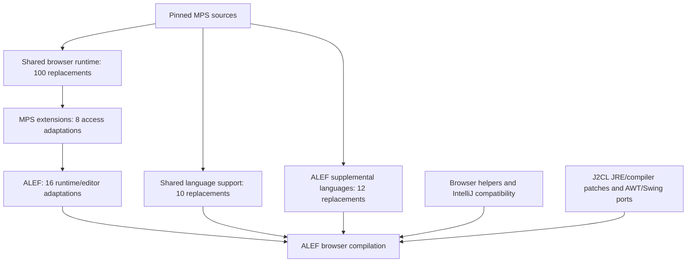

# MPS J2CL replacements and additions

This report inventories the current mps-j2cl browser dependency and the additional MPS adaptations that ALEF places over it. It covers source replacement, new browser/platform support, source selection, and build patches. It does not inventory the separate Java backend or changes to ALEF-generated business-language code. Snapshot: 1 October 2026.

The shared dependency replaces **100 MPS runtime files** and **10 generated-language/persistence support files**. Including MPS extensions and ALEF’s own MPS adaptations, the current deployment has **142 distinct modified MPS source paths**, represented by 146 layered replacement records. Most selected MPS Java files are used directly.

## Complete lists

- [Every MPS replacement and its purpose](<C:/Codex/alef-j2cl/docs/analysis/mps-j2cl-changes/replacement-list.md>)
- [Every browser helper and IntelliJ compatibility class](<C:/Codex/alef-j2cl/docs/analysis/mps-j2cl-changes/additions-list.md>)
- [Every patch target, AWT/Swing view mapping, support file, and local upstream metadata change](<C:/Codex/alef-j2cl/docs/analysis/mps-j2cl-changes/build-and-support-list.md>)
- [Filterable replacement inventory with hashes, bases, selected providers, and line counts](<C:/Codex/alef-j2cl/docs/analysis/mps-j2cl-changes/mps-replacements.csv>)
- [Every selected MPS source and its effective provider](<C:/Codex/alef-j2cl/docs/analysis/mps-j2cl-changes/selected-mps-sources.csv>)
- [Exact incremental differences for MPS replacements, ALEF helper copies, and IntelliJ overrides](<C:/Codex/alef-j2cl/docs/analysis/mps-j2cl-changes/replacement-differences.diff>)
- [Combined machine-readable inventory](<C:/Codex/alef-j2cl/docs/analysis/mps-j2cl-changes/inventory.json>)

## How the replacement layers work

ALEF’s MODULE.bazel selects .work/mps-j2cl. tools/prepare.py composes that view from the MPS extensions view, which in turn points to the shared mps-j2cl package. For the 36 browser projects, the source rule picks exactly one file for each original MPS path, in this priority order: ALEF override, extension override, shared mps-web override, original MPS. The financial language-support list and ALEF’s supplemental MPS list are separate source selections.



| Replacement layer | Files at this layer | Exact files selected by ALEF |
| --- | --- | --- |
| shared MPS browser runtime | 100 | 99 |
| shared generated language support | 10 | 10 |
| MPS extensions access | 8 | 5 |
| ALEF runtime and editor | 16 | 16 |
| ALEF supplemental MPS language support | 12 | 12 |


EditorComponent appears in three layers; EditorCell_Label and UpdaterImpl appear in two. Earlier layers contribute to the later copies and therefore must not be counted as separate original MPS classes. The inventory identifies the selected provider for every row.

## What had to change in MPS

| Area | Replacement mechanism and purpose | Representative files |
| --- | --- | --- |
| Reflection and class loading | Register already compiled classes, constructor factories, query callbacks, rule owners, selection aliases, resources and style attributes. The selected J2CL runtime has no JVM bytecode loader or general runtime Java reflection. | ModuleClassLoader, MPSModuleClassLoader, LanguageRegistry, ExtensionRegistry, ModuleRuntime, QueryMethods, BaseQuickFixProvider, SelectionInfoImpl, AWTKeymapHandler |
| Execution and lifecycle | Use cancellable browser scheduling and explicit disposal. Preserve model-access and command ordering on one event loop. Release listeners, typechecking sessions and weak registries when hosts close. | Highlighter, HighlighterUpdateSession, IntentionsSupport, ThreadUtils, DefaultModelAccess, ProjectModelAccess2, TypecheckingFacade and controllers, DataTransferManager |
| Editor rendering and input | Route real MPS cells, gutter, completion input, keyboard events and IME through browser-supported Swing/AWT and canvas. Bind selected original MPS actions to shortcuts. | EditorComponent, LeftEditorHighlighter, NodeSubstitutePatternEditor, PlatformEditorEmulation, EditorComponentKeyboardHandler |
| IDE services and undo | Inject platform/project services, retain real in-memory repositories and MPS undo items, use repository-scoped node handles, and replace a blocking paste-import dialog with a host policy. | MPSProject, MPSCoreComponents, WorkbenchUndoHandler, UndoActionsCollector, OnReloadingUndoCleaner, MPSNodeVirtualFile, NodeVirtualFileSystem, AddRequiredImportsDialog |
| Resources and persistence boundaries | Register model/icon bytes and resource origins explicitly. Use lexical paths/URLs and portable XML. Reject unsupported JAR content access, ZIP extraction/creation, JDK discovery and desktop file loading. | BaseIconManager, IconLoadingUtil, IconResource, MPSIcons, ParseFacility, FileUtil, JarFileData, ZipFileContainer, SDKDiscovery, UnzipUtil, JDOMUtil |
| JRE and compiler compatibility | Replace unavailable formatting, resource bundles, scanners, regex forms, collection APIs, JVM timestamp/thread inspection and weak-reference mechanisms while retaining the intended selected behavior. | NameUtil, PatternUtil, ModuleReference, MacroHelper, PathSpec, SModelName, WeakSet, ArrayWrapper, StringUtil, StringsIO, ClassLoaderManager |
| Generated language deployment | Restrict generated Language descriptors to selected aspects; retain portable persistence and checking interfaces; explicitly reject JVM static-field reflection and omit unavailable generation-trace lookup. | Three shared Language.java profiles, eleven ALEF Language.java profiles, SModelHeader, MetaModelInfoProvider, ReflectionUtil, IMainClass__BehaviorDescriptor |
| Extension access | Expose existing members/classes across eight files so grammar-cell helpers can use typed Java calls instead of reflective access. | EditorComponentActions, UpdaterImpl, EditorCell_Label, EditorCell_STHint, CellAction_InsertIntoCollection, SubstituteMenuItemAsActionItem, NodeEditorActions, EditorComponent |
| ALEF editor behavior | Expose table layout/style access, measure complete text runs, style completion, add text highlights, enforce editing policy at mutation/IME/quick-fix boundaries, and refresh temporary models after writes. | StyleImpl, EditorCell_Basic, EditorCell_Collection, TextLine, CellLayout_Vertical, EditorFontMetricsImpl, SNode, SModel, InputMethodListenerImpl, UpdaterModelListener |


The file-by-file reasons for the shared 100 replacements come from MPS_OVERRIDE_REASONS. Extension and ALEF reasons were checked against their generators, current copies and incremental differences. “Necessary” here means used to make the current selected deployment work; it does not prove that each individual source override is the only possible design.

## What was added

The shared dependency supplies **17 browser Java helpers**: eleven for the reusable editor/platform integration and six for the financial sample deployment. ALEF supplies three deployment copies of those sample helpers. It also supplies **276 compatibility Java files** in third_party/intellij-stubs/src; ALEF replaces four of these and adds BrowserActionPopupStyle, resulting in **277 selected compatibility files**.

The four ALEF IntelliJ overrides are CommandProcessor (transaction begin/finish hooks), UndoManager (undo-transparent quick fixes and guarded undo/redo transactions), AbstractPopup (resize the actual popup when its content changes), and JBPopupFactory (action popup styling and measured labels). BrowserActionPopupStyle provides the shared styling for those action popups.

| Added integration | Purpose |
| --- | --- |
| BrowserPlatform and BrowserModelAccess | Create the selected MPS platform and supply model/command access on the browser event loop. |
| BrowserEditorHost | Install application/project services, repository, editors, inspectors, actions and cleanup. |
| BrowserEditorClassLoader, BrowserSelectionFactories and BrowserStyleRegistry | Supply explicit class/factory/style registrations that replace desktop discovery and reflection. |
| BrowserEditorActionBindings and BrowserEditorShortcuts | Connect keyboard input to original MPS workbench action implementations, including their access and undo policies. |
| BrowserMpsAssets, BrowserMpsAssetData and BrowserResourceIcon | Make original MPS image assets available through a browser registry. |
| Financial deployment helpers | Demonstrate generated language registration, XML9 model loading and embedded model resources; ALEF has its own deployment copies. |
| IntelliJ compatibility surface | Supply selected services, disposal, message bus, action data, clipboard, scheduling, commands, undo, popups and utility contracts without IntelliJ binaries. |
| J2CL compiler and JRE changes | Compose IO/NIO/concurrency/networking providers; support Class relations, reflective array allocation, registered ClassLoader resources/factories and missing JRE APIs. |
| Root build and audit infrastructure | Select sources, register overrides, prepare dependency views, generate language/assets/shortcuts, check ownership and run JVM/browser contracts. |


The Class type-support patch changes seven J2CL runtime/compiler files. It supports isInstance, isAssignableFrom, cast, asSubclass and reflective Array.newInstance through retained type relations. It does not provide arbitrary JVM reflection. The composed JRE manifest contains 263 source providers; the complete patch target list is in the build appendix. Shared root-owned AWT/Swing view mappings are also listed there. ALEF-specific Java time and other sibling-port work are outside this MPS dependency count.

## Original code that is selected without replacement

| Source group | Selected Java source files |
| --- | --- |
| Shared browser profile across 36 projects | 2052 |
| Shared generated language support selected by ALEF | 2287 |
| Original workbench action implementations | 23 |
| ALEF supplemental MPS support | 307 |
| Distinct selected original MPS paths across these groups | 4669 |
| Paths used directly without a replacement | 4527 |


The 23 workbench action files are upstream MPS implementations added to the compilation selection; they were not rewritten. Similarly, selecting generated structure, behavior, constraints, editor, intentions or type-system files is not an addition to MPS source. The financial deployment manifest includes sample code that ALEF explicitly filters out. These are compile-input counts, not counts of classes retained after Closure optimization.

## Which changes are inherent and which are choices

Replacing JVM bytecode loading, arbitrary reflection, native threads, desktop process/window integration and host filesystem discovery is inherent to this browser architecture. Typed registries, cooperative tasks and explicit resource providers are the chosen implementations of those boundaries.

Formatting, parsing, library-method and access-visibility adaptations are compatibility choices. Some could move into a more complete JRE or upstream API over time; their presence does not establish that MPS must always be patched this way. The public-member changes for grammar cells/tables replace reflection but still couple consumers to MPS internals.

Completion styling, search/comparison highlights, application edit leases, transaction hooks and transient-model refreshes support ALEF behavior. They are not generic requirements for transpiling MPS. Generated aspect removal is a deliberate feature profile: code excluded from that profile is not claimed to work.

Explicitly unavailable paths remain unavailable: desktop plugin/service discovery, runtime JVM class definition, general reflective field/method discovery, arbitrary archive extraction, JVM instrumentation, blocking desktop dialogs, native process/window control and parallel execution through the compatibility executor. Some documentation HTML is rendered as normalized text. Custom two-stroke action shortcuts still require host dispatch.

## Verification and items needing attention

The inventory resolves the existing WSL dependency view, reads current manifests, compares replacement files with their immediate bases and original MPS files, checks stored base hashes, and verifies the effective IntelliJ compatibility providers. The CSV/JSON outputs record the current hashes. No application code was changed, no dependency preparation was run, and no browser/JVM build or behavioral suite was rerun.

The upstream MPS Java baseline is commit d2589ed55bbc9445b660769fcc17da97e8e395a6. Git currently reports **57 tracked local changes** in that checkout; they are listed in the build appendix. The source-audit command failed with `IDEAPlugin: unresolved module dependencies: ['intellij-stubs', 'webawt', 'webswing']`. The inspected .iml differences replace original module dependencies with local compatibility modules. Therefore the checkout cannot currently be described as wholly pristine, and the shared audit cannot be reported as passing.

The independent inventory checks reported no missing or unregistered replacement files, recorded base-hash mismatches, conflicting source providers, or prepared IntelliJ-provider mismatches.

The local module metadata should be reconciled separately with the intended upstream/source-audit boundary. This analysis leaves it untouched. Source mapping verification does not replace a successful compile or browser behavior test.

## Sources and regeneration

- [MODULE.bazel](<C:/Codex/alef-j2cl/MODULE.bazel>)
- [prepare.py](<C:/Codex/alef-j2cl/tools/prepare.py>)
- [mps-rules.bzl](<C:/Codex/mps-j2cl/mps-rules.bzl>)
- [mps-overrides.bzl](<C:/Codex/mps-j2cl/mps-overrides.bzl>)
- [mps-browser-projects.bzl](<C:/Codex/mps-j2cl/mps-browser-projects.bzl>)
- [financial-sources.bzl](<C:/Codex/mps-j2cl/financial-sources.bzl>)
- [editor-action-sources.bzl](<C:/Codex/mps-j2cl/editor-action-sources.bzl>)
- [mps-access.json](<C:/Codex/mps-extensions-j2cl/mps-access.json>)
- [mps-access.json](<C:/Codex/alef-j2cl/mps-access.json>)
- [mps-sources.bzl](<C:/Codex/alef-j2cl/mps-sources.bzl>)
- [intellij-api.json](<C:/Codex/mps-j2cl/compatibility/intellij-api.json>)
- [dependency-views.json](<C:/Codex/mps-j2cl/dependency-views.json>)

The analysis scripts write only this documentation directory. Regenerate from Windows PowerShell with:

```powershell
wsl -d Ubuntu -- python3 /mnt/c/Codex/alef-j2cl/docs/analysis/mps-j2cl-changes/collect_inventory.py
wsl -d Ubuntu -- python3 /mnt/c/Codex/alef-j2cl/docs/analysis/mps-j2cl-changes/render_inventory.py
```
