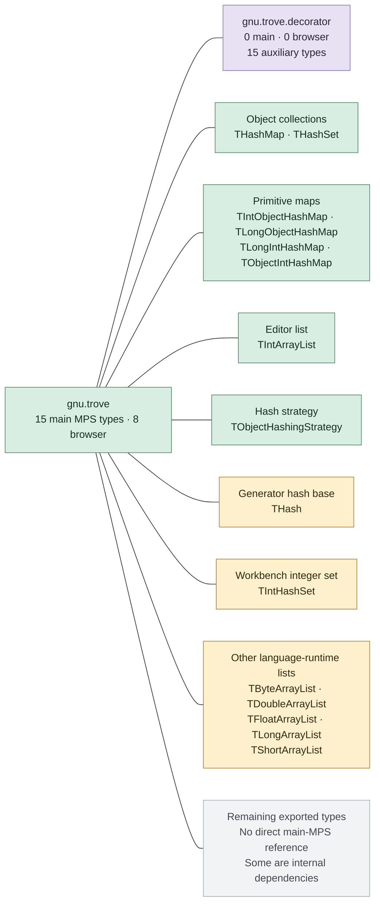

# MPS requirements for GNU Trove

Analysis date: 2026-09-29. MPS commit: `d2589ed55bbc9445b660769fcc17da97e8e395a6`.

Main MPS sources directly reference **15 Trove types**. The selected MPS sources used by this ALEF browser workspace reference **8 types**, all in `gnu.trove`. The `gnu.trove.decorator` package appears only in the auxiliary test sources in this scan.

The inspected Trove variants have only **two public Java packages**: `gnu.trove` and `gnu.trove.decorator`. The type families expanded in the diagram are descriptive groupings, not additional packages. This is the flat package layout used by these variants, not Trove 3's reorganized layout.

**Colors:** green = directly referenced in selected browser sources; amber = direct references elsewhere in main MPS sources; purple = auxiliary references only; gray = no direct reference from main MPS. Bold table entries are directly referenced in the browser source set. Counts are numbers of source files, not executions.

## Packages and directly referenced types

| Type in `gnu.trove` | Main MPS files | Browser files | Example use |
|---|---:|---:|---|
| **`THashMap`** | 26 | 22 | Node lookup, model caches, type-system state and workbench maps |
| **`THashSet`** | 37 | 28 | Type-system sets, structure registry, references and editor tracking |
| **`TIntArrayList`** | 2 | 1 | Column widths in the editor vertical layout; also a collections-language wrapper |
| **`TIntObjectHashMap`** | 4 | 2 | Editor cell actions and keymaps; upstream persistence and workbench indexes |
| **`TLongIntHashMap`** | 3 | 3 | Concept and enumeration-literal indexes |
| **`TLongObjectHashMap`** | 3 | 3 | Numeric node-ID lookup and structure adapter caches |
| **`TObjectHashingStrategy`** | 2 | 1 | Object-identity equality/hash strategy; also upstream JPS integration |
| **`TObjectIntHashMap`** | 9 | 5 | Concept-switch indexes, type-system rules and workbench lookup |
| `TByteArrayList` | 1 | 0 | Collections-language byte-list wrapper |
| `TDoubleArrayList` | 1 | 0 | Collections-language double-list wrapper |
| `TFloatArrayList` | 1 | 0 | Collections-language float-list wrapper |
| `THash` | 1 | 0 | Superclass of the generator implementation NodeMap |
| `TIntHashSet` | 1 | 0 | Workbench PropertyValueIndex |
| `TLongArrayList` | 1 | 0 | Collections-language long-list wrapper |
| `TShortArrayList` | 1 | 0 | Collections-language short-list wrapper; absent from the current J2CL provider |

## Version and provider boundaries

| Input | Actual artifact or declaration | Scope |
|---|---|---|
| Current browser library | `org.jetbrains.intellij.deps:trove4j:1.0.20200330`, adapted by `C:/Codex/gnu-trove-j2cl` | Selected by ALEF and MPS Bazel modules |
| MPS platform declaration | `.idea/libraries/gnu_trove.xml` points to `lib/trove.jar` | The original platform JAR is absent from this checkout; its binary identity is not asserted |
| MPS collections-language runtime | Bundled `trove-2.1.0.jar` | Distinct from the browser library baseline |

The JAR catalogs were read directly from the local binary artifacts, using class access flags for public top-level types:

| Package | JetBrains baseline public types | Trove 2.1.0 public types | Main MPS direct types | Browser direct types | Auxiliary direct types |
|---|---:|---:|---:|---:|---:|
| `gnu.trove` | 157 | 208 | 15 | 8 | 16 |
| `gnu.trove.decorator` | 40 | 54 | 0 | 0 | 15 |

All eight directly referenced browser types have source providers in the current J2CL library. This checks provider presence, not complete API or behavioral compatibility.

`TShortArrayList` is a concrete boundary: the MPS collections-language wrapper references it, and it exists in the bundled Trove 2.1.0 JAR, but it is absent from the JetBrains baseline and current J2CL provider. The auxiliary tests also name `TShortHashSet`, `TShortShortHashMap`, `TShortHashSetDecorator`, and `TShortShortHashMapDecorator`, which are absent from that provider. Expanding the browser profile to the full collections language therefore needs separate compatibility work.

The similarly named `TByteArrayListDecorator` through `TShortArrayListDecorator` in MPS belong to `jetbrains.mps.baseLanguage.collections.trove.runtime`, **not** `gnu.trove.decorator`. They wrap the primitive list types listed in the main table.

## Direct use versus library support

Keeping only the eight directly referenced source classes would not compile. Following named type dependencies through complete current Trove source files reaches **42 of the provider's 207 Java source files**: the eight direct types plus 34 support types. Every file in this candidate set is in `gnu.trove`; none is in `gnu.trove.decorator`.

The candidate set was compiled in isolation with JDK 25 `javac --release 21`, an empty source path, an empty class path, and annotation processing disabled. It passed, with unchecked-operation warnings. Compiler output and the exact source list are in `validation/`.

This establishes a compilable library subset for these direct roots, **not** the minimum runtime footprint or a validated replacement for the existing browser build. The subset retains complete source units, including methods not called by these consumers. IntelliJ adapters, browser host helpers, ALEF/MPS-extensions code, inferred callback types, or future generated code may introduce additional requirements. No existing library sources or build targets were reduced.

| Supporting role | Additional types in the 42-file set |
|---|---|
| Hash bases | `THash`, `TLongHash`, `TObjectHash`, `TPrimitiveHash` |
| Iterators | `THashIterator`, `TIntObjectIterator`, `TIterator`, `TLongIntIterator`, `TLongObjectIterator`, `TObjectHashIterator`, `TObjectIntIterator`, `TPrimitiveIterator` |
| Callbacks and conversion | `TIntFunction`, `TIntObjectProcedure`, `TIntProcedure`, `TLongIntProcedure`, `TLongObjectProcedure`, `TLongProcedure`, `TObjectFunction`, `TObjectIntProcedure`, `TObjectObjectProcedure`, `TObjectProcedure`, `ToObjectArrayProcedure` |
| Hashing and equality | `CanonicalEquality`, `Equality`, `IdentityEquality`, `TIntHashingStrategy`, `TLongHashingStrategy`, `TObjectCanonicalHashingStrategy`, `TObjectIdentityHashingStrategy` |
| Internal utilities | `ArraySupport`, `FloatSupport`, `HashFunctions`, `PrimeFinder` |

`THash` illustrates the distinction: MPS names it directly only in its desktop generator, but the browser collections still require it internally.

## Auxiliary references

Auxiliary sources directly name 31 types: 16 in `gnu.trove`, and 15 in `gnu.trove.decorator`. Two of the 16 root-package types (`TIntHashSet` and `TLongObjectHashMap`) also occur in main MPS sources. These counts are not additive to the main total.

| Package | Types referenced in auxiliary sources |
|---|---|
| `gnu.trove` | `TByteByteHashMap`, `TByteHashSet`, `TByteObjectHashMap`, `TDoubleDoubleHashMap`, `TDoubleHashSet`, `TDoubleObjectHashMap`, `TFloatFloatHashMap`, `TFloatHashSet`, `TIntHashSet`, `TIntIntHashMap`, `TLongHashSet`, `TLongLongHashMap`, `TLongObjectHashMap`, `TObjectDoubleHashMap`, `TShortHashSet`, `TShortShortHashMap` |
| `gnu.trove.decorator` | `TByteByteHashMapDecorator`, `TByteHashSetDecorator`, `TByteObjectHashMapDecorator`, `TDoubleDoubleHashMapDecorator`, `TDoubleHashSetDecorator`, `TDoubleObjectHashMapDecorator`, `TFloatFloatHashMapDecorator`, `TFloatHashSetDecorator`, `TIntHashSetDecorator`, `TIntIntHashMapDecorator`, `TLongHashSetDecorator`, `TLongLongHashMapDecorator`, `TObjectDoubleHashMapDecorator`, `TShortHashSetDecorator`, `TShortShortHashMapDecorator` |

## Scope and limitations

- The source scopes match the earlier [Swing/AWT analysis](../mps-ui-dependencies/REPORT.md): 29,684 tracked Java/Kotlin paths, divided into 22,143 main and 7,541 auxiliary paths. There are 84 files containing the `gnu.trove` prefix. Main includes checked-in generated language/runtime code outside the auxiliary path rules.
- The browser scope contains 4,646 selected MPS files, resolved from current source manifests and provider precedence: ALEF replacement, MPS-extensions replacement, MPS replacement, upstream. The JSON records exact paths and SHA-256 hashes. It excludes the implementations of ALEF languages, MPS-extensions languages, IntelliJ adapters, browser host helpers and external libraries.
- Comments and string literals are removed for direct-reference counting. Explicit imports must have a matching code identifier; qualified references and package wildcards are supported. The actual Trove scan has no unresolved named references against the combined artifact catalog. This is lexical analysis, not a compiler-attributed scan of all MPS sources; implicit inherited types, inferred lambda target types, shadowing, reflection and ungenerated source remain limitations.
- `THashSet` is imported but not used in `DoubleTermRules.java`; this import is excluded in both upstream and browser counts.
- The collections-language generator constructs names using `"gnu.trove.T" + ... + "ArrayList"`. These string-producing expressions are recorded separately and excluded from the direct type counts. The count is not a bound on every type the language could generate. Serialized MPS model files were not read or changed.
- The original baseline artifacts have overlapping fully qualified names; their presence does not imply that they can be merged or exchanged on one classpath. No complete compatibility test was run for Trove 2.1.0 or the MPS platform artifact.
- The 42-file set was compile-checked as a standalone Trove subset only. No MPS application build, J2CL compilation or browser behavior test was performed for a reduced provider.

## Source evidence for all detected types

Each row shows one example; `inventory.json` retains all matching files and the source dependency paths. Counts below exclude unused imports. Provider availability means a matching source filename exists in the current J2CL provider, not that the original type's complete contract has been verified.

| Type | Main files | Browser files | Auxiliary files | Port source present | Example source |
|---|---:|---:|---:|---|---|
| `gnu.trove.TByteArrayList` | 1 | 0 | 0 | Yes | [TByteArrayListDecorator.java:16](<C:/Codex/mps-j2cl/mps/languages/baseLanguage/collections/languages/trove/runtime/source_gen/jetbrains/mps/baseLanguage/collections/trove/runtime/TByteArrayListDecorator.java:16>) |
| `gnu.trove.TByteByteHashMap` | 0 | 0 | 1 | Yes | [PrimMap_Test.java:34](<C:/Codex/mps-j2cl/mps/testbench/testsolutions/collections_trove.test/source_gen/jetbrains/mps/internal/collections/trove/test/PrimMap_Test.java:34>) |
| `gnu.trove.TByteHashSet` | 0 | 0 | 1 | Yes | [PrimSet_Test.java:30](<C:/Codex/mps-j2cl/mps/testbench/testsolutions/collections_trove.test/source_gen/jetbrains/mps/internal/collections/trove/test/PrimSet_Test.java:30>) |
| `gnu.trove.TByteObjectHashMap` | 0 | 0 | 1 | Yes | [PrimMap_Test.java:40](<C:/Codex/mps-j2cl/mps/testbench/testsolutions/collections_trove.test/source_gen/jetbrains/mps/internal/collections/trove/test/PrimMap_Test.java:40>) |
| `gnu.trove.TDoubleArrayList` | 1 | 0 | 0 | Yes | [TDoubleArrayListDecorator.java:16](<C:/Codex/mps-j2cl/mps/languages/baseLanguage/collections/languages/trove/runtime/source_gen/jetbrains/mps/baseLanguage/collections/trove/runtime/TDoubleArrayListDecorator.java:16>) |
| `gnu.trove.TDoubleDoubleHashMap` | 0 | 0 | 2 | Yes | [InferredTroveMap_Test.java:17](<C:/Codex/mps-j2cl/mps/testbench/testsolutions/collections_trove.test/source_gen/jetbrains/mps/internal/collections/trove/test/InferredTroveMap_Test.java:17>) |
| `gnu.trove.TDoubleHashSet` | 0 | 0 | 1 | Yes | [PrimSet_Test.java:40](<C:/Codex/mps-j2cl/mps/testbench/testsolutions/collections_trove.test/source_gen/jetbrains/mps/internal/collections/trove/test/PrimSet_Test.java:40>) |
| `gnu.trove.TDoubleObjectHashMap` | 0 | 0 | 2 | Yes | [InferredTroveMap_Test.java:19](<C:/Codex/mps-j2cl/mps/testbench/testsolutions/collections_trove.test/source_gen/jetbrains/mps/internal/collections/trove/test/InferredTroveMap_Test.java:19>) |
| `gnu.trove.TFloatArrayList` | 1 | 0 | 0 | Yes | [TFloatArrayListDecorator.java:16](<C:/Codex/mps-j2cl/mps/languages/baseLanguage/collections/languages/trove/runtime/source_gen/jetbrains/mps/baseLanguage/collections/trove/runtime/TFloatArrayListDecorator.java:16>) |
| `gnu.trove.TFloatFloatHashMap` | 0 | 0 | 1 | Yes | [PrimMap_Test.java:60](<C:/Codex/mps-j2cl/mps/testbench/testsolutions/collections_trove.test/source_gen/jetbrains/mps/internal/collections/trove/test/PrimMap_Test.java:60>) |
| `gnu.trove.TFloatHashSet` | 0 | 0 | 1 | Yes | [PrimSet_Test.java:46](<C:/Codex/mps-j2cl/mps/testbench/testsolutions/collections_trove.test/source_gen/jetbrains/mps/internal/collections/trove/test/PrimSet_Test.java:46>) |
| `gnu.trove.THash` | 1 | 0 | 0 | Yes | [NodeMap.java:33](<C:/Codex/mps-j2cl/mps/core/generator/source/jetbrains/mps/generator/impl/NodeMap.java:33>) |
| `gnu.trove.THashMap` | 26 | 22 | 0 | Yes | [BaseFastNodeFinder.java:240](<C:/Codex/mps-j2cl/mps/core/kernel/source/jetbrains/mps/smodel/BaseFastNodeFinder.java:240>) |
| `gnu.trove.THashSet` | 37 | 28 | 0 | Yes | [StructureRegistry.java:48](<C:/Codex/mps-j2cl/mps/core/kernel/source/jetbrains/mps/smodel/language/StructureRegistry.java:48>) |
| `gnu.trove.TIntArrayList` | 2 | 1 | 0 | Yes | [CellLayout_Vertical.java:113](<C:/Codex/alef-j2cl/j2cl-src/mps/editor/editor-runtime/source/jetbrains/mps/nodeEditor/cellLayout/CellLayout_Vertical.java:113>) |
| `gnu.trove.TIntHashSet` | 1 | 0 | 1 | Yes | [PrimSet_Test.java:55](<C:/Codex/mps-j2cl/mps/testbench/testsolutions/collections_trove.test/source_gen/jetbrains/mps/internal/collections/trove/test/PrimSet_Test.java:55>) |
| `gnu.trove.TIntIntHashMap` | 0 | 0 | 1 | Yes | [PrimMap_Test.java:67](<C:/Codex/mps-j2cl/mps/testbench/testsolutions/collections_trove.test/source_gen/jetbrains/mps/internal/collections/trove/test/PrimMap_Test.java:67>) |
| `gnu.trove.TIntObjectHashMap` | 4 | 2 | 0 | Yes | [EditorCell_Basic.java:99](<C:/Codex/alef-j2cl/j2cl-src/mps/editor/editor-runtime/source/jetbrains/mps/nodeEditor/cells/EditorCell_Basic.java:99>) |
| `gnu.trove.TLongArrayList` | 1 | 0 | 0 | Yes | [TLongArrayListDecorator.java:16](<C:/Codex/mps-j2cl/mps/languages/baseLanguage/collections/languages/trove/runtime/source_gen/jetbrains/mps/baseLanguage/collections/trove/runtime/TLongArrayListDecorator.java:16>) |
| `gnu.trove.TLongHashSet` | 0 | 0 | 1 | Yes | [PrimSet_Test.java:105](<C:/Codex/mps-j2cl/mps/testbench/testsolutions/collections_trove.test/source_gen/jetbrains/mps/internal/collections/trove/test/PrimSet_Test.java:105>) |
| `gnu.trove.TLongIntHashMap` | 3 | 3 | 0 | Yes | [EnumerationLiteralsIndex.java:71](<C:/Codex/mps-j2cl/mps/core/kernel/source/jetbrains/mps/lang/smodel/EnumerationLiteralsIndex.java:71>) |
| `gnu.trove.TLongLongHashMap` | 0 | 0 | 1 | Yes | [PrimMap_Test.java:79](<C:/Codex/mps-j2cl/mps/testbench/testsolutions/collections_trove.test/source_gen/jetbrains/mps/internal/collections/trove/test/PrimMap_Test.java:79>) |
| `gnu.trove.TLongObjectHashMap` | 3 | 3 | 1 | Yes | [MetaAdapterFactory.java:65](<C:/Codex/mps-j2cl/mps/core/kernel/source/jetbrains/mps/smodel/adapter/structure/MetaAdapterFactory.java:65>) |
| `gnu.trove.TObjectDoubleHashMap` | 0 | 0 | 2 | Yes | [InferredTroveMap_Test.java:18](<C:/Codex/mps-j2cl/mps/testbench/testsolutions/collections_trove.test/source_gen/jetbrains/mps/internal/collections/trove/test/InferredTroveMap_Test.java:18>) |
| `gnu.trove.TObjectHashingStrategy` | 2 | 1 | 0 | Yes | [ObjectIdentityHashingStrategy.java:8](<C:/Codex/mps-j2cl/mps/core/util/source/jetbrains/mps/util/ObjectIdentityHashingStrategy.java:8>) |
| `gnu.trove.TObjectIntHashMap` | 9 | 5 | 0 | Yes | [ConceptSwitchIndex.java:33](<C:/Codex/mps-j2cl/mps/core/kernel/source/jetbrains/mps/lang/smodel/ConceptSwitchIndex.java:33>) |
| `gnu.trove.TShortArrayList` | 1 | 0 | 0 | No | [TShortArrayListDecorator.java:16](<C:/Codex/mps-j2cl/mps/languages/baseLanguage/collections/languages/trove/runtime/source_gen/jetbrains/mps/baseLanguage/collections/trove/runtime/TShortArrayListDecorator.java:16>) |
| `gnu.trove.TShortHashSet` | 0 | 0 | 1 | No | [PrimSet_Test.java:111](<C:/Codex/mps-j2cl/mps/testbench/testsolutions/collections_trove.test/source_gen/jetbrains/mps/internal/collections/trove/test/PrimSet_Test.java:111>) |
| `gnu.trove.TShortShortHashMap` | 0 | 0 | 1 | No | [PrimMap_Test.java:87](<C:/Codex/mps-j2cl/mps/testbench/testsolutions/collections_trove.test/source_gen/jetbrains/mps/internal/collections/trove/test/PrimMap_Test.java:87>) |
| `gnu.trove.decorator.TByteByteHashMapDecorator` | 0 | 0 | 1 | Yes | [PrimMap_Test.java:34](<C:/Codex/mps-j2cl/mps/testbench/testsolutions/collections_trove.test/source_gen/jetbrains/mps/internal/collections/trove/test/PrimMap_Test.java:34>) |
| `gnu.trove.decorator.TByteHashSetDecorator` | 0 | 0 | 1 | Yes | [PrimSet_Test.java:30](<C:/Codex/mps-j2cl/mps/testbench/testsolutions/collections_trove.test/source_gen/jetbrains/mps/internal/collections/trove/test/PrimSet_Test.java:30>) |
| `gnu.trove.decorator.TByteObjectHashMapDecorator` | 0 | 0 | 1 | Yes | [PrimMap_Test.java:40](<C:/Codex/mps-j2cl/mps/testbench/testsolutions/collections_trove.test/source_gen/jetbrains/mps/internal/collections/trove/test/PrimMap_Test.java:40>) |
| `gnu.trove.decorator.TDoubleDoubleHashMapDecorator` | 0 | 0 | 2 | Yes | [InferredTroveMap_Test.java:17](<C:/Codex/mps-j2cl/mps/testbench/testsolutions/collections_trove.test/source_gen/jetbrains/mps/internal/collections/trove/test/InferredTroveMap_Test.java:17>) |
| `gnu.trove.decorator.TDoubleHashSetDecorator` | 0 | 0 | 1 | Yes | [PrimSet_Test.java:40](<C:/Codex/mps-j2cl/mps/testbench/testsolutions/collections_trove.test/source_gen/jetbrains/mps/internal/collections/trove/test/PrimSet_Test.java:40>) |
| `gnu.trove.decorator.TDoubleObjectHashMapDecorator` | 0 | 0 | 2 | Yes | [InferredTroveMap_Test.java:19](<C:/Codex/mps-j2cl/mps/testbench/testsolutions/collections_trove.test/source_gen/jetbrains/mps/internal/collections/trove/test/InferredTroveMap_Test.java:19>) |
| `gnu.trove.decorator.TFloatFloatHashMapDecorator` | 0 | 0 | 1 | Yes | [PrimMap_Test.java:60](<C:/Codex/mps-j2cl/mps/testbench/testsolutions/collections_trove.test/source_gen/jetbrains/mps/internal/collections/trove/test/PrimMap_Test.java:60>) |
| `gnu.trove.decorator.TFloatHashSetDecorator` | 0 | 0 | 1 | Yes | [PrimSet_Test.java:46](<C:/Codex/mps-j2cl/mps/testbench/testsolutions/collections_trove.test/source_gen/jetbrains/mps/internal/collections/trove/test/PrimSet_Test.java:46>) |
| `gnu.trove.decorator.TIntHashSetDecorator` | 0 | 0 | 1 | Yes | [PrimSet_Test.java:55](<C:/Codex/mps-j2cl/mps/testbench/testsolutions/collections_trove.test/source_gen/jetbrains/mps/internal/collections/trove/test/PrimSet_Test.java:55>) |
| `gnu.trove.decorator.TIntIntHashMapDecorator` | 0 | 0 | 1 | Yes | [PrimMap_Test.java:67](<C:/Codex/mps-j2cl/mps/testbench/testsolutions/collections_trove.test/source_gen/jetbrains/mps/internal/collections/trove/test/PrimMap_Test.java:67>) |
| `gnu.trove.decorator.TLongHashSetDecorator` | 0 | 0 | 1 | Yes | [PrimSet_Test.java:105](<C:/Codex/mps-j2cl/mps/testbench/testsolutions/collections_trove.test/source_gen/jetbrains/mps/internal/collections/trove/test/PrimSet_Test.java:105>) |
| `gnu.trove.decorator.TLongLongHashMapDecorator` | 0 | 0 | 1 | Yes | [PrimMap_Test.java:79](<C:/Codex/mps-j2cl/mps/testbench/testsolutions/collections_trove.test/source_gen/jetbrains/mps/internal/collections/trove/test/PrimMap_Test.java:79>) |
| `gnu.trove.decorator.TObjectDoubleHashMapDecorator` | 0 | 0 | 2 | Yes | [InferredTroveMap_Test.java:18](<C:/Codex/mps-j2cl/mps/testbench/testsolutions/collections_trove.test/source_gen/jetbrains/mps/internal/collections/trove/test/InferredTroveMap_Test.java:18>) |
| `gnu.trove.decorator.TShortHashSetDecorator` | 0 | 0 | 1 | No | [PrimSet_Test.java:111](<C:/Codex/mps-j2cl/mps/testbench/testsolutions/collections_trove.test/source_gen/jetbrains/mps/internal/collections/trove/test/PrimSet_Test.java:111>) |
| `gnu.trove.decorator.TShortShortHashMapDecorator` | 0 | 0 | 1 | No | [PrimMap_Test.java:87](<C:/Codex/mps-j2cl/mps/testbench/testsolutions/collections_trove.test/source_gen/jetbrains/mps/internal/collections/trove/test/PrimMap_Test.java:87>) |

## Artifact fingerprints

- `jetbrains`: `c5fd725bffab51846bf3c77db1383c60aaaebfe1b7fe2f00d23fe1b7df0a439d` — [trove4j-1.0.20200330.jar](<C:/Codex/gnu-trove-j2cl/third_party/trove4j-1.0.20200330.jar>)
- `language_2_1`: `294fb88c272598b9a5dcae15f13d228e64134256de941fbc28917a994beeb075` — [trove-2.1.0.jar](<C:/Codex/mps-j2cl/mps/languages/baseLanguage/collections/languages/trove/runtime/lib/trove-2.1.0.jar>)

## Reproduction

`refresh.ps1 -Python <python.exe> -Javac <JDK-25-javac.exe>` refreshes Git candidate lists, reconstructs the catalogs and selected sources, compiles the candidate Trove subset, and renders this report. It writes only into this analysis directory. The scanner reuses the lexical and scope helpers from the sibling Swing/AWT report directory.

Files: `REPORT.md`, `trove-packages.mmd`, `classes.csv`, `inventory.json`, `analyze_trove.py`, `render_report.py`, `refresh.ps1`, and `validation/`.
