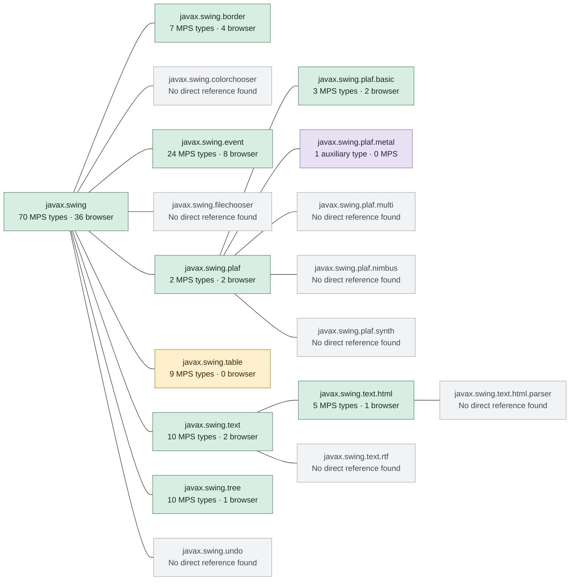
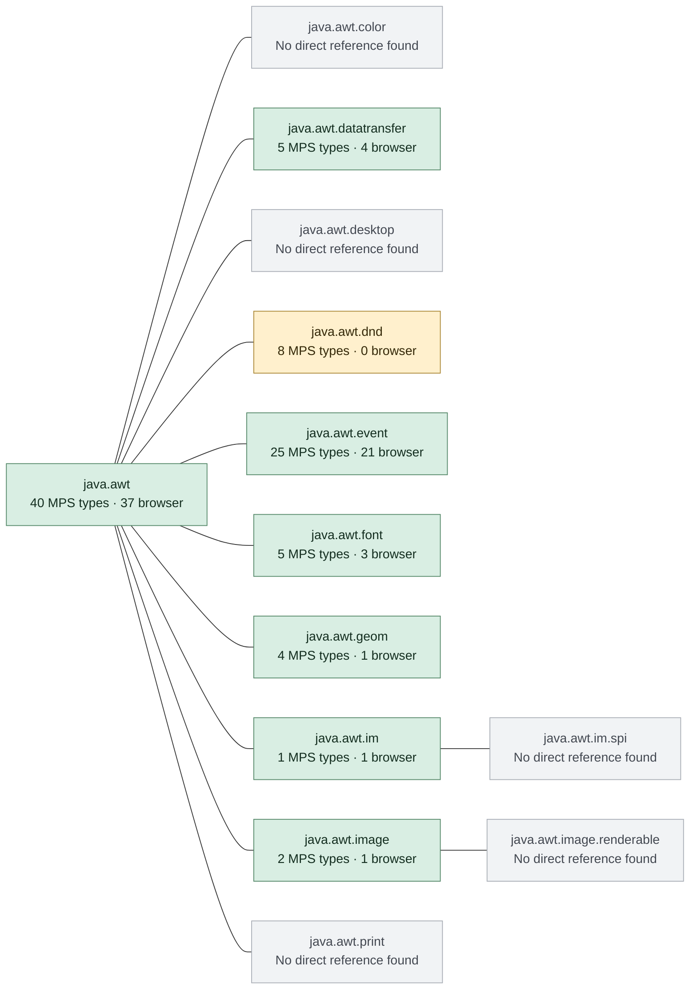

# MPS requirements for Swing and AWT

Analysis date: 2026-09-29. Upstream MPS commit: `d2589ed55bbc9445b660769fcc17da97e8e395a6`.

This is a direct source-reference inventory against the Java 21 public/protected type catalog. It answers which Swing and AWT types appear in MPS source code, and which remain in the selected MPS sources used by this ALEF browser workspace. It is not a runtime trace or a complete transitive dependency closure.

| Scope | Swing types | Swing packages | AWT types | AWT packages |
|---|---:|---:|---:|---:|
| Main upstream MPS sources | 140 | 9 / 18 | 90 | 8 / 13 |
| Selected MPS sources in ALEF browser profile | 56 | 8 / 18 | 68 | 7 / 13 |

Counts include interfaces and explicitly named nested types. Unused imports are excluded from these counts and listed separately below. The browser row is a subset of the upstream row at the type level.

**Diagram colors:** green = directly referenced in the selected browser sources; amber = directly referenced in other main MPS sources; purple = only found in auxiliary sources; gray = no direct reference found. Green packages can also contain types used only outside the browser profile. Lines show package-name hierarchy, not calls or inheritance. Java subpackages are separate packages.

**Class tables:** bold type names also occur in the selected browser sources. Plain names occur in the main upstream scan but have no code reference in that selected browser source set.

## Swing: all public packages

| Package | Classes / interfaces referenced by MPS |
|---|---|
| `javax.swing` (70) | **`AbstractAction`**, **`AbstractButton`**, `AbstractCellEditor`, `AbstractListModel`, **`Action`**, **`BorderFactory`**, `Box`, **`BoxLayout`**, `ButtonGroup`, **`ButtonModel`**, `ComboBoxModel`, **`DefaultButtonModel`**, `DefaultCellEditor`, `DefaultComboBoxModel`, `DefaultListCellRenderer`, **`DefaultListModel`**, `FocusManager`, **`Icon`**, **`ImageIcon`**, **`InputMap`**, **`JButton`**, **`JCheckBox`**, `JCheckBoxMenuItem`, `JComboBox`, **`JComponent`**, **`JDialog`**, **`JEditorPane`**, `JFormattedTextField`, `JFrame`, **`JLabel`**, **`JLayeredPane`**, **`JList`**, **`JMenu`**, **`JMenuItem`**, `JOptionPane`, **`JPanel`**, **`JPopupMenu`**, `JProgressBar`, `JRadioButton`, `JRootPane`, **`JScrollBar`**, **`JScrollPane`**, `JSeparator`, `JSlider`, `JSpinner`, `JSpinner.DefaultEditor`, `JSpinner.NumberEditor`, `JTable`, `JTextArea`, **`JTextField`**, `JTextPane`, `JToolBar`, `JTree`, **`JViewport`**, **`JWindow`**, **`KeyStroke`**, **`LayoutFocusTraversalPolicy`**, **`ListCellRenderer`**, **`ListSelectionModel`**, `RootPaneContainer`, `ScrollPaneConstants`, **`Scrollable`**, `SpinnerNumberModel`, **`SwingConstants`**, **`SwingUtilities`**, `Timer`, `ToolTipManager`, `TransferHandler`, **`UIManager`**, `WindowConstants` |
| `javax.swing.border` (7) | **`AbstractBorder`**, **`Border`**, `CompoundBorder`, **`EmptyBorder`**, `EtchedBorder`, **`LineBorder`**, `TitledBorder` |
| `javax.swing.event` (24) | `CaretEvent`, `CaretListener`, **`ChangeEvent`**, **`ChangeListener`**, **`DocumentEvent`**, `DocumentEvent.EventType`, **`DocumentListener`**, **`HyperlinkEvent`**, **`HyperlinkEvent.EventType`**, **`HyperlinkListener`**, `ListDataEvent`, `ListDataListener`, `ListSelectionEvent`, **`ListSelectionListener`**, `MenuKeyEvent`, `TableModelEvent`, `TableModelListener`, `TreeExpansionEvent`, `TreeExpansionListener`, `TreeModelEvent`, `TreeModelListener`, `TreeSelectionEvent`, `TreeSelectionListener`, `TreeWillExpandListener` |
| `javax.swing.plaf` (2) | **`ButtonUI`**, **`ScrollBarUI`** |
| `javax.swing.plaf.basic` (3) | **`BasicButtonUI`**, **`BasicMenuItemUI`**, `BasicTableUI` |
| `javax.swing.table` (9) | `AbstractTableModel`, `DefaultTableCellRenderer`, `DefaultTableModel`, `JTableHeader`, `TableCellEditor`, `TableCellRenderer`, `TableColumn`, `TableColumnModel`, `TableModel` |
| `javax.swing.text` (10) | **`BadLocationException`**, **`DefaultEditorKit`**, `DefaultFormatter`, `DefaultStyledDocument`, `Element`, `NumberFormatter`, `SimpleAttributeSet`, `StyleConstants`, `StyledDocument`, `View` |
| `javax.swing.text.html` (5) | `HTML`, `HTML.Attribute`, `HTMLDocument`, **`HTMLEditorKit`**, `StyleSheet` |
| `javax.swing.tree` (10) | `DefaultMutableTreeNode`, `DefaultTreeCellRenderer`, `DefaultTreeModel`, `MutableTreeNode`, `TreeCellEditor`, `TreeCellRenderer`, `TreeModel`, **`TreeNode`**, `TreePath`, `TreeSelectionModel` |

## AWT: all public packages

| Package | Classes / interfaces referenced by MPS |
|---|---|
| `java.awt` (40) | **`AWTKeyStroke`**, **`Adjustable`**, **`AlphaComposite`**, **`BasicStroke`**, **`BorderLayout`**, **`Color`**, **`Component`**, **`Container`**, **`Cursor`**, **`Desktop`**, **`Dialog`**, **`Dimension`**, **`FlowLayout`**, **`FocusTraversalPolicy`**, **`Font`**, **`FontMetrics`**, **`Frame`**, **`Graphics`**, **`Graphics2D`**, `GraphicsConfiguration`, **`GraphicsDevice`**, **`GraphicsEnvironment`**, **`GridBagConstraints`**, **`GridBagLayout`**, **`GridLayout`**, **`HeadlessException`**, **`Image`**, **`Insets`**, **`KeyboardFocusManager`**, **`LayoutManager`**, `MenuItem`, **`Paint`**, **`Point`**, `PopupMenu`, **`Rectangle`**, **`RenderingHints`**, **`Stroke`**, **`TexturePaint`**, **`Toolkit`**, **`Window`** |
| `java.awt.datatransfer` (5) | `Clipboard`, **`DataFlavor`**, **`StringSelection`**, **`Transferable`**, **`UnsupportedFlavorException`** |
| `java.awt.dnd` (8) | `DnDConstants`, `DragSourceAdapter`, `DragSourceDragEvent`, `DropTargetDragEvent`, `DropTargetDropEvent`, `DropTargetEvent`, `DropTargetListener`, `InvalidDnDOperationException` |
| `java.awt.event` (25) | **`ActionEvent`**, **`ActionListener`**, **`ComponentAdapter`**, **`ComponentEvent`**, **`ComponentListener`**, **`FocusAdapter`**, **`FocusEvent`**, **`FocusListener`**, **`HierarchyEvent`**, **`InputEvent`**, **`InputMethodEvent`**, **`InputMethodListener`**, `ItemEvent`, `ItemListener`, **`KeyAdapter`**, **`KeyEvent`**, **`KeyListener`**, **`MouseAdapter`**, **`MouseEvent`**, **`MouseListener`**, **`MouseMotionAdapter`**, **`MouseMotionListener`**, **`MouseWheelEvent`**, `WindowAdapter`, `WindowEvent` |
| `java.awt.font` (5) | **`FontRenderContext`**, `GlyphVector`, **`TextAttribute`**, **`TextHitInfo`**, `TextLayout` |
| `java.awt.geom` (4) | **`AffineTransform`**, `GeneralPath`, `Point2D`, `Rectangle2D` |
| `java.awt.im` (1) | **`InputMethodRequests`** |
| `java.awt.image` (2) | **`BufferedImage`**, `RenderedImage` |

## What this means for the port

MPS uses Swing as a host for the projectional editor and its surrounding controls: components, panels, scroll panes, labels/icons, lists and popups, action/input handling, borders, and selected UI delegates. The direct browser footprint still contains text/HTML support and `TreeNode`; it is broader than a single custom-painted component.

AWT is a substantial part of the editor contract: component geometry and layouts, `Graphics`/`Graphics2D`, color, font metrics, image rendering, keyboard/mouse/focus events, clipboard transfer types, and input-method support. Replacing Swing alone would not replace these editor dependencies.

`javax.swing.table` and `java.awt.dnd` have direct references in main MPS sources but none in the selected MPS browser source set. `javax.swing.undo` has no direct reference in the scanned sources; that does not mean MPS lacks undo. Its editor exposes its own command/undo integration.

Packages such as `javax.swing.plaf.metal`, `.nimbus`, `.synth`, `java.awt.print`, and `java.awt.color` cannot be declared removable from a complete distribution using this analysis. An IntelliJ class, Swing implementation, superclass, reflection, service provider, or selected look and feel may require them indirectly. In particular, gray packages mean **no direct source reference found**, not **never used**.

The selected browser source list includes classes that the optimizer may discard and methods whose providers have browser adaptations. A reference to `Desktop`, `Dialog`, `Window`, or `Toolkit` therefore does not prove that the browser implements the complete corresponding desktop API.

## Source selection and method

- The upstream scan inventories all 29,684 Git-tracked `.java`, `.kt`, and `.kts` paths. A Git content prefilter finds 1,432 candidates containing `javax.swing` or `java.awt`.
- The main scope contains 22,143 paths. Another 7,541 paths are separated as auxiliary by the reproducible path rules in `analyze.py`: top-level tests/testbench/samples, test/testdata/sandbox path components, and components ending in `.tests` or `-tests`. This is a source-tree classification, not a release packaging assertion. Generator output outside those paths is included.
- The browser scope contains 4,646 selected MPS files: 2,052 from the 36-project browser manifest, 2,287 additional non-sample financial/language-support files, and 307 supplemental ALEF MPS files. Duplicated logical paths are counted once.
- Browser providers follow the current prepared rule precedence: ALEF replacement, then MPS-extensions replacement, then MPS browser replacement, then original upstream. The complete resolved file list and SHA-256 hashes are in `inventory.json`.
- The browser comparison intentionally measures selected MPS sources. It does not include ALEF language code, MPS-extensions language code, browser host helpers, IntelliJ adapters, or the Swing/AWT library implementations themselves. Their additional and transitive requirements need a separate closure analysis before reducing providers.
- Comments and string/character literals are removed while preserving line numbers. Explicit imports are matched against code identifiers; fully qualified references, package wildcards, static imports and explicitly qualified nested types are handled. Wildcard matches are checked against the Java API catalog and explicit competing imports. All 57 wildcard evidence rows come from six source files and were inspected for the relevant type references.
- This is lexical analysis, not a complete compiler symbol-resolution pass. It can miss implicit inherited nested types, reflective names and generated code that is absent from the checkout. Symbol shadowing and unusual syntax are remaining limitations. Source evidence is retained so each result can be reviewed.
- A fresh API catalog was generated using the local JDK 25 compiler with `--release 21`; it reports all 31 public AWT/Swing packages. The source catalog includes public/protected nested types, and each such referenced type counts separately. JDK-internal packages such as `java.awt.peer` and `sun.awt` are outside the public-package diagram.
- No MPS source, model, build configuration or library provider was changed. No application build or browser capability test was needed or claimed for this inventory.

Package boundaries were checked against the official [Java 21 java.desktop API](https://docs.oracle.com/en/java/javase/21/docs/api/java.desktop/module-summary.html) and [java.datatransfer API](https://docs.oracle.com/en/java/javase/21/docs/api/java.datatransfer/module-summary.html). `java.awt.datatransfer` belongs to `java.datatransfer`; it is included here because its package is in the AWT namespace.

## Auxiliary-only types

These additional direct references occur only in paths classified as tests, testbench, samples or sandboxes. They are not in the main totals.

| Type | Example evidence |
|---|---|
| `java.awt.geom.Point2D.Double` | [Rectangle.java:12](<C:/Codex/mps-j2cl/mps/languages/baseLanguage/constructors/solutions/jetbrains.mps.baseLanguage.constructors.sandbox/source_gen/jetbrains/mps/core/baseLanguage/constructors/sandbox/test2/Rectangle.java:12>) |
| `java.awt.geom.Rectangle2D.Double` | [Rectangle.java:17](<C:/Codex/mps-j2cl/mps/languages/baseLanguage/constructors/solutions/jetbrains.mps.baseLanguage.constructors.sandbox/source_gen/jetbrains/mps/core/baseLanguage/constructors/sandbox/test2/Rectangle.java:17>) |
| `javax.swing.UnsupportedLookAndFeelException` | [KajaFrame.java:43](<C:/Codex/mps-j2cl/mps/samples/robot_Kaja/solutions/JavaKajak/source_gen/JavaKaja/runtime/KajaFrame.java:43>) |
| `javax.swing.plaf.metal.MetalLookAndFeel` | [KajaFrame.java:42](<C:/Codex/mps-j2cl/mps/samples/robot_Kaja/solutions/JavaKajak/source_gen/JavaKaja/runtime/KajaFrame.java:42>) |

## Types with imports but no code use in that scope

These are excluded from the usage counts. An unused Java import can still impose a compilation dependency until removed.

| Type | Scope | Example evidence |
|---|---|---|
| `java.awt.Polygon` | upstream | [ErrorStateComponent.java:27](<C:/Codex/mps-j2cl/mps/workbench/mps-ui/source/jetbrains/mps/ide/ui/tree/ErrorStateComponent.java:27>) |
| `java.awt.dnd.DragGestureEvent` | upstream | [ProjectPaneTree.java:77](<C:/Codex/mps-j2cl/mps/workbench/mps-workbench/source/jetbrains/mps/ide/projectPane/ProjectPaneTree.java:77>) |
| `java.awt.dnd.DragGestureListener` | upstream | [ProjectPaneTree.java:78](<C:/Codex/mps-j2cl/mps/workbench/mps-workbench/source/jetbrains/mps/ide/projectPane/ProjectPaneTree.java:78>) |
| `java.awt.dnd.DragSource` | upstream | [ProjectPaneTree.java:79](<C:/Codex/mps-j2cl/mps/workbench/mps-workbench/source/jetbrains/mps/ide/projectPane/ProjectPaneTree.java:79>) |
| `java.awt.dnd.DropTarget` | upstream | [ProjectPaneTree.java:82](<C:/Codex/mps-j2cl/mps/workbench/mps-workbench/source/jetbrains/mps/ide/projectPane/ProjectPaneTree.java:82>) |
| `javax.swing.JOptionPane` | browser | [MPSErrorDialog.java:33](<C:/Codex/mps-j2cl/mps/editor/editor-runtime/source/jetbrains/mps/nodeEditor/MPSErrorDialog.java:33>) |
| `javax.swing.event.CaretEvent` | browser | [CompletionTextField.java:22](<C:/Codex/mps-j2cl/mps/workbench/mps-ui/source/jetbrains/mps/ide/ui/CompletionTextField.java:22>) |
| `javax.swing.event.CaretListener` | browser | [CompletionTextField.java:23](<C:/Codex/mps-j2cl/mps/workbench/mps-ui/source/jetbrains/mps/ide/ui/CompletionTextField.java:23>) |

## Per-type source evidence

File counts measure files containing a code reference, not method calls or execution frequency. One example is shown per type; the JSON retains every matching file. Browser evidence is preferred when available.

| Type | Main MPS files | Browser files | Auxiliary files | Example source |
|---|---:|---:|---:|---|
| `java.awt.AWTKeyStroke` | 1 | 1 | 0 | [PanelCustomizations.java:52](<C:/Codex/mps-j2cl/mps/editor/editor-runtime/source/jetbrains/mps/nodeEditor/cells/contextAssistant/PanelCustomizations.java:52>) |
| `java.awt.Adjustable` | 2 | 2 | 0 | [EditorComponent.java:669](<C:/Codex/alef-j2cl/j2cl-src/mps/editor/editor-runtime/source/jetbrains/mps/nodeEditor/EditorComponent.java:669>) |
| `java.awt.AlphaComposite` | 1 | 1 | 0 | [TooltipWrapper.java:70](<C:/Codex/mps-j2cl/mps/plugins/mps-tooltips/languages/tooltips.runtime/source_gen/jetbrains/mps/lang/editor/tooltips/runtime/TooltipWrapper.java:70>) |
| `java.awt.BasicStroke` | 4 | 2 | 2 | [TooltipWrapper.java:72](<C:/Codex/mps-j2cl/mps/plugins/mps-tooltips/languages/tooltips.runtime/source_gen/jetbrains/mps/lang/editor/tooltips/runtime/TooltipWrapper.java:72>) |
| `java.awt.BorderLayout` | 101 | 9 | 3 | [EditorComponentDecoration.java:32](<C:/Codex/mps-j2cl/mps/editor/editor-runtime/source/jetbrains/mps/nodeEditor/EditorComponentDecoration.java:32>) |
| `java.awt.Color` | 196 | 45 | 27 | [EditorMenuItemStyle.java:31](<C:/Codex/mps-j2cl/mps/editor/editor-api/source/jetbrains/mps/openapi/editor/menus/style/EditorMenuItemStyle.java:31>) |
| `java.awt.Component` | 97 | 24 | 41 | [CreateFromUsageUtil.java:83](<C:/Codex/mps-j2cl/mps/editor/editor-runtime/source/jetbrains/mps/nodeEditor/CreateFromUsageUtil.java:83>) |
| `java.awt.Container` | 16 | 5 | 9 | [EditorComponent.java:432](<C:/Codex/alef-j2cl/j2cl-src/mps/editor/editor-runtime/source/jetbrains/mps/nodeEditor/EditorComponent.java:432>) |
| `java.awt.Cursor` | 16 | 6 | 0 | [EditorMessageIconRenderer.java:70](<C:/Codex/mps-j2cl/mps/editor/editor-runtime/source/jetbrains/mps/nodeEditor/EditorMessageIconRenderer.java:70>) |
| `java.awt.Desktop` | 1 | 1 | 0 | [MPSDocumentationUI.java:139](<C:/Codex/mps-j2cl/mps/editor/editor-runtime/source/jetbrains/mps/nodeEditor/documentation/ui/MPSDocumentationUI.java:139>) |
| `java.awt.Dialog` | 3 | 2 | 0 | [MPSErrorDialog.java:75](<C:/Codex/mps-j2cl/mps/editor/editor-runtime/source/jetbrains/mps/nodeEditor/MPSErrorDialog.java:75>) |
| `java.awt.Dimension` | 84 | 21 | 8 | [EditorCell_WithComponent.java:22](<C:/Codex/mps-j2cl/mps/editor/editor-runtime/source/jetbrains/mps/nodeEditor/EditorCell_WithComponent.java:22>) |
| `java.awt.FlowLayout` | 14 | 2 | 10 | [EditorMessagesPanel.java:69](<C:/Codex/mps-j2cl/mps/editor/editor-runtime/source/jetbrains/mps/nodeEditor/EditorMessagesPanel.java:69>) |
| `java.awt.FocusTraversalPolicy` | 2 | 1 | 0 | [EditorComponent.java:430](<C:/Codex/alef-j2cl/j2cl-src/mps/editor/editor-runtime/source/jetbrains/mps/nodeEditor/EditorComponent.java:430>) |
| `java.awt.Font` | 41 | 20 | 3 | [NodePresentationUtil.java:95](<C:/Codex/mps-j2cl/mps/core/kernel/source/jetbrains/mps/smodel/presentation/NodePresentationUtil.java:95>) |
| `java.awt.FontMetrics` | 14 | 7 | 0 | [EditorComponent.java:2457](<C:/Codex/alef-j2cl/j2cl-src/mps/editor/editor-runtime/source/jetbrains/mps/nodeEditor/EditorComponent.java:2457>) |
| `java.awt.Frame` | 29 | 4 | 0 | [MPSErrorDialog.java:70](<C:/Codex/mps-j2cl/mps/editor/editor-runtime/source/jetbrains/mps/nodeEditor/MPSErrorDialog.java:70>) |
| `java.awt.Graphics` | 88 | 36 | 12 | [AdditionalPainter.java:29](<C:/Codex/mps-j2cl/mps/editor/editor-runtime/source/jetbrains/mps/nodeEditor/AdditionalPainter.java:29>) |
| `java.awt.Graphics2D` | 25 | 12 | 2 | [IconCreationUtil.java:36](<C:/Codex/mps-j2cl/mps-web/core/kernel/source/jetbrains/mps/util/IconCreationUtil.java:36>) |
| `java.awt.GraphicsConfiguration` | 1 | 0 | 0 | [ImageUtil.java:27](<C:/Codex/mps-j2cl/mps/plugins/mps-context-actions/modules/pluginSolution/source_gen/jetbrains/mps/editor/contextActionsTool/pluginSolution/plugin/ImageUtil.java:27>) |
| `java.awt.GraphicsDevice` | 2 | 1 | 0 | [WindowsUtil.java:29](<C:/Codex/mps-j2cl/mps/core/kernel/source/jetbrains/mps/util/WindowsUtil.java:29>) |
| `java.awt.GraphicsEnvironment` | 4 | 2 | 1 | [WindowsUtil.java:29](<C:/Codex/mps-j2cl/mps/core/kernel/source/jetbrains/mps/util/WindowsUtil.java:29>) |
| `java.awt.GridBagConstraints` | 35 | 1 | 0 | [MPSDocumentationManager.java:243](<C:/Codex/mps-j2cl/mps/editor/editor-runtime/source/jetbrains/mps/nodeEditor/documentation/MPSDocumentationManager.java:243>) |
| `java.awt.GridBagLayout` | 49 | 1 | 0 | [MPSDocumentationManager.java:242](<C:/Codex/mps-j2cl/mps/editor/editor-runtime/source/jetbrains/mps/nodeEditor/documentation/MPSDocumentationManager.java:242>) |
| `java.awt.GridLayout` | 14 | 2 | 4 | [EditorComponentDecoration.java:47](<C:/Codex/mps-j2cl/mps/editor/editor-runtime/source/jetbrains/mps/nodeEditor/EditorComponentDecoration.java:47>) |
| `java.awt.HeadlessException` | 10 | 1 | 0 | [MPSErrorDialog.java:74](<C:/Codex/mps-j2cl/mps/editor/editor-runtime/source/jetbrains/mps/nodeEditor/MPSErrorDialog.java:74>) |
| `java.awt.Image` | 4 | 1 | 0 | [EditorCell_Image.java:70](<C:/Codex/mps-j2cl/mps/editor/editor-runtime/source/jetbrains/mps/nodeEditor/cells/EditorCell_Image.java:70>) |
| `java.awt.Insets` | 30 | 3 | 0 | [AbstractStepComboBoxButton.java:61](<C:/Codex/mps-j2cl/mps/editor/editor-runtime/source/jetbrains/mps/nodeEditor/cells/contextAssistant/AbstractStepComboBoxButton.java:61>) |
| `java.awt.KeyboardFocusManager` | 5 | 3 | 0 | [EditorComponent.java:3230](<C:/Codex/alef-j2cl/j2cl-src/mps/editor/editor-runtime/source/jetbrains/mps/nodeEditor/EditorComponent.java:3230>) |
| `java.awt.LayoutManager` | 5 | 2 | 0 | [EditorComponentLayoutManager.java:23](<C:/Codex/mps-j2cl/mps/editor/editor-runtime/source/jetbrains/mps/nodeEditor/EditorComponentLayoutManager.java:23>) |
| `java.awt.MenuItem` | 1 | 0 | 0 | [CopySupport.java:27](<C:/Codex/mps-j2cl/mps/workbench/mps-workbench/jetbrains.mps.ide/source_gen/jetbrains/mps/workbench/dialogs/project/components/parts/CopySupport.java:27>) |
| `java.awt.Paint` | 1 | 1 | 0 | [ColorAndGraphicsUtil.java:124](<C:/Codex/mps-j2cl/mps/workbench/mps-platform/source/jetbrains/mps/ide/util/ColorAndGraphicsUtil.java:124>) |
| `java.awt.Point` | 48 | 20 | 1 | [WindowsUtil.java:24](<C:/Codex/mps-j2cl/mps/core/kernel/source/jetbrains/mps/util/WindowsUtil.java:24>) |
| `java.awt.PopupMenu` | 1 | 0 | 0 | [CopySupport.java:26](<C:/Codex/mps-j2cl/mps/workbench/mps-workbench/jetbrains.mps.ide/source_gen/jetbrains/mps/workbench/dialogs/project/components/parts/CopySupport.java:26>) |
| `java.awt.Rectangle` | 48 | 32 | 0 | [WindowsUtil.java:24](<C:/Codex/mps-j2cl/mps/core/kernel/source/jetbrains/mps/util/WindowsUtil.java:24>) |
| `java.awt.RenderingHints` | 5 | 3 | 2 | [IconCreationUtil.java:37](<C:/Codex/mps-j2cl/mps-web/core/kernel/source/jetbrains/mps/util/IconCreationUtil.java:37>) |
| `java.awt.Stroke` | 3 | 1 | 0 | [ColorAndGraphicsUtil.java:137](<C:/Codex/mps-j2cl/mps/workbench/mps-platform/source/jetbrains/mps/ide/util/ColorAndGraphicsUtil.java:137>) |
| `java.awt.TexturePaint` | 1 | 1 | 0 | [ColorAndGraphicsUtil.java:145](<C:/Codex/mps-j2cl/mps/workbench/mps-platform/source/jetbrains/mps/ide/util/ColorAndGraphicsUtil.java:145>) |
| `java.awt.Toolkit` | 4 | 2 | 1 | [EditorComponent.java:283](<C:/Codex/alef-j2cl/j2cl-src/mps/editor/editor-runtime/source/jetbrains/mps/nodeEditor/EditorComponent.java:283>) |
| `java.awt.Window` | 9 | 6 | 0 | [HintPopupController.java:134](<C:/Codex/mps-j2cl/mps-web/editor/editor-runtime/source/jetbrains/mps/nodeEditor/HintPopupController.java:134>) |
| `java.awt.datatransfer.Clipboard` | 1 | 0 | 1 | [CopySupport.java:31](<C:/Codex/mps-j2cl/mps/workbench/mps-workbench/jetbrains.mps.ide/source_gen/jetbrains/mps/workbench/dialogs/project/components/parts/CopySupport.java:31>) |
| `java.awt.datatransfer.DataFlavor` | 8 | 4 | 0 | [SNodeClip.java:22](<C:/Codex/mps-j2cl/mps/core/kernel/source/jetbrains/mps/datatransfer/SNodeClip.java:22>) |
| `java.awt.datatransfer.StringSelection` | 3 | 1 | 1 | [CopyPasteUtil.java:193](<C:/Codex/mps-j2cl/mps/workbench/mps-platform/jetbrains.mps.ide.platform/source_gen/jetbrains/mps/ide/datatransfer/CopyPasteUtil.java:193>) |
| `java.awt.datatransfer.Transferable` | 9 | 5 | 0 | [SNodeClip.java:25](<C:/Codex/mps-j2cl/mps/core/kernel/source/jetbrains/mps/datatransfer/SNodeClip.java:25>) |
| `java.awt.datatransfer.UnsupportedFlavorException` | 6 | 3 | 0 | [SNodeClip.java:43](<C:/Codex/mps-j2cl/mps/core/kernel/source/jetbrains/mps/datatransfer/SNodeClip.java:43>) |
| `java.awt.dnd.DnDConstants` | 2 | 0 | 0 | [LogicalViewDragSource.java:46](<C:/Codex/mps-j2cl/mps/workbench/mps-workbench/source/jetbrains/mps/ide/projectPane/logicalview/LogicalViewDragSource.java:46>) |
| `java.awt.dnd.DragSourceAdapter` | 1 | 0 | 0 | [ProjectPaneTree.java:386](<C:/Codex/mps-j2cl/mps/workbench/mps-workbench/source/jetbrains/mps/ide/projectPane/ProjectPaneTree.java:386>) |
| `java.awt.dnd.DragSourceDragEvent` | 1 | 0 | 0 | [ProjectPaneTree.java:388](<C:/Codex/mps-j2cl/mps/workbench/mps-workbench/source/jetbrains/mps/ide/projectPane/ProjectPaneTree.java:388>) |
| `java.awt.dnd.DropTargetDragEvent` | 1 | 0 | 0 | [ProjectPaneDnDListener.java:72](<C:/Codex/mps-j2cl/mps/workbench/mps-workbench/source/jetbrains/mps/ide/projectPane/ProjectPaneDnDListener.java:72>) |
| `java.awt.dnd.DropTargetDropEvent` | 1 | 0 | 0 | [ProjectPaneDnDListener.java:98](<C:/Codex/mps-j2cl/mps/workbench/mps-workbench/source/jetbrains/mps/ide/projectPane/ProjectPaneDnDListener.java:98>) |
| `java.awt.dnd.DropTargetEvent` | 1 | 0 | 0 | [ProjectPaneDnDListener.java:93](<C:/Codex/mps-j2cl/mps/workbench/mps-workbench/source/jetbrains/mps/ide/projectPane/ProjectPaneDnDListener.java:93>) |
| `java.awt.dnd.DropTargetListener` | 1 | 0 | 0 | [ProjectPaneDnDListener.java:60](<C:/Codex/mps-j2cl/mps/workbench/mps-workbench/source/jetbrains/mps/ide/projectPane/ProjectPaneDnDListener.java:60>) |
| `java.awt.dnd.InvalidDnDOperationException` | 1 | 0 | 0 | [ToolComponent.java:136](<C:/Codex/mps-j2cl/mps/plugins/mps-context-actions/modules/pluginSolution/source_gen/jetbrains/mps/editor/contextActionsTool/pluginSolution/plugin/ToolComponent.java:136>) |
| `java.awt.event.ActionEvent` | 67 | 7 | 8 | [EditorComponent.java:475](<C:/Codex/alef-j2cl/j2cl-src/mps/editor/editor-runtime/source/jetbrains/mps/nodeEditor/EditorComponent.java:475>) |
| `java.awt.event.ActionListener` | 32 | 1 | 8 | [AWTKeymapHandler.java:395](<C:/Codex/mps-j2cl/mps-web/editor/editor-runtime/source/jetbrains/mps/nodeEditor/keymaps/AWTKeymapHandler.java:395>) |
| `java.awt.event.ComponentAdapter` | 3 | 3 | 0 | [NodeSubstituteChooser.java:81](<C:/Codex/mps-j2cl/mps/editor/editor-runtime/source/jetbrains/mps/nodeEditor/cellMenu/NodeSubstituteChooser.java:81>) |
| `java.awt.event.ComponentEvent` | 5 | 5 | 0 | [NodeSubstituteChooser.java:83](<C:/Codex/mps-j2cl/mps/editor/editor-runtime/source/jetbrains/mps/nodeEditor/cellMenu/NodeSubstituteChooser.java:83>) |
| `java.awt.event.ComponentListener` | 2 | 2 | 0 | [MPSDocumentationPopupUI.java:127](<C:/Codex/mps-j2cl/mps/editor/editor-runtime/source/jetbrains/mps/nodeEditor/documentation/ui/MPSDocumentationPopupUI.java:127>) |
| `java.awt.event.FocusAdapter` | 6 | 4 | 0 | [IntentionsSupport.java:120](<C:/Codex/mps-j2cl/mps-web/editor/editor-runtime/source/jetbrains/mps/nodeEditor/IntentionsSupport.java:120>) |
| `java.awt.event.FocusEvent` | 12 | 7 | 0 | [EditorComponent.java:563](<C:/Codex/alef-j2cl/j2cl-src/mps/editor/editor-runtime/source/jetbrains/mps/nodeEditor/EditorComponent.java:563>) |
| `java.awt.event.FocusListener` | 7 | 4 | 0 | [EditorComponent.java:561](<C:/Codex/alef-j2cl/j2cl-src/mps/editor/editor-runtime/source/jetbrains/mps/nodeEditor/EditorComponent.java:561>) |
| `java.awt.event.HierarchyEvent` | 1 | 1 | 0 | [NodeEditorComponent.java:78](<C:/Codex/mps-j2cl/mps/editor/editor-runtime/source/jetbrains/mps/nodeEditor/NodeEditorComponent.java:78>) |
| `java.awt.event.InputEvent` | 12 | 2 | 0 | [EditorCell_URL.java:40](<C:/Codex/mps-j2cl/mps/editor/editor-runtime/source/jetbrains/mps/nodeEditor/cells/EditorCell_URL.java:40>) |
| `java.awt.event.InputMethodEvent` | 1 | 2 | 0 | [EditorComponent.java:269](<C:/Codex/alef-j2cl/j2cl-src/mps/editor/editor-runtime/source/jetbrains/mps/nodeEditor/EditorComponent.java:269>) |
| `java.awt.event.InputMethodListener` | 1 | 1 | 0 | [InputMethodListenerImpl.java:31](<C:/Codex/alef-j2cl/j2cl-src/mps/editor/editor-runtime/source/jetbrains/mps/nodeEditor/ui/InputMethodListenerImpl.java:31>) |
| `java.awt.event.ItemEvent` | 9 | 0 | 0 | [ScopeAndPanels.java:216](<C:/Codex/mps-j2cl/mps/plugins/execution-configurations/junit/source_gen/jetbrains/mps/baseLanguage/unitTest/execution/settings/ScopeAndPanels.java:216>) |
| `java.awt.event.ItemListener` | 7 | 0 | 0 | [ScopeAndPanels.java:214](<C:/Codex/mps-j2cl/mps/plugins/execution-configurations/junit/source_gen/jetbrains/mps/baseLanguage/unitTest/execution/settings/ScopeAndPanels.java:214>) |
| `java.awt.event.KeyAdapter` | 14 | 6 | 0 | [EditorComponent.java:544](<C:/Codex/alef-j2cl/j2cl-src/mps/editor/editor-runtime/source/jetbrains/mps/nodeEditor/EditorComponent.java:544>) |
| `java.awt.event.KeyEvent` | 37 | 18 | 3 | [EditorComponent.java:387](<C:/Codex/alef-j2cl/j2cl-src/mps/editor/editor-runtime/source/jetbrains/mps/nodeEditor/EditorComponent.java:387>) |
| `java.awt.event.KeyListener` | 4 | 2 | 1 | [HintPopupController.java:36](<C:/Codex/mps-j2cl/mps-web/editor/editor-runtime/source/jetbrains/mps/nodeEditor/HintPopupController.java:36>) |
| `java.awt.event.MouseAdapter` | 36 | 11 | 0 | [EditorComponent.java:501](<C:/Codex/alef-j2cl/j2cl-src/mps/editor/editor-runtime/source/jetbrains/mps/nodeEditor/EditorComponent.java:501>) |
| `java.awt.event.MouseEvent` | 70 | 25 | 33 | [EditorComponent.java:503](<C:/Codex/alef-j2cl/j2cl-src/mps/editor/editor-runtime/source/jetbrains/mps/nodeEditor/EditorComponent.java:503>) |
| `java.awt.event.MouseListener` | 8 | 5 | 0 | [EditorComponent.java:354](<C:/Codex/alef-j2cl/j2cl-src/mps/editor/editor-runtime/source/jetbrains/mps/nodeEditor/EditorComponent.java:354>) |
| `java.awt.event.MouseMotionAdapter` | 6 | 2 | 0 | [HintPopupController.java:68](<C:/Codex/mps-j2cl/mps-web/editor/editor-runtime/source/jetbrains/mps/nodeEditor/HintPopupController.java:68>) |
| `java.awt.event.MouseMotionListener` | 5 | 4 | 0 | [HintPopupController.java:34](<C:/Codex/mps-j2cl/mps-web/editor/editor-runtime/source/jetbrains/mps/nodeEditor/HintPopupController.java:34>) |
| `java.awt.event.MouseWheelEvent` | 2 | 1 | 0 | [EditorComponent.java:801](<C:/Codex/alef-j2cl/j2cl-src/mps/editor/editor-runtime/source/jetbrains/mps/nodeEditor/EditorComponent.java:801>) |
| `java.awt.event.WindowAdapter` | 3 | 0 | 0 | [BreakpointsBrowserDialog.java:379](<C:/Codex/mps-j2cl/mps/plugins/debugger-api/runtime/source_gen/jetbrains/mps/debugger/api/ui/breakpoints/BreakpointsBrowserDialog.java:379>) |
| `java.awt.event.WindowEvent` | 3 | 0 | 0 | [BreakpointsBrowserDialog.java:381](<C:/Codex/mps-j2cl/mps/plugins/debugger-api/runtime/source_gen/jetbrains/mps/debugger/api/ui/breakpoints/BreakpointsBrowserDialog.java:381>) |
| `java.awt.font.FontRenderContext` | 2 | 1 | 0 | [EditorFontMetricsImpl.java:29](<C:/Codex/alef-j2cl/j2cl-src/mps/editor/editor-runtime/source/jetbrains/mps/nodeEditor/cells/EditorFontMetricsImpl.java:29>) |
| `java.awt.font.GlyphVector` | 1 | 0 | 0 | [BookmarkManager.java:436](<C:/Codex/mps-j2cl/mps/workbench/mps-workbench/source/jetbrains/mps/ide/bookmark/BookmarkManager.java:436>) |
| `java.awt.font.TextAttribute` | 12 | 1 | 0 | [TextLine.java:252](<C:/Codex/alef-j2cl/j2cl-src/mps/editor/editor-runtime/source/jetbrains/mps/nodeEditor/cells/TextLine.java:252>) |
| `java.awt.font.TextHitInfo` | 1 | 2 | 0 | [EditorComponent.java:268](<C:/Codex/alef-j2cl/j2cl-src/mps/editor/editor-runtime/source/jetbrains/mps/nodeEditor/EditorComponent.java:268>) |
| `java.awt.font.TextLayout` | 1 | 0 | 0 | [Text__BehaviorDescriptor.java:43](<C:/Codex/mps-j2cl/mps/languages/languageDesign/resources/source_gen/jetbrains/mps/lang/resources/behavior/Text__BehaviorDescriptor.java:43>) |
| `java.awt.geom.AffineTransform` | 1 | 1 | 0 | [MessagesGutter.java:137](<C:/Codex/mps-j2cl/mps/editor/editor-runtime/source/jetbrains/mps/nodeEditor/MessagesGutter.java:137>) |
| `java.awt.geom.GeneralPath` | 1 | 0 | 0 | [ExpandCollapseIcon.java:27](<C:/Codex/mps-j2cl/mps/plugins/mps-context-actions/modules/pluginSolution/source_gen/jetbrains/mps/editor/contextActionsTool/pluginSolution/plugin/ExpandCollapseIcon.java:27>) |
| `java.awt.geom.Point2D` | 1 | 0 | 1 | [PlatformEditorEmulation.java:456](<C:/Codex/mps-j2cl/mps/editor/editor-runtime/source/jetbrains/mps/nodeEditor/PlatformEditorEmulation.java:456>) |
| `java.awt.geom.Rectangle2D` | 2 | 0 | 2 | [Text__BehaviorDescriptor.java:44](<C:/Codex/mps-j2cl/mps/languages/languageDesign/resources/source_gen/jetbrains/mps/lang/resources/behavior/Text__BehaviorDescriptor.java:44>) |
| `java.awt.im.InputMethodRequests` | 2 | 2 | 0 | [EditorComponent.java:278](<C:/Codex/alef-j2cl/j2cl-src/mps/editor/editor-runtime/source/jetbrains/mps/nodeEditor/EditorComponent.java:278>) |
| `java.awt.image.BufferedImage` | 6 | 2 | 3 | [IconCreationUtil.java:35](<C:/Codex/mps-j2cl/mps-web/core/kernel/source/jetbrains/mps/util/IconCreationUtil.java:35>) |
| `java.awt.image.RenderedImage` | 1 | 0 | 0 | [PrintNodeRunnable.java:124](<C:/Codex/mps-j2cl/mps/languages/languageDesign/jetbrains.mps.lang.editor.imageGen/source_gen/jetbrains/mps/lang/editor/imageGen/plugin/PrintNodeRunnable.java:124>) |
| `javax.swing.AbstractAction` | 33 | 7 | 0 | [EditorComponent.java:473](<C:/Codex/alef-j2cl/j2cl-src/mps/editor/editor-runtime/source/jetbrains/mps/nodeEditor/EditorComponent.java:473>) |
| `javax.swing.AbstractButton` | 2 | 1 | 2 | [ContextAssistantButton.java:120](<C:/Codex/mps-j2cl/mps/editor/editor-runtime/source/jetbrains/mps/nodeEditor/cells/contextAssistant/ContextAssistantButton.java:120>) |
| `javax.swing.AbstractCellEditor` | 1 | 0 | 0 | [CheckBoxNodeRenderer.java:129](<C:/Codex/mps-j2cl/mps/workbench/mps-ui/source/jetbrains/mps/ide/platform/ui/CheckBoxNodeRenderer.java:129>) |
| `javax.swing.AbstractListModel` | 4 | 0 | 1 | [DebuggerToolPanel.java:189](<C:/Codex/mps-j2cl/mps/plugins/debugger-api/runtime/source_gen/jetbrains/mps/debugger/api/ui/tool/DebuggerToolPanel.java:189>) |
| `javax.swing.Action` | 25 | 3 | 0 | [ContextAssistantButton.java:58](<C:/Codex/mps-j2cl/mps/editor/editor-runtime/source/jetbrains/mps/nodeEditor/cells/contextAssistant/ContextAssistantButton.java:58>) |
| `javax.swing.BorderFactory` | 30 | 4 | 2 | [EditorMessagesPanel.java:94](<C:/Codex/mps-j2cl/mps/editor/editor-runtime/source/jetbrains/mps/nodeEditor/EditorMessagesPanel.java:94>) |
| `javax.swing.Box` | 16 | 0 | 0 | [JUnitConfigurationEditorComponent.java:37](<C:/Codex/mps-j2cl/mps/plugins/execution-configurations/junit/source_gen/jetbrains/mps/baseLanguage/unitTest/execution/settings/JUnitConfigurationEditorComponent.java:37>) |
| `javax.swing.BoxLayout` | 20 | 1 | 0 | [EditorMessagesPanel.java:121](<C:/Codex/mps-j2cl/mps/editor/editor-runtime/source/jetbrains/mps/nodeEditor/EditorMessagesPanel.java:121>) |
| `javax.swing.ButtonGroup` | 13 | 0 | 2 | [JavaBreakpointsProvider.java:164](<C:/Codex/mps-j2cl/mps/plugins/debugger-java/runtime/source_gen/jetbrains/mps/debugger/java/runtime/breakpoints/JavaBreakpointsProvider.java:164>) |
| `javax.swing.ButtonModel` | 2 | 1 | 0 | [ContextAssistantButton.java:162](<C:/Codex/mps-j2cl/mps/editor/editor-runtime/source/jetbrains/mps/nodeEditor/cells/contextAssistant/ContextAssistantButton.java:162>) |
| `javax.swing.ComboBoxModel` | 2 | 0 | 0 | [DebuggerToolPanel.java:189](<C:/Codex/mps-j2cl/mps/plugins/debugger-api/runtime/source_gen/jetbrains/mps/debugger/api/ui/tool/DebuggerToolPanel.java:189>) |
| `javax.swing.DefaultButtonModel` | 1 | 1 | 0 | [AbstractStepComboBoxButton.java:165](<C:/Codex/mps-j2cl/mps/editor/editor-runtime/source/jetbrains/mps/nodeEditor/cells/contextAssistant/AbstractStepComboBoxButton.java:165>) |
| `javax.swing.DefaultCellEditor` | 2 | 0 | 0 | [ModulePropertiesConfigurable.java:775](<C:/Codex/mps-j2cl/mps/workbench/mps-ui/source/jetbrains/mps/ide/ui/dialogs/properties/ModulePropertiesConfigurable.java:775>) |
| `javax.swing.DefaultComboBoxModel` | 4 | 0 | 0 | [TwoOptionsStep.java:141](<C:/Codex/mps-j2cl/mps/plugins/mps-build/pluginSolutions/jetbrains.mps.build.mps.pluginSolution/source_gen/jetbrains/mps/build/mps/pluginSolution/plugin/TwoOptionsStep.java:141>) |
| `javax.swing.DefaultListCellRenderer` | 5 | 0 | 0 | [DebuggerToolPanel.java:123](<C:/Codex/mps-j2cl/mps/plugins/debugger-api/runtime/source_gen/jetbrains/mps/debugger/api/ui/tool/DebuggerToolPanel.java:123>) |
| `javax.swing.DefaultListModel` | 2 | 1 | 0 | [CompletionTextField.java:281](<C:/Codex/mps-j2cl/mps/workbench/mps-ui/source/jetbrains/mps/ide/ui/CompletionTextField.java:281>) |
| `javax.swing.FocusManager` | 1 | 0 | 0 | [FrameRule.java:79](<C:/Codex/mps-j2cl/mps/workbench/mps-platform/source/jetbrains/mps/ide/dataExtraction/FrameRule.java:79>) |
| `javax.swing.Icon` | 659 | 23 | 13 | [CategoryKind.java:12](<C:/Codex/mps-j2cl/mps/core/findUsages-runtime/source_gen/jetbrains/mps/ide/findusages/model/CategoryKind.java:12>) |
| `javax.swing.ImageIcon` | 6 | 1 | 1 | [EditorCell_Image.java:228](<C:/Codex/mps-j2cl/mps/editor/editor-runtime/source/jetbrains/mps/nodeEditor/cells/EditorCell_Image.java:228>) |
| `javax.swing.InputMap` | 2 | 2 | 0 | [AbstractStepComboBoxButton.java:66](<C:/Codex/mps-j2cl/mps/editor/editor-runtime/source/jetbrains/mps/nodeEditor/cells/contextAssistant/AbstractStepComboBoxButton.java:66>) |
| `javax.swing.JButton` | 18 | 5 | 10 | [MPSErrorDialog.java:55](<C:/Codex/mps-j2cl/mps/editor/editor-runtime/source/jetbrains/mps/nodeEditor/MPSErrorDialog.java:55>) |
| `javax.swing.JCheckBox` | 38 | 1 | 4 | [AbstractSearchPanel.java:67](<C:/Codex/mps-j2cl/mps/workbench/mps-ui/source/jetbrains/mps/ide/search/AbstractSearchPanel.java:67>) |
| `javax.swing.JCheckBoxMenuItem` | 1 | 0 | 0 | [GenerationTracerView.java:194](<C:/Codex/mps-j2cl/mps/plugins/mps-devkit/source/jetbrains/mps/ide/devkit/generator/GenerationTracerView.java:194>) |
| `javax.swing.JComboBox` | 10 | 0 | 3 | [MPSFacetPathsTab.java:46](<C:/Codex/mps-j2cl/mps/IdeaPlugin/mps-core/src/jetbrains/mps/idea/core/facet/ui/MPSFacetPathsTab.java:46>) |
| `javax.swing.JComponent` | 247 | 23 | 17 | [EditorCell_WithComponent.java:11](<C:/Codex/mps-j2cl/mps/editor/editor-runtime/source/jetbrains/mps/nodeEditor/EditorCell_WithComponent.java:11>) |
| `javax.swing.JDialog` | 2 | 1 | 0 | [MPSErrorDialog.java:52](<C:/Codex/mps-j2cl/mps/editor/editor-runtime/source/jetbrains/mps/nodeEditor/MPSErrorDialog.java:52>) |
| `javax.swing.JEditorPane` | 6 | 3 | 0 | [NodeEditorActions.java:786](<C:/Codex/mps-extensions-j2cl/j2cl-src/jetbrains/mps/nodeEditor/NodeEditorActions.java:786>) |
| `javax.swing.JFormattedTextField` | 2 | 0 | 0 | [RemoteSettingsEditor.java:28](<C:/Codex/mps-j2cl/mps/plugins/execution-configurations/plugin/source_gen/jetbrains/mps/execution/configurations/implementation/plugin/plugin/RemoteSettingsEditor.java:28>) |
| `javax.swing.JFrame` | 2 | 0 | 18 | [CellPropertiesWindow.java:35](<C:/Codex/mps-j2cl/mps/plugins/mps-devkit/source/jetbrains/mps/ide/devkit/cellExplorer/CellPropertiesWindow.java:35>) |
| `javax.swing.JLabel` | 79 | 3 | 17 | [EditorMessagesPanel.java:71](<C:/Codex/mps-j2cl/mps/editor/editor-runtime/source/jetbrains/mps/nodeEditor/EditorMessagesPanel.java:71>) |
| `javax.swing.JLayeredPane` | 2 | 1 | 0 | [MPSDocumentationPopupUI.java:95](<C:/Codex/mps-j2cl/mps/editor/editor-runtime/source/jetbrains/mps/nodeEditor/documentation/ui/MPSDocumentationPopupUI.java:95>) |
| `javax.swing.JList` | 20 | 4 | 0 | [NodeItemCellRenderer.java:69](<C:/Codex/alef-j2cl/j2cl-src/mps/editor/editor-runtime/source/jetbrains/mps/nodeEditor/cellMenu/NodeItemCellRenderer.java:69>) |
| `javax.swing.JMenu` | 1 | 1 | 0 | [AWTKeymapHandler.java:401](<C:/Codex/mps-j2cl/mps-web/editor/editor-runtime/source/jetbrains/mps/nodeEditor/keymaps/AWTKeymapHandler.java:401>) |
| `javax.swing.JMenuItem` | 2 | 1 | 0 | [AWTKeymapHandler.java:391](<C:/Codex/mps-j2cl/mps-web/editor/editor-runtime/source/jetbrains/mps/nodeEditor/keymaps/AWTKeymapHandler.java:391>) |
| `javax.swing.JOptionPane` | 19 | 0 | 1 | [GoToEditorDeclarationHelper.java:39](<C:/Codex/mps-j2cl/mps/plugins/mps-devkit/languages/mpsdevkit/source_gen/jetbrains/mps/ide/devkit/actions/GoToEditorDeclarationHelper.java:39>) |
| `javax.swing.JPanel` | 161 | 13 | 16 | [EditorComponent.java:1458](<C:/Codex/alef-j2cl/j2cl-src/mps/editor/editor-runtime/source/jetbrains/mps/nodeEditor/EditorComponent.java:1458>) |
| `javax.swing.JPopupMenu` | 17 | 6 | 0 | [EditorComponent.java:1543](<C:/Codex/alef-j2cl/j2cl-src/mps/editor/editor-runtime/source/jetbrains/mps/nodeEditor/EditorComponent.java:1543>) |
| `javax.swing.JProgressBar` | 1 | 0 | 0 | [TestProgressLine.java:30](<C:/Codex/mps-j2cl/mps/plugins/execution-configurations/junit/source_gen/jetbrains/mps/baseLanguage/unitTest/execution/tool/TestProgressLine.java:30>) |
| `javax.swing.JRadioButton` | 11 | 0 | 3 | [MPSFacetPathsTab.java:43](<C:/Codex/mps-j2cl/mps/IdeaPlugin/mps-core/src/jetbrains/mps/idea/core/facet/ui/MPSFacetPathsTab.java:43>) |
| `javax.swing.JRootPane` | 3 | 0 | 0 | [TransientModelBalloonDisplayer.java:94](<C:/Codex/mps-j2cl/mps/plugins/mps-make/plugin/source/jetbrains/mps/ide/make/actions/TransientModelBalloonDisplayer.java:94>) |
| `javax.swing.JScrollBar` | 4 | 4 | 0 | [EditorComponent.java:930](<C:/Codex/alef-j2cl/j2cl-src/mps/editor/editor-runtime/source/jetbrains/mps/nodeEditor/EditorComponent.java:930>) |
| `javax.swing.JScrollPane` | 37 | 8 | 1 | [EditorComponent.java:340](<C:/Codex/alef-j2cl/j2cl-src/mps/editor/editor-runtime/source/jetbrains/mps/nodeEditor/EditorComponent.java:340>) |
| `javax.swing.JSeparator` | 1 | 0 | 0 | [BreakpointIconRenderer.java:69](<C:/Codex/mps-j2cl/mps/plugins/debugger-api/runtime/source_gen/jetbrains/mps/debugger/api/ui/breakpoints/BreakpointIconRenderer.java:69>) |
| `javax.swing.JSlider` | 1 | 0 | 0 | [ModelCheckerPreferencesPage.java:34](<C:/Codex/mps-j2cl/mps/plugins/mps-modelchecker/platform/source_gen/jetbrains/mps/ide/modelchecker/platform/actions/ModelCheckerPreferencesPage.java:34>) |
| `javax.swing.JSpinner` | 2 | 0 | 0 | [EditorSettingsPreferencesPage.java:53](<C:/Codex/mps-j2cl/mps/workbench/mps-editor/source/jetbrains/mps/nodeEditor/EditorSettingsPreferencesPage.java:53>) |
| `javax.swing.JSpinner.DefaultEditor` | 1 | 0 | 0 | [EditorSettingsPreferencesPage.java:107](<C:/Codex/mps-j2cl/mps/workbench/mps-editor/source/jetbrains/mps/nodeEditor/EditorSettingsPreferencesPage.java:107>) |
| `javax.swing.JSpinner.NumberEditor` | 1 | 0 | 0 | [ModulePropertiesConfigurable.java:463](<C:/Codex/mps-j2cl/mps/workbench/mps-ui/source/jetbrains/mps/ide/ui/dialogs/properties/ModulePropertiesConfigurable.java:463>) |
| `javax.swing.JTable` | 16 | 0 | 1 | [MpsElementsTable.java:105](<C:/Codex/mps-j2cl/mps/IdeaPlugin/mps-core/src/jetbrains/mps/idea/core/ui/MpsElementsTable.java:105>) |
| `javax.swing.JTextArea` | 8 | 0 | 0 | [ExportThreadsDialog.java:27](<C:/Codex/mps-j2cl/mps/plugins/debugger-api/runtime/source_gen/jetbrains/mps/debugger/api/ui/actions/ExportThreadsDialog.java:27>) |
| `javax.swing.JTextField` | 28 | 2 | 7 | [MPSErrorDialog.java:57](<C:/Codex/mps-j2cl/mps/editor/editor-runtime/source/jetbrains/mps/nodeEditor/MPSErrorDialog.java:57>) |
| `javax.swing.JTextPane` | 4 | 0 | 0 | [MPSFrameworkSupportConfigurable.java:90](<C:/Codex/mps-j2cl/mps/IdeaPlugin/mps-core/src/jetbrains/mps/idea/core/facet/MPSFrameworkSupportConfigurable.java:90>) |
| `javax.swing.JToolBar` | 1 | 0 | 0 | [FindersEditor.java:90](<C:/Codex/mps-j2cl/mps/workbench/mps-workbench/source/jetbrains/mps/ide/findusages/view/optionseditor/components/FindersEditor.java:90>) |
| `javax.swing.JTree` | 21 | 0 | 0 | [MessageTreeRenderer.java:41](<C:/Codex/mps-j2cl/mps/IdeaPlugin/mps-migration/src/jetbrains/mps/migration/idea/MessageTreeRenderer.java:41>) |
| `javax.swing.JViewport` | 5 | 3 | 0 | [EditorComponent.java:925](<C:/Codex/alef-j2cl/j2cl-src/mps/editor/editor-runtime/source/jetbrains/mps/nodeEditor/EditorComponent.java:925>) |
| `javax.swing.JWindow` | 2 | 2 | 0 | [NodeSubstitutePatternEditor.java:422](<C:/Codex/mps-j2cl/mps-web/editor/editor-runtime/source/jetbrains/mps/nodeEditor/cellMenu/NodeSubstitutePatternEditor.java:422>) |
| `javax.swing.KeyStroke` | 30 | 10 | 2 | [EditorComponent.java:478](<C:/Codex/alef-j2cl/j2cl-src/mps/editor/editor-runtime/source/jetbrains/mps/nodeEditor/EditorComponent.java:478>) |
| `javax.swing.LayoutFocusTraversalPolicy` | 1 | 1 | 0 | [PanelCustomizations.java:42](<C:/Codex/mps-j2cl/mps/editor/editor-runtime/source/jetbrains/mps/nodeEditor/cells/contextAssistant/PanelCustomizations.java:42>) |
| `javax.swing.ListCellRenderer` | 6 | 1 | 0 | [NodeItemCellRenderer.java:47](<C:/Codex/alef-j2cl/j2cl-src/mps/editor/editor-runtime/source/jetbrains/mps/nodeEditor/cellMenu/NodeItemCellRenderer.java:47>) |
| `javax.swing.ListSelectionModel` | 11 | 1 | 1 | [NodeSubstituteChooserUi.java:97](<C:/Codex/alef-j2cl/j2cl-src/mps/editor/editor-runtime/source/jetbrains/mps/nodeEditor/cellMenu/NodeSubstituteChooserUi.java:97>) |
| `javax.swing.RootPaneContainer` | 2 | 0 | 0 | [RootHistoryDialog.java:140](<C:/Codex/mps-j2cl/mps/plugins/mps-vcs/vcs-platform/solutions/jetbrains.mps.ide.vcs.platform/source_gen/jetbrains/mps/vcs/diff/ui/RootHistoryDialog.java:140>) |
| `javax.swing.ScrollPaneConstants` | 3 | 0 | 0 | [ParametersPanel.java:74](<C:/Codex/mps-j2cl/mps/plugins/mps-devkit/languages/pluginSolutions/baseLanguage/source_gen/jetbrains/mps/baseLanguage/pluginSolution/plugin/ParametersPanel.java:74>) |
| `javax.swing.Scrollable` | 3 | 1 | 0 | [EditorComponent.java:216](<C:/Codex/alef-j2cl/j2cl-src/mps/editor/editor-runtime/source/jetbrains/mps/nodeEditor/EditorComponent.java:216>) |
| `javax.swing.SpinnerNumberModel` | 2 | 0 | 0 | [EditorSettingsPreferencesPage.java:106](<C:/Codex/mps-j2cl/mps/workbench/mps-editor/source/jetbrains/mps/nodeEditor/EditorSettingsPreferencesPage.java:106>) |
| `javax.swing.SwingConstants` | 17 | 1 | 0 | [EditorComponent.java:2511](<C:/Codex/alef-j2cl/j2cl-src/mps/editor/editor-runtime/source/jetbrains/mps/nodeEditor/EditorComponent.java:2511>) |
| `javax.swing.SwingUtilities` | 35 | 10 | 38 | [ModelAccessNoLimit.java:23](<C:/Codex/mps-j2cl/mps/core/kernel/kernelSolution/source_gen/jetbrains/mps/smodel/ModelAccessNoLimit.java:23>) |
| `javax.swing.Timer` | 3 | 0 | 0 | [ToolController.java:33](<C:/Codex/mps-j2cl/mps/plugins/mps-context-actions/modules/pluginSolution/source_gen/jetbrains/mps/editor/contextActionsTool/pluginSolution/plugin/ToolController.java:33>) |
| `javax.swing.ToolTipManager` | 1 | 0 | 0 | [MPSTree.java:97](<C:/Codex/mps-j2cl/mps/workbench/mps-ui/source/jetbrains/mps/ide/ui/tree/MPSTree.java:97>) |
| `javax.swing.TransferHandler` | 1 | 0 | 0 | [CopySupport.java:32](<C:/Codex/mps-j2cl/mps/workbench/mps-workbench/jetbrains.mps.ide/source_gen/jetbrains/mps/workbench/dialogs/project/components/parts/CopySupport.java:32>) |
| `javax.swing.UIManager` | 9 | 1 | 1 | [MPSDocumentationEditorPane.java:21](<C:/Codex/mps-j2cl/mps-web/editor/editor-runtime/source/jetbrains/mps/nodeEditor/documentation/MPSDocumentationEditorPane.java:21>) |
| `javax.swing.WindowConstants` | 1 | 0 | 0 | [RunMigrationScriptsDialog.java:64](<C:/Codex/mps-j2cl/mps/plugins/mps-ide/modules/lang.script/source_gen/jetbrains/mps/lang/script/pluginSolution/plugin/RunMigrationScriptsDialog.java:64>) |
| `javax.swing.border.AbstractBorder` | 1 | 1 | 0 | [ContextAssistantButton.java:92](<C:/Codex/mps-j2cl/mps/editor/editor-runtime/source/jetbrains/mps/nodeEditor/cells/contextAssistant/ContextAssistantButton.java:92>) |
| `javax.swing.border.Border` | 9 | 2 | 1 | [EditorCell_Component.java:101](<C:/Codex/mps-j2cl/mps/editor/editor-runtime/source/jetbrains/mps/nodeEditor/cells/EditorCell_Component.java:101>) |
| `javax.swing.border.CompoundBorder` | 7 | 0 | 0 | [ScopeAndPanels.java:188](<C:/Codex/mps-j2cl/mps/plugins/execution-configurations/junit/source_gen/jetbrains/mps/baseLanguage/unitTest/execution/settings/ScopeAndPanels.java:188>) |
| `javax.swing.border.EmptyBorder` | 18 | 1 | 0 | [LightBulbMenu.java:49](<C:/Codex/mps-j2cl/mps/editor/intentions-runtime/source/jetbrains/mps/intentions/LightBulbMenu.java:49>) |
| `javax.swing.border.EtchedBorder` | 4 | 0 | 0 | [AbstractStep.java:70](<C:/Codex/mps-j2cl/mps/plugins/mps-build/pluginSolutions/jetbrains.mps.build.mps.pluginSolution/source_gen/jetbrains/mps/build/mps/pluginSolution/plugin/AbstractStep.java:70>) |
| `javax.swing.border.LineBorder` | 4 | 1 | 1 | [NodeInformationDialog.java:62](<C:/Codex/mps-j2cl/mps-web/editor/editor-runtime/source/jetbrains/mps/nodeEditor/NodeInformationDialog.java:62>) |
| `javax.swing.border.TitledBorder` | 6 | 0 | 1 | [JavaBreakpointsProvider.java:163](<C:/Codex/mps-j2cl/mps/plugins/debugger-java/runtime/source_gen/jetbrains/mps/debugger/java/runtime/breakpoints/JavaBreakpointsProvider.java:163>) |
| `javax.swing.event.CaretEvent` | 2 | 0 | 0 | [TwoOptionsStep.java:110](<C:/Codex/mps-j2cl/mps/plugins/mps-build/pluginSolutions/jetbrains.mps.build.mps.pluginSolution/source_gen/jetbrains/mps/build/mps/pluginSolution/plugin/TwoOptionsStep.java:110>) |
| `javax.swing.event.CaretListener` | 2 | 0 | 0 | [TwoOptionsStep.java:108](<C:/Codex/mps-j2cl/mps/plugins/mps-build/pluginSolutions/jetbrains.mps.build.mps.pluginSolution/source_gen/jetbrains/mps/build/mps/pluginSolution/plugin/TwoOptionsStep.java:108>) |
| `javax.swing.event.ChangeEvent` | 10 | 2 | 0 | [EditorComponent.java:682](<C:/Codex/alef-j2cl/j2cl-src/mps/editor/editor-runtime/source/jetbrains/mps/nodeEditor/EditorComponent.java:682>) |
| `javax.swing.event.ChangeListener` | 11 | 2 | 0 | [EditorComponent.java:679](<C:/Codex/alef-j2cl/j2cl-src/mps/editor/editor-runtime/source/jetbrains/mps/nodeEditor/EditorComponent.java:679>) |
| `javax.swing.event.DocumentEvent` | 12 | 2 | 6 | [AbstractSearchPanel.java:154](<C:/Codex/mps-j2cl/mps/workbench/mps-ui/source/jetbrains/mps/ide/search/AbstractSearchPanel.java:154>) |
| `javax.swing.event.DocumentEvent.EventType` | 1 | 0 | 0 | [PathField.java:65](<C:/Codex/mps-j2cl/mps/workbench/mps-workbench/source/jetbrains/mps/workbench/dialogs/project/newproject/PathField.java:65>) |
| `javax.swing.event.DocumentListener` | 3 | 2 | 6 | [AbstractSearchPanel.java:152](<C:/Codex/mps-j2cl/mps/workbench/mps-ui/source/jetbrains/mps/ide/search/AbstractSearchPanel.java:152>) |
| `javax.swing.event.HyperlinkEvent` | 9 | 1 | 0 | [MPSDocumentationUI.java:82](<C:/Codex/mps-j2cl/mps/editor/editor-runtime/source/jetbrains/mps/nodeEditor/documentation/ui/MPSDocumentationUI.java:82>) |
| `javax.swing.event.HyperlinkEvent.EventType` | 9 | 1 | 0 | [MPSDocumentationUI.java:83](<C:/Codex/mps-j2cl/mps/editor/editor-runtime/source/jetbrains/mps/nodeEditor/documentation/ui/MPSDocumentationUI.java:83>) |
| `javax.swing.event.HyperlinkListener` | 2 | 1 | 0 | [MPSDocumentationUI.java:82](<C:/Codex/mps-j2cl/mps/editor/editor-runtime/source/jetbrains/mps/nodeEditor/documentation/ui/MPSDocumentationUI.java:82>) |
| `javax.swing.event.ListDataEvent` | 1 | 0 | 1 | [MessageToolSearchPanel.java:52](<C:/Codex/mps-j2cl/mps/workbench/mps-ui/source/jetbrains/mps/ide/messages/MessageToolSearchPanel.java:52>) |
| `javax.swing.event.ListDataListener` | 1 | 0 | 1 | [MessageToolSearchPanel.java:50](<C:/Codex/mps-j2cl/mps/workbench/mps-ui/source/jetbrains/mps/ide/messages/MessageToolSearchPanel.java:50>) |
| `javax.swing.event.ListSelectionEvent` | 6 | 0 | 0 | [DebuggerToolPanel.java:116](<C:/Codex/mps-j2cl/mps/plugins/debugger-api/runtime/source_gen/jetbrains/mps/debugger/api/ui/tool/DebuggerToolPanel.java:116>) |
| `javax.swing.event.ListSelectionListener` | 6 | 1 | 0 | [NodeSubstituteChooser.java:235](<C:/Codex/mps-j2cl/mps/editor/editor-runtime/source/jetbrains/mps/nodeEditor/cellMenu/NodeSubstituteChooser.java:235>) |
| `javax.swing.event.MenuKeyEvent` | 1 | 0 | 0 | [FindersEditor.java:97](<C:/Codex/mps-j2cl/mps/workbench/mps-workbench/source/jetbrains/mps/ide/findusages/view/optionseditor/components/FindersEditor.java:97>) |
| `javax.swing.event.TableModelEvent` | 5 | 0 | 0 | [StatisticsTableModel.java:147](<C:/Codex/mps-j2cl/mps/plugins/execution-configurations/junit/source_gen/jetbrains/mps/baseLanguage/unitTest/execution/tool/StatisticsTableModel.java:147>) |
| `javax.swing.event.TableModelListener` | 4 | 0 | 1 | [StatisticsTableModel.java:27](<C:/Codex/mps-j2cl/mps/plugins/execution-configurations/junit/source_gen/jetbrains/mps/baseLanguage/unitTest/execution/tool/StatisticsTableModel.java:27>) |
| `javax.swing.event.TreeExpansionEvent` | 2 | 0 | 0 | [ModelTreeBuilder.java:35](<C:/Codex/mps-j2cl/mps/workbench/mps-platform/jetbrains.mps.ide.platform/source_gen/jetbrains/mps/ide/platform/modeltree/ModelTreeBuilder.java:35>) |
| `javax.swing.event.TreeExpansionListener` | 2 | 0 | 0 | [ModelTreeBuilder.java:28](<C:/Codex/mps-j2cl/mps/workbench/mps-platform/jetbrains.mps.ide.platform/source_gen/jetbrains/mps/ide/platform/modeltree/ModelTreeBuilder.java:28>) |
| `javax.swing.event.TreeModelEvent` | 1 | 0 | 0 | [MPSTree.java:124](<C:/Codex/mps-j2cl/mps/workbench/mps-ui/source/jetbrains/mps/ide/ui/tree/MPSTree.java:124>) |
| `javax.swing.event.TreeModelListener` | 1 | 0 | 0 | [MPSTree.java:122](<C:/Codex/mps-j2cl/mps/workbench/mps-ui/source/jetbrains/mps/ide/ui/tree/MPSTree.java:122>) |
| `javax.swing.event.TreeSelectionEvent` | 13 | 0 | 0 | [AbstractBreakpointsTree.java:77](<C:/Codex/mps-j2cl/mps/plugins/debugger-api/runtime/source_gen/jetbrains/mps/debugger/api/ui/breakpoints/AbstractBreakpointsTree.java:77>) |
| `javax.swing.event.TreeSelectionListener` | 12 | 0 | 0 | [AbstractBreakpointsTree.java:75](<C:/Codex/mps-j2cl/mps/plugins/debugger-api/runtime/source_gen/jetbrains/mps/debugger/api/ui/breakpoints/AbstractBreakpointsTree.java:75>) |
| `javax.swing.event.TreeWillExpandListener` | 1 | 0 | 0 | [MPSTree.java:943](<C:/Codex/mps-j2cl/mps/workbench/mps-ui/source/jetbrains/mps/ide/ui/tree/MPSTree.java:943>) |
| `javax.swing.plaf.ButtonUI` | 1 | 1 | 0 | [ContextAssistantButton.java:56](<C:/Codex/mps-j2cl/mps/editor/editor-runtime/source/jetbrains/mps/nodeEditor/cells/contextAssistant/ContextAssistantButton.java:56>) |
| `javax.swing.plaf.ScrollBarUI` | 1 | 1 | 0 | [MyScrollBar.java:14](<C:/Codex/mps-j2cl/mps/editor/editor-runtime/source/jetbrains/mps/nodeEditor/MyScrollBar.java:14>) |
| `javax.swing.plaf.basic.BasicButtonUI` | 1 | 1 | 0 | [ContextAssistantButton.java:124](<C:/Codex/mps-j2cl/mps/editor/editor-runtime/source/jetbrains/mps/nodeEditor/cells/contextAssistant/ContextAssistantButton.java:124>) |
| `javax.swing.plaf.basic.BasicMenuItemUI` | 1 | 1 | 0 | [AWTKeymapHandler.java:397](<C:/Codex/mps-j2cl/mps-web/editor/editor-runtime/source/jetbrains/mps/nodeEditor/keymaps/AWTKeymapHandler.java:397>) |
| `javax.swing.plaf.basic.BasicTableUI` | 1 | 0 | 0 | [BasicDiffRowTableUI.java:20](<C:/Codex/mps-j2cl/mps/workbench/mps-workbench/jetbrains.mps.ide/source_gen/jetbrains/mps/workbench/dialogs/project/components/parts/diffrowtable/BasicDiffRowTableUI.java:20>) |
| `javax.swing.table.AbstractTableModel` | 9 | 0 | 0 | [MpsElementsTableModel.java:24](<C:/Codex/mps-j2cl/mps/IdeaPlugin/mps-core/src/jetbrains/mps/idea/core/ui/MpsElementsTableModel.java:24>) |
| `javax.swing.table.DefaultTableCellRenderer` | 1 | 0 | 0 | [RuleTypeRenderer.java:19](<C:/Codex/mps-j2cl/mps/workbench/mps-ui/source_gen/jetbrains/mps/ide/ui/dialogs/properties/renderers/RuleTypeRenderer.java:19>) |
| `javax.swing.table.DefaultTableModel` | 2 | 0 | 1 | [RunMigrationScriptsDialog.java:198](<C:/Codex/mps-j2cl/mps/plugins/mps-ide/modules/lang.script/source_gen/jetbrains/mps/lang/script/pluginSolution/plugin/RunMigrationScriptsDialog.java:198>) |
| `javax.swing.table.JTableHeader` | 2 | 0 | 0 | [RunMigrationScriptsDialog.java:307](<C:/Codex/mps-j2cl/mps/plugins/mps-ide/modules/lang.script/source_gen/jetbrains/mps/lang/script/pluginSolution/plugin/RunMigrationScriptsDialog.java:307>) |
| `javax.swing.table.TableCellEditor` | 3 | 0 | 0 | [ParametersPanel.java:104](<C:/Codex/mps-j2cl/mps/plugins/mps-devkit/languages/pluginSolutions/baseLanguage/source_gen/jetbrains/mps/baseLanguage/pluginSolution/plugin/ParametersPanel.java:104>) |
| `javax.swing.table.TableCellRenderer` | 11 | 0 | 0 | [MpsElementsTable.java:102](<C:/Codex/mps-j2cl/mps/IdeaPlugin/mps-core/src/jetbrains/mps/idea/core/ui/MpsElementsTable.java:102>) |
| `javax.swing.table.TableColumn` | 6 | 0 | 0 | [ParametersPanel.java:91](<C:/Codex/mps-j2cl/mps/plugins/mps-devkit/languages/pluginSolutions/baseLanguage/source_gen/jetbrains/mps/baseLanguage/pluginSolution/plugin/ParametersPanel.java:91>) |
| `javax.swing.table.TableColumnModel` | 1 | 0 | 0 | [RunMigrationScriptsDialog.java:83](<C:/Codex/mps-j2cl/mps/plugins/mps-ide/modules/lang.script/source_gen/jetbrains/mps/lang/script/pluginSolution/plugin/RunMigrationScriptsDialog.java:83>) |
| `javax.swing.table.TableModel` | 5 | 0 | 1 | [StatisticsTableModel.java:25](<C:/Codex/mps-j2cl/mps/plugins/execution-configurations/junit/source_gen/jetbrains/mps/baseLanguage/unitTest/execution/tool/StatisticsTableModel.java:25>) |
| `javax.swing.text.BadLocationException` | 4 | 1 | 0 | [CompletionTextField.java:173](<C:/Codex/mps-j2cl/mps/workbench/mps-ui/source/jetbrains/mps/ide/ui/CompletionTextField.java:173>) |
| `javax.swing.text.DefaultEditorKit` | 1 | 1 | 0 | [EditorComponent.java:846](<C:/Codex/alef-j2cl/j2cl-src/mps/editor/editor-runtime/source/jetbrains/mps/nodeEditor/EditorComponent.java:846>) |
| `javax.swing.text.DefaultFormatter` | 3 | 0 | 0 | [RemoteSettingsEditor.java:44](<C:/Codex/mps-j2cl/mps/plugins/execution-configurations/plugin/source_gen/jetbrains/mps/execution/configurations/implementation/plugin/plugin/RemoteSettingsEditor.java:44>) |
| `javax.swing.text.DefaultStyledDocument` | 1 | 0 | 0 | [StyledTextPrinterImpl.java:15](<C:/Codex/mps-j2cl/mps/workbench/mps-workbench/jetbrains.mps.ide/source_gen/jetbrains/mps/ide/actions/StyledTextPrinterImpl.java:15>) |
| `javax.swing.text.Element` | 1 | 0 | 0 | [MPSDocumentationEditorPane.java:132](<C:/Codex/mps-j2cl/mps/editor/editor-runtime/source/jetbrains/mps/nodeEditor/documentation/MPSDocumentationEditorPane.java:132>) |
| `javax.swing.text.NumberFormatter` | 1 | 0 | 0 | [GenerationSettingsPreferencesPage.java:84](<C:/Codex/mps-j2cl/mps/workbench/mps-workbench/source/jetbrains/mps/ide/generator/GenerationSettingsPreferencesPage.java:84>) |
| `javax.swing.text.SimpleAttributeSet` | 1 | 0 | 0 | [StyledTextPrinterImpl.java:16](<C:/Codex/mps-j2cl/mps/workbench/mps-workbench/jetbrains.mps.ide/source_gen/jetbrains/mps/ide/actions/StyledTextPrinterImpl.java:16>) |
| `javax.swing.text.StyleConstants` | 1 | 0 | 0 | [StyledTextPrinterImpl.java:21](<C:/Codex/mps-j2cl/mps/workbench/mps-workbench/jetbrains.mps.ide/source_gen/jetbrains/mps/ide/actions/StyledTextPrinterImpl.java:21>) |
| `javax.swing.text.StyledDocument` | 2 | 0 | 0 | [MPSDocumentationEditorPane.java:120](<C:/Codex/mps-j2cl/mps/editor/editor-runtime/source/jetbrains/mps/nodeEditor/documentation/MPSDocumentationEditorPane.java:120>) |
| `javax.swing.text.View` | 1 | 0 | 0 | [MPSDocumentationEditorPane.java:91](<C:/Codex/mps-j2cl/mps/editor/editor-runtime/source/jetbrains/mps/nodeEditor/documentation/MPSDocumentationEditorPane.java:91>) |
| `javax.swing.text.html.HTML` | 1 | 0 | 0 | [MPSDocumentationEditorPane.java:96](<C:/Codex/mps-j2cl/mps/editor/editor-runtime/source/jetbrains/mps/nodeEditor/documentation/MPSDocumentationEditorPane.java:96>) |
| `javax.swing.text.html.HTML.Attribute` | 1 | 0 | 0 | [MPSDocumentationEditorPane.java:96](<C:/Codex/mps-j2cl/mps/editor/editor-runtime/source/jetbrains/mps/nodeEditor/documentation/MPSDocumentationEditorPane.java:96>) |
| `javax.swing.text.html.HTMLDocument` | 1 | 0 | 0 | [NodeInformationDialog.java:52](<C:/Codex/mps-j2cl/mps/editor/editor-runtime/source/jetbrains/mps/nodeEditor/NodeInformationDialog.java:52>) |
| `javax.swing.text.html.HTMLEditorKit` | 4 | 1 | 0 | [MPSDocumentationHtmlUtil.java:9](<C:/Codex/mps-j2cl/mps-web/editor/editor-runtime/source/jetbrains/mps/nodeEditor/documentation/MPSDocumentationHtmlUtil.java:9>) |
| `javax.swing.text.html.StyleSheet` | 2 | 0 | 0 | [MPSDocumentationHtmlUtil.java:32](<C:/Codex/mps-j2cl/mps/editor/editor-runtime/source/jetbrains/mps/nodeEditor/documentation/MPSDocumentationHtmlUtil.java:32>) |
| `javax.swing.tree.DefaultMutableTreeNode` | 17 | 0 | 0 | [MessageTreeRenderer.java:87](<C:/Codex/mps-j2cl/mps/IdeaPlugin/mps-migration/src/jetbrains/mps/migration/idea/MessageTreeRenderer.java:87>) |
| `javax.swing.tree.DefaultTreeCellRenderer` | 2 | 0 | 0 | [InitialStep.java:169](<C:/Codex/mps-j2cl/mps/plugins/mps-migration/migration-platform/solutions/component/source_gen/jetbrains/mps/ide/migration/wizard/InitialStep.java:169>) |
| `javax.swing.tree.DefaultTreeModel` | 13 | 0 | 0 | [WatchableNode.java:67](<C:/Codex/mps-j2cl/mps/plugins/debugger-api/runtime/source_gen/jetbrains/mps/debugger/api/ui/tree/WatchableNode.java:67>) |
| `javax.swing.tree.MutableTreeNode` | 1 | 0 | 0 | [MPSTreeNode.java:228](<C:/Codex/mps-j2cl/mps/workbench/mps-ui/source/jetbrains/mps/ide/ui/tree/MPSTreeNode.java:228>) |
| `javax.swing.tree.TreeCellEditor` | 1 | 0 | 0 | [CheckBoxNodeRenderer.java:129](<C:/Codex/mps-j2cl/mps/workbench/mps-ui/source/jetbrains/mps/ide/platform/ui/CheckBoxNodeRenderer.java:129>) |
| `javax.swing.tree.TreeCellRenderer` | 7 | 0 | 0 | [CheckBoxCellRenderrer.java:22](<C:/Codex/mps-j2cl/mps/plugins/mps-build/pluginSolutions/jetbrains.mps.build.mps.pluginSolution/source_gen/jetbrains/mps/build/mps/pluginSolution/plugin/CheckBoxCellRenderrer.java:22>) |
| `javax.swing.tree.TreeModel` | 4 | 0 | 0 | [WatchableNode.java:63](<C:/Codex/mps-j2cl/mps/plugins/debugger-api/runtime/source_gen/jetbrains/mps/debugger/api/ui/tree/WatchableNode.java:63>) |
| `javax.swing.tree.TreeNode` | 20 | 1 | 0 | [MPSCommonDataKeys.java:86](<C:/Codex/mps-j2cl/mps/workbench/mps-platform/source/jetbrains/mps/ide/actions/MPSCommonDataKeys.java:86>) |
| `javax.swing.tree.TreePath` | 36 | 0 | 0 | [AbstractBreakpointsTree.java:92](<C:/Codex/mps-j2cl/mps/plugins/debugger-api/runtime/source_gen/jetbrains/mps/debugger/api/ui/breakpoints/AbstractBreakpointsTree.java:92>) |
| `javax.swing.tree.TreeSelectionModel` | 8 | 0 | 0 | [CheckBoxTree.java:25](<C:/Codex/mps-j2cl/mps/plugins/mps-build/pluginSolutions/jetbrains.mps.build.mps.pluginSolution/source_gen/jetbrains/mps/build/mps/pluginSolution/plugin/CheckBoxTree.java:25>) |

## Reproduction and files

Run `refresh.ps1` with paths to Python and a JDK 21-or-newer `java.exe`; the supplied catalog command uses Java source-file launch and `--release 21`. The script only refreshes files in this report directory.

- `REPORT.md`: this editable report, both diagrams, package class tables and per-type evidence.
- `swing-packages.mmd`, `awt-packages.mmd`: editable Mermaid diagrams.
- `classes.csv`: all 239 detected types, including auxiliary-only and import-only entries, with separate scope counts.
- `inventory.json`: all evidence and the exact selected browser sources with file hashes.
- `api-results/jdk-21.tsv`: freshly generated reference API catalog.
- `analyze.py`, `render_report.py`, `ApiInventory.java`, `refresh.ps1`: reproducible extraction and report generation.
