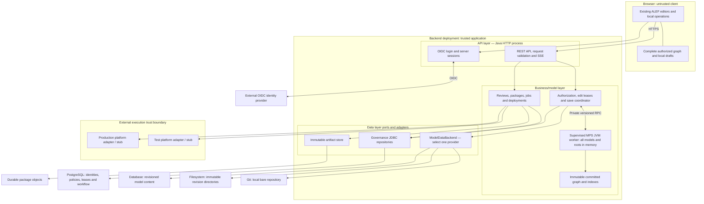
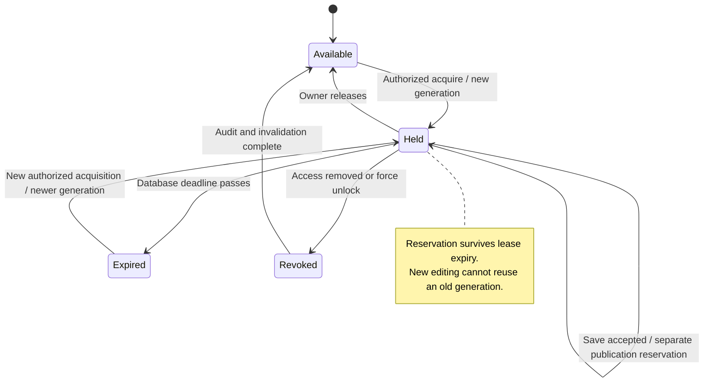
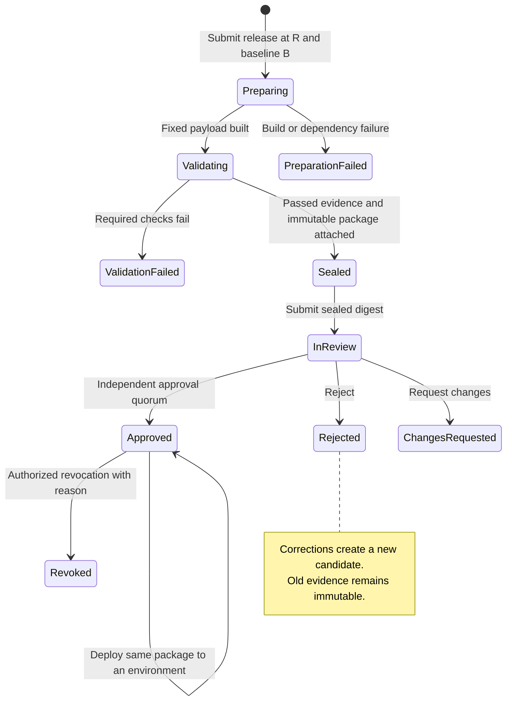
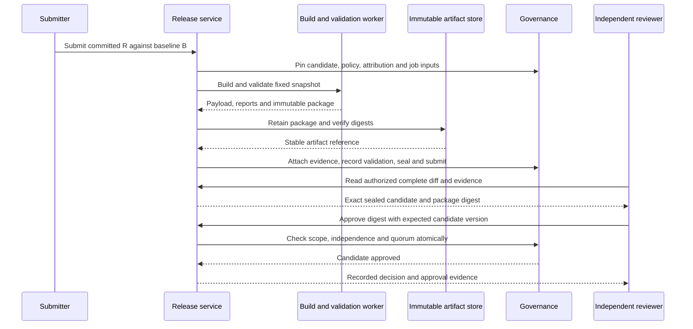

**ALEF browser backend — technical design**

Design date: 24 September 2026. Status: proposed architecture grounded in source inspection. This document implements no backend functionality.

**1. Recommended direction and scope**

Build one modular Java application, with an HTTP/API process and a supervised MPS runtime process deployed together. The business layer owns both the application services and the MPS worker. PostgreSQL stores authorization and workflow state. A selected Git, filesystem, or database adapter stores versioned model content. A content-addressed artifact store retains immutable release packages. The browser downloads the complete model graph it is authorized to read and continues using the existing generated editors locally.

Start with the existing local-authoritative Git provider and one shared workspace on `master`, matching the earlier backend's confirmed scope. Other providers expose the same revision and publication contract. All model writes go through the backend. External Git pushes and manual edits to authoritative files are outside the initial supported workflow. The ALEF language source checkout's `develop` branch is unrelated to this model repository's `master` branch.

An exclusive root lease grants temporary editing rights; authorization grants permission to request those rights. A save requires both. Saves produce durable draft revisions, which may contain ordinary language diagnostics. An explicit **Submit release** action freezes a revision, builds and validates a package, and starts independent review. Only that exact approved package can be deployed, separately to each configured execution platform.

The small process boundary around MPS is deliberate: its language classloaders, platform services, heap, and potentially long-running rules need a lifecycle independent of HTTP sessions and governance recovery. It also avoids forcing the legacy MPS toolchain onto the web application's classpath. This is one product/deployment, not a collection of independently operated services. A compatibility spike may justify an in-process runtime later; the application-facing interface remains unchanged.

**Default assumptions, pending product decisions**

| Decision | Proposed initial default |
| --- | --- |
| Workspace | One repository, one shared current revision; all configured application models are loaded. |
| Saves | Explicit Save, plus optional later autosave; incomplete semantic drafts can be saved. |
| Deployment unit | Entire configured workspace plus its pinned runtime dependencies. |
| Storage | Existing local bare Git provider first; filesystem and PostgreSQL model providers follow. |
| Login | Existing organizational OIDC provider when available; otherwise Keycloak for the initial deployment. |
| Review | One independent human approver, distinct from every contributor and the submitter. |
| Production | An additional environment authorization gate; configurable independent production approval. |
| Availability | One active writer; maintenance/recovery may temporarily make the workspace unavailable. |
| Offline | Local read access to already-loaded data; editing requires a current server lease. |
| Generation | Optional release job, enabled only when a real target requires generated artifacts. |

**2. What exists today, and what does not**

These findings come from current files. Builds, MPS runtime execution, browser interactions, and live identity-provider integration were not rerun for this design.

| Area | Verified source evidence | Design implication |
| --- | --- | --- |
| Toolchain | [source-lock.json](C:/Codex/alef-j2cl/source-lock.json:1) pins ALEF `96dd99ff70cb88112e578088e2d4b70d6efc4327`, MPS `2025.1`, extensions `2025.1.3226.9d3d593`. [generation script](C:/Codex/alef-j2cl/tools/generate_sources.py:105) selects Java 21. | Match these language/runtime inputs first. Do not substitute the sibling MPS checkout's current build/JDK requirements. |
| Browser runtime | [README](C:/Codex/alef-j2cl/README.md:3) describes Regelspraak, Gegevensspraak, Servicespraak and Testspraak; [AlefLanguages](C:/Codex/alef-j2cl/browser-src/alefj2cl/AlefLanguages.java:10) registers their compiled dependency closure. | Preserve the four supported languages and their required dependencies. Browser registration is an inventory input, not a JVM bootstrap implementation. |
| Models | [createModel](C:/Codex/alef-j2cl/example/AlefEditorApp.java:481) constructs a solution and a `MemoryModel`; sample roots are created in Java. [AlefStandardModels](C:/Codex/alef-j2cl/browser-src/alefj2cl/AlefStandardModels.java:11) installs read-only models with persistent IDs. | A real server snapshot loader and serializer are new work. Preserve the standard models and their IDs. |
| Editing | [createRoot](C:/Codex/alef-j2cl/example/AlefEditorApp.java:181) uses `executeCommand`, constraints and `NodeFactoryManager`; the app supports generated editors, intentions, undo/redo, reference navigation and service/test execution. | Retain local editing; put a lease-aware command boundary and synchronization bridge around it. |
| Project navigation | [project view contract](C:/Codex/alef-j2cl/example/PROJECT_VIEW.md:1) uses stable MPS references. Its tree snapshot contains root summaries, not full ASTs. | Reuse the UI contract; introduce a separate complete graph transfer format. |
| Current persistence | [browser README](C:/Codex/alef-j2cl/README.md:46) says reload resets the session; [index.html](C:/Codex/alef-j2cl/example/index.html:18) labels it “Session only”. | Login, durable Save, leases and remote updates are proposed features. |
| Earlier backend | [backend README](<C:/Users/niekh/Documents/ChatGPT/ALEFBackend/README.md:1>) and [settings](<C:/Users/niekh/Documents/ChatGPT/ALEFBackend/settings.gradle:1>) contain four Java modules: governance, storage API, Git, XML9. | Reuse and extend these modules instead of recreating them in the browser repository. |
| Storage API | [ModelDataBackend](<C:/Users/niekh/Documents/ChatGPT/ALEFBackend/alef-model-api/src/main/java/nl/alef/backend/storage/ModelDataBackend.java:13>) provides pinned snapshots, prepare/publish, operation lookup, history, diff and retention. | A good foundation for interchangeable persistence. It is an internal trusted API, not an authorized HTTP service. |
| Governance | [database guide](<C:/Users/niekh/Documents/ChatGPT/ALEFBackend/docs/database-layer.md:1>) and migrations V1–V5 cover identities, leases, publication intents, reviews, jobs, deployment/outbox records. | Authorization policy, orchestration, handlers, HTTP endpoints and dispatchers still need implementation. Tables alone do not enforce the product workflow. |
| XML9 | [storage guide](<C:/Users/niekh/Documents/ChatGPT/ALEFBackend/docs/model-data-layer.md:1>) documents bounded native XML9 projection, original resource preservation, single-file and file-per-root layouts. | It is not an ALEF runtime or an AST-to-MPS serializer. Compatibility with actual ALEF models must be demonstrated. |
| Prior validation | Existing test-result XML files dated 8 September 2026 report 93 tests, zero failures/errors: governance 52, Git 27, XML9 14. | Historical reports were inspected; these are not new test results or proof of an integrated application. |
| Source baseline | The earlier backend's files are untracked and its Git `master` has no commits. The browser workspace root is not a Git repository. | Establish an agreed source-control home and baseline before implementation. No commits or repository changes were made here. |

The earlier [architecture plan](<C:/Users/niekh/Documents/ChatGPT/ALEFBackend/docs/architecture-plan.md:1>) proposed a graph database alternative. This design recommends PostgreSQL snapshot/blob storage first because runtime traversal is already in memory; a graph database remains an optional provider. This is a recommendation, not a claim that a database model provider already exists.

**3. Layers, trust boundaries and deployment**



The API layer handles authentication, DTO validation, request limits, CSRF protection and API versioning. Business services evaluate permissions for the actual affected entities, enforce leases and revisions, and coordinate durable operations. Data adapters never trust a caller-supplied user, contributor list, approval result or validation result. Only internal services may call them.

MPS holds every configured application model and required library model in memory. Immutable committed graph DTOs and indexes support authorized queries and snapshot exports without serializing live `SNode` objects across process boundaries. Node traversal is not translated into database queries. Storage readers are used for initial loading, recovery, historical review and migration.

Run the API, supervisor and bounded job runner as one control JVM. Start one long-lived MPS worker over a private OS pipe or authenticated loopback connection. It has no public port, identity-provider tokens, direct storage publication privilege or deployment credentials. The supervisor owns worker epochs, operation IDs, timeouts and restarts. Release validation/generation may use a short-lived worker on a pinned snapshot, with a strict concurrency limit, so it does not mutate the live editing repository.

**Technology choices**

| Component | Recommendation and reason | Alternative / tradeoff |
| --- | --- | --- |
| Java | Java 21 for the initial runtime spike, aligned with ALEF generation. Existing Java 17 library bytecode can be retained and tested on that JVM. | Do not upgrade MPS or infer compatibility from a different sibling checkout. |
| HTTP | Spring Boot, Spring MVC and Spring Security OIDC. A Boot 4.x compatibility spike is appropriate; the currently checked requirements support Java 21. | Quarkus/Micronaut are viable, but would add unfamiliar wiring without a measured benefit here. |
| Dependency management | Retain Gradle modules; align web dependencies using the selected Boot BOM. Review existing Jackson, Flyway and logging pins; remove library-owned runtime logging bindings in the assembled application. | Do not assume the existing standalone dependency set works unchanged in Boot. |
| Operational persistence | PostgreSQL, JDBC and Flyway; reuse explicit repository transactions and concurrency logic. | JPA adds little to the existing SQL-heavy state transitions. |
| Model storage | JGit first, behind `ModelDataBackend`. PostgreSQL content provider later. | Filesystem is useful for controlled deployments but must implement history and recovery itself. |
| Jobs | Existing PostgreSQL job leases plus bounded Java executors; transactional outbox with durable consumer cursors. | Add a broker only when throughput or deployment separation justifies it. |
| Live updates | SSE for notifications and progress; HTTP for commands and snapshot chunks. | WebSocket adds bidirectional connection state that the initial workflow does not need. |
| Artifact storage | Durable content-addressed directory initially; an object-store adapter later. | Artifact storage is independent of the selected model provider. |

Spring supports issuer-based OIDC discovery; Keycloak explicitly recommends using standard ecosystem protocol support before vendor-specific adapters. See [Spring OIDC configuration](https://docs.spring.io/spring-security/reference/servlet/oauth2/login/core.html), [Boot requirements](https://docs.spring.io/spring-boot/system-requirements.html), and [Keycloak integration guidance](https://www.keycloak.org/securing-apps/overview). These are framework capabilities, not evidence that this application is integrated.

**4. Interchangeable model persistence**

All providers must implement one observable contract: immutable snapshots, one current head, durable preparation, conditional atomic publication, idempotent inspection/recovery, attributed history, diffs and retention. Providers that cannot meet these requirements are rejected at startup; governance must not quietly weaken when storage changes.

Revisions are opaque provider values internally. Public API revisions are opaque application tokens. UUIDs, Git object IDs and filesystem directory names must not determine business behavior. Persist a provider instance/epoch with each revision so values remain unambiguous across migrations.

| Capability | Git provider | Filesystem provider, proposed | PostgreSQL model provider, proposed |
| --- | --- | --- | --- |
| Snapshot | Retained commit/tree | Immutable manifest and content-addressed files | Immutable revision manifest and model/resource rows |
| Prepare | Fixed commit retained by operation evidence | Write complete staged files, flush, persist preparation manifest | Insert immutable blobs and prepared revision in a transaction |
| Atomic publication | Expected-old-head ref update | Single-writer OS lock plus checked head; atomically replace one durable head manifest | Compare-and-set current revision row and record publication in one transaction |
| History | Commit parents and stored attribution | Explicit parent chain and journal | Revision/parent/change tables |
| Diff | Model/root projections plus resource bytes | Same logical comparison; resource manifest diff | Same logical comparison; deterministic resource export |
| Recovery | Inspect fixed operation evidence and commit reachability | Inspect preparation journal, published head lineage and terminal operation state | Inspect operation and revision rows |
| Retention | Protected retention refs | Reference-counted manifests; GC only after reconciliation | Retention rows prevent deletion of referenced revisions/blobs |
| Extra infrastructure | Durable volume, exclusive publication access | Durable local filesystem with tested atomic replace/fsync behavior | PostgreSQL transactions and storage backup |
| Current implementation | Present, local-authoritative only | Absent | Absent |

A plain directory of mutable `.mps` files is not a conforming filesystem provider. Write a new revision under staging, flush file data and manifests, move it into the immutable revision namespace, then atomically replace the small head manifest. Never overwrite multiple live model files in place. Document and test OS/filesystem crash semantics; do not assume a network share provides the same guarantees. Serialize head checks and replacement under one writer lock. The journal retains operation identity even after later head advances.

For database model storage, initially store native persistence resources as immutable blobs keyed by digest, with revision/model/resource membership tables. Optionally store canonical AST projections for inspection. The native resources preserve metadata, opaque extensions and round-trip fidelity; runtime MPS remains the semantic authority. Model content can share a PostgreSQL server with governance but uses a separate schema and credentials/ownership rules. Keep the same prepare/publish coordinator even if a future optimized provider can combine some transactions.

The current API represents complete model persistence units and preserves unconfigured Git files. Its `ModelDiff` reports created/updated/deleted models and roots; it has no first-class rename operation. Extend the contract before claiming uniform rename/file tracking. Introduce stable logical resources and an explicit `ResourceChange` manifest with before/after paths, digests and change kind. Derive renames from identity/path transitions, not just content similarity. Model display-name changes, virtual-package changes, root moves and physical file renames are different events.

Module descriptors, language imports, model inventory and path bindings must be versioned alongside the model snapshot. The existing Git bindings are configuration-based; changing those bindings currently changes how historical commits are interpreted. Add a versioned workspace manifest/binding catalog. Preserve unrelated files and modes. Do not expose arbitrary filesystem patches through the API.

This requires a deliberate API extension: evolve the current model-only `ModelWriteSet` into a `WorkspaceWriteSet` containing complete changed model units, deletions, a versioned inventory and allowlisted non-model resource changes. A single prepared revision atomically includes all of them. Extend snapshot reads to return the same workspace inventory/resources internally. Storing module descriptors or binding updates out of band would make model snapshots and recovery inconsistent.

**Publication and recovery contract additions**

Retain the existing `prepareChange`, `publish` and `lookupPublication` operations. Add explicit format/capability versions, resource-level change evidence, provider-instance identity, and a terminal cancellation/reconciliation contract. The current code lacks a safe accepted-operation abort path. In the first vertical slice, retry the same fixed accepted operation; do not discard its reservation on timeout. A later abort must prove publication did not occur and prevent every delayed publisher from publishing that operation afterward.

**Provider migration**

Enter maintenance mode, block new leases/writes, finish all accepted publications, and take matching governance/content/artifact backups. Export the committed snapshot, native resources, workspace manifest, identity map, history required by retention policy, and every retained release source/baseline revision. Import into the new provider and build an immutable old-to-new revision map. Verify resource hashes, model/root identities, reference resolution, metadata and semantic round trips; then rebuild the runtime and atomically switch the configured provider epoch/current-revision mapping.

Existing approvals and packages retain their original provenance and hashes. Keep historical revisions resolvable through the migration map or retain the former provider read-only; never rewrite signed/sealed evidence to new revision strings. Resume only after comparing the authorized browser export and readiness checks. Keep the old provider for rollback until new writes begin; subsequent rollback requires reconciling those writes, not simply changing configuration.

**5. MPS runtime profile and lifecycle**

Support the application's existing four language profiles and the dependency closure required by them. The browser registry also includes, among others, `bronspraak`, `contexts`, `rapporten`, MPS BaseLanguage/core/XML/smodel components and extension runtimes. Verify the JVM closure through pinned generated descriptors and compiled artifacts; do not copy the browser source-selection list as the JVM classpath.

Use original JVM-capable ALEF code and its normal module classloaders. Browser-only reflection replacements (`TranslatorRegistry`, `RendererRegistry`, `ClassMetadata`), WebAWT/Swing adapters and `BrowserModelAccess` do not belong in the server. The JVM may use reflection required by the pinned trusted language runtime.

| Capability | Initial support | Reason / boundary |
| --- | --- | --- |
| `SRepository`, `SModule`, `SModel`, `SNode`, persistence identities | Required | Load, traverse, preserve and change actual model graphs. |
| Structure, concept/property/link metadata | Required | Decode graphs, validate roles and types, preserve IDs. |
| Behavior, constraints and reference scopes | Required | Authoritative semantic validation and safe writes. |
| Typesystem and non-typesystem checks | Required | Server diagnostics and release validation. |
| Node factories/actions | Required where used by current root creation | Keep initializers and mandatory children consistent with the browser. |
| ALEF interpreters and translator runtime | Required for supported service/test validation | Actual JVM/browser parity is an acceptance gate. |
| Standard/accessory models | Required, read-only | `gegevensspraak.base`, `standaard.funcs`, Regelspraak/Servicespraak/Testspraak slot models keep persistent IDs. |
| Intentions and quick fixes | Local frontend; selected server operations only | Never expose arbitrary intention invocation or editor contexts over HTTP. Validate resulting edits. |
| Editor rendering, inspector, completion UI, WebAWT, desktop menus | No server product support | The browser already owns these interactions. Some upstream jars may remain linkage dependencies. |
| Linguistic presentation | Only if needed for diagnostics/review labels | It may be a non-UI dependency; test headlessly. |
| Generator, TextGen, Java compilation | Separate opt-in release profile | Needed only for execution targets that consume generated code. |
| XSD registration/comparison/validation | Deferred unless a target/model requires it | The browser explicitly excludes these operations; JVM support must be proved independently. |
| Migration, refactoring, project hygiene, language authoring, IDE plugins | Excluded from public API | Language upgrades are controlled offline maintenance with a new toolchain fingerprint. |
| `servicespraak.tijd` and `testspraak.tijd` | Outside the initial supported language profile | Do not silently expand beyond current browser support. |

“Excluded” means not activated or exposed as a supported capability. It does not promise that upstream distribution jars can immediately be removed. Generated `Language` classes refer to multiple aspects, including editors and migrations; pruning their dependencies without testing can cause linkage errors even in a headless service.

Local MPS source inspection found `MpsEnvironment` bootstrapping a headless platform with `PlatformOptionsBuilder.ALL`, and platform options `CORE`, `PERSISTENCE`, `ALL`. That sibling checkout is separately pinned and is **not** proof of API compatibility with ALEF's MPS 2025.1 distribution. Use it as a bootstrap lead. The spike must verify the matching distribution's entry points and required plugins. Begin with its supported headless bootstrap and narrow activated components after observing actual dependencies; do not invent a minimal classpath from package names.

Launch with a private cache/config/temp directory, `java.awt.headless=true`, fixed locale/timezone where required for reproducible output, and no desktop project autoload. Register an allowlisted set of compiled language modules and libraries, open the configured solution descriptors, then fully load every application model/root and its required library closure. Force traversal and reference indexing so readiness cannot mean “only root descriptors loaded.” Language artifacts are trusted deployment inputs, never uploaded by an editing client.

Read live MPS graphs inside repository read actions. Run mutations through the model-access implementation's supported command/write mechanism on a serialized runtime executor. Respect any thread-affinity requirement discovered in the pinned bootstrap; the HTTP thread never assumes it can call MPS directly. MPS commands provide model synchronization, **not** a transaction spanning MPS, Git and PostgreSQL. JetBrains documents its read/write-action and command requirements in [MPS Open API](https://www.jetbrains.com/help/mps/open-api-accessing-models-from-code.html).

On shutdown stop accepting writes, drain/recover accepted publications, dispose validation/typechecking sessions and listeners, close projects/repositories, unload language modules through the supported lifecycle, then stop the environment. A worker crash discards only rebuildable runtime state. No client ever receives raw MPS objects, Java serialized objects, class names to instantiate, or arbitrary executable model commands.

**6. In-memory state, saves and concurrency**

Use these distinct facts: `storageHead` (observed provider head), `finalizedRevision` (governance has recorded the publication), and `activeRevision` (the runtime's committed view). Ready for new writes means they agree, the worker/toolchain matches, and no accepted publication is unresolved. These correspond to existing governance status concepts; the live activation protocol is new.

Startup progresses through `STARTING → RECOVERING → LOADING → INDEXING → READY`. Expose sanitized stage progress after login. Fatal format, identity, missing-language or corruption failures enter `FAILED`; do not serve a partially loaded workspace. Ordinary semantic diagnostics produce `READY_WITH_DIAGNOSTICS` and block affected releases rather than blocking all draft work. A database failure disables protected operations because leases and current authorization cannot be verified.

Stable identities follow the existing `ModelTypes`: module ID + persistent model ID + node ID. Node IDs and numeric concept/feature IDs cross JavaScript boundaries as strings to avoid 64-bit precision loss. Root identity is a separate durable UUID mapped to the current model/node key. A root moved between models retains its root UUID, records an identity transition, and updates affected references. Names, virtual packages and storage paths are mutable presentation/location attributes.

Maintain node-to-root lookup, outgoing/incoming references, root content versions, model-context versions and reverse dependencies. Track dependencies conservatively: dynamic scopes and type rules can depend on model imports or workspace context beyond explicit references. When uncertain, invalidate/revalidate the whole model/workspace. Never treat an unchanged AST hash as proof that its semantics are unchanged.

Keep one serialized save coordinator per workspace. Users can hold leases and edit different roots concurrently in their browsers; accepted publications advance one shared head in order. For the first implementation, preserve the existing strict expected-workspace-revision check. Even an unrelated intervening save requires refresh and revalidation. Return an actionable conflict without discarding the local draft. Transparent disjoint-root rebasing is a later optimization, not an unimplemented promise.

**Save sequence and visibility**

1. Authenticate, resolve the editing client, validate request size/schema, and perform preliminary permission/lease checks. Reserve the idempotency key against a normalized request digest.
2. Enter the serialized save pipeline at committed revision R. Check expected workspace, affected root and model-context versions. Retain an immutable committed graph/persistence snapshot for R.
3. Close the live MPS semantic-query gate. Apply the proposed root changes under an MPS command, validate them, derive the actual changed roots/metadata and serialize complete affected persistence units. Other users can still read the immutable committed DTO view at R. No tentative state is exposed.
4. Reject undeclared changes, unleased roots, unauthorized references/metadata, invalid identities, unsupported content or structural corruption. Semantic diagnostics may be saved as draft evidence. If tentative processing fails, rebuild the runtime from the retained committed state before reopening it; do not assume MPS undo rolls back every side effect.
5. Ask storage to prepare and durably retain the exact target revision and operation evidence. Do not advance its head yet.
6. In a short PostgreSQL transaction, lock the coordination row, recheck current permissions/policy epoch, session, lease owner/generation/expiry and revision, then persist an immutable publication intent and scope reservations. Permission changes use compatible locking so revocation and acceptance have a defined order. This is the write-acceptance point.
7. Publish the fixed prepared operation using storage compare-and-set. Then record its durable result and finalize revision history, roots, audit and outbox in PostgreSQL. Network/filesystem work occurs outside SQL transactions.
8. Activate the new immutable runtime graph/index at R2, acknowledge the worker's operation/epoch, and mark it indexed. Only then announce a ready revision and return completed Save. Release the save gate. If activation fails, reload R2 and remain unavailable for new writes until recovery succeeds.

An accepted operation may finish after the original human lease expires: it was authorized while valid and now holds a durable publication reservation. No new edits are admitted under that expired lease. Force-unlock or logout does not erase accepted work. Distinguish “saving/accepted” from “saved/active” in the frontend; a lost response is resolved by querying the same operation ID.

```mermaid
sequenceDiagram
  participant B as Browser editor
  participant A as API and save coordinator
  participant G as PostgreSQL governance
  participant M as MPS runtime
  participant S as Selected model store
  B->>A: Acquire root lease for editing client
  A->>G: Check permission and acquire atomically
  G-->>B: Lease identity, generation and deadline via API
  Note over B: Local edits only while lease is valid
  B->>A: Save roots, base versions, lease proofs, operation ID
  A->>M: Stage and validate at revision R
  M-->>A: Actual change set and complete persistence units
  A->>S: Prepare fixed operation against R
  S-->>A: Retained target R2 and digest
  A->>G: Recheck authorization and leases; accept intent
  G-->>A: Accepted and scopes reserved
  A->>S: Publish exact operation with expected-head check
  S-->>A: Durable publication evidence
  A->>G: Record and finalize R2, audit and outbox
  A->>M: Activate committed graph R2
  M-->>A: Active revision R2
  A->>G: Mark indexed R2
  A-->>B: Saved R2 and new root versions
  A-->>B: Authorized change event
```

If Alice and Bob edit different roots in the same `.mps` file, Bob must not submit a replacement file captured before Alice's save. Bob submits only his root proposal. After refresh/revalidation, the trusted runtime applies it to the latest complete model and serializes the file containing both current roots. A failed expected-head check leaves the head untouched. Lease granularity is about semantic ownership; publication granularity is the complete persistence unit and workspace revision.

Memory budgeting includes MPS graphs, committed immutable DTOs, indexes, type caches, serialization buffers, outstanding snapshot retention and any release worker. Measure peak heap rather than file size. Bound concurrent exports and release workers, stream serialized chunks, and retain at most a configured number of snapshot versions. Begin with one release worker at most, disabled when there is insufficient headroom. Full-model loading remains required; if capacity is exceeded, reject startup/export with a clear limit rather than quietly switching to lazy loading.

For future scale, HTTP replicas can share sessions/governance while routing each workspace to one fenced writer/runtime owner. Read replicas activate only finalized revisions and label their revision. A PostgreSQL model provider can enforce writer epoch in its publish transaction. Git/filesystem failover additionally requires a publication gateway or infrastructure fencing that makes the old writer unable to change storage; a database lease alone cannot fence a paused process updating a Git ref. Automatic failover is deferred until this is proven. Initial recovery uses one exclusive process/volume owner and controlled restart.

**7. Login and authorization**

Use OIDC for identity and backend policy for model permissions. Authentication proves who the user is; provider groups are inputs to role mapping, not a substitute for root-level authorization.

| Option | Suitable use | Tradeoff |
| --- | --- | --- |
| Existing organizational OIDC provider | Preferred when the intended users already have managed accounts. | Confirm issuer/tenant, group claims, account lifecycle and administrator access. Avoid introducing another account directory. |
| Keycloak, self-hosted | Default for a standalone installation needing control over identity configuration and hosting. | The operator owns database availability, upgrades, backups and identity security. Uses the same standard OIDC integration. |
| Microsoft Entra ID | Strong fit for users already in a Microsoft organizational tenant. | Requires tenant application registration and decisions about allowed members/guests and claim mappings. Use a tenant-specific issuer initially. |
| Auth0, managed | Suitable when avoiding operation of an identity server is a priority. | External service dependency and plan/region/connection requirements must be evaluated for the intended users; no pricing assumptions are made here. |

These options are supported by their current primary documentation: [Keycloak server configuration](https://www.keycloak.org/server/configuration), [Entra OIDC and tenant discovery](https://learn.microsoft.com/en-us/entra/identity-platform/v2-protocols-oidc), and [Auth0 overview](https://auth0.com/docs/get-started/auth0-overview). Provider-specific capability and contract selection remain deployment decisions.

**Browser session flow**

Serve the browser and API from the same HTTPS origin. The backend is a confidential OIDC client and handles Authorization Code flow with PKCE S256, state and nonce. It validates issuer, signature, audience, nonce and token lifetime using the security library and configured trust. Store access/refresh tokens only server-side, encrypted at rest if persisted. Never use an ID token as a general API bearer token.

Issue an opaque session cookie with `Secure`, `HttpOnly`, `SameSite=Lax` and a narrow host scope; rotate it after login. Use a server-side session store, initially PostgreSQL. State-changing requests carry a CSRF token and pass origin checks. API authentication failures return structured 401 responses rather than an identity-provider HTML page. OIDC errors show a retryable login screen without exposing tokens.

Suggested session defaults are a 30-minute idle timeout and an 8-hour absolute lifetime, configurable by deployment policy. Refresh provider tokens server-side when required; refresh failure ends the application session. Recheck local principal disablement and ACL policy on each request. External group/account changes require provider events or bounded refresh; default to refreshing group-derived policy at most every five minutes and require fresh authentication for production approval when configured. This external revocation delay must be tested and documented for the selected provider.

Logout is a CSRF-protected POST that invalidates the server session, stops its event streams, releases eligible editing leases, clears browser graphs/drafts, and optionally performs provider logout. An accepted save is reconciled rather than cancelled implicitly. A separate API-client token flow can be added later without exposing browser refresh tokens.

This session design follows the documented server-cookie pattern and standard code flow, with application-specific policy choices above: [Auth0 cookie-based SPA authentication](https://auth0.com/docs/manage-users/cookies/spa-authenticate-with-cookies), [Entra authorization code flow](https://learn.microsoft.com/en-us/entra/identity-platform/v2-oauth2-auth-code-flow), [Spring CSRF integration](https://docs.spring.io/spring-security/reference/servlet/exploits/csrf.html).

**Permission model**

Identify an account by `(issuer, subject)`, never email. Map verified account aliases to a stable `personId` for independence checks. Identity linking is an explicit administration operation; matching email strings alone cannot grant access or merge reviewer identities.

| Permission | Scope and checks |
| --- | --- |
| `READ` | Root and descendants, minimal ancestor container metadata, permitted references and diagnostics. |
| `EDIT` | Root; additionally requires `READ` and a valid editing lease. |
| `CREATE_ROOT` / `EDIT_MODEL_STRUCTURE` | Model; required for root inventory/import/module-context changes. |
| `DELETE_ROOT` | Root plus the relevant structural scope and all actual changes. |
| `SUBMIT_RELEASE` | Release scope; requires read access to its entire source/dependency closure. |
| `REVIEW` | Root/package scope; permits inspection and comments but is not by itself approval authority. |
| `APPROVE_RELEASE` | Entire immutable package scope plus independence/quorum policy. |
| `DEPLOY` / `APPROVE_ENVIRONMENT` | Explicit execution-platform/environment binding; separate from editing and release approval. |
| `MANAGE_ACCESS` / `FORCE_UNLOCK` / `AUDIT` | Explicit administrative scopes. They do not silently grant model read or self-approval. |

Bindings target principals or mapped groups, at workspace, model or root scope. Use default deny. Resolve applicable grants along workspace → model → root; an explicit deny at any applicable scope wins. Child scopes may add grants but cannot override a deny. Administrative deployment permissions are separately scoped to platforms. Record policy version/epoch and effective decisions for sensitive operations.

The existing `role_binding` table stores a principal, free-form scope and role; it does not implement this inheritance/deny/group policy. Add typed ACL bindings, group mappings and policy-version data via new migrations and a central `AuthorizationService`. Do not reinterpret old role strings as proof that root enforcement already exists.

Every output is a policy projection: snapshots, searches, completions supplied by the server, historical diffs, validation messages, event payloads, download links, locks and review evidence. Recheck access when a job runs and when its result is read. Worker computation may need the full trusted graph, but its result must not disclose hidden nodes, values, presentation strings, counts or dependency names.

**Whole-model loading with restricted roots**

“Whole model” means all readable application roots and all permitted required library roots, fully loaded before normal editing. It does not mean shipping hidden roots and hiding them in the tree. Return a model shell only when required by visible roots. Do not expose unfiltered native model files: the current internal `RootNodeBundle` includes the complete persistence unit, which can contain other users' roots.

For an authorized reference target, transfer its real stable identity. For an inaccessible target, return a generic unresolved/restricted reference plus a random opaque preservation handle. Do not send the target model/node ID, name, `resolveInfo`, native reference string or sensitive derived presentation. Treat nonexistent and inaccessible lookups uniformly at the public API boundary.

The server binds a preservation handle to the viewing principal, source node/role, original edge and relevant base version. On save it may preserve that exact existing edge, but cannot transplant the handle to another source, create access to the target, or use it as an arbitrary resolver. Clearing/replacing an edge requires normal edit validation; inventing a link to a hidden target is denied. The browser installs a safe synthetic unresolved reference and keeps the handle outside the persisted AST. Unknown metadata omitted from the browser is preserved by the trusted server, not erased by root replacement.

Some language operations cannot be complete with hidden dependencies. Show a generic “requires unavailable context” result locally; perform authoritative validation on the backend and sanitize the result. Full local semantics across inaccessible data and nondisclosure cannot both be guaranteed. If a workflow requires complete local evaluation, grant its dependency closure explicitly or select a workspace/access boundary that includes it.

Changing access increments a policy epoch. Stop affected streams/transfers, invalidate snapshots and caches, disable editing, release relevant leases, and rebuild the authorized graph. The application clears already-received data from its own UI and memory; revocation cannot recall data a user previously copied. Avoid durable browser model caches initially.

**8. Exclusive editing leases**

Reuse `EditLeaseRepository` for atomic hierarchical scope acquisition, generations, database-clock expiry, renewal and audit. Add authenticated editing-client lifecycle and current-policy enforcement around it. Distinguish the HTTP login session from an editing client: one browser tab owns one server-registered `editingClientId`, bound to the login session and principal. Its unguessable client credential is held in that tab's memory. A second tab does not automatically inherit the lease even for the same user; transfer/reacquisition invalidates the old generation.

Proposed defaults: a 120-second lease, renewal every 30 seconds, and a conservative client freeze before the last confirmed deadline. The server's database time is authoritative. The client uses a monotonic countdown derived from the response and a safety margin; it never extends editing based solely on its wall clock or a renewal request that has not succeeded.

Lease proof contains scope, lease identity and monotonically increasing generation; ownership additionally comes from the authenticated principal and editing client. Do not disclose proof fields to other readers. Each write revalidates them at acceptance. Renewal also checks current authorization. Acquisition of multiple scopes is all-or-nothing in a deterministic order; a failure returns only conflict information the requester may see.

Acquisition also returns current root/model-context versions and records the client's edit base. If those differ from the loaded view, catch up before enabling edits. Keep base revision evidence and restricted-edge preservation mappings while the lease is live, then for a bounded recovery grace period. A download handle's expiry must not invalidate an otherwise valid long-running editing session. Once edit-base retention expires, require a fresh authorized comparison; never accept unverifiable old edge handles.



Normal readers/reviewers never acquire edit leases. A lock can remain held across multiple saves; saved root versions change while the lease generation stays valid. The UI shows owner and expiry only to users entitled to that root. Force-unlock requires a reason and audit record, and cannot bypass an accepted publication reservation.

| Operation | Required scope and behavior |
| --- | --- |
| Edit root/descendants | Exclusive root lease, root permission and expected versions. |
| Intention/quick fix touching multiple roots | Discover the write set through a safe preflight/scratch run; acquire every root lease before changing the live local graph. Refuse unsupported preflight cases. |
| Create root | Acquire model structural lease; reserve a persistent root identity and unpublished-root lease, then allow local factory initialization. First save publishes the root and transitions the identity to active; keep its root lease when the model lease is released. |
| Delete root | Root lease plus model structural protection; inspect incoming references and require leases/permissions for any references that will be changed. Reject unsafe deletion with a sanitized diagnostic. |
| Move subtree between roots | Both root leases, type/containment checks, stable IDs; one atomic save. |
| Move root between models | Source/destination model structural protection and root lease; verify node-ID collisions, imports and affected incoming references. Record the identity transition. |
| Change imports, module metadata or model inventory | Structural model/module lease. Parent scopes exclude conflicting descendant editors. |
| Multiple roots share a file | Independent root leases are sufficient for ordinary content edits; the save coordinator reconstructs and conditionally publishes the whole file. |

Creating an unpublished root requires proposed identity/session extensions; the current governance repository requires scopes to exist. Do not insert a fake committed root version. Record `RESERVED` identity state owned by the creation operation, remove/expire unused reservations safely, and prevent ID reuse while referenced by an operation. Root/model lease conversion or downgrade must happen atomically under the coordination lock so another editor cannot enter between them. Parent lease coverage is an explicit stronger permission, not a means to evade root authorization.

The current browser often has several roots in one `SModel`; setting model-wide read-only state is insufficient for root-specific locking. Introduce a browser command guard shared by cells, intentions, quick fixes, paste, creation, deletion and undo/redo. It checks lease state and complete write scope before mutation. Remote refreshes run as synchronization operations outside local undo history. Any post-command scope mismatch restores the pre-command draft and reports a conflict; the server independently rejects it on Save.

On connection loss, editing freezes before the confirmed lease expires; failed renewal never prolongs it. Keep the unsaved draft in memory as read-only. After reconnect, authenticate, reacquire the lease, fetch the current committed root and compare three states: original base, unsaved draft, current server state. Require explicit conflict resolution when overlapping or dependency changes exist. Never auto-save a stale draft under a new lease. On permission removal or logout, purge that draft according to access policy rather than exposing it through an export action.

**9. Complete frontend loading and synchronization**

Add an `alef-graph/v1` transport contract separate from native MPS XML9 and internal storage DTOs. The browser's existing tree remains a summary view generated from the loaded graph. Replace demo initialization with a bootstrap bridge; keep `AlefEditorApp`, generated editors and project-view behavior intact.

The manifest pins a snapshot ID, opaque revision, policy epoch, language/toolchain fingerprint, transport version, event cursor, visible counts, content digests and chunk list. Schema tables map stable concept/property/containment/reference IDs to the descriptors already compiled into the browser. Nodes include string IDs, concept IDs, explicitly represented properties, ordered children with role IDs, and static/dynamic/unresolved/restricted references. Preserve global child order across roles and absent/null/empty property distinctions. Never enable arbitrary class deserialization.

Read-only standard models already compiled into the browser may be reused only when the manifest proves exact identity/content/toolchain compatibility. Otherwise load the authorized version from the snapshot or reject the mismatch. Do not combine stale compiled library nodes with a newer server model. The first protocol requires an exact browser/backend language fingerprint; a mismatch asks for a compatible application update instead of opening an editable partial graph.

**Consistent load protocol**

1. After login, register the editing client and request a snapshot from a ready committed revision. Atomically associate that revision with an event-log watermark and policy epoch. Retain its content for a bounded download lifetime.
2. Return a manifest and bounded chunk URLs scoped to the user/session/snapshot. All chunks describe the same revision; every request rechecks session and policy. Counts and digests describe only the authorized view.
3. Stream compressed graph records in bounded chunks. All roots will be transferred; chunking is a transport optimization, not lazy loading. Retry individual chunks by digest without mixing snapshots.
4. Construct model shells and nodes with persistent IDs first; then connect containment and references, install language imports and library mappings, and verify totals/digests. Yield between bounded batches so progress can repaint. The graph is not editable until reconstruction is complete.
5. Connect/replay authorized events after the pinned watermark. Apply catch-up changes to the complete graph. Only after catch-up and lease acquisition may the user edit. If events expired or permissions changed, discard the incomplete view and obtain a new snapshot.

```mermaid
sequenceDiagram
  participant B as Browser
  participant A as API and session service
  participant I as OIDC provider
  participant P as Authorization and committed view
  B->>A: Open application / request session
  A-->>B: Login redirect with state, nonce and PKCE challenge
  B->>I: Authenticate
  I-->>B: Authorization code redirect
  B->>A: Callback with code and state
  A->>I: Redeem code with verifier and client authentication
  I-->>A: Identity and tokens
  A-->>B: Opaque secure session cookie
  B->>A: Request full authorized snapshot
  A->>P: Pin revision R, policy epoch and event cursor
  P-->>A: Filtered manifest and complete graph chunks
  A-->>B: Manifest or preparation job
  loop All chunks at revision R
    B->>A: Fetch chunk with current session
    A-->>B: Authorized records and digest
  end
  Note over B: Create all nodes, bind references, show progress
  B->>A: Resume event stream after snapshot cursor
  A-->>B: Authorized catch-up events or resnapshot instruction
  Note over B: Complete view ready; roots read-only until leased
```

Show a loading overlay after 300 ms to avoid flashing it for fast loads. Use named stages: **Preparing snapshot**, **Downloading**, **Creating nodes**, **Resolving references**, **Catching up**. Use byte totals only when encoded/decoded units are actually comparable; otherwise show verified chunks/roots completed against manifest totals. Node/reference initialization uses its own counters. Unknown-duration server work is indeterminate. Do not synthesize a percentage that reaches 100 before readiness.

Cancel aborts HTTP streams and browser reconstruction and releases the snapshot handle; the server TTL cleans up abandoned handles. A failed chunk can retry within the same snapshot. Expired snapshots, policy changes or incompatible versions require a new load. Show concise errors and a retry action while keeping the normal editor unavailable for an incomplete graph.

After a successful load, retain the graph's revision/identity metadata in the editing client. The `baseSnapshotId` in a later save identifies that established edit base; it is not permission to reopen an expired download URL. Lease acquisition promotes the required baseline evidence into edit-base retention. New loads, policy changes and lease transfer explicitly replace or invalidate that binding.

**Submitting local changes**

| Approach | Benefit | Cost / suitability |
| --- | --- | --- |
| Named semantic commands only | Small, explicit server operations | Every editor/intention mutation must map to a command; current arbitrary MPS editing is a poor initial fit. |
| Fine-grained node deltas | Efficient for large roots; preserves mutation intent | Needs robust operation ordering, reference handling, retries and undo synchronization. |
| Complete changed-root snapshots | Matches the current local editor and exclusive-root model | Larger payloads; requires server preservation of omitted metadata and strict identity/scope checks. |

Recommend a hybrid: complete changed-root snapshots for ordinary saves, plus explicit structural operations for create/delete/move/import changes. Include only affected roots, their expected versions, model-context versions, lease proofs and base snapshot. Never submit the full authorized workspace as a replacement for the server's full workspace. The server merges each root into the current trusted model, preserves hidden-reference handles and metadata, computes its own diff and serializes complete persistence units.

Root snapshots are proposals, not trusted validation evidence. Preserve identity for surviving nodes, allocate new IDs using a pinned MPS-compatible scheme, reject collisions and cross-root ID theft, and record actual node moves. Allocate IDs or ranges through the server when browser-compatible generation is uncertain. Validate concept/role whitelists, containment, reference policy, model imports and resource limits before accepting. Do not replay node factories on existing roots merely because they arrived in a snapshot.

**Remote changes and undo**

Publish outbox-backed SSE notifications only after activation. A change event carries an opaque cursor, authorized affected-root IDs/versions, revision token and context invalidation hints. The client fetches corresponding version-pinned root data, applies a complete event batch atomically, and updates its cursor. Refreshes update existing nodes by stable identity where possible; preserve selection/tab references or reopen them explicitly if their nodes were deleted.

Do not append remote changes to local undo history. The current application has shared undo history, so the bridge must track affected roots per local command, reject undo without all required current leases, and invalidate conflicting history after remote updates. An undo of a previously saved change is a new draft change followed by a new save; it does not move the shared server revision backwards.

For a clean root, apply an incoming version directly. For a dirty root, pause and compare rather than overwrite. Valid leases should prevent another user's overlapping save, but administrator actions, lease loss and missed responses still make this check necessary. Remote changes to dependencies invalidate local diagnostics and require revalidation even if the edited root's own version is unchanged.

SSE is at-least-once: consumers deduplicate opaque event identities, and reconnect with `Last-Event-ID` or a stored cursor. Cursors are scoped to the authorized view and must not expose hidden root events. Replay applies current authorization. A gap/expired cursor returns `RESNAPSHOT_REQUIRED`; a permission epoch change invalidates the graph. Snapshot watermarking plus durable replay closes the race between initial download and event subscription.

**10. Change tracking and immutable releases**

Saving is not releasing. Every accepted save records authenticated attribution, actual contributors, root/model/resource changes, parent revision and toolchain context. The UI's **Submit release** action selects a committed revision R, a baseline B and a release policy. Editing may continue afterward; the candidate always remains pinned to R.

Use the last approved release on the release lineage as the default baseline, made explicit to the submitter. For the first release, use an explicit empty/import baseline so all initial content is reviewed; do not silently regard imported content as previously approved. Require B to be a known ancestor of R in the provider-neutral revision graph. The baseline is not implicitly the current production deployment, which may lag or have been rolled back.

Track two related change sets: semantic changes by stable model/root/node/feature identity, and resource changes by logical resource identity/path/hash. Include configured model files, module/workspace metadata, and an explicit allowlist of deployment resources. Database storage exports those same logical resources deterministically. Root renames and file renames are shown distinctly. Content outside the configured release inventory is preserved by storage but not silently packaged; external changes to managed inputs trigger reconciliation.

Initial packages are **complete deployable snapshots**, with a delta manifest for review. A production deployment must not depend on untracked leftovers from a prior deployment. Reusing content-addressed blobs is an internal optimization. True delta deployment is deferred until targets can prove the exact installed base and apply updates atomically.

Suggested package layout:

```text
release-package/
  release.json                 # versioned manifest and payload digests
  models/                      # canonical native resources at revision R
  workspace/                   # module/import/binding metadata
  changes/semantic.json         # B -> R changes using stable identities
  changes/resources.json        # add/modify/delete/rename plus before/after hashes
  dependencies/lock.json        # exact language, runtime and library digests
  artifacts/                   # optional target-ready generated outputs
  validation/report.json       # source/payload checks and test evidence
  provenance.json              # source, baseline, toolchain, job and attribution
```

`release.json` enumerates files and SHA-256 digests, transport/package schema versions, source/baseline provider epochs and revisions, dependency closure, required target capabilities and policy version. Compute the package digest over canonical manifest/payload content without a self-referential hash field. Keep approvals as external append-only attestations bound to that digest. Do not put secrets or environment credentials in the package.

Build from the immutable source snapshot in an isolated worker. Materialize pinned modules and dependencies; run structural/semantic checks and relevant Testspraak tests. If a target requires generation, run the pinned generation plan/TextGen/compiler and include all required runtime dependencies or immutable resolvable references accepted by that target. Pin clock/timezone/locale/random inputs where generation uses them; normalize archive ordering/timestamps. Test reproducibility with two builds. If a generator remains nondeterministic, record that limitation and deploy only the exact reviewed bytes, never a post-approval rebuild.

The initial stub target can consume a source-model package and confirm storage/checksum/capability acceptance only. That is not proof that generated services run on a real execution platform. The real target's artifact contract determines which generation profile must be implemented.

**Review lifecycle and immutable evidence**

Construct payload → validate the pinned payload → write its report → assemble the immutable envelope → retain/upload and verify bytes → attach package metadata → record validation → seal candidate → submit. The report identifies the payload/source it validated; the envelope digest also binds the report. Avoid a cycle in which a report claims to contain its own final package hash.

This order respects the existing review library, which requires package metadata before the first validation freezes inputs and binds sealing to a particular passing validation run. The service, not the client, computes those digests and evidence links. A failed build/validation remains a failed job/candidate attempt; correcting inputs produces a new candidate.



`Preparing/Validating` and their failures are workflow/job stages; the existing `ReviewRepository` states are `PREPARING`, `SEALED`, `SUBMITTED`, `APPROVED`, `REJECTED`, `CHANGES_REQUESTED`, `REVOKED`. Map those explicitly; do not assume diagram states already exist as database enum values. Deployment is not a terminal release state.

Reviewers see a semantic before/after view, file/resource diff, dependency and context changes, validation results, complete contributor attribution and the exact package manifest. Schema/import-only changes are reviewable even when no projected root hash changed. Generated changes are linked back to source inputs when traceability exists. Binary outputs show hashes, sizes and provenance rather than a misleading textual diff.

Each final approver must have current `READ`, `REVIEW` and `APPROVE_RELEASE` coverage for the entire package and dependency context. Partial root reviewers may comment or provide preliminary coverage but cannot approve unseen package content. By default, the submitter and every contributor, including verified identity aliases, are excluded from the approval quorum. No automated worker counts as an independent human. Imported changes with unknown authors need explicit provenance reconciliation/import policy before they can satisfy independence requirements.

The approval binds source and baseline revisions, package/manifest digest, validation run/digest, toolchain/dependency fingerprint and policy version. Apply optimistic candidate version checks to decisions. New model edits, a changed dependency selection or a rebuilt artifact create a different candidate; they do not mutate an earlier approval. An older approved candidate remains historically approved until explicitly revoked, but current environment policy can still prohibit deployment.



**11. Execution platforms and deployment**

Configure multiple `ExecutionPlatform` records with a stable ID, display name, environment type, adapter kind/version, endpoint allowlist, target capabilities, credential reference, concurrency limit and deployment policy. For example, `test` and `production` may point to different instances of the same adapter. Configuration is versioned; credentials live in a secret store or externally managed encrypted configuration, never in models or release packages.

Use separate desired, delivery and observed deployment states. An approved release is a reusable immutable object; each platform deployment is its own record. A release can be running on test, queued for production and historically failed on another platform without changing its approval state.

Initial deployment workflow: `REQUESTED → WAITING_FOR_ENVIRONMENT_APPROVAL` when required, then `QUEUED → DISPATCHING → VERIFYING → SUCCEEDED`. Alternatives include `FAILED`, `CANCELLED` and `UNKNOWN/RECONCILING`. An RPC timeout after dispatch means unknown outcome, not guaranteed failure.

At request acceptance, require current deploy permission, an approved/unrevoked candidate, retained matching bytes and platform compatibility. Recheck those conditions at dispatch, serialized with approval revocation/environment gate changes. Record a durable deployment acceptance/dispatch authorization point. Revocation prevents new dispatches; after a remote platform has accepted deployment it cannot undo that side effect. Reconcile or explicitly roll back if revocation races with an in-flight accepted deployment.

Acquire one active deployment slot per platform, with an expected installed package digest/configuration version. This prevents concurrent promotions/rollbacks from silently overwriting each other. Approvals for an environment bind package digest, platform ID, relevant configuration/policy version and any required test-deployment evidence. Deploy credentials have least privilege for that target.

The adapter receives a stable deployment ID/idempotency key and immutable package digest. It must support lookup after timeout or clearly declare that automatic retry cannot be safe. Workers use job tokens/generations and bounded retries with backoff. A stale worker cannot mark a later attempt complete; remote idempotency or reconciliation prevents duplicate installation. Observed success requires target confirmation of the package digest and applicable health check, not merely HTTP 202.

```mermaid
sequenceDiagram
  participant U as Authorized deployer
  participant A as Deployment service
  participant G as Governance and jobs
  participant O as Artifact store
  participant T as Target adapter
  U->>A: Deploy approved package P to production
  A->>G: Validate permission, approval and environment gate
  G-->>A: Deployment ID and durable queued job
  A->>G: Claim job; recheck dispatch authorization and target slot
  A->>O: Read immutable P and verify digest
  O-->>A: Exact reviewed bytes
  A->>T: Submit deployment ID, digest and expected installed version
  alt Target responds
    T-->>A: Stable target operation ID
  else Timeout after possible acceptance
    A->>T: Lookup by deployment ID
    T-->>A: Existing result or provably absent
  end
  A->>T: Observe package digest and health
  T-->>A: Running P / failure / still unknown
  A->>G: Record observed state, attempt and audit
  A-->>U: Authorized progress/result event
```

Promotion references the same retained package; it never rebuilds from current `master`. Optional production policy can require successful installation of that digest on test and an independent environment approver. Environment-specific non-secret configuration is a separate versioned deployment input; behaviorally significant configuration requires its own approval binding.

Rollback creates a new deployment targeting a previously approved, retained, compatible and currently unrevoked package. Record the actual current and desired digest and execute it through the same gates. This rolls back deployed code/models only; an execution platform with mutable operational data needs a separate compatible data-migration/rollback contract.

The stub adapter persists operations and the simulated installed digest, verifies package checksums/capabilities, and supports deterministic injected delay, failure-before-acceptance, timeout-after-acceptance and recovery. Repeating the same ID/body returns the same operation; reusing an ID for different content fails. Its status explicitly says `simulated=true`, and any success means simulated delivery, not real execution or production readiness. No stub can be silently selected for a configured real production target.

**12. Java modules and interface sketches**

Continue the backend in its agreed backend source repository; keep browser integration in `alef-j2cl`. Do not put server code in the pristine `alef/` checkout. Reuse the existing `nl.alef.backend` namespace. The following module layout is proposed; the four marked existing modules are already present.

| Module | Package / responsibility |
| --- | --- |
| `alef-model-api` — existing | `storage`: immutable persistence DTOs and provider contracts. |
| `alef-model-git` — existing | `storage.git`: JGit adapter. |
| `alef-model-mps-xml` — existing | `storage.mps`: bounded native XML9 inspection/preservation. |
| `alef-governance-postgres` — existing | `persistence`: SQL transactions, leases, review and job repositories. |
| `alef-domain` | `domain`: identities, permissions, policies and provider-independent workflow values. |
| `alef-application` | `application`: save/import/recovery, snapshot, review and deployment orchestration. |
| `alef-runtime-api` | `runtime.api`: versioned graph and runtime-operation DTOs; no MPS dependencies. |
| `alef-runtime-mps` | `runtime.mps`: pinned MPS bootstrap, model adapter, validation and native serializer; worker executable. |
| `alef-api-http` | `api`: Spring controllers, security/session integration, OpenAPI and SSE. |
| `alef-model-filesystem` / `alef-model-postgres` | `storage.fs` / `storage.postgres`: additional conforming providers. |
| `alef-release` | `release`: package manifest, deterministic assembly and artifact-store port. |
| `alef-platform-api` / `alef-platform-stub` | `deployment`: execution adapter contract and durable simulator. |
| `alef-server` | `bootstrap`: wiring, configuration, supervisor, job runner and observability. |

The application layer depends on interfaces. Implementations point inward; neither storage providers nor MPS modules depend on HTTP controllers. Framework injection stays in the server assembly. A separate runtime DTO module avoids importing Spring/Jackson implementation types into MPS code. JSON is a wire format, not an excuse to share mutable maps throughout the domain.

These are design sketches, not implementation files or guaranteed drop-in signatures. Referenced value types would be immutable records with validated constructors.

```java
// Existing storage contract, selected methods; keep its opaque revision semantics.
interface ModelDataBackend extends AutoCloseable {
    SnapshotReader openSnapshot(RevisionId revision);
    PreparedChange prepareChange(Optional<RevisionId> expectedRevision,
                                 ModelWriteSet writes, ChangeContext context);
    Publication publish(UUID operationId);
    Optional<Publication> lookupPublication(UUID operationId);
    RetentionHandle retainRevision(RevisionId revision, String retentionKey);
}

// Proposed business-facing ports: no SNode, JGit or JDBC values escape here.
interface ModelRuntime {
    LoadResult load(RuntimeBootstrap bootstrap, ImmutableWorkspace source);
    CommittedView readCommitted(RevisionToken revision);
    StagedChange stage(RevisionToken base, RootChangeProposal proposal);
    ActivationResult activate(OperationId operation, RevisionToken committed);
    void restore(ImmutableWorkspace committedSource);
}

interface AuthorizationService {
    AuthorizedView project(Actor actor, CommittedView source, PolicySnapshot policy);
    AuthorizationDecision evaluate(Actor actor, Action action, ResourceScope scope);
    // Write acceptance needs a transaction-bound recheck, not a cached decision.
}

interface EditLeaseService {
    LeaseSet acquire(Actor actor, EditingClient client, Set<Scope> scopes);
    LeaseSet renew(Actor actor, EditingClient client, LeaseSetProof proof);
    void release(Actor actor, EditingClient client, LeaseSetProof proof);
}

interface SaveCoordinator {
    SaveReceipt save(Actor actor, EditingClient client, SaveProposal proposal);
    OperationStatus inspect(Actor actor, OperationId operation);
    RecoveryResult reconcile(OperationId operation);
}

interface ReleaseBuilder {
    RetainedPackage build(FrozenCandidate candidate, JobExecution execution);
}

interface ExecutionPlatformAdapter {
    PlatformCapabilities capabilities(PlatformConfig config);
    Submission submit(DeploymentCommand command, VerifiedPackage source);
    Optional<Submission> lookup(PlatformId platform, DeploymentId id);
    DeploymentObservation observe(PlatformId platform, TargetOperationId id);
    CancellationResult cancel(PlatformId platform, TargetOperationId id);
}

record DeploymentCommand(DeploymentId id, PlatformId platform,
                         PackageDigest packageDigest,
                         Optional<PackageDigest> expectedInstalledDigest,
                         ConfigVersion configurationVersion) {}
```

`Actor` always comes from authenticated server context. Runtime `stage` holds an exclusive semantic gate until activation or verified restoration; it cannot process a second save against tentative state. Its result contains the actual changed identities, diagnostics, complete native persistence units, dependency/context digests and operation/worker epoch. Native serialization uses the pinned MPS persistence implementation through an adapter; the existing XML9 codec can independently inspect/check the resulting units but is not falsely treated as a live MPS serializer.

To close the authorization race, add a transaction-scoped publication-acceptance method or integrated repository operation that evaluates current ACL/session state and calls the existing lease/publication logic in the same coordination transaction. Calling `AuthorizationService` and then the existing `PublicationRepository.prepare` in unrelated transactions is insufficient. Extend repositories with new migrations/APIs; do not modify already-deployed V1–V5 migrations.

**13. Domain and schema**

Keep immutable evidence separate from mutable projections. PostgreSQL tables provide transaction boundaries and constraints, but services must derive and validate their contents.

| Domain record | Existing foundation / required addition | Key fields and invariants |
| --- | --- | --- |
| Principal/person | Existing `principal`; extend identity-link evidence | Unique issuer+subject; stable person identity; disabled status and verified aliases. |
| Session/editing client | New session and editing-client records | Principal, login session, per-tab credential hash, expiry/revocation, last heartbeat. |
| Authorization | Existing roles plus new typed ACL/group/policy tables | Subject, scope kind/key, action, allow/deny, policy epoch and audit. |
| Workspace/module/model | Existing repository and identity tables; new versioned inventory | One active workspace initially; stable identity independent of path/name. |
| Root identity/version | Existing root identity, root revisions, heads, transitions; new reservation lifecycle | Persistent root UUID, current MPS key, immutable content/context versions, deletion tombstone. |
| Storage revision | Existing revision/parent tables; new provider namespace/migration map | Provider instance+revision; immutable parents; retained bindings/manifest version. |
| Change set | Existing changes/contributors/roots; extend resource and structural changes | Actual affected identities; authenticated attribution; no mutable approved history. |
| Edit lease | Existing `edit_lease`; editing-client binding extension | Scope, owner, client, lease ID, generation, database deadline. |
| Publication | Existing intent/reservation/state; recovery/cancellation additions | Fixed operation ID/body digest, expected/target revisions, accepted permissions/evidence and terminal outcome. |
| Snapshot handle | New, bounded retention metadata | Principal/session, revision, policy epoch, event watermark, chunk hashes and expiry. |
| Edit base | New, bound to editing client and lease scope | Base revision/root/context versions and restricted-edge mappings; retained independently of download handles. |
| Review/candidate | Existing review request/candidate/roots/dependencies/contributors | Immutable source/baseline, package/evidence/policy digests; optimistic version. |
| Validation/package | Existing validation/release-package rows plus artifact-store verification | Exact payload/toolchain, passing run, immutable package hash and retained bytes. |
| Review decision | Existing review decisions; comments may be added | Stable person, decision, candidate hash/version, time and reason; append-only. |
| Job/attempt | Existing job and job-attempt repositories | Fixed input digest, worker token/generation, claim deadline, bounded attempts. |
| Platform/deployment | Existing environment/deployment tables; add configuration, approval and service APIs | Package+platform+config version; independent desired/delivery/observed state. |
| Audit/outbox | Existing audit/outbox/processed-event tables; dispatcher still needed | Append-only event body, operation correlation, transactional insert and durable consumer cursor. |

Suggested database model-provider tables are `model_store.blob`, `revision`, `revision_parent`, `revision_resource`, `workspace_head`, `prepared_operation`, `published_operation` and `retention`. Resource rows reference stable model/resource keys and content hashes. `workspace_head` advances by compare-and-set. An operation ID has one normalized request digest and one durable outcome. Retention references block garbage collection.

Use foreign keys and uniqueness for identity/version links; guard candidate/package evidence against modification after sealing. Add indexes for active lease scope/expiry, root heads, reverse dependencies, pending publication, queued jobs, deployment platform/state and outbox cursor. Do not store the live MPS graph in governance JSONB. JSONB is suitable for pinned job inputs, versioned metadata and audit payloads.

The job runner claims work in short database transactions and performs work outside them. `FOR UPDATE SKIP LOCKED` can support competing queue consumers, but is not a replacement for consistent model reads; PostgreSQL documents this queue-oriented use in [SELECT locking](https://www.postgresql.org/docs/current/sql-select.html). Every job completion verifies its current attempt token/generation. The outbox dispatcher uses at-least-once delivery and idempotent consumer processing; activation gating prevents it announcing an unreadable revision.

**14. API outline and representative payloads**

Use `/api/v1`; all application routes require login except health probes with minimal output and OIDC entry/callback routes. Public identifiers below are opaque examples, not current MPS IDs. REST serves DTOs, never filesystem paths or internal `RootNodeBundle` resources. Expose a machine-readable OpenAPI contract during implementation.

| Method and route | Purpose and key precondition |
| --- | --- |
| `GET /session`, `POST /logout` | Authenticated identity/effective session details; CSRF-protected logout. |
| `POST /editing-clients`, `DELETE /editing-clients/{id}` | Register/close one tab's editing identity. |
| `GET /workspace/status` | Readiness and sanitized loading/recovery progress. |
| `POST /snapshots` | Pin complete authorized view; return 201 manifest or 202 preparation job. |
| `GET /snapshots/{id}`, `GET /snapshots/{id}/chunks/{chunk}` | Manifest and immutable authorized graph chunks; current session/policy checks. |
| `DELETE /snapshots/{id}` | Cancel/release a snapshot retention handle. |
| `GET /roots/{id}?snapshot=...`, `GET /nodes/{id}?snapshot=...` | Read from a version-pinned authorized view. |
| `GET /search?snapshot=...&q=...` | Authorized search; no global hidden hit counts. |
| `POST /lease-sets`, `POST /lease-sets/{id}/renew`, `DELETE /lease-sets/{id}` | Acquire all requested scopes, renew/release with proof. |
| `POST /lease-sets/{id}/force-release` | Administrative reason, permission and audited revocation. |
| `POST /root-reservations` | Reserve a new root identity and required structural/root leases. |
| `POST /changes` | Atomic affected-root save plus explicit structural operations. |
| `GET /operations/{id}` | Resolve lost/slow save responses without resubmitting changed content. |
| `GET /events` | Authorized resumable SSE; progress, lease and model notifications. |
| `POST /release-candidates` | Freeze source/baseline and enqueue build/validation. |
| `GET /release-candidates/{id}`, `GET /release-candidates/{id}/diff` | Authorized complete candidate and semantic/resource review view. |
| `POST /release-candidates/{id}/submit` | Submit sealed evidence for review. |
| `POST /release-candidates/{id}/decisions` | Version/digest-bound approve/reject/request-changes. |
| `POST /release-candidates/{id}/revoke` | Explicit reason and revocation authority. |
| `GET /packages/{id}/manifest`, `GET /packages/{id}/download` | Full package access only with complete package scope. |
| `GET /platforms`, `PUT /platforms/{id}` | List allowed targets; versioned administration configuration, no secret echo. |
| `POST /deployments`, `POST /deployments/{id}/environment-decisions` | Request package delivery and satisfy configured environment gate. |
| `GET /deployments/{id}`, `POST /deployments/{id}/cancel` | Observed/desired status and best-effort cancellation. |
| `GET /jobs/{id}`, `POST /jobs/{id}/cancel` | Authorized progress and cooperative cancellation. |

All mutations use a CSRF header; editing mutations additionally bind an editing-client credential. An `Idempotency-Key` identifies each logical mutation. Transport retries use the same key/body; a changed proposal uses a new key. Expired keys remain retained as long as related durable evidence requires. A reused key with different normalized content returns a conflict.

Example snapshot manifest, abbreviated but valid JSON:

```json
{
  "snapshotId": "snap_example",
  "revision": "rev_opaque_A",
  "policyEpoch": "policy_opaque_C",
  "format": "alef-graph/v1",
  "languageFingerprint": "sha256:example-toolchain-digest",
  "eventCursor": "cursor_opaque",
  "counts": {"models": 2, "roots": 14, "nodes": 8200},
  "chunks": [
    {"id": "chunk_1", "url": "/api/v1/snapshots/snap_example/chunks/chunk_1",
     "roots": 14, "sha256": "example-chunk-digest"}
  ],
  "expiresAt": "2026-09-24T15:15:00Z"
}
```

Example lease acquisition body and private response:

```json
{
  "editingClientId": "client_example",
  "scopes": [{"kind": "ROOT", "id": "root_example"}]
}
```

```json
{
  "leaseSetId": "leases_example",
  "serverTime": "2026-09-24T15:00:00Z",
  "renewAfterSeconds": 30,
  "leases": [{"scope": {"kind": "ROOT", "id": "root_example"},
              "leaseId": "lease_example", "generation": 7,
              "expiresAt": "2026-09-24T15:02:00Z"}]
}
```

Example `POST /changes` uses `Idempotency-Key: save_example` and `If-Match: "rev_opaque_A"`. This illustrates the envelope; a real snapshot contains the complete proposed affected root and schema-valid feature IDs.

```json
{
  "editingClientId": "client_example",
  "baseSnapshotId": "snap_example",
  "languageFingerprint": "sha256:example-toolchain-digest",
  "reason": "Update allowance rule",
  "leases": [{"scopeId": "root_example", "leaseId": "lease_example", "generation": 7}],
  "rootUpdates": [{
    "rootId": "root_example",
    "expectedVersion": "root_version_12",
    "expectedModelContext": "model_context_4",
    "root": {
      "nodeId": "9007199254740993",
      "conceptId": "concept_opaque",
      "properties": [{"featureId": "property_opaque", "value": "Example"}],
      "children": [],
      "references": [{"roleId": "reference_opaque", "kind": "RESTRICTED",
                      "preservationHandle": "edge_opaque"}]
    }
  }],
  "structuralOperations": []
}
```

```json
{
  "operationId": "save_example",
  "state": "ACTIVE",
  "revision": "rev_opaque_B",
  "roots": [{"rootId": "root_example", "version": "root_version_13"}],
  "diagnostics": {"errors": 0, "warnings": 1},
  "eventCursor": "cursor_next"
}
```

Return 200 only for a completed/active save. A durable accepted operation still processing returns 202 with its operation URL; polling resolves it. A timeout before acceptance may be retried idempotently. A cancellation request cannot pretend to undo a committed or uncertain publication.

Example release/deployment bodies:

```json
{
  "sourceRevision": "rev_opaque_B",
  "baselinePackageId": "package_previous",
  "scope": "WORKSPACE",
  "title": "Allowance update",
  "policyId": "release-policy-v1"
}
```

```json
{
  "decision": "APPROVE",
  "expectedCandidateVersion": 4,
  "candidateDigest": "sha256:example-candidate-digest",
  "packageDigest": "sha256:example-package-digest",
  "comment": "Reviewed model diff and validation evidence"
}
```

```json
{
  "packageId": "package_approved",
  "platformId": "production",
  "expectedInstalledPackageDigest": "sha256:previous-package-digest",
  "configurationVersion": "production-config-3"
}
```

Errors use a structured problem body with a stable code, safe message, correlation ID and authorized conflict details. Suggested mappings: `401 SESSION_REQUIRED`, `403 NOT_PERMITTED`, `404 RESOURCE_NOT_FOUND` for absent/hidden identities, `409 REVISION_CONFLICT`/`IDEMPOTENCY_CONFLICT`/`POLICY_CHANGED`, `412 PRECONDITION_FAILED`, `423 LEASE_CONFLICT`/`LEASE_LOST`, `422 INVALID_MODEL_CHANGE`, `413 PAYLOAD_TOO_LARGE`, `410 SNAPSHOT_EXPIRED`, `429 CAPACITY_LIMIT`, `503 WORKSPACE_RECOVERING`. Distinguish missing from mismatched required version headers consistently in the OpenAPI contract.

```json
{
  "type": "urn:alef:problem:lease-lost",
  "status": 423,
  "code": "LEASE_LOST",
  "title": "Editing lease is no longer valid",
  "rootId": "root_example",
  "action": "REACQUIRE_AND_COMPARE",
  "correlationId": "request_example"
}
```

SSE example, where identifiers and cursor are meaningful only in the authorized view:

```text
id: cursor_next
event: roots.changed
data: {"revision":"rev_opaque_B","roots":[{"id":"root_example","version":"root_version_13"}]}

event: job.progress
data: {"jobId":"job_example","stage":"VALIDATING","completed":12,"total":14}
```

Progress is observational and does not authorize reading job inputs. Read-only GET routes must not acquire leases, publish changes or launch deployments. Downloads use authenticated streaming or short-lived tightly scoped links with current access checks; avoid durable public package URLs.

**15. Failure handling and operational limits**

| Failure | Required behavior |
| --- | --- |
| Startup lacks a language or encounters duplicate IDs/unsupported persistence | Do not become ready. Retain the diagnostic with safe public wording; require a compatible import/toolchain. |
| Root proposal fails before acceptance | No durable model change; restore committed runtime state and release tentative resources. |
| Runtime mutated but serializer/validation throws | Keep the live semantic gate closed, rebuild from committed snapshot, then reopen. Never rely on a partial exception path or generic undo. |
| Prepared storage operation exists but SQL acceptance fails | Head remains unchanged. Keep it associated with the request for inspection/retry; GC only after proving no active request/intent/retention depends on it. |
| SQL intent accepted, process dies before publish | Startup reads the immutable intent and retained exact operation, then resumes it. Human lease expiry does not authorize discarding it. |
| Publication response is lost | Inspect operation evidence and history. A later head may contain the published target as an ancestor; equality with current head is insufficient. |
| Storage published, SQL finalization fails | Retry finalization for the same operation; block new writes. Never produce another commit to mimic the same save. |
| SQL finalized, runtime activation fails | Rebuild the finalized revision and acknowledge activation; withhold new writes and ready events until consistent. |
| Storage head changed outside governance | Quarantine writes and reconcile under maintenance. Do not automatically bless an unexplained head as authorized. |
| Accepted operation cannot publish | Keep its reservation until a fenced reconciliation establishes publication or safely prevents it forever. Add an explicit audited terminal-abort protocol; the current library lacks one. |
| Lease expires, permission revoked, or stale browser retries | Reject new acceptance; freeze UI and preserve only still-authorized drafts for comparison. |
| Two roots share one file | Apply each root proposal to the latest trusted model; publish the full unit with expected-head CAS. Test that neither edit disappears. |
| PostgreSQL unavailable | Protected writes, leases, reviews and deployments fail closed. Do not fall back to in-process locks. |
| Worker dies or exceeds CPU/heap/time limit | Kill/restart only that supervised worker, reconcile the operation, and rebuild. Do not serve partial runtime data. |
| SSE duplication/disconnection/gap | Deduplicate and replay; resnapshot after retention expiry or policy changes. |
| Package generation fails or consumes excessive resources | Fail the bounded job; no sealing/approval/deployment. Preserve useful redacted logs and fixed inputs for diagnosis. |
| Artifact missing or digest mismatch | Mark package unavailable for deployment; restore retained bytes. Do not rebuild and retain the old approval. |
| Deployment timeout after possible acceptance | Enter unknown/reconciling; lookup the idempotency key before any retry. |
| Approval revoked while queued | Recheck at dispatch and refuse. Already accepted remote work needs reconciliation/rollback, not a rewritten history. |
| Database/model/artifact backup mismatch | Restore to a common proven revision/evidence boundary. Keep read/write gates closed until all approved references resolve. |

Back up governance, provider history/prepared-operation evidence, versioned model bindings and immutable packages as one recoverable set. Restore testing must include a pending publication and an approved package with historical dependencies. A local Git commit is durable only relative to the configured volume/backup policy; this design does not claim remote replication is already implemented.

Collect request/operation correlation IDs, active/finalized/storage revision agreement, lease renewal failures, save latency, MPS heap/GC, full-load node counts/time, snapshot retention, job queue depth, outbox lag and deployment outcome. Logs exclude tokens, lease credentials, protected model values and unrestricted native paths. Report model diagnostics through authorized APIs rather than dumping entire graphs into logs.

Proposed engineering performance targets, to be ratified against a representative corpus: UI loading feedback within 300 ms; progress updates at least once per second when work advances; complete transfer/reconstruction of a 100,000-node reference corpus within 10 seconds on an agreed desktop and 100 Mbit/s connection; p95 save below 2 seconds for a 1,000-node edited root under the agreed concurrency load. These are target measurements, not current capabilities. Benchmark 10,000/100,000/1,000,000-node datasets, realistic reference density and 1/10/20 concurrent clients before choosing heap and hard limits.

**16. Delivery plan and acceptance gates**

| Phase | Work and concrete exit gate |
| --- | --- |
| 0 — baseline and compatibility | Establish backend source-control baseline without altering upstream ALEF. Pin actual distribution/artifacts. Load all four language profiles, actual persisted ALEF models and standard models in a headless Java 21 worker. Prove IDs/references and native load/save/reload parity. Record required MPS/plugin/classpath closure and which rules cannot run headlessly. |
| 1 — first working vertical slice | One configured local Git repository + PostgreSQL + one OIDC provider. Import identities/inventory, load all models, send a complete authorized graph, acquire a root lease, edit in the existing browser, save through prepare/accept/publish/finalize/activate, restart, and load the saved result. Two users must demonstrate no lost updates when roots share one file. Recovery injection is part of this slice, not postponed. |
| 2 — complete collaboration boundary | Root ACL projection, restricted-reference preservation, tab ownership, structural operations, lease-aware undo/intentions, revocation, progress/retry/cancel, SSE replay and dirty-draft conflict handling. Test on Chromium, Firefox and WebKit using served development and optimized bundles where appropriate. |
| 3 — reviewable release | Baseline-aware semantic/resource change tracking, frozen candidate, complete immutable source package, validation/Testspraak evidence, independent approval and revocation. The first package must be reviewable without a functioning external execution platform. |
| 4 — multiple deployment targets | Durable stub adapters for test/production, environment permissions/gates, idempotent dispatch/reconciliation, promotion and rollback. Demonstrate simulation labels; do not claim real platform execution. |
| 5 — storage interchangeability | Implement filesystem and PostgreSQL model providers; run the same provider contract suite plus real cross-provider migration/restore. Demonstrate governance and browser behavior without storage-specific branches. |
| 6 — real target and measured capacity | Define real execution payload/generation contract; validate the required generator profile, deploy approved exact bytes to a test target, test failure/rollback and capacity. Introduce HA only with storage-level writer fencing. |

Phase 0 is the entry gate for the first vertical slice, not a standalone claim of backend completion. Do not begin broad endpoint scaffolding before the actual MPS persistence/runtime boundary is proven.

**Acceptance scenarios**

| Contract | Required evidence |
| --- | --- |
| Provider equivalence | Identical corpus on Git/filesystem/PostgreSQL yields the same semantic/resource digests, reference results and history meaning. Shared tests cover snapshots surviving later saves, CAS conflict, fixed-operation retries, preparation retention and crash recovery. |
| Native round trips | Real ALEF roots plus imports, opaque metadata, standard models, static/dynamic/unresolved references, global child order, 64-bit IDs and file-per-root layouts survive edits and reloads. Unsupported formats fail before publication. |
| Headless semantics | JVM/browser comparisons for representative Regelspraak/Gegevensspraak constraints/types and Servicespraak/Testspraak execution, including the existing allowance example's passing/failing cases. Compiling selected sources alone is not sufficient. |
| Authorization | A restricted user receives no hidden roots/IDs/names/resolveInfo in graph bytes, chunks, diffs, diagnostics, search, events, job output or downloads. Cross-user snapshot URLs and forged edge handles fail. Permissions revoked mid-download cannot continue using old chunks. |
| Lease races | Concurrent acquire has one winner; renewal after expiry fails; old generations and other tabs cannot save; logout/access removal invalidate new writes. Multi-root acquire is atomic. |
| Shared persistence file | Two clients edit separate roots in one file; the final file contains both accepted edits, untouched roots/metadata remain, and a stale full-file replacement is never accepted. |
| Structural edits | New-root reservation/factory flow, deletion with incoming references, moves between roots/models, imports and parent-scope exclusion preserve identity and require every actual permission/lease. |
| Durable save | Kill/inject failure at each prepare/accept/publish/finalize/activate boundary. Recovery records one logical save with original attribution; no unapproved head, partial projection or duplicate revision is served. |
| Full loading | Every authorized root and descendant exists before readiness; a save during chunk download cannot mix revisions. Progress reflects real units, UI repaints, cancel frees resources, retry preserves snapshot consistency. |
| Live collaboration | Remote update is applied once, never overwrites dirty work, does not enter local undo, and invalidates dependent diagnostics. Event-gap and permission changes resnapshot safely. |
| Release immutability | Source changes after submission leave the candidate unchanged. Changed bytes/report/toolchain cannot reuse approval. Build/validation failures cannot seal; approval requires all package scope and independent people. |
| Deployment | Nonapproved/revoked/missing packages are refused at acceptance and dispatch. Timeout-after-acceptance is reconciled idempotently. Test and production states differ independently; promotion preserves hash; rollback uses a new governed job. |
| Migration/restore | Migrate between providers while preserving current/historical identities and release provenance. Restore matching content/governance/artifacts, including in-flight publication, and prove readiness only after reconciliation. |
| Capacity | Measure declared corpus/concurrency on named hardware with peak heap, browser memory, GC, load/save p95 and job interference. Set supported limits from evidence. |

Reuse the earlier PostgreSQL/JGit/XML9 tests and the browser project's existing creation, reference-navigation, inspector, service/test and undo contracts. Add real integration tests around the new boundaries; mocks alone cannot prove MPS semantics, filesystem durability, identity login or execution-platform behavior. This design review did not run those future checks.

**17. Decisions requiring input before their implementation phase**

| Decision | Working assumption used in this design | Needed by |
| --- | --- | --- |
| Backend repository/home | Continue the earlier backend in its own versioned repository; this document lives with the browser integration. | Phase 0 |
| Representative production models and expected size | Existing generated demo and available language artifacts are discovery inputs; provide/identify persisted real ALEF workspaces for compatibility and capacity gates. | Phase 0 |
| Identity provider and hosting | Existing organizational OIDC if available, otherwise Keycloak; one organization/workspace initially. | Phase 1 |
| Root-access policy | Default deny, inherited grants with explicit deny precedence; dependencies require explicit read coverage. | Phase 1–2 |
| Direct desktop/Git editing | Backend is the sole publisher; desktop clients would need the same authorization/lease workflow. | Phase 1 |
| Draft saving and autosave | Explicit save accepts structurally valid semantic drafts; release requires passing validation. | Phase 1 |
| Approval scope and independence | Whole-workspace package, one independent approver, submitter/all contributors excluded. | Phase 3 |
| Release baseline/import authorship | Last approved lineage package; initial import fully reviewed with reconciled provenance. | Phase 3 |
| Target payload | Source-model package for stub; executable format and required generators are not yet specified. | Phase 4–6 |
| Production gate/rollback policy | Separate environment authorization; optional independent production approval and required successful test evidence. | Phase 4 |
| Retention and availability objectives | Retain approved packages and source/baseline/dependency revisions; no automatic multi-writer failover initially. Exact periods/RPO/RTO remain open. | Before production |

These choices do not block the design. They identify where implementation must confirm policy or gather runtime evidence instead of treating a default as a settled requirement.

**18. Inspection boundaries and design traceability**

This document was based on the browser README, source lock, generated language registry, standard-model adapter, `AlefEditorApp`, project-view contract and generation script; the earlier backend's README, architecture/storage/governance guides, Gradle configuration, storage/lease/publication/review/job interfaces and migrations; and its existing test-result XML. Relevant MPS Java bootstrap/API source was inspected as an architectural lead. No raw MPS model XML was interpreted as semantic evidence, and no live MPS project or production model corpus was validated.

The current MPS repository's [workflow guidance](C:/Codex/mps-j2cl/mps/.agents/skills/mps-mcp-workflow/SKILL.md:1) informed identity preservation and the separation between generated Java inspection and model-aware validation. Its current checkout and API documentation can differ from the ALEF-pinned MPS distribution; phase 0 must verify the actual runtime. Online links near the related choices are primary vendor documentation checked during this design, not a substitute for that compatibility test.

Only this technical-design document was added. No Java backend, migrations, browser behavior, dependency versions, running services or upstream models were changed.
