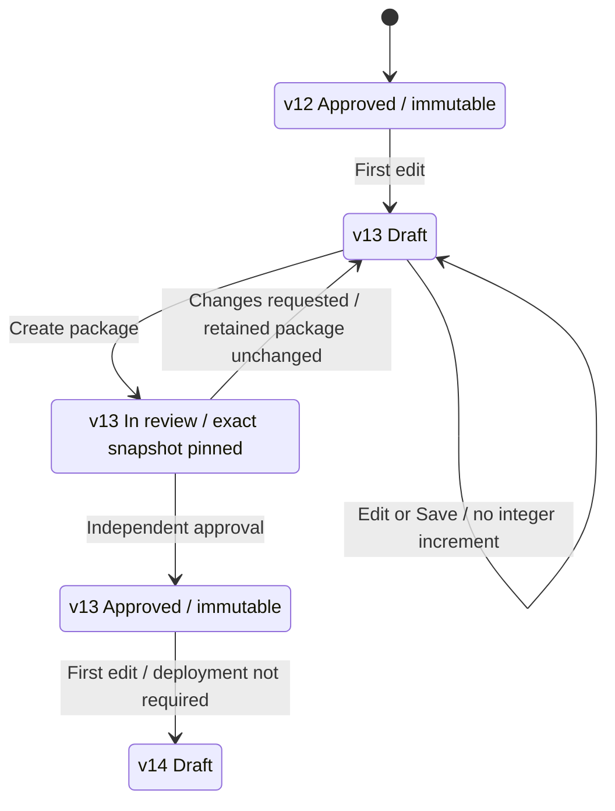

# ALEF design revision 04

**Historical design.** [Revision 05](REVISION-05.md) supersedes the parallel-package
and frozen-during-review rules below. This iteration remains available at
`iteration-04.html`; the current prototype uses one editable active package.

**Design only.** This is the isolated prototype at http://127.0.0.1:18821/.
No application/backend files, native models, permissions, approvals or deployment
records were changed. The prototype has no API client; reload resets its in-memory
fixtures. The generated editor and inspector remain captures of the actual editor.

## Visible root versions

Following the annotated feedback, integer versions appear in the compact model
header, not in the project tree or document tabs. Project labels are left-aligned
and use a restrained Segoe UI Variable Text font stack. The header also shows
**Draft**, **In review** or **Approved**. Lease
ownership and unsaved changes stay in a separate toolbar. The generated inspector
remains the sole Inspector content, beside Diagnostics in the bottom dock.

The initial illustration is a **v13 correction draft**, after changes were requested
on release #18 package 1. Use **Preview edit** in the design-study bar to simulate
an edit: this is explicitly a prototype control, not a replacement generated editor.
Save updates only the illustrative saved snapshot. Repeated edits and saves retain
v13. Package submission blocks further editing until changes are requested or the
package is approved. After approval, the next Preview edit starts v14.

## Proposed interpretation: version cycle versus immutable snapshot

This interpretation resolves the tension between corrections before approval and
packages that must never change. **Before approval, v13 names the open version
cycle, not a finalized content identity.** Within that cycle there can be multiple
draft snapshots. A package always pins a tuple:

`(stable root ID, integer version, immutable snapshot ID/content hash)`

For example, package 1 retains `(root-name, v13, draft-13.1)` forever. A correction
can produce package 2 containing `(root-name, v13, draft-13.4)`. The displayed
integer is still 13; neither package is mutable. Approval permanently binds
`(root-name, v13)` to exactly one snapshot. After that, different content requires
v14. This supersedes revision 03's example where correcting a candidate increased
its integer before approval.

The proposed `draft-13.x` identifiers are secondary evidence, shown in comparisons
and manifests. They are not alternate root version numbers and need not appear
beside every node in everyday editing. Actual implementation should use real,
retained immutable snapshot/content identifiers. Fixture IDs and shortened package
digests in this design are not cryptographic evidence.

Unchanged roots retain their current integers and exact snapshots. Finalized
versions can be reused by any number of future packages. Review metadata and
deployment status live outside package bytes. Revoking approval blocks new jobs
but does not unfinalize a root number or permit overwriting its contents.

Approval is sufficient to start the next root version. **Release** subsequently
marks the approved package available for distribution, without rebuilding it;
**Deploy** is a separate optional action. A package may remain approved and
undeployed indefinitely. Test and production outcomes never rewrite root versions.

## Multiple candidates containing the same root

The initial proposed policy is **one eligible snapshot per open root/version cycle**.
Multiple pending packages may include that same snapshot. They may not independently
finalize different contents under the same `(root ID, integer)` identity.

- A saved correction advances the eligible snapshot in the same version cycle.
  Pending candidates that pin older content become **Outdated** and cannot be
  approved. They remain retained for inspection; replacement requires fresh review.
- Approval must atomically check eligibility and finalize all newly approved root
  versions. An existing identical binding is acceptable. Any conflicting binding
  rejects the whole approval, rather than partially finalizing the package.
- A replacement package keeps every unaffected pinned root unchanged. It must not
  silently refresh unrelated roots from the workspace. In this fixture the active
  workspace is the explicitly isolated correction context; it is not a demonstration
  of resetting the application's shared live workspace to an old package.
- Save and submit must recheck the cycle generation, lease and finalized binding.
  A locally unsaved draft cannot overwrite content finalized by another review.
  Preserve it for an explicit comparison/rebase into the next permitted version.

The **Parallel name update** fixture shows an outdated package containing an earlier
v13 snapshot. It exposes a conflict explanation and no approval action. This is a
design simulation of the gate, not a multi-process concurrency implementation.

Suggested eventual governance records are a root-version cycle with an expected
generation and eligible/final snapshot, immutable snapshot records, package-to-root
manifest entries, and append-only decisions. The root-version reservation and
approval checks belong on the backend. Local UI state must not grant authority.

## Changes is a comparison workspace

Two selectors define **Compare** and **Against**. Compact **Before** and **After**
headers identify Against on the left and Compare on the right. The swap
control reverses both sides. Available fixtures include saved workspace, requested
packages, approved packages and two released baselines.

The project tree shows only differences and their containing model groups, including
deleted roots under their prior model. Markers distinguish **M** modified, **A** added,
**D** deleted, **R** renamed and an arrow for moved. Following the annotated feedback,
tree rows contain names and change markers only; version pairs and other secondary
details appear in the selected comparison pane. Managed resources have their own
group. Selection opens a read-only model
or resource diff. Side-by-side and unified modes use actual differences between
the selected fixture snapshots; choosing endpoints changes both tree and content.
The tree uses the same font, size and selected-row weight as Model. Each diff side
has a single-line header with its root version and source, rather than a stacked
metadata block. Long source labels truncate; the full source and immutable snapshot
identity are available in the header's tooltip and accessible label.

Saved workspace comparison is a retained snapshot, such as w43. **Unsaved local
edits are excluded.** Later saves do not silently refresh it. Refresh saved workspace
explicitly captures a newer saved revision. Refresh and Reset are available in the
compact **Comparison options** menu beside Swap; the explanatory strip below the
selectors has been removed. Package snapshots are always retained.
Review status labels may update, but snapshot content does not. Identical endpoints
produce a clear No changes state.

Package creation is available only in Releases. Changes has no Create package
button, and the model's correction context links to Releases instead of creating
a package directly.

The intended implementation filters both endpoints by current permissions before
constructing the tree, counts, diffs, paths or references. It must not reveal names
or identities of unauthorized roots from a baseline package. Permission loss
invalidates the view and requires reload. The prototype contains only illustrative
authorized data and does not implement identity or authorization.

Projectional model changes should eventually use generated read-only presentation
or a semantic tree view; raw file diffs remain available for relevant resources.
The fixture DSL lines are diagrammatic examples, not a new ALEF parser or a claim
that arbitrary MPS models can be represented faithfully as text diffs.

## Cleaner Releases layout

The compact list has a dedicated **Version** column, separate from the title,
review status, author, reviewer, update time and deployment state. The same version
is prominent beside the release detail title. Search and All / Needs review /
Approved / Released filters work in the prototype. Root integers (v13), release
versions (v1.4.0) and package revisions (1, 2, …) are distinct.

Creating a new release requires a unique major.minor.patch version. This retains
the existing fixture format as a design assumption, without asserting semantic
compatibility rules for each component. A correction keeps the release version
read-only and increments its package revision; all previous packages stay fixed.
The prototype checks version format and uniqueness in memory. Real enforcement
and persistent allocation remain backend responsibilities.

The detail screen has a short header and five tabs:
**Overview**, **Changes**, **Included roots**, **Checks**, **Activity / history**.
The Changes tab reuses the same comparison layout and gives the diff most space.
It now includes **Compare** and **Against** directly in the diff surface. Compare
selects a retained package revision of the open release; Against can select any
retained release package, including earlier candidates, approved packages and
released packages. Changing Against updates the tree and differences without
changing the release being reviewed. Each release remembers its selected baseline
for this session. The duplicate Package history selector is omitted on Changes;
it remains available on the other tabs. Both endpoints are immutable snapshots.
The reviewer rail was removed following the annotated feedback. Eligible packages
have a compact **Review…** header action for approval, requested changes and rejection.
Compare, version rules and revocation remain in the header's actions menu. Reviewer
identity is available in Overview, and scope/independence evidence belongs in Checks.
The root manifest shows both integer and snapshot; history can reopen any retained
package. Large workflow step bars, repeated immutability banners and summary cards
have been removed. Requested-change messages appear within the diff/editor rather
than in a page-wide banner. Version conflicts remain inspectable in Checks and the
header actions menu; approval still checks eligibility. **Approved · not deployed**
remains a separate release status.

This follows familiar pull-request review layout conventions without introducing
a separate pull-request object or integrating with Bitbucket. Independent reviewer
permissions, validation, approval/revocation and exact-package deployment remain
required backend responsibilities.

### Inline review discussions

Use the **+** in a diff line's gutter to add a comment. Threads appear directly
beneath that line and support replies, Resolve and Reopen. Both side-by-side and
unified modes retain discussions, including comments on unchanged before-side
lines. Draft text survives local rerenders; comments never alter model content.

Each thread is anchored to the reviewed package ID, the specific source package
on that diff side, root/resource identity, before/after side and fixture line.
Before-side comments disappear when another baseline is selected and return when
their original source is restored; after-side comments stay with the reviewed
package. A replacement package starts with its own discussions; earlier comments
remain accessible through Compare or Package history and are
not silently reattached to different content. Model integration should use stable
node IDs and editor-cell roles, with a fallback source-range anchor for resources,
rather than treating fixture line numbers as stable MPS identities.

The initial requested change is now the discussion beside the roepnaam difference.
New Request changes feedback asks for a changed root/resource and appears inside
that root's diff. A comparison with no changes must be changed before submitting
root-scoped feedback. The saved-workspace comparison also shows requested-change
context for its selected package/root. The representative correction editor shows
an expandable feedback card inside its canvas, with the original release/package
and an **Open discussion** link. This preserves the generated editor image and the
generated-inspector-only bottom panel. Mapping annotations to live generated cells
and other root editors remains proposed application work, not part of this prototype.

These are proposed review interactions, stored only in this page's memory and
reset by reload. The generated editing surface remains unchanged. Backend comment
storage, identity, access checks, notifications and concurrent discussions are not
implemented. Resolving a thread is separate from approving a package; whether open
threads must block approval remains a product policy decision.

## Environments and smaller screens

The existing multiple-environment design is retained: Integration, Regression and
Acceptance test targets, plus Production EU. Add environment and the type filters
remain available. Every stub outcome is labelled **SIMULATED**. The deployment
dialog lists released, unrevoked packages and independent target selections; it
submits no operations. The status table is a separate illustrative scenario and
does not invent successful installations when a review is approved.

On narrow screens the project panel becomes a drawer in Model. In Changes, the
changed-project list is a bounded panel above the diff, and code panels stack.
Release tabs and compact header actions wrap and the package selector gets its own
row. Inline threads wrap inside their diff column. Wide release lists and manifests scroll within their
containers. The inspector stays in the bottom panel.

## Existing features versus proposed additions

Relevant current application code was inspected read-only:

- `example/page.js` mounts the generated editor and inspector and handles panel
  sizing; the prototype preserves those surfaces through the earlier live captures.
- `example/backend-workflows.js` already exposes release submission, source/package
  digests, semantic before/after changes, resource diffs, manifests, provenance,
  validation evidence, independent decisions and simulated deployment controls.
- Its current inspection UI uses dialogs and disclosure sections. This study
  proposes a new layout around those capabilities.
- Approval-gated integer root version cycles, eligibility across multiple packages,
  isolated corrections and arbitrary workspace/package/release comparison selectors
  are **proposed behavior**, not claimed existing backend capabilities.

## Decisions still needing product agreement

The prototype proceeds with these explicit defaults; none blocked design work:

1. Before approval, the integer is a cycle label; immutable snapshot identity is
   the tuple described above. If the integer alone must identify immutable content
   from first submission, allowing corrections without incrementing it is incompatible.
2. There is one eligible draft content stream per root/version across packages.
   Independent divergent release branches would need a different version namespace
   or an explicit branching policy; this design does not silently allow them.
3. A rejected or withdrawn candidate does not finalize or consume the root number.
   Its open cycle can be corrected and resubmitted. Finalized numbers are never reused.
4. Root creation begins at v1. Deletion should retain a versioned tombstone and
   provenance; exact UX for restoring deleted roots remains to be specified.
5. Whole-workspace release review requires access to every included root. Whether
   to support segmented review by several scoped reviewers is a later policy choice.

## Browser verification

Verified against the served prototype in the in-app browser, not just source:

| Journey/check | Observed result |
| --- | --- |
| Save, edit again, Save | Root remains v13; saved snapshot changes |
| Submit replacement | Review package pins v13; edit and Save controls are disabled |
| Request changes, correct, Save, submit again | Root remains v13; new package and snapshot require approval |
| Inspect earlier package | Original v13/draft-13.1 remains; no current approval action |
| Conflicting parallel candidate | Outdated; no approval button; root conflict explanation present |
| Approve eligible package | v13 finalized; Approved / not deployed displayed |
| First edit after approval | v14 Draft appears without release/deployment |
| Workspace vs released baseline | Seven changed model/resource entries; no unchanged roots listed |
| Release 1.3.0 vs 1.2.0 | Two changed roots; v11 → v12 visible |
| Package 3 vs package 1 | Same v13, different fixed snapshots; correction diff shown |
| Retained workspace w43 after later saves | Still shows draft-13.2 until explicit refresh |
| Unified mode | Added/deleted lines shown in one read-only view |
| Release search and Approved filter | Matching release(s) only; clearing search restores list |

Desktop editor, comparisons and review were visually checked at 1440 × 960.
Model, Changes, the release list and an approved release were also checked at
390 × 844, each with document width 390 px. No browser console errors were observed.
The JavaScript syntax check passed. These are prototype interaction checks, not
authorization, native semantic compatibility or backend concurrency tests.

Screenshots: `revision-04-editor.jpg`, `revision-04-workspace-compare.jpg`,
`revision-04-release-compare.jpg`, `revision-04-package-compare.jpg`,
`revision-04-releases.jpg`, `revision-04-review.jpg`,
`revision-04-changes-requested.jpg`, `revision-04-approved-undeployed.jpg`,
`revision-04-version-lifecycle.jpg`, `revision-04-compare-narrow.jpg`,
`revision-04-editor-narrow.jpg`, and `revision-04-approved-narrow.jpg`.

The subsequent compact Changes refinement was checked at 878 × 791. Model and
Changes root rows both use Segoe UI Variable Text / Segoe UI, 12 px, weight 400
(600 selected), and a 37 px row height. The before/after header measures 30.8 px;
the explanatory strip is absent and there is no document horizontal overflow.
Refresh, Reset, Swap and changed-root selection were exercised in the served
prototype. `revision-04-changes-compact.jpg` records this latest layout.

Release version and discussion refinements were also verified against the served
prototype: a correction retains v1.4.0 while creating package revision 2; a new
release accepts v1.5.0 and rejects an already-used version. Posting, replying,
resolving and reopening inline threads worked. Unified mode retained a comment
on an unchanged Before line. Package revision 2 showed no inherited comments;
returning to revision 1 restored its discussions, with no approval action on the
historical package. The new Review header dialog approved the current package
and showed Approved / not deployed. The reviewer rail is absent. Comment rendering
and JavaScript syntax were rechecked after preserving discussion scroll position.
These remain local design simulations with no backend changes.

The subsequent in-release comparison refinement was verified with release 1.4.0
against both 1.3.0 and 1.2.0, and package revision 2 against revision 1 of the same
release. Changing the baseline changed the Before version (v12 to v11) without
changing the review subject. A Before-side comment disappeared on the other
baseline and returned on its original one; the After-side requested-change thread
remained attached to package 1. Identical endpoints showed No changes. Selecting an
earlier Compare package restored its feedback and exposed no Review action.
New requested-change feedback appeared inside the selected root's diff with no
page-wide warning. The representative correction editor and saved-workspace diff
both displayed the original package's feedback and reopened its discussion.
Latest captures: `revision-04-review-package-comparison.jpg` and
`revision-04-editor-feedback.jpg`.

| Visual | Open screenshot |
| --- | --- |
| Root version in the model header, contextual correction feedback | [Updated editor](revision-04-editor-feedback.jpg) |
| Workspace versus release package | [Compact workspace comparison](revision-04-changes-compact.jpg) |
| Released version versus released version | [Release comparison](revision-04-release-compare.jpg) |
| Two package snapshots in the same version cycle | [Package comparison](revision-04-package-compare.jpg) |
| Compact release list with explicit versions | [Releases](revision-04-release-versions.jpg) |
| Package comparison within review and contextual discussions | [Review](revision-04-review-package-comparison.jpg) |
| Requested changes | [Correction state](revision-04-changes-requested.jpg) |
| Approval without deployment | [Approved package](revision-04-approved-undeployed.jpg) |
| Proposed version lifecycle | [Version explanation](revision-04-version-lifecycle.jpg) |
| Narrow editor, comparison and approval | [Editor](revision-04-editor-narrow.jpg) · [Compare](revision-04-compare-narrow.jpg) · [Approval](revision-04-approved-narrow.jpg) |

Final regression checks also confirmed Inspector/Diagnostics tab switching and the
three test environments plus Production EU, with all stub statuses labelled SIMULATED.

## Files and local preview

The active entry is `index.html`, with `styles.css`, `revision-02.css`,
`revision-04.css`, `icons.js`, `prototype.js` and `design-04.js`. The last script
replaces review/comparison behavior while retaining the captured editor and
environment controls. Revision 03 remains intact in `iteration-03.html` with its
original scripts; earlier screenshots and documents are preserved.

The existing loopback server continues serving the files. If needed, run
`node preview-server.cjs` from this directory. No application build is required.
