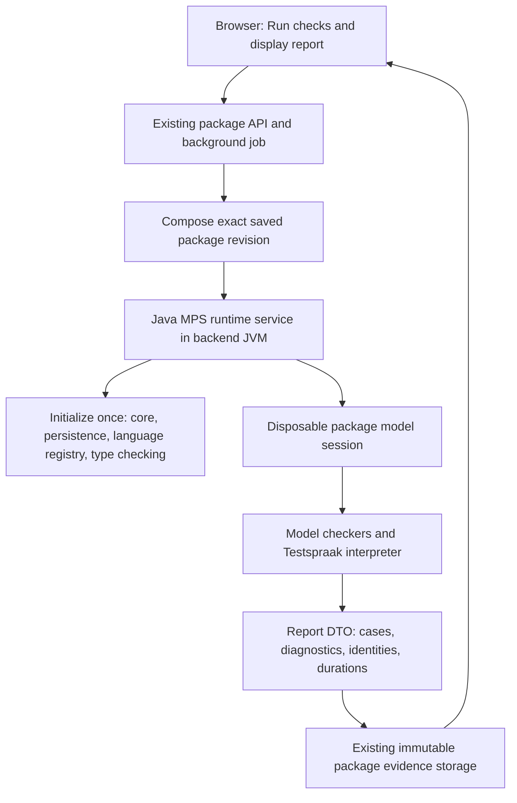

# Plan: run ALEF checks inside the Java backend

Research date: 29 September 2026. Implemented and locally activated 1 October 2026; see
[execution evidence](java-mps-runtime-implementation.md) for verified results and
the selected hard-timeout fallback. The proposal below is retained as the original
design and acceptance criteria.

## Recommendation

Embed a long-lived MPS Java runtime in the backend JVM, using the original MPS Java libraries, compiled ALEF languages and interpreter. Give it an explicit set of components and language modules, and run each package check in a disposable model session. Initialize the language runtime once, then load only the selected package models for each job.

This is feasible in principle and has a concrete starting point in the existing code. Kernel alone is insufficient. The substantial work is removing ALEF's desktop-project assumptions, preserving language/module loading, and managing global state safely across repeated jobs. Complete ALEF compatibility without the IDE has not yet been demonstrated.

Start with package validation and tests. Workspace saving and package comparison can adopt the same runtime after that migration passes its gates. Saving must continue to accept structurally representable, semantically invalid models; do not add package validation to the save path.

## What the investigation established

### The current worker starts considerably more than the interpreter

[RuntimeWorker.java](C:/Users/niekh/Documents/ChatGPT/ALEFBackend/alef-runtime-mps/src/main/java/nl/alef/backend/runtime/mps/RuntimeWorker.java:41) constructs `IdeaEnvironment`, enables automatic plugin discovery and creates a project. Its write helper uses `ApplicationManager.getApplication().invokeAndWait(...)`. [mps-runtime.py](C:/Users/niekh/Documents/ChatGPT/ALEFBackend/tools/mps-runtime.py:26) supplies the MPS distribution and discovers ALEF, JSON, MPS and extension plugins. [ReleaseBuilder.java](C:/Users/niekh/Documents/ChatGPT/ALEFBackend/alef-application/src/main/java/nl/alef/backend/application/ReleaseBuilder.java:28) starts and closes a worker for each package build.

Tests themselves invoke Testspraak behavior and the ALEF interpreter on MPS nodes. They do not require generating and compiling the user's service into Java first. Preserve that execution model.

### MPS supplies a Java bootstrap without the IDE application

The installed source archive contains `MpsEnvironment`, which initializes `PlatformFactory.initPlatform(PlatformOptionsBuilder.ALL)` and its own library/classloader support instead of starting `IdeaEnvironment`. The [official MPS implementation](https://github.com/JetBrains/MPS/blob/master/core/tool/environment/source_gen/jetbrains/mps/tool/environment/MpsEnvironment.java) also documents this path. The installed 2025.1 source and bytecode, rather than the current upstream branch, were inspected for this plan.

There are two useful stages:

1. Use the existing `MpsEnvironment` probe to establish correctness without an IntelliJ application.
2. Replace its broad `ALL` composition with a small Java backend bootstrap containing only the required services.

`ALL` also starts make, generator, find-usages and text-generation components. Merely replacing `IdeaEnvironment` with `MpsEnvironment` is therefore an intermediate compatibility step, not the final minimal runtime.

### A prior standalone probe identifies a real ALEF blocker

[The retained probe log](C:/Codex/alef-j2cl/out/backend-runtime-probe.log:11), from 24 September, shows successful registration of Regelspraak, Gegevensspraak, Servicespraak and Testspraak, and round-tripping 157 models containing 43,298 nodes. Semantic checking then repeatedly failed:

```text
MPSUtil.mpsProject()
  -> ApplicationManager.getApplication().isDispatchThread()
  -> NullPointerException: application is null
```

One concrete path is Servicespraak's `BerichtType.alleServices` behavior, invoked by a non-typesystem rule. [That behavior](C:/Codex/alef-j2cl/upstream-src/languages/servicespraak/source_gen/servicespraak/behavior/BerichtType__BehaviorDescriptor.java:151) requests an `MPSProject` to search services. Its no-project fallback explicitly searches a narrower set of models. Returning null or an empty project would hide the failure while potentially changing validation results. The Java implementation must search the correct package scope, including retained baseline roots and required dependencies.

This is historical diagnostic evidence, not a fresh successful run of the proposed runtime.

### The browser provides a composition pattern, not drop-in JVM binaries

[BrowserPlatform](C:/Codex/mps-j2cl/browser/src/jetbrains/mps/core/platform/BrowserPlatform.java:25) composes real `MPSCore`, `MPSTypechecking` and `MPSTypesystem` components. That is a useful model for the Java host.

However, its `registerCompiledLanguage` API is an addition in the browser's replacement `LanguageRegistry`, not an upstream JVM API. The browser also replaces reflection, translator discovery, model access and IntelliJ services. Do not put the browser compatibility implementations, JSInterop, WebAWT or the J2CL JRE on the backend classpath. Use ordinary JVM reflection, Java collections, concurrency, IO and time libraries.

## Required libraries and resources

The following is the starting dependency set, not a claim that the final transitive dependency list has already been proven. Source-project boundaries and distributed JAR boundaries differ: the installed `mps-core.jar` already contains several projects, including platform bootstrap and type-checking implementations.

| Layer | Java projects / components required | Purpose |
|---|---|---|
| Model foundation | `openapi`, `model`, `smodel`, `kernel`, `project`, `module`, `components`, `vfs`, utilities and logging | Real nodes, repositories, model access, identity, references, modules and classloaders |
| Language semantics | Behavior API/runtime, constraints runtime, language/concept/extension registries, feedback/message components | Concept inheritance, generated behavior dispatch, constraints and diagnostics |
| Persistence | XML model persistence and required model/data-source factories | Load saved model XML without changing node, model or module IDs |
| Type checking | `typechecking`, `typesystemEngine`, `project-check`, pattern runtime as required | Existing structure, constraints, typesystem and non-typesystem checks |
| Generated-language support | MPS core/smodel language support, collections, closures, tuples, references, annotations and any declared runtime dependencies | APIs used by generated ALEF classes |
| ALEF | Gegevensspraak, Regelspraak, Servicespraak, Testspraak, their transitive language dependencies, `interpreter.runtime`, `interpreter.debug`, translator runtime, standard functions and ALEF runtime helpers | Execute the same test semantics as today |
| Model resources | Standard models, language/module/deployment descriptors, and translator aspect models or an equivalent generated registry | Resolve built-in references and discover translator extensions correctly |
| Third-party support | Matching JVM libraries, including required JDOM, Trove, annotations and IntelliJ utility classes | Dependencies of the original MPS implementation |

The installed artifacts include `mps-openapi.jar`, `mps-core.jar`, `mps-persistence.jar`, behavior/constraints JARs and the ALEF language/interpreter JARs. [The inspection inventory](C:/Codex/alef-j2cl/out/java-mps-runtime-research/installed-runtime.json) records actual class ownership. For example, both `PathManager` and MPS's `org.jdom.Element` are supplied by `util-8.jar`; substituting arbitrary modern JDOM dependencies is not equivalent.

Use a reproducible extraction/publication task to expose the required, hash-pinned JARs and resources as Gradle dependencies. There is no need to rebuild all MPS Java projects before the first implementation. Initially preserve complete required JARs, even if some contain unused editor classes. Exclude IDE startup and plugin activation first; shrink packaged bytecode only after correctness is established.

If source-level separation is necessary, create a separate JVM build profile over pristine pinned MPS sources with explicit source selection and narrowly scoped adapters. The existing project inventory can help, but it is not the JVM dependency lock. `kernel`, `project` and `constraints-runtime` have source cycles; use an internal compilation group rather than pretending they are independent Java build targets.

No editor rendering, Swing editor lifecycle, IDE indexes, desktop actions, generator invocation or workbench application is required by the target package-test flow. Some utility or API classes may remain dependencies. Eliminating every `com.intellij` class is a separate, larger objective from eliminating the IntelliJ application.

## Target architecture



Expose a backend-owned interface such as `PackageModelRuntime.openSession(toolchain)`. A session needs model loading and graph/composition operations as well as `runChecks()`: `PackageComposer` currently uses the worker before `releaseEvidence` is called. Adapt that entire boundary rather than replacing only the last call.

Use one initialized runtime per backend instance, initially accepting one active package session at a time. Keep MPS objects inside the runtime layer and return DTOs or existing JSON structures to Spring. All model access runs through a dedicated executor and real MPS read/write access. Requests must not operate on `SNode` instances from arbitrary HTTP threads.

## Required adaptations

### 1. Explicit Java platform bootstrap

Create a small `JavaBackendPlatform` composition and lifecycle owner. Initialize core, persistence, type checking, legacy typesystem and the required validation/feedback components in dependency order; dispose them in reverse order. Preserve the existing strict checker list, including broken-reference checks.

There is a detail to prove in the bootstrap: `PlatformBase` wires `MPSCore`'s parent component host only on its `ALL` path. Calling `PERSISTENCE` followed by `install(typechecking)` does not automatically reproduce that wiring. Use a narrowly scoped bridge in `jetbrains.mps.core.platform`, analogous to `BrowserPlatform`, if the public API cannot expose the complete component host. Compile it against the pinned original classes with the same classloader; do not replace the kernel or assume split classloaders preserve package-private access.

Avoid `MpsEnvironment`'s global logging initialization in the final Spring-hosted implementation. Connect logging and diagnostics explicitly without replacing the backend's logging configuration.

### 2. Deterministic language and translator loading

Load an explicit manifest of required MPS/ALEF language modules with their IDs, dependency order, classloader ownership and resources. Prefer the original JVM library/module loading APIs for the first proof. Preserve the one-provider rule for every class and module ID; do not flatten all plugin JARs onto a single classpath.

[TranslatorExtensionsScope](C:/Codex/alef-j2cl/upstream-src/plugins/translator/solutions/translator.runtime/source_gen/translator/runtime/runtime/TranslatorExtensionsScope.java:40) uses registered language aspects, dependency scopes and translator models. A classpath containing translator classes alone is insufficient. Either retain these descriptors/models and initialize their extension registrations, or generate an explicit translator registry from the pinned language artifacts and prove equivalent selection and ordering. Prefer the original discovery behavior first.

### 3. Replace desktop project lookups with a runtime context

Introduce a context containing the active package repository, allowed model scope and diagnostic sink. Refactor reachable ALEF runtime queries to use that context instead of the active IDE project, selected editor, UI data context or event thread.

The known initial changes are the `MPSUtil` project lookup and Servicespraak service search. Inventory other reachable uses with dependency analysis and runtime traces. Keep adaptations separate from pristine generated sources, with exactly one provider for any adapted class. Prefer changes to shared runtime helpers or the source language definitions when practical, so regeneration cannot silently erase fixes. Never make a required checker silently return success to avoid an IDE dependency.

### 4. Separate execution results from editor debugging

Keep the current `ITestGeval` discovery and generated behavior invocation. Preserve expected-failure semantics, ignored/incomplete tests, per-case exceptions and unchanged-source checks.

[RuntimeController](C:/Codex/alef-j2cl/upstream-src/solutions/interpreter.runtime/source_gen/interpreter/runtime/RuntimeController.java:17) is a singleton and references temporary models and `MPSProject`. The existing `evalAsBool` path uses `NoExecutionTracer`, but those references still need auditing for class loading and initialization. Provide a server execution context or narrow runtime adapter for this path; do not initialize the editor debugger just to obtain a test result. Browser debug-node rendering remains a separate consumer.

### 5. Session cleanup, isolation and cancellation

One MPS environment per JVM is the documented environment contract, and ALEF has additional static state. For every session, register only that package's writable copies, use the exact baseline plus selected changes, and unregister/dispose them before another package reuses the same module IDs. Reset interpreter, translator and type-checking session state in `finally`, including after failed tests or exceptions. Standard models and language runtimes stay loaded and must not acquire job-owned mutations.

A persistent backend session cannot rely on `System.exit`, global stdout redirection or process teardown for cleanup. Remove those responsibilities from the reusable implementation. Do not embed the current worker `main()` unchanged.

The current process supervisor can kill a timed-out worker. `Future.cancel(true)` inside the backend cannot guarantee termination of interpreter code. Before enabling in-process execution, demonstrate cooperative deadline/cancellation checks in the interpreter's execution path, or explicitly keep a lightweight Java worker for jobs needing hard timeouts. That fallback can still use the same reduced Java libraries without MPS IDE startup or WSL. It is a deployment fallback, not the proposed default.

## Implementation sequence and acceptance gates

| Phase | Concrete work | Gate before proceeding |
|---|---|---|
| 1. Pin inputs and capture baseline | Record hashes for the current native libraries, ALEF code, extensions and standard models. Capture current native outcomes, diagnostics and cold/warm timing for retained fixtures. Inventory required classes/resources and desktop call sites. | Reproducible input lock and an explicit dependency/adapter list; no reliance on an arbitrary installed MPS directory. |
| 2. Prove execution without IDEA | Extend the existing standalone probe with the real package-check path. Repair the identified project-scope dependency and any reachable IDE assumptions. Use the original JVM language loading initially. | Same test outcomes and relevant diagnostics as the current worker, with no IntelliJ application started. Include cross-model services, not only the small Sportclub fixture. |
| 3. Build the reusable Java runtime | Add explicit component bootstrap, language manifest, runtime context and disposable sessions. Extract protocol-independent model loading/composition/check logic from `RuntimeWorker`. | Runs using only the declared Java distribution; missing languages/aspects fail clearly; no implicit IDE installation or plugin discovery. |
| 4. Integrate into the backend | Add Gradle runtime modules and a Spring lifecycle/executor service. Adapt `ReleaseBuilder`, `PackageComposer` and `ReleaseToolchain`. Keep the existing worker implementation as a parity oracle during migration. | The existing package UI receives the same report schema; revision, authorization, review invalidation and immutable evidence rules remain intact. Cancellation behavior is proven or a fallback is retained. |
| 5. Verify repeated use and reduce distribution | Exercise failure/correction/rerun, cleanup, concurrent requests and same-ID packages. Trim unused dependencies only with parity tests. Measure cold startup, warm runs, retained heap and artifact size. | No stale results, duplicate registrations, cross-package model visibility, unbounded retained sessions or validation omissions; demonstrated performance improvement on equivalent workloads. |
| 6. Retire the old package launcher | Select the Java runtime as the package-check implementation and publish the new runtime fingerprint. Test packaged startup on Windows and Linux without WSL. | Package checks no longer invoke Python, WSL or `IdeaEnvironment`; rollback to the previous implementation remains possible until acceptance. |

Proposed code ownership in `C:/Users/niekh/Documents/ChatGPT/ALEFBackend`:

- `alef-runtime-api`: runtime/session interfaces and backend-owned result types.
- `alef-runtime-java`: bootstrap, original MPS dependency set, model sessions, ALEF adapters and test execution.
- `alef-runtime-mps`: keep the current process implementation temporarily for comparison and fallback.
- `alef-application`: inject the runtime service at the release/composition boundary.
- `tools/prepare-java-runtime.py` or an equivalent Gradle task: assemble and verify the declared JVM runtime artifacts; replace broad distribution retention for new candidates.

These are proposed module names and files, not modules already created.

## Verification matrix

1. Reuse `NativeReleaseEvidenceTest`: five passing Sportclub cases; deliberately incorrect expected values; incomplete cases; correction followed by a clean rerun. Add an exception-producing case and verify that later cases still run.
2. Add fixtures for rule tests, input/output tests, expected-red behavior, ignored cases, cross-model services, translator extensions and built-in function/model references. Check every supported language profile identified by the dependency manifest.
3. Compare both implementations' test IDs, statuses and model diagnostics. Normalize timings and ordering only where they are non-semantic. Engine errors must never be reported as successful validation.
4. Preserve module/model/node IDs and references through XML load/serialize; assert that tests do not change persisted package inputs or standard models.
5. Alternate two packages with identical IDs but different contents, repeatedly failing and correcting tests. Verify disposal and cache invalidation after success, exceptions and cancellation, with a bounded memory soak run.
6. Submit simultaneous requests and prove serialization and correct job attribution. A queued job must never read another job's models or interpreter state.
7. Check actual backend execution and the served report UI. Java compilation alone does not prove compatibility. Keep the comparison editors mounted while checks complete.
8. Benchmark the same package and toolchain in both implementations: startup, language loading, model composition, validation, test execution and report storage separately. Record first-run and steady-state results; no speedup figure is promised before measurement.

## Version and scope decisions

Use the current ALEF revision `96dd99ff70cb88112e578088e2d4b70d6efc4327` and its MPS 2025.1 generation baseline for the first parity run. The sibling browser MPS source lock points to `d2589ed55bbc9445b660769fcc17da97e8e395a6`; do not assume its original source APIs match the installed 2025.1 binaries.

The installed distribution has different build markers: root `build.txt` and the current release lock say `MPS-251.23774.423`, while `lib/build.txt` says `MPS-251.23774.580`. This observation does not establish that the runtime is broken. Phase 1 must resolve artifact provenance and pin actual bytes instead of relying on a single version label.

Keep existing package artifacts and their toolchain fingerprints immutable. New checks under the Java runtime produce new evidence under a new fingerprint. Historical candidates that require a different toolchain must use a matching retained runtime or report that it is unavailable; they must not silently execute with the current embedded version.

The work removes IDE startup from backend checks. It does not move the browser editor into the server, rebuild the design preview, change the language semantics, or introduce generation/compilation of user services. A later source-built minimal MPS distribution is optional after the original-JAR implementation is proven.

## Expected result and remaining uncertainty

The intended steady-state flow is a normal Java call: load a small package into an already initialized runtime, validate it, execute Testspraak, collect the report and dispose the model session. This removes per-package WSL/JVM/IDE startup and broad plugin discovery from that path.

The exact final JAR closure, full ALEF desktop-call-site list, safe cancellation behavior and measured improvement remain implementation gates. The evidence supports this approach, but does not justify claiming the migration is already working or that it is only a dependency declaration change.

Research evidence is saved in [out/java-mps-runtime-research](C:/Codex/alef-j2cl/out/java-mps-runtime-research), including extracted installed sources, bootstrap bytecode inspection and class ownership. No application processes, packages, models or runtime configuration were changed while preparing this plan.
