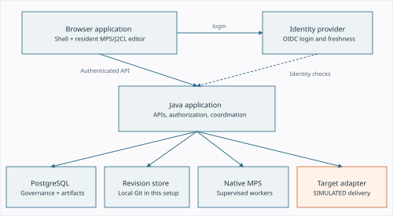
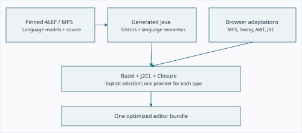
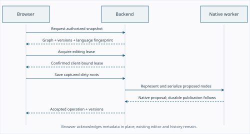
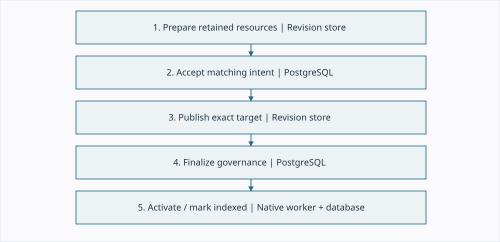
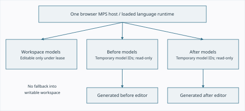
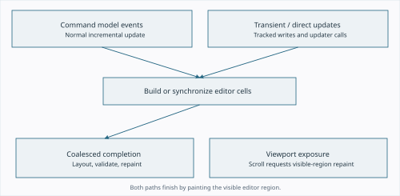
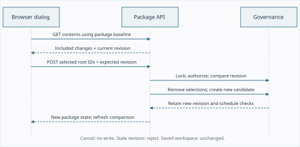
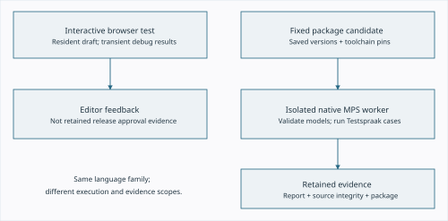
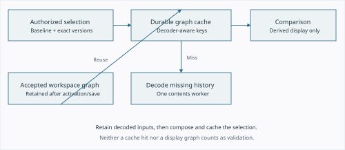
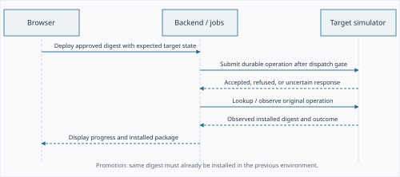

# ALEF in the browser

## Architecture, implementation and risk

**Technical paper | Implementation snapshot: 29 September 2026 | Version 1.0**

The ALEF application combines generated JetBrains MPS language editors in a browser with a Java backend for shared model persistence, access control, package review and governed deployment. Its central design choice is to keep editing, saving, checking, approving and deploying as separate operations, each with its own authority and failure conditions.

This paper explains the implemented system at three levels: system context, component and workflow design, and selected implementation details where correctness depends on identity, ordering or recovery. It includes the new ability to remove multiple changes from an open package. It is intended for engineers, architects and technical reviewers who need to understand what exists, why it behaves as it does, and what would need additional work before a production rollout.

### Abstract

The browser executes a selected MPS/ALEF Java runtime compiled through J2CL. Generated projectional editors operate on resident model nodes; a JavaScript application shell supplies navigation and workflows. The Spring-based backend owns authenticated commands, edit leases, immutable model revisions and PostgreSQL governance. Native MPS runs in supervised subprocesses for workspace model operations and package validation. Review candidates retain exact model selections, toolchain inputs and evidence. A durable deployment adapter currently simulates delivery; it does not execute the packaged business services.

The implementation addresses three recurring classes of failure: losing the distinction between a draft and a validated release, presenting stale editor pixels as current results, and confusing a failed request with an operation whose durable outcome is unknown. Remaining risks include native-runtime startup cost, compatibility maintenance across the browser port, single-writer availability, retained-data growth and the absence of a real execution-platform integration.

### Reading map

| Level | Sections | Main question |
| --- | --- | --- |
| High level | 1-3 | What runs where, and what is authoritative? |
| Workflow level | 4-6, 9, 11-13 | How do editing, packages, checks and delivery work? |
| Selected detail | 7-8, 10 | How are comparison, repaint and removal made correct? |
| Assessment | 14-17, Appendix A | What is established, what is risky, and what is next? |

**Status boundary.** This is an implementation analysis, not a production certification. Current source inspection, retained test reports and earlier local measurements are distinguished throughout. The proposed embedded Java MPS runtime is still a plan.

<!-- pagebreak -->
## 1. Scope, evidence and architectural position

The subject is the integrated application served locally on port 8080: Editor, Compare, Packaging, Deployment and Settings. The standalone editor demonstration and the archived design preview are related artifacts, but neither is the authority for current application behavior. The integrated editor has one visible root view; changing roots preserves in-memory drafts. Package Contents and Compare are read-only views. [S01, S02]

The application supports one configured shared workspace. The inspected local configuration selects a service-owned Git store on the shared `master` branch. PostgreSQL separately owns identities, authorization, leases, publication records, review decisions, jobs, artifacts and deployment state. The application also implements filesystem and PostgreSQL revision-store providers. The existence of those providers does not imply identical durability on every operating system or a distributed writer topology. [S11, S12, S20]

### Five architectural invariants

1. **A browser draft is not a published revision.** Editing changes resident nodes. Save explicitly publishes accepted content and advances version metadata.
2. **Saveability is not semantic validity.** A model can be saved when it can be represented safely as native nodes, even when rules, references or tests are incomplete. Package checks establish separate evidence.
3. **An approval refers to fixed evidence.** A package name or version label alone is insufficient. Candidate identity, package digest, selected versions and approval round matter.
4. **A displayed comparison must use its own versions.** Historical references must not silently resolve into newer writable workspace models.
5. **An uncertain outcome must be reconciled.** Retrying a write with a new identity after a lost response can duplicate effects or invalidate recovery. [S03-S09, S13-S17]

### Method and limitations

The analysis inspected browser integration code, Java editor bridges, backend services, storage configuration, native worker code, tests and implementation notes. Appendix A identifies those sources; `source-index.json` records their paths, line counts and SHA-256 hashes. Source hashes describe the inspected files, not a claim that every possible deployment contains those exact bytes.

Some early README passages still describe HTTP integration and the runtime as future work. Current controllers, worker supervision and publication coordination demonstrate that these parts are now implemented. Where older prose and current code differ, this paper follows the code and the later, feature-specific implementation records.

No package, model or deployment was changed to prepare this paper. No new full-system benchmark or penetration test was performed. Risks below are engineering assessments of the inspected design; they are not statistically estimated incident probabilities.

<!-- pagebreak -->
## 2. System context: execution and authority



**Figure 1.** The browser, application JVM and native workers are distinct execution environments. The deployment target shown here is the implemented simulator.

The browser holds the editable projection and transient test/debug presentation. It cannot establish permission merely by enabling a button. Authenticated backend services recheck access and command preconditions. The identity provider establishes the login identity; application permissions remain an application concern. [S02, S10]

The backend provides a synchronized workspace command boundary and supervises a native worker. That worker owns native MPS objects and serialization. PostgreSQL transactions protect governance changes, while the model store retains immutable model resources. Publication coordination joins these durability boundaries through retained operation evidence and recovery; it does not rely on a single transaction spanning all of them. [S03, S04, S11]

Package preparation uses an isolated native worker over selected saved versions. It must not evaluate an arbitrary browser draft or the latest workspace in place of those versions. Derived display contents have a separate durable cache and are not approval evidence. [S13, S16, S18]

The native worker's environment is restricted to an allowlist of operating-system bootstrap variables. Database, identity-provider and deployment credentials are not forwarded through that environment. This reduces accidental exposure, but a subprocess under the same operating-system account is not a complete sandbox against hostile executable code. [S11]

### Responsibility map

| Component | Owns | Does not establish |
| --- | --- | --- |
| Browser | Draft nodes, editor state, view selection, transient results | Durable acceptance or authorization |
| Java application | Commands, recovery, API projections, workflow rules | Real external execution without an adapter |
| PostgreSQL | Governance, artifacts, jobs, audit and permissions | Native language correctness by storage alone |
| Revision store | Retained model bytes and publication evidence | Reviewer eligibility or lease validity |
| Native MPS worker | Model operations and language evaluation | Authentication or business approval |


## 3. Components and build composition



**Figure 2.** The browser build selects generated language aspects and explicit compatibility layers. The backend uses original JVM artifacts in a separate runtime configuration.

The pinned ALEF source commit is `96dd99ff70cb88112e578088e2d4b70d6efc4327`. The source lock identifies MPS 2025.1, MPS extensions 2025.1.3226.9d3d593, Bazel 8.3.1 and J2CL 20260402. These are this project's declared inputs, not statements about the latest available releases. [S19]

Generated Gegevensspraak, Regelspraak, Servicespraak and Testspraak aspects supply structure, behavior, constraints, type systems, intentions and editors. J2CL compiles the selected Java code to JavaScript. Closure produces the optimized browser bundle. Compatibility layers supply browser implementations of required platform services, Swing and AWT behavior. Static translator bindings replace selected discovery/reflection paths that the browser profile cannot execute directly. [S19, S21]

The project keeps upstream inputs distinct from generated source copies and browser adaptations. Scripts reproduce changes to selected MPS/editor classes; source-audit tooling checks ownership and duplicate providers. This boundary matters because an arbitrary second definition of a class or module can produce incorrect dispatch or registration failures. Rebuilding upstream and then manually patching output would make fixes harder to reproduce.

### Application composition

| Area | Principal implementation |
| --- | --- |
| Web shell and package workflows | `interface.js`, `interface-ui.js`, `interface.css` |
| Backend editing integration | `backend.js`, `BackendModelBridge`, `saved-workspace.js` |
| MPS host and generated editor lifecycle | `AlefEditorApp`, `BrowserEditorHost`, inspector/navigation bridges |
| Compare | `model-diff.js`, `mps-diff.js`, `BrowserComparisonSession`, `BrowserComparisonEditor` |
| Backend application | Spring Boot 4.1.1 dependency platform; Java 21 toolchain |
| Persistence and governance | Workspace-store providers and PostgreSQL repositories |
| Native execution | `WorkerSupervisor`, `RuntimeWorker`, release toolchain configuration |

The integrated application serves a prepared set of assets from `out/backend-web`, with hashes in `out/backend-browser-artifacts.json`. Editing a source file is not by itself proof that the running application serves it. Release verification must check the served bytes as well as compilation. [S19, S22]


## 4. Identity, concurrency and access control

Several identities coexist, and they must not be collapsed into names or paths. A package can retain an older version of a root whose current display name has changed. Two historical comparison models can legitimately contain the same persisted node ID. An editing client is also distinct from the person who logged in. [S02-S05]

| Identity | Meaning and use |
| --- | --- |
| Principal and person | Login/account identity versus the human behind aliases; reviewer independence uses person identity |
| Editing client | Browser editing session that owns leases; another tab is not automatically the owner |
| Model and node reference | Qualified technical identity used by MPS and reference resolution |
| Governance root UUID | Stable root identity used for permissions, versions and package membership |
| Root version and model-context digest | Accepted content version and its surrounding model/import context |
| Workspace revision | Retained publication of the complete workspace resources |
| Package, candidate, digest, review round | Logical package, fixed preparation, retained bytes and current approval assignment |
| Operation ID | Retry/recovery identity for a side-effecting command |

### Authentication and authorization

Spring Security implements OIDC login with PKCE, server-side session CSRF protection and API authentication failures. Session freshness checks local account state on API access, bounds provider-state freshness to approximately 60 seconds and enforces an eight-hour absolute session. The implemented provider strategy requires token introspection; an unavailable or incompatible provider cannot simply be treated as authenticated. Authorized-client credentials are retained server-side. [S10]

The UI reads permission-derived capabilities such as `canEdit`, `canReview` and `canDeploy`. These improve usability but do not replace checks in service methods and database transactions. Package editing requires its author and Submit permission. Review requires an assigned, independent, authorized human reviewer. Deployment requires the existing Deploy permission for the applicable scope. [S05, S17]

### Leases and structural operations

An editing lease is a renewable, time-bounded proof tied to an owner, editing client, scope and generation. The ordinary root edit path uses root scope. Structural changes, such as root creation or model-import changes, can require a model lease. Backend checks combine these proofs with expected root versions and model-context digests. This is stronger than a cosmetic lock icon. [S03]

The browser also applies read-only policy to editor cells, input-method text insertion, actions and undo/redo. Unlocked content remains selectable. Model-level mutation guards and backend checks remain necessary even when normal typing is blocked. A client clock or a delayed UI update cannot be the final authorization authority. [S02, S04, S23]


## 5. Workspace loading and the editing loop



**Figure 3.** The loop keeps the resident editor alive. A successful Save updates bookkeeping after durable acceptance; it does not reopen the workspace.

The backend starts or recovers its native workspace, indexes roots and builds an authorized graph projection. Snapshot responses include revision, language fingerprint, policy epoch, an expiry and checksummed download metadata. The inspected implementation returns one graph chunk; this is not an incremental, on-demand model loader. Snapshot capacity and worker frame limits are explicit, so large-workspace behavior needs separate measurement. [S03, S11]

`BackendModelBridge` reconstructs resident MPS models, preserving concept, node and reference identities. Required standard models are loaded read-only. The browser must finish preparing the usable graph before ordinary synchronous MPS editor behavior can traverse it. A network fetch hidden inside a node getter would violate that execution model. [S04]

Project-tree selection changes the single visible editor root. Drafts remain in the workspace even when their root is not currently visible. A successful lock acquisition enables editing; releasing a lock updates project status immediately from the confirmed lease response. Slower status requests are ordered so that an older response cannot restore a released lock icon. [S01, S02]

Save captures dirty roots with expected versions, model-context proofs, lease tokens, a snapshot base and an operation identity. While its outcome is pending, overlapping saves are prevented. On confirmation, `savedWorkspace` compares the submitted snapshots with accepted content and updates version/context metadata without replacing MPS nodes. `BackendModelBridge.acknowledgeSave` verifies submitted snapshots before clearing dirty markers. [S02, S04, S06]

Unexpected accepted content, relocation or conflicting changes require explicit refresh/reconciliation. The application must not silently clear a draft just because the HTTP request succeeded. Remote-change handling can freeze editing and offer a comparison of the original, local draft and current accepted content. Rebuilding against a refreshed base may clear old undo history; that is a different operation from an ordinary Save.

**Persistence boundary.** Resident drafts and debug state are not a durable offline editing system. Reload, authentication recovery and tab loss must be treated as potential draft-loss events unless a verified draft-recovery path applies. The operation identifier retained for uncertain saves is not a general backup of all unsaved model content.


## 6. Save publication and recovery



**Figure 4.** The numbered boundaries correspond to `PublicationCoordinator`. Normal activation can reuse the worker proposal; recovery loads retained committed content. [S03, S07]

The backend verifies the caller, editing client, language fingerprint, submitted scope, leases, expected root versions and model context. It asks the native worker to represent the proposed nodes and serialize the resulting persistence units. Representability checks remain mandatory; semantic validation is deliberately absent from this normal Save path.

The revision store first retains the exact prepared resources and attribution without advancing the published head. PostgreSQL then accepts the matching publication intent. The coordinator publishes the retained target, finalizes governance, activates the native projection and marks the indexed revision ready. These stages are ordered, but they do not form one cross-system ACID transaction.

| Interruption point | Required behavior |
| --- | --- |
| Prepared bytes, no accepted intent | No new accepted workspace head; inspect the operation before assuming acceptance |
| Accepted intent, publication incomplete | Retain the reservation and finish that exact operation during recovery |
| Store published, governance incomplete | Confirm retained target and finalize the existing intent |
| Governance finalized, runtime inactive | Reload or activate the committed revision before accepting further edits |
| Response lost after completion | Resolve the original operation; do not invent a second save identity |

`PublicationCoordinator.verify` compares operation ID, expected/target revisions, request digest, actor and contributors. Recovery must not regenerate an accepted proposal using a newer toolchain or silently attribute it to the recovering process. A mismatched or unexplained store head stops readiness and requires maintenance reconciliation. [S07]

The application deliberately has one writer. An application-level PostgreSQL advisory lock prevents a second writer from opening the workspace, and synchronized services serialize commands within the JVM. Loss of writer ownership closes readiness. There is no automatic high-availability takeover protocol. A future active/passive or multi-writer design requires explicit fencing of storage and workers, not just another application instance. [S11, S12]


## 7. Read-only MPS comparison



**Figure 5.** Temporary comparison models are isolated from the writable workspace and from each other. Switching roots replaces views while retaining the loaded comparison models. [S08]

Both selectors on Compare can select saved workspace or available package content. Package Contents compares the current package with its baseline or another available retained version. The project view uses the same reusable tree component as the editor. Comparison is always side by side; the former change-navigation/layout toolbar has been removed. [S01, S08]

The application downloads authorized before/after graphs and creates two temporary sets of read-only models inside the existing MPS host. Model identities are remapped per comparison side; persisted node IDs are retained. Cross-model references are rebound within their version. Missing historical models must remain unresolved rather than resolving into newer workspace models. Shared read-only language dependencies may be supplied from the loaded runtime. This does not provide historical language-runtime switching.

### Two-stage difference calculation

First, `modelChanges` matches nodes by identity and compares concepts, properties, references, containment roles and sibling ordering. A changed reference target can be important even when its displayed name is identical. Second, the generated MPS editors produce actual label cells. The painter pairs labels using node identity, cell ID, role and occurrence, then aligns rendered text. This keeps the review notation consistent with the editor instead of reducing the model to a generic JSON diff. [S08, S09]

Added text is green, removed text red, and unchanged text neutral. Pure property changes can highlight only the changed text. Structural changes, changed reference identity or unmatched cells can require whole-label highlighting. Whitespace is removed from highlight ranges, including spacing-only cells, so layout gaps are not presented as content changes.

The text alignment operates on Unicode code points and returns UTF-16 offsets for the rendered labels. It bounds the dynamic-programming work: when the unmatched middle exceeds one million pair comparisons, it highlights the remaining changed span instead of allocating an unbounded alignment matrix. This is a deliberate performance/precision trade-off. [S09]

**Residual risk.** A rendered diff explains identity and presentation differences; it is not proof of semantic equivalence. Derived labels, ambiguous repeated cells, very large labels and language-version drift require targeted regression coverage. Disposal must remove temporary models and views without corrupting workspace history.


## 8. Editor updates: nodes, cells and pixels



**Figure 6.** There are two refresh paths. Model changes update cells; scrolling also has to repaint newly exposed pixels even when the cells are already correct.

The missing failed-test cross exposed an important layering issue: model correctness, generated-cell correctness and canvas correctness are distinct. A mouse click that makes a result appear does not imply the test was rerun. It may simply trigger painting that should already have happened. [S23]

Normal MPS command events feed the editor updater. ALEF test execution also changes transient result state and node user objects, and some runtime changes occur inside write actions without a normal editing command. Earlier direct updater calls could construct new cells without completing layout, component validation and repaint. The browser adaptation queues and coalesces that completion work and observes changes on the models tracked by the editor. Disposed editors ignore queued work.

A later, narrower reproduction found another issue: an individual test finished while its result was below the visible viewport. The result cells were current, but scrolling exposed stale canvas pixels. The Swing viewport compatibility implementation now repaints the newly visible region for native scrolling and programmatic view-position changes. The regression checks the actual red pixels without a compensating mouse click or resize. [S23]

### Font metrics are part of correctness

Changing editor fonts initially produced overlapping table text because the compatibility layer rounded character widths individually. Measuring the complete text run using fractional browser metrics, then rounding once, aligned cell geometry with actual painting. The same metrics affect cursor hit testing. CSS alone could not fix a mismatch inside the generated editor's layout calculations. [S23]

### Design consequence

The preferred remedy is at the common update or viewport boundary, not a full workspace reload after every test. Reloading would hide lifecycle defects, lose state and add latency. A useful regression must verify the observable artifact: removal of old pixels, appearance of new failure markers, preserved clipping and unchanged persistent model nodes. A callback firing or a changed Java object is insufficient evidence of a refreshed editor.


## 9. Package composition and review semantics

A package is a baseline plus an explicit selection of saved root versions. It is not a branch containing the entire latest workspace, and it is not just a list of names. Unchanged baseline roots remain part of the composed package. An included deletion removes a baseline root from the result. Selected changes and final composed contents are consequently different sets. [S05, S13]

```text
B = retained baseline: root identity -> saved version
C = selected changes: root identity -> saved version or deletion
P = copy(B)
for each change in C:
    deletion -> remove its root from P
    otherwise -> replace/add its root in P
```

The composer retains native resources and required model context, not just displayed properties. It checks that selection does not unexpectedly change unselected baseline roots. Model imports and managed resources therefore matter even when the visible model is small. [S13]

| Example root | Baseline | Selected change | Package result after removal of that change |
| --- | --- | --- | --- |
| Object model | Version A | Modified version B | Version A restored |
| Input mapping | Absent | Added version C | Mapping absent from this package |
| Old service | Version D | Deletion | Version D restored |
| Rule group | Version E | No selected change | Version E stays; it is not a removable change |

Changed roots linked to open packages follow subsequent saved versions. An unchanged root inherited from the baseline does not automatically become a selected change when edited in the workspace. Historical selected versions remain pinned. This separates an author's current work from content already selected for a package. Removing a selection also ends that change's linkage for the package. [S05]

### Candidate and metadata changes

Changing content creates a new candidate and new checks; old approvals do not authorize the new content. Changing reviewer assignments advances the optimistic package revision and approval round, but retains the candidate, contents, package digest and test report. It requires fresh approvals without starting tests again. Explicitly rerunning checks creates new immutable evidence and also requires fresh approvals. [S05, S14]

The author finalizes only when current checks succeed, linked updates are settled, reviewers are assigned and all required independent approvals match the current evidence. Finalization makes package contents immutable. Approval independence is checked through person identity and contributors, preventing an account alias from serving as its own independent reviewer.

A separate Delete package operation removes a never-deployed package from the catalog through an immutable deletion record. It retains workspace content, artifacts and historical evidence. Current or past successful deployment, or an active/unreconciled delivery, blocks deletion. Removing a change is not package deletion. [S15]


## 10. Detailed example: removing package changes



**Figure 7.** The selection is always relative to the package's own baseline, regardless of the comparison selector. Nothing is removed while the dialog is merely open.

The package header exposes **Remove changes...** for an editable, unfinalized package. Its dialog loads the current `/contents` response and lists only roots marked `includedChange`. Search, select-filtered, clear and individual checkboxes support batch removal. The selected root's **Remove change** button opens the same dialog with that root preselected. [S01]

The fresh response supplies `revision`. This matters because package metadata can change after the page was opened. Once the user selects changes, the submitted revision stays fixed. If another operation changes the package in the meantime, the backend rejects the stale command rather than silently applying the old selection to a new state.

```json
POST /api/v1/packages/{packageId}/changes
Idempotency-Key: <operation UUID>
{
  "expectedRevision": 9,
  "versions": [],
  "removeRootIds": ["<root UUID>", "<another root UUID>"]
}
```

`PackageService.change` removes these identities from the selected-change map, then calls the normal revision/composition path. It requires Review access plus the author's Submit authority, an open package and the expected revision. Removing a modification restores its baseline version; removing an addition excludes it; removing a deletion restores the baseline root. No workspace save or root deletion is issued. [S05]

The package is rerendered after a successful content mutation, because its comparison models have changed. Editor membership status is refreshed too. This differs from reviewer-only updates, which retain the existing comparison session. Cancel and load failure make no mutation. A stale-revision error leaves the dialog selection and existing comparison available for recovery.

### Boundaries worth making explicit

- Only explicit changes can be removed. An inherited unchanged baseline root is not a selected change.
- The backend rejects a composition with zero roots. Removing every selected change is valid when the retained baseline still supplies content.
- Removing a referenced addition may leave remaining package content invalid. New checks must report this; removal does not promise to repair dependencies automatically.
- Finalized packages cannot be edited through this control or by calling the endpoint directly.

The browser regression covers batch selection, packaged deletions, baseline restoration, stale revisions, cancellation, load failure, re-add availability and read-only packages. The live verification inspected four removable changes in the open package and cancelled the dialog; it did not remove user content. [S24]


## 11. Package checks and native runtime execution



**Figure 8.** Browser feedback helps the author edit. The retained package report comes from the native worker over the fixed package selection.

The browser can execute generated Testspraak/ALEF behavior against resident models and display transient debugging information. Those results are useful during editing, but are not the retained approval evidence. The Checks panel reports validation and tests performed on the package's exact saved content by the backend release workflow. [S14, S16]

`ReleaseBuilder` retains and verifies the pinned toolchain inputs, composes the fixed package, starts a native worker, calls `releaseEvidence` and closes the worker. The current `RuntimeWorker` bootstraps `IdeaEnvironment`, automatic plugin discovery and an MPS project. It is a native JVM process using considerably more infrastructure than just the interpreter. A small user model therefore does not imply a cheap cold check. [S11, S16]

`releaseEvidence` runs strict model validation and discovers the Testspraak `ITestGeval` interface. It evaluates individual cases through generated behavior, resetting the runtime controller and creating fresh run parameters. A case is recorded as PASSED, FAILED, ERROR or SKIPPED. Ignored/incomplete cases are not counted as successes, and an exception in one case is recorded while remaining cases continue. It compares serialized persisted inputs before and after execution. [S16]

The current pass predicate requires no engine failures, no error diagnostics, unchanged persisted source and every discovered case to pass. A preparation failure before execution is presented as tests not having run, not as a failed assertion. With no discovered cases, the per-case condition is vacuously satisfied; a product rule requiring a minimum test count would need an additional explicit gate.

The built archive includes source resources, validation report, semantic/resource changes, provenance and a dependency lock. Its manifest advertises `alef-source-package/v1`, `SOURCE_MODEL_SIMULATION` and no requested executable generation contract. Deterministic archive ordering and fixed ZIP timestamps support stable retained bytes for fixed inputs. This does not claim that a whole build across changed candidate metadata must produce the same package digest. [S16]

**Operational lesson.** Worker bytecode and dependency pins must be updated together through the toolchain preparation flow. An earlier preparation failure was caused by worker files no longer matching their retained hashes. Disabling the pin would hide a provenance violation rather than solve it. [S14]


## 12. Package loading, caching and latency



**Figure 9.** Derived contents are reusable across reviewer changes and backend restarts. An uncached historical revision may still require a native decode.

Package viewing originally suffered from a small in-memory cache keyed too closely to candidates. A cache miss started an isolated MPS process, so reviewer changes and restarts could impose startup cost on a tiny model. `PackageContentsStore` now stores checksummed, chunked derived graphs as artifacts and records durable cache mappings. Workspace activation and Save retain the already decoded committed graph. [S18]

A selection key covers the decoder/toolchain fingerprint, view-format version, baseline digest and ordered root identities, versions, storage revisions, locations and deletion state. Candidate IDs, reviewers, tags and approval state are excluded because they do not define model content. Root order remains significant to context selection. Returned revision metadata is adapted to the requesting candidate without mutating the retained graph.

Stored graphs are composed without starting a contents worker. For missing historical inputs, one separate worker decodes the needed sources and retains them. Only those native misses are serialized; unrelated cached reads are not queued behind them. Authorization and candidate checks occur around the potentially slow loading step, and cached data has no public unauthenticated access path. [S05, S18]

| Recorded local measurement, 29 September | Observed result |
| --- | --- |
| Isolated empty native-worker startup | About 11.6 seconds |
| First migration of older uncached package content | 13,295 ms contents request |
| Subsequent stored reads | 52 and 54 ms |
| Stored reads after backend restart | 186, 137 and 135 ms |
| Click to native editor, warm / after restart | 253 / 378 ms |

These figures are retained local measurements from `docs/package-contents-cache.md`, not a benchmark rerun for this paper or a service-level objective. Network conditions, workspace size, active jobs, browser warm-up and hardware affect end-to-end latency.

Cache correctness depends on complete keys, integrity checks and invalidation. A cached graph is display material only: it cannot satisfy checks or approval merely because it exists. Decoder changes intentionally invalidate reuse. The cache adds storage growth and backup considerations; it does not remove the distinct startup cost of the active workspace or a new release-check worker.


## 13. Deployment and promotion



**Figure 10.** The implemented adapter is durable and simulated. Acceptance and observed completion are separate events.

The Deployment tab lists an ordered environment path and exposes deploy/promote controls according to existing Deploy permission and package eligibility. A package must be finalized and its candidate approved and unrevoked. Promotion preserves the same retained digest and requires successful delivery of that exact package to the preceding environment. An environment can impose additional approval or test-delivery requirements. [S17]

The command binds target, package digest, expected installed digest and configuration version. Before dispatch, the service rechecks permissions, approval, retained artifacts/dependencies and environment ordering. These checks prevent a browser selection made earlier from authorizing a deployment against changed configuration or a different installation state.

`ExecutionPlatformAdapter` separates submission, lookup, observation and cancellation. Its contract distinguishes an explicit refusal from an uncertain result after possible target acceptance. The durable simulator stores operations and supports idempotent lookup across restart. A lost response is reconciled using the original identity; it is not safely handled by blindly creating a new deployment. [S17]

The application distinguishes desired, delivery and observed states. A dispatched request is not proof of installation. The installed digest advances from observed successful delivery. Governance records and adapter-owned state must agree. An earlier local inconsistency between those records caused refusal, illustrating why clearing only one side during maintenance is unsafe.

### What deployment currently delivers

The target records simulated delivery of a retained source-model package. It does not publish a SOAP/REST service, execute ALEF requests, provision infrastructure or demonstrate a production rollback of running business services. These are material product boundaries, not merely missing presentation polish. [S16, S17]

A real adapter would need a versioned executable/runtime contract, artifact acceptance and verification, authentication and secret handling, idempotent submission/lookup, installed-digest observation, timeouts, cancellation/rollback semantics and reconciliation after process/network failure. Those behaviors must be tested against the actual execution platform before removing the simulated label.


<!-- pagebreak -->

## 14. Risk assessment: correctness and security

The priorities below are qualitative. **High** indicates a release-blocking consequence or a large integrity/security exposure if the stated condition occurs. **Medium** indicates a meaningful operational or review defect with a more contained impact. Existing controls reduce risk; they do not establish zero residual risk.

| Risk / priority | Existing controls | Residual exposure and recommended gate |
| --- | --- | --- |
| Cross-store divergence after failure / High | Retained intent, exact-target publication, recovery and readiness gate | Failure injection and a complete restore rehearsal must cover store, governance and native activation together |
| Unauthorized or stale write / High | Server-side permissions, client-bound leases, generations, expected root/context versions | Test lease expiry, revoked access, structural edits and uncertain responses together; UI controls alone are insufficient |
| Browser/native semantic drift / High | Pinned language inputs, explicit port overlays, language and native tests | Representative parity is not exhaustive equivalence; maintain a shared conformance corpus before language upgrades |
| Wrong historical reference resolution / High | Per-side model identity remapping; no writable-workspace fallback | Compare with missing dependencies, repeated IDs and changed runtime descriptors; historical runtime switching is absent |
| Approval of unintended content / High | Fixed candidates/digests, independent reviewers, review rounds, invalidation after content changes | Verify dependency/context changes and linked-save behavior; reviewer-only metadata must not reset test execution |
| Excess runtime privilege / High | Worker environment allowlist and process boundary | Same-account native execution is not a security sandbox; define the trust model for model authors and language extensions |
| Identity/session failure / High | OIDC, PKCE, CSRF, encrypted server-side credentials, freshness checks | Production issuer, TLS, secrets, introspection availability and account lifecycle require operational validation |
| Misleading test success / Medium | Explicit FAILED/ERROR/SKIPPED states; source-unchanged check | Define policy for zero tests and test coverage; passing selected examples is not business correctness |

### Trust boundaries

Model input is untrusted data to the API and native serializer. Package metadata, reviewer comments and error text must be rendered safely. Browser fixtures include report escaping checks, but this paper is not an injection or authorization audit. Likewise, a checksummed artifact proves identity/integrity of retained bytes, not that the bytes contain safe or correct business logic.

Local development uses simplified test accounts and loopback services. That convenience configuration must not become a production credential or transport policy. The paper intentionally does not reproduce passwords, session tokens or client secrets.


<!-- pagebreak -->

## 15. Risk assessment: operations and maintainability

| Risk / priority | Existing controls | Residual exposure and recommended gate |
| --- | --- | --- |
| Single-writer outage / High | Exclusive writer ownership; fail-closed readiness | No automatic takeover; publish and rehearse an operator recovery procedure before availability promises |
| Real deployment capability missing / High | UI and manifest identify simulation | Delivery records are not service execution; accept a real adapter only after end-to-end platform tests |
| Runtime cold-start latency / Medium | Durable contents cache; resident workspace worker | Package checks still start an isolated worker; measure queued and cold paths separately |
| Large graph / memory pressure / Medium | Snapshot/frame capacity limits; bounded text diff | Full graph loading and duplicated comparison graphs need scale tests, not extrapolation from the six-root example |
| Stale or missing editor pixels / Medium | Coalesced editor completion; viewport repaint; pixel regressions | Test offscreen results, disposal, zoom/DPI and browser variations; a resized screenshot can mask the bug |
| Toolchain/overlay maintenance / High | Source lock, ownership audit, generated adapters, hash pins | Regeneration can expose platform assumptions; upgrades need native and optimized-browser compatibility gates |
| Retention growth / Medium | Immutable revisions/artifacts and catalog tombstones | Deletion does not reclaim history; define quotas, backup cost and a dependency-aware retention policy |
| Documentation drift / Medium | Feature-specific notes and this source index | Early READMEs are stale; maintain one current operational/architecture entry point |
| Package removal surprises / Medium | Baseline-relative selection, revision guard, new checks | Restored baseline references may conflict with remaining selections; explain errors and verify dependency-sensitive cases |

### Backup and restore are system-level operations

A complete backup must retain model history and prepared publication evidence together with PostgreSQL governance/artifacts, configuration, migration receipts where used and protected cryptographic material. Restoring only the latest model files loses review provenance and can leave the governance head inconsistent. Storage migration preserves logical revision identities through receipts rather than rewriting old approval evidence. [S20]

Deletion is deliberately conservative. Catalog-deleted packages retain evidence, existing dependent baselines remain readable, and previously deployed packages remain protected. This is useful for traceability but creates a long-term storage-management obligation. Automatic garbage collection must understand package baselines, retained toolchains, active jobs and publication recovery before removing bytes.

### Observability priorities

Correlate browser command IDs, publication IDs, candidate IDs and job IDs in diagnostics. Measure snapshot loading, native startup, graph decode, comparison mount, check execution and target observation separately. Distinguish preparation failure, failed business test and unknown delivery outcome. A single generic failure message loses the information an operator needs to recover safely.


<!-- pagebreak -->

## 16. Verification and what the evidence establishes

Verification must follow the execution boundary. Java compilation cannot establish canvas repaint behavior; a browser fixture cannot establish durable PostgreSQL/Git recovery; a simulator cannot establish real platform delivery. The available suites are complementary. [S22-S25]

| Boundary | Evidence inspected | What it establishes / limit |
| --- | --- | --- |
| Interface workflows | `test_interface.mjs`, package-removal fixture | Selection, permissions, state retention, stale revisions, cancellation and rendered controls; API behavior is fixtured |
| Running removal UI | Live verification immediately before this paper | Served button, four eligible changes, disabled submission without selection, finalized read-only state; zero removal writes |
| Package governance | Retained `PackageWorkflowTest` report | 30 tests, zero failures/errors; timestamp 29 September 2026, 17:07:56 UTC |
| Delivery recovery | Retained `DeploymentRecoveryTest` report | 8 tests, zero failures/errors; same date, 17:07:37 UTC; simulator boundary |
| Native package evidence | Native test and implementation records | Passing/failing/incomplete cases and source preservation on isolated fixtures; historical execution evidence |
| MPS editing and rendering | Save, lease, comparison, update, debug and text-layout suites | Real generated-editor behavior and targeted pixel/layout contracts; browser coverage varies by suite |
| Artifact publication | Browser asset manifest and served-byte verification | The last installed interface asset matched its source; not a complete deployment attestation |

The backend test reports above were retained outputs inspected for this paper. The preceding validation command found the unchanged backend tasks up to date; it did not rerun all backend tests. The package-removal browser suite and authenticated read-only live verification did run during that feature change. No new production-load, security, disaster-recovery or broad cross-browser campaign was run while writing this document.

### Acceptance scenarios for continued development

1. Kill a save at every publication boundary and recover the same target without duplication or attribution changes.
2. Edit under a lease, lose it, receive a remote change and preserve the draft until explicit reconciliation.
3. Compare overlapping node/model IDs and confirm that references stay within the selected historical version.
4. Run an individual failing test below the viewport, scroll and observe failure pixels without clicking or resizing.
5. Remove modified, added and deleted selections; preserve workspace content; reject a stale or finalized mutation.
6. Change reviewers without rechecking tests; change content and require new checks and approvals.
7. Lose a target submission response and recover by identity; refuse promotion when the preceding digest differs.

These scenarios should remain durable regression contracts as implementations are optimized. Performance improvements that bypass these conditions would change the correctness model rather than simply make it faster.


<!-- pagebreak -->

## 17. Evolution path and engineering priorities

### Current implementation versus the paused runtime plan

The current server uses supervised native MPS workers with `IdeaEnvironment`. The separate saved plan proposes embedding a long-lived MPS Java runtime in the backend JVM, with explicitly composed services and disposable package model sessions. That migration has not been implemented. Browser compatibility classes, WebAWT and J2CL JRE replacements are not JVM runtime libraries to copy into Spring. [S26]

Kernel libraries alone are insufficient. The proposed host also needs repository/model access, persistence, module/classloader services, language and concept registries, behavior/constraints, type checking, ALEF interpreter/translators, standard models and the matching third-party dependencies. A previous probe found desktop-project assumptions in validation, including `MPSUtil` and service lookup. Returning an empty project would hide the exception while changing semantics.

The first proof should execute the same package corpus and compare reports, source preservation and reference behavior with the current worker. Initialize one runtime, allow one package session at a time initially, dispose all job-owned models, and audit static state before considering concurrency. A runaway in-process test has a different failure-isolation profile from a killable subprocess; lower startup latency is not the only design criterion.

### Suggested order of work

| Priority | Work item | Exit evidence |
| --- | --- | --- |
| 1 | Consolidate current architecture, runbooks and source/asset records | One reproducible deployment description; removed stale status claims |
| 2 | Rehearse failure recovery and complete backup/restore | Matching store/governance heads and retained package evidence after restore |
| 3 | Establish a shared browser/native conformance corpus | Same intended model/test behavior across both runtime profiles |
| 4 | Measure scale and latency by phase | Cold/warm and concurrent results with reproducible fixtures and resource limits |
| 5 | Prove the embedded Java runtime in isolation | Compatible reports, no persisted-input mutation, complete session cleanup |
| 6 | Implement a real execution-platform adapter | Verified artifact execution, observed digest, retries, reconciliation and rollback contract |

The first four items strengthen the existing system without presuming a new runtime architecture. The last two are independent product milestones: embedding MPS does not by itself make deployment real, and a real target adapter does not eliminate browser/native compatibility risk.

The architecture already has useful boundaries for this evolution: the worker protocol, provider-neutral revision store, immutable package evidence and execution-platform adapter. Their value depends on preserving their contracts while replacing internals, and verifying observable results at each boundary.

<!-- pagebreak -->
## Appendix A. Source index and reproducibility

All references below point to local implementation or retained evidence inspected on 29 September 2026. No external literature claims are needed to establish the described code paths. The companion `source-index.json` records absolute paths and full file hashes. The diagram source and PDF builder are retained alongside this Markdown file.

**Repository aliases:** F = `C:/Codex/alef-j2cl`; B = `C:/Users/niekh/Documents/ChatGPT/ALEFBackend`. In backend Java paths below, `application/` expands to `alef-application/src/main/java/nl/alef/backend/application/`.

### Sources S01-S13

| ID | Source and relevant responsibility |
| --- | --- |
| S01 | F: `example/interface.js` - package pages, removal dialog, reviewer updates, routing and status |
| S02 | F: `example/backend.js` - authenticated loading, leases, editing clients, save and reconciliation |
| S03 | B: `application/WorkspaceService.java` - authorized snapshots, representable saves and runtime activation |
| S04 | F: `example/BackendModelBridge.java` - graph reconstruction, temporary identities, guards and acknowledgement |
| S05 | B: `application/PackageService.java` - selection, revision checks, reviewers, finalization and deletion |
| S06 | F: `example/saved-workspace.js` - accepted-save bookkeeping without model replacement |
| S07 | B: `application/PublicationCoordinator.java` - retained publication and recovery boundaries |
| S08 | F: `example/BrowserComparisonSession.java`, `example/model-diff.js`, `example/mps-diff.js` - versioned comparison |
| S09 | F: `example/BrowserComparisonEditor.java`, `example/ComparisonTextDiff.java` - generated cell pairing and text highlights |
| S10 | B: `application/SecurityConfiguration.java`, `SessionFreshness.java`, `DurableAuthorizedClients.java`, `SessionCipher.java` - identity and sessions |
| S11 | B: `application/WorkerSupervisor.java`, `WorkspaceConfiguration.java` - worker process boundary and writer ownership |
| S12 | B: `alef-workspace-store/.../RevisionStore.java`, `application/ModelStoreConfiguration.java`, `tools/local-environment.ps1` - provider contract and local Git selection |
| S13 | B: `application/PackageComposer.java`, `ReleaseBuilder.java` - exact-version composition and retained artifacts |

The local configuration is referenced only for non-secret storage selection. Its content and hash are deliberately excluded from the shareable source manifest because it also contains local secret configuration.

<!-- pagebreak -->
## Appendix A. Source index, continued

### Sources S14-S26

| ID | Source and relevant responsibility |
| --- | --- |
| S14 | F: `docs/package-test-report.md`, `example/package-checks.js` - report semantics and reviewer/check separation |
| S15 | F: `docs/package-deletion.md`; B: `application/PackageService.java` - tombstone and deployed-package safeguards |
| S16 | B: `alef-runtime-mps/.../RuntimeWorker.java`, `application/ReleaseBuilder.java`, `ReleaseToolchain.java` - native checks, pins and source-package format |
| S17 | B: `application/DeploymentService.java`, `ExecutionPlatformAdapter.java`, `DurableStubAdapter.java` - governed simulated delivery |
| S18 | B: `application/PackageContentsStore.java`, `PackageContents.java`; F: `docs/package-contents-cache.md` - durable graph cache and historical measurements |
| S19 | F: `source-lock.json`, `BUILD.bazel`, `README.md`; B: `alef-application/build.gradle` - pinned inputs and component selection |
| S20 | B: `docs/running-the-application.md` - operational configuration, providers and complete backup/restore |
| S21 | F: `tools/prepare.py`, `tools/adapt_translators.py`, `mps-access.json` - source preparation and explicit browser adaptation |
| S22 | F: `out/backend-browser-artifacts.json`, `tools/package_backend_browser.py` - installed assets and packaging |
| S23 | F: `docs/editor-refresh-investigation.md`, `docs/design/IMPLEMENTATION-23.md`, `tools/adapt_editor_updates.py`, `tools/adapt_tables.py`, `tools/adapt_backend_guard.py` - updates, metrics and read-only input |
| S24 | F: `tools/test_interface.mjs`, `test_package_change_removal.mjs`, `verify_package_change_removal_live.mjs` - latest removal verification |
| S25 | B: retained JUnit XML for `PackageWorkflowTest` and `DeploymentRecoveryTest`; F: `tools/test_debug_results.mjs`, `test_editor_updates.mjs`, `test_mps_text_layout.mjs`, `test_mps_diff_live.mjs`, `test_save_without_reload.mjs`, `test_editor_locks.mjs` - verification boundaries |
| S26 | F: `docs/java-mps-runtime-plan.md` - separate, paused embedded-runtime proposal |

### Reproduction and maintenance

The editable paper is `docs/technical-paper/ALEF-technical-paper.md`. Its vector diagrams are generated by `build_paper.py`; the script creates the PDF, SVG illustrations and source index. Run it using a Python environment with ReportLab. The paper uses installed Arial, Georgia and Consolas fonts for this Windows build. Generated PDF checks use pypdf and Poppler; rendering success alone is not a substitute for visual inspection.

The optimized editor asset identified in the installed manifest at inspection time has SHA-256 `297a4014a1e8e634adfc521b895621c21e913325b1516287fa559f6845ea0525`. The latest workflow asset has SHA-256 `be2e045a8e31abfcca76f71b238a01714d34800ad894e4354374f91c3fd9db5a`. These identify the referenced local publication and are not universal ALEF version identifiers.

The saved design preview remains under `docs/design/archive/`. The embedded Java runtime proposal remains separate and unexecuted. Future revisions of this paper should update the source index, evidence dates and status boundaries together, rather than replacing historical test results with undated success claims.
