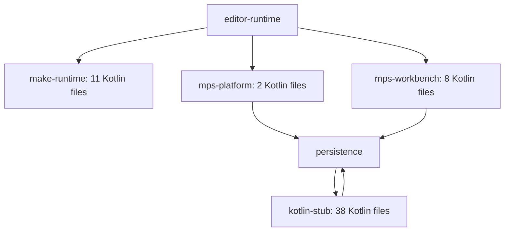

# Kotlin sources and editor dependencies

Implementation is paused. This list describes the pinned upstream production source graph; it does not mean these projects have already been ported.

MPS revision: `d2589ed55bbc9445b660769fcc17da97e8e395a6`. There are 59 production Kotlin files in four projects. No Kotlin files occur in the editor API and type-engine foundation checkpoint.

**Kotlin files**

**kotlin-stub — 38 files**

- [source/jetbrains/mps/kotlin/stubs/IFileUtil.kt](C:/Codex/mps-j2cl/mps/core/kotlin-stub/source/jetbrains/mps/kotlin/stubs/IFileUtil.kt)
- [source/jetbrains/mps/kotlin/stubs/extension/annotations.kt](C:/Codex/mps-j2cl/mps/core/kotlin-stub/source/jetbrains/mps/kotlin/stubs/extension/annotations.kt)
- [source/jetbrains/mps/kotlin/stubs/extension/sourceFile.kt](C:/Codex/mps-j2cl/mps/core/kotlin-stub/source/jetbrains/mps/kotlin/stubs/extension/sourceFile.kt)
- [source/jetbrains/mps/kotlin/stubs/loading/KotlinPackageModelId.kt](C:/Codex/mps-j2cl/mps/core/kotlin-stub/source/jetbrains/mps/kotlin/stubs/loading/KotlinPackageModelId.kt)
- [source/jetbrains/mps/kotlin/stubs/loading/KotlinStubModelDescriptor.kt](C:/Codex/mps-j2cl/mps/core/kotlin-stub/source/jetbrains/mps/kotlin/stubs/loading/KotlinStubModelDescriptor.kt)
- [source/jetbrains/mps/kotlin/stubs/loading/KotlinStubModelRoot.kt](C:/Codex/mps-j2cl/mps/core/kotlin-stub/source/jetbrains/mps/kotlin/stubs/loading/KotlinStubModelRoot.kt)
- [source/jetbrains/mps/kotlin/stubs/loading/KotlinStubModelRootFactory.kt](C:/Codex/mps-j2cl/mps/core/kotlin-stub/source/jetbrains/mps/kotlin/stubs/loading/KotlinStubModelRootFactory.kt)
- [source/jetbrains/mps/kotlin/stubs/loading/NodeIdHandler.kt](C:/Codex/mps-j2cl/mps/core/kotlin-stub/source/jetbrains/mps/kotlin/stubs/loading/NodeIdHandler.kt)
- [source/jetbrains/mps/kotlin/stubs/loading/component/KotlinComponent.kt](C:/Codex/mps-j2cl/mps/core/kotlin-stub/source/jetbrains/mps/kotlin/stubs/loading/component/KotlinComponent.kt)
- [source/jetbrains/mps/kotlin/stubs/loading/component/KotlinStubModelProducer.kt](C:/Codex/mps-j2cl/mps/core/kotlin-stub/source/jetbrains/mps/kotlin/stubs/loading/component/KotlinStubModelProducer.kt)
- [source/jetbrains/mps/kotlin/stubs/loading/component/PackageScopeControlUtil.kt](C:/Codex/mps-j2cl/mps/core/kotlin-stub/source/jetbrains/mps/kotlin/stubs/loading/component/PackageScopeControlUtil.kt)
- [source/jetbrains/mps/kotlin/stubs/loading/component/detection/ComponentScanner.kt](C:/Codex/mps-j2cl/mps/core/kotlin-stub/source/jetbrains/mps/kotlin/stubs/loading/component/detection/ComponentScanner.kt)
- [source/jetbrains/mps/kotlin/stubs/loading/component/detection/findKotlinComponent.kt](C:/Codex/mps-j2cl/mps/core/kotlin-stub/source/jetbrains/mps/kotlin/stubs/loading/component/detection/findKotlinComponent.kt)
- [source/jetbrains/mps/kotlin/stubs/loading/component/impl/CommonComponent.kt](C:/Codex/mps-j2cl/mps/core/kotlin-stub/source/jetbrains/mps/kotlin/stubs/loading/component/impl/CommonComponent.kt)
- [source/jetbrains/mps/kotlin/stubs/loading/component/impl/JvmComponent.kt](C:/Codex/mps-j2cl/mps/core/kotlin-stub/source/jetbrains/mps/kotlin/stubs/loading/component/impl/JvmComponent.kt)
- [source/jetbrains/mps/kotlin/stubs/loading/component/impl/KLibComponent.kt](C:/Codex/mps-j2cl/mps/core/kotlin-stub/source/jetbrains/mps/kotlin/stubs/loading/component/impl/KLibComponent.kt)
- [source/jetbrains/mps/kotlin/stubs/loading/ids/FunctionIdBuilder.kt](C:/Codex/mps-j2cl/mps/core/kotlin-stub/source/jetbrains/mps/kotlin/stubs/loading/ids/FunctionIdBuilder.kt)
- [source/jetbrains/mps/kotlin/stubs/loading/ids/KotlinId.kt](C:/Codex/mps-j2cl/mps/core/kotlin-stub/source/jetbrains/mps/kotlin/stubs/loading/ids/KotlinId.kt)
- [source/jetbrains/mps/kotlin/stubs/loading/ids/TypeParameterIdSection.kt](C:/Codex/mps-j2cl/mps/core/kotlin-stub/source/jetbrains/mps/kotlin/stubs/loading/ids/TypeParameterIdSection.kt)
- [source/jetbrains/mps/kotlin/stubs/loading/ids/migration/KotlinStringBasedNodeIdMap.kt](C:/Codex/mps-j2cl/mps/core/kotlin-stub/source/jetbrains/mps/kotlin/stubs/loading/ids/migration/KotlinStringBasedNodeIdMap.kt)
- [source/jetbrains/mps/kotlin/stubs/loading/ids/migration/KtFunctionNodeId.kt](C:/Codex/mps-j2cl/mps/core/kotlin-stub/source/jetbrains/mps/kotlin/stubs/loading/ids/migration/KtFunctionNodeId.kt)
- [source/jetbrains/mps/kotlin/stubs/loading/kind/KotlinCommonModelKind.kt](C:/Codex/mps-j2cl/mps/core/kotlin-stub/source/jetbrains/mps/kotlin/stubs/loading/kind/KotlinCommonModelKind.kt)
- [source/jetbrains/mps/kotlin/stubs/loading/kind/KotlinJvmModelKind.kt](C:/Codex/mps-j2cl/mps/core/kotlin-stub/source/jetbrains/mps/kotlin/stubs/loading/kind/KotlinJvmModelKind.kt)
- [source/jetbrains/mps/kotlin/stubs/loading/kind/KotlinModelKind.kt](C:/Codex/mps-j2cl/mps/core/kotlin-stub/source/jetbrains/mps/kotlin/stubs/loading/kind/KotlinModelKind.kt)
- [source/jetbrains/mps/kotlin/stubs/loading/references/KtReferenceResolver.kt](C:/Codex/mps-j2cl/mps/core/kotlin-stub/source/jetbrains/mps/kotlin/stubs/loading/references/KtReferenceResolver.kt)
- [source/jetbrains/mps/kotlin/stubs/loading/signature/SignatureMask.kt](C:/Codex/mps-j2cl/mps/core/kotlin-stub/source/jetbrains/mps/kotlin/stubs/loading/signature/SignatureMask.kt)
- [source/jetbrains/mps/kotlin/stubs/loading/signature/Signatures.kt](C:/Codex/mps-j2cl/mps/core/kotlin-stub/source/jetbrains/mps/kotlin/stubs/loading/signature/Signatures.kt)
- [source/jetbrains/mps/kotlin/stubs/metadata/jvm/JvmDescriptorParser.kt](C:/Codex/mps-j2cl/mps/core/kotlin-stub/source/jetbrains/mps/kotlin/stubs/metadata/jvm/JvmDescriptorParser.kt)
- [source/jetbrains/mps/kotlin/stubs/metadata/metadataReader.kt](C:/Codex/mps-j2cl/mps/core/kotlin-stub/source/jetbrains/mps/kotlin/stubs/metadata/metadataReader.kt)
- [source/jetbrains/mps/kotlin/stubs/metadata/metadataUtils.kt](C:/Codex/mps-j2cl/mps/core/kotlin-stub/source/jetbrains/mps/kotlin/stubs/metadata/metadataUtils.kt)
- [source/jetbrains/mps/kotlin/stubs/metadata/metadataVersion.kt](C:/Codex/mps-j2cl/mps/core/kotlin-stub/source/jetbrains/mps/kotlin/stubs/metadata/metadataVersion.kt)
- [source/jetbrains/mps/kotlin/stubs/platform/SimplePlatform.kt](C:/Codex/mps-j2cl/mps/core/kotlin-stub/source/jetbrains/mps/kotlin/stubs/platform/SimplePlatform.kt)
- [source/jetbrains/mps/kotlin/stubs/platform/TargetPlatform.kt](C:/Codex/mps-j2cl/mps/core/kotlin-stub/source/jetbrains/mps/kotlin/stubs/platform/TargetPlatform.kt)
- [source/jetbrains/mps/kotlin/stubs/platform/fileExtensions.kt](C:/Codex/mps-j2cl/mps/core/kotlin-stub/source/jetbrains/mps/kotlin/stubs/platform/fileExtensions.kt)
- [source/jetbrains/mps/kotlin/stubs/platform/stubRoot/ClassRoot.kt](C:/Codex/mps-j2cl/mps/core/kotlin-stub/source/jetbrains/mps/kotlin/stubs/platform/stubRoot/ClassRoot.kt)
- [source/jetbrains/mps/kotlin/stubs/platform/stubRoot/PackageRoot.kt](C:/Codex/mps-j2cl/mps/core/kotlin-stub/source/jetbrains/mps/kotlin/stubs/platform/stubRoot/PackageRoot.kt)
- [source/jetbrains/mps/kotlin/stubs/platform/stubRoot/StubRoot.kt](C:/Codex/mps-j2cl/mps/core/kotlin-stub/source/jetbrains/mps/kotlin/stubs/platform/stubRoot/StubRoot.kt)
- [source/jetbrains/mps/persistence/kotlin/KotlinClassesPersistence.kt](C:/Codex/mps-j2cl/mps/core/kotlin-stub/source/jetbrains/mps/persistence/kotlin/KotlinClassesPersistence.kt)

Direct project dependencies: `closures-runtime`, `collections-runtime`, `components`, `java-stub`, `kernel`, `openapi`, `persistence`.

External library declarations: `KotlinCoreLibs`, `KotlinJavaRuntime`, `gnu.trove`, `objectweb.asm`.

**make-runtime — 11 files**

- [source/jetbrains/mps/make/kotlin/JvmKotlinCompilerRunner.kt](C:/Codex/mps-j2cl/mps/core/make-runtime/source/jetbrains/mps/make/kotlin/JvmKotlinCompilerRunner.kt)
- [source/jetbrains/mps/make/kotlin/KotlinBuildFileSerialization.kt](C:/Codex/mps-j2cl/mps/core/make-runtime/source/jetbrains/mps/make/kotlin/KotlinBuildFileSerialization.kt)
- [source/jetbrains/mps/make/kotlin/KotlinCompilationOutput.kt](C:/Codex/mps-j2cl/mps/core/make-runtime/source/jetbrains/mps/make/kotlin/KotlinCompilationOutput.kt)
- [source/jetbrains/mps/make/kotlin/KotlinCompilationOutputCollector.kt](C:/Codex/mps-j2cl/mps/core/make-runtime/source/jetbrains/mps/make/kotlin/KotlinCompilationOutputCollector.kt)
- [source/jetbrains/mps/make/kotlin/KotlinCompilerOptions.kt](C:/Codex/mps-j2cl/mps/core/make-runtime/source/jetbrains/mps/make/kotlin/KotlinCompilerOptions.kt)
- [source/jetbrains/mps/make/kotlin/KotlinCompilerRunner.kt](C:/Codex/mps-j2cl/mps/core/make-runtime/source/jetbrains/mps/make/kotlin/KotlinCompilerRunner.kt)
- [source/jetbrains/mps/make/kotlin/KotlinModule.kt](C:/Codex/mps-j2cl/mps/core/make-runtime/source/jetbrains/mps/make/kotlin/KotlinModule.kt)
- [source/jetbrains/mps/make/kotlin/LogUtil.kt](C:/Codex/mps-j2cl/mps/core/make-runtime/source/jetbrains/mps/make/kotlin/LogUtil.kt)
- [source/jetbrains/mps/make/kotlin/messages/CompilerMessageSeverity.kt](C:/Codex/mps-j2cl/mps/core/make-runtime/source/jetbrains/mps/make/kotlin/messages/CompilerMessageSeverity.kt)
- [source/jetbrains/mps/make/kotlin/messages/CompilerMessageSourceLocation.kt](C:/Codex/mps-j2cl/mps/core/make-runtime/source/jetbrains/mps/make/kotlin/messages/CompilerMessageSourceLocation.kt)
- [source/jetbrains/mps/make/kotlin/messages/MessageCollector.kt](C:/Codex/mps-j2cl/mps/core/make-runtime/source/jetbrains/mps/make/kotlin/messages/MessageCollector.kt)

Direct project dependencies: `closures-runtime`, `collections-runtime`, `generator-engine`, `kernel`, `kernel-resources`, `tuples-runtime`.

External library declarations: `KotlinCoreLibs`, `javac2`, `objectweb.asm`, `org.jdom`.

**mps-platform — 2 files**

- [source/jetbrains/mps/ide/util/MPSProjectActivity.kt](C:/Codex/mps-j2cl/mps/workbench/mps-platform/source/jetbrains/mps/ide/util/MPSProjectActivity.kt)
- [source/jetbrains/mps/ide/util/PlatformStarter.kt](C:/Codex/mps-j2cl/mps/workbench/mps-platform/source/jetbrains/mps/ide/util/PlatformStarter.kt)

Direct project dependencies: `ant-mps-common`, `baseLanguage-search`, `closures-runtime`, `collections-runtime`, `editing-runtime`, `editor-api`, `environment`, `findUsages-runtime`, `generator-engine`, `java-stub`, `kernel`, `kernel-resources`, `make-runtime`, `mps-icons`, `persistence`, `platform`, `resources_en`, `tuples-runtime`, `vfs-tracking`.

External library declarations: `Idea-platform`, `gnu.trove`, `google.gson`, `objectweb.asm`.

**mps-workbench — 8 files**

- [source/jetbrains/mps/ide/ui/FindTextInModelDialogHeader.kt](C:/Codex/mps-j2cl/mps/workbench/mps-workbench/source/jetbrains/mps/ide/ui/FindTextInModelDialogHeader.kt)
- [source/jetbrains/mps/ide/whatsnew/MPSWhatsNewInVisionContentProvider.kt](C:/Codex/mps-j2cl/mps/workbench/mps-workbench/source/jetbrains/mps/ide/whatsnew/MPSWhatsNewInVisionContentProvider.kt)
- [source/jetbrains/mps/intellij/integration/MPSRecentProjectsManagerBase.kt](C:/Codex/mps-j2cl/mps/workbench/mps-workbench/source/jetbrains/mps/intellij/integration/MPSRecentProjectsManagerBase.kt)
- [source/jetbrains/mps/plugins/MPSApplicationInitializedListener.kt](C:/Codex/mps-j2cl/mps/workbench/mps-workbench/source/jetbrains/mps/plugins/MPSApplicationInitializedListener.kt)
- [source/jetbrains/mps/plugins/applicationplugins/GroupAdjuster.kt](C:/Codex/mps-j2cl/mps/workbench/mps-workbench/source/jetbrains/mps/plugins/applicationplugins/GroupAdjuster.kt)
- [source/jetbrains/mps/workbench/actions/OpenMPSProjectTrustProjectHelper.kt](C:/Codex/mps-j2cl/mps/workbench/mps-workbench/source/jetbrains/mps/workbench/actions/OpenMPSProjectTrustProjectHelper.kt)
- [source/jetbrains/mps/workbench/actions/whatsnew/WhatsNewProjectWizard.kt](C:/Codex/mps-j2cl/mps/workbench/mps-workbench/source/jetbrains/mps/workbench/actions/whatsnew/WhatsNewProjectWizard.kt)
- [source/jetbrains/mps/workbench/actions/whatsnew/WhatsNewShowProjectView.kt](C:/Codex/mps-j2cl/mps/workbench/mps-workbench/source/jetbrains/mps/workbench/actions/whatsnew/WhatsNewShowProjectView.kt)

Direct project dependencies: `actions-runtime`, `closures-runtime`, `collections-runtime`, `debuginfo-impl`, `editor-runtime`, `findUsages-runtime`, `generator-engine`, `kernel`, `kernel-resources`, `make-runtime`, `model`, `module`, `mps-editor`, `mps-icons`, `mps-platform`, `mps-ui`, `openapi`, `persistence`, `project-check`, `refactoring`, `refactoring-runtime`, `resources`, `resources_en`, `textgen`, `tuples-runtime`, `typechecking`, `typesystemEngine`, `vfs-tracking`.

External library declarations: `Idea-platform`, `gnu.trove`.

**Why these Kotlin projects enter the editor graph**

Arrows point from a project to one of its direct dependencies; this is a selected subgraph.

**All direct editor-runtime project dependencies — 21**

- [actions-runtime](C:/Codex/mps-j2cl/mps/editor/actions-runtime/actions-runtime.iml)
- [behavior-api](C:/Codex/mps-j2cl/mps/core/aspects/behavior/behavior-api/behavior-api.iml)
- [behavior-runtime](C:/Codex/mps-j2cl/mps/core/aspects/behavior/behavior-runtime/behavior-runtime.iml)
- [closures-runtime](C:/Codex/mps-j2cl/mps/languages/baseLanguage/closures/runtime/closures-runtime.iml)
- [collections-runtime](C:/Codex/mps-j2cl/mps/languages/baseLanguage/collections/runtime/collections-runtime.iml)
- [constraints-runtime](C:/Codex/mps-j2cl/mps/core/aspects/constraints/constraints-runtime/constraints-runtime.iml)
- [editing-runtime](C:/Codex/mps-j2cl/mps/editor/editing-runtime/editing-runtime.iml)
- [editor-api](C:/Codex/mps-j2cl/mps/editor/editor-api/editor-api.iml)
- [editorlang-runtime](C:/Codex/mps-j2cl/mps/editor/editorlang-runtime/editorlang-runtime.iml)
- [findUsages-runtime](C:/Codex/mps-j2cl/mps/core/findUsages-runtime/findUsages-runtime.iml)
- [intentions-runtime](C:/Codex/mps-j2cl/mps/editor/intentions-runtime/intentions-runtime.iml)
- [kernel](C:/Codex/mps-j2cl/mps/core/kernel/kernel.iml)
- [make-runtime](C:/Codex/mps-j2cl/mps/core/make-runtime/make-runtime.iml)
- [messages-for-legacy-constraints](C:/Codex/mps-j2cl/mps/core/aspects/feedback/messages-for-legacy-constraints/messages-for-legacy-constraints.iml)
- [mps-icons](C:/Codex/mps-j2cl/mps/workbench/mps-icons/mps-icons.iml)
- [mps-platform](C:/Codex/mps-j2cl/mps/workbench/mps-platform/mps-platform.iml)
- [mps-ui](C:/Codex/mps-j2cl/mps/workbench/mps-ui/mps-ui.iml)
- [mps-workbench](C:/Codex/mps-j2cl/mps/workbench/mps-workbench/mps-workbench.iml)
- [tuples-runtime](C:/Codex/mps-j2cl/mps/languages/baseLanguage/tuples/runtime/tuples-runtime.iml)
- [typechecking](C:/Codex/mps-j2cl/mps/core/typechecking/typechecking.iml)
- [typesystemEngine](C:/Codex/mps-j2cl/mps/core/typesystemEngine/typesystemEngine.iml)

**Complete transitive project list — 62 including editor-runtime**

The table retains every production project dependency, including the cycles. Test-only and runtime-only descriptor entries are not included in this compile graph. A library-level dependency applies to the project; it does not prove every Kotlin file uses that library.

| Project | Java | Kotlin | Direct project dependencies | External libraries |
| --- | ---: | ---: | --- | --- |
| [actions-runtime](C:/Codex/mps-j2cl/mps/editor/actions-runtime/actions-runtime.iml) | 21 | 0 | behavior-api, collections-runtime, editing-runtime, editor-api, editor-runtime, kernel | Annotations, Idea-platform |
| [ant-mps-common](C:/Codex/mps-j2cl/mps/core/tool/common/ant-mps-common.iml) | 12 | 0 | mps-annotations | Annotations, org.jdom |
| [baseLanguage-runtime](C:/Codex/mps-j2cl/mps/languages/baseLanguage/references/runtime/baseLanguage-runtime.iml) | 4 | 0 |  |  |
| [baseLanguage-search](C:/Codex/mps-j2cl/mps/languages/baseLanguage/baseLanguage.search/baseLanguage-search.iml) | 9 | 0 | behavior-api, behavior-runtime, closures-runtime, collections-runtime, components, kernel, make-runtime, project, tuples-runtime, typechecking, typesystemEngine | Annotations |
| [behavior-api](C:/Codex/mps-j2cl/mps/core/aspects/behavior/behavior-api/behavior-api.iml) | 23 | 0 | components, mps-annotations, openapi, smodel |  |
| [behavior-runtime](C:/Codex/mps-j2cl/mps/core/aspects/behavior/behavior-runtime/behavior-runtime.iml) | 23 | 0 | behavior-api, components, smodel |  |
| [closures-runtime](C:/Codex/mps-j2cl/mps/languages/baseLanguage/closures/runtime/closures-runtime.iml) | 8 | 0 |  |  |
| [collections-runtime](C:/Codex/mps-j2cl/mps/languages/baseLanguage/collections/runtime/collections-runtime.iml) | 76 | 0 | baseLanguage-runtime, closures-runtime |  |
| [components](C:/Codex/mps-j2cl/mps/core/components/components.iml) | 6 | 0 | mps-annotations |  |
| [constraints-runtime](C:/Codex/mps-j2cl/mps/core/aspects/constraints/constraints-runtime/constraints-runtime.iml) | 45 | 0 | behavior-api, behavior-runtime, context, kernel, messages-for-legacy-constraints, mps-annotations, smodel |  |
| [context](C:/Codex/mps-j2cl/mps/core/aspects/feedback/context/context.iml) | 4 | 0 | openapi | Annotations |
| [debuginfo-api](C:/Codex/mps-j2cl/mps/core/debuginfo/api/debuginfo-api.iml) | 10 | 0 | logging, mps-annotations, openapi, smodel, util-core |  |
| [debuginfo-impl](C:/Codex/mps-j2cl/mps/core/debuginfo/impl/debuginfo-impl.iml) | 4 | 0 | debuginfo-api, generator-engine, kernel | org.jdom |
| [editing-runtime](C:/Codex/mps-j2cl/mps/editor/editing-runtime/editing-runtime.iml) | 1 | 0 | editor-api, kernel | Annotations |
| [editor-api](C:/Codex/mps-j2cl/mps/editor/editor-api/editor-api.iml) | 116 | 0 | components, kernel | Annotations, org.jdom |
| [editor-runtime](C:/Codex/mps-j2cl/mps/editor/editor-runtime/editor-runtime.iml) | 457 | 0 | actions-runtime, behavior-api, behavior-runtime, closures-runtime, collections-runtime, constraints-runtime, editing-runtime, editor-api, editorlang-runtime, findUsages-runtime, intentions-runtime, kernel, make-runtime, messages-for-legacy-constraints, mps-icons, mps-platform, mps-ui, mps-workbench, tuples-runtime, typechecking, typesystemEngine | Annotations, Idea-platform, gnu.trove |
| [editorlang-runtime](C:/Codex/mps-j2cl/mps/editor/editorlang-runtime/editorlang-runtime.iml) | 50 | 0 | collections-runtime, editor-api, kernel | Annotations |
| [environment](C:/Codex/mps-j2cl/mps/core/tool/environment/environment.iml) | 19 | 0 | ant-mps-common, closures-runtime, collections-runtime, generator-engine, kernel, make-runtime, platform | Annotations, com.intellij.openapi |
| [feedback-api](C:/Codex/mps-j2cl/mps/core/aspects/feedback/feedback-api/feedback-api.iml) | 10 | 0 | components, context, kernel, openapi, problem | Annotations |
| [findUsages-runtime](C:/Codex/mps-j2cl/mps/core/findUsages-runtime/findUsages-runtime.iml) | 50 | 0 | closures-runtime, collections-runtime, components, kernel, project | Annotations, gnu.trove, org.jdom |
| [generator-engine](C:/Codex/mps-j2cl/mps/core/generator/generator-engine.iml) | 291 | 0 | closures-runtime, collections-runtime, kernel, persistence, tuples-runtime, typechecking | gnu.trove, org.jdom |
| [intentions-runtime](C:/Codex/mps-j2cl/mps/editor/intentions-runtime/intentions-runtime.iml) | 20 | 0 | editor-api, editor-runtime, kernel, mps-icons, mps-platform, scripts-runtime, typechecking, typesystemEngine | Annotations, Idea-platform |
| [java-stub](C:/Codex/mps-j2cl/mps/core/java-stub/java-stub.iml) | 50 | 0 | closures-runtime, collections-runtime, kernel | Annotations, eclipse.ecj, objectweb.asm |
| [kernel](C:/Codex/mps-j2cl/mps/core/kernel/kernel.iml) | 477 | 0 | baseLanguage-runtime, behavior-api, behavior-runtime, closures-runtime, collections-runtime, components, constraints-runtime, context, messages-for-legacy-constraints, mps-messaging, openapi, project, smodel, tuples-runtime, vfs | gnu.trove, org.jdom |
| [kernel-resources](C:/Codex/mps-j2cl/mps/core/resources/kernel-resources.iml) | 12 | 0 | closures-runtime, collections-runtime, generator-engine, kernel, make-runtime, tuples-runtime |  |
| [kotlin-stub](C:/Codex/mps-j2cl/mps/core/kotlin-stub/kotlin-stub.iml) | 18 | 38 | closures-runtime, collections-runtime, components, java-stub, kernel, openapi, persistence | KotlinCoreLibs, KotlinJavaRuntime, gnu.trove, objectweb.asm |
| [logging](C:/Codex/mps-j2cl/mps/core/logging/logging.iml) | 2 | 0 | mps-annotations, openapi |  |
| [make-runtime](C:/Codex/mps-j2cl/mps/core/make-runtime/make-runtime.iml) | 97 | 11 | closures-runtime, collections-runtime, generator-engine, kernel, kernel-resources, tuples-runtime | KotlinCoreLibs, javac2, objectweb.asm, org.jdom |
| [messages-api](C:/Codex/mps-j2cl/mps/core/aspects/feedback/messages-api/messages-api.iml) | 3 | 0 | context, feedback-api, openapi, problem, util-core | Annotations |
| [messages-for-legacy-constraints](C:/Codex/mps-j2cl/mps/core/aspects/feedback/messages-for-legacy-constraints/messages-for-legacy-constraints.iml) | 7 | 0 | context, openapi, problem | Annotations |
| [messages-for-rules](C:/Codex/mps-j2cl/mps/core/aspects/feedback/messages-for-rules/messages-for-rules.iml) | 4 | 0 | constraints-runtime, openapi, problem | Annotations |
| [messages-for-structure](C:/Codex/mps-j2cl/mps/core/aspects/feedback/messages-for-structure/messages-for-structure.iml) | 9 | 0 | context, openapi, problem | Annotations |
| [model](C:/Codex/mps-j2cl/mps/core/model/model.iml) | 1 | 0 | kernel, logging, mps-annotations, openapi, project, vfs |  |
| [module](C:/Codex/mps-j2cl/mps/core/module/module.iml) | 1 | 0 | kernel, logging, model, mps-annotations, openapi, project, vfs |  |
| [mps-annotations](C:/Codex/mps-j2cl/mps/core/mps-annotations/mps-annotations.iml) | 5 | 0 |  | Annotations |
| [mps-editor](C:/Codex/mps-j2cl/mps/workbench/mps-editor/mps-editor.iml) | 130 | 0 | actions-runtime, closures-runtime, collections-runtime, editor-api, editor-runtime, findUsages-runtime, intentions-runtime, kernel, mps-icons, mps-platform, project-check, typechecking, typesystemIntegration | Annotations, Idea-platform |
| [mps-icons](C:/Codex/mps-j2cl/mps/workbench/mps-icons/mps-icons.iml) | 2 | 0 |  | Idea-platform |
| [mps-messaging](C:/Codex/mps-j2cl/mps/core/mps-messaging/mps-messaging.iml) | 6 | 0 | logging, mps-annotations |  |
| [mps-platform](C:/Codex/mps-j2cl/mps/workbench/mps-platform/mps-platform.iml) | 254 | 2 | ant-mps-common, baseLanguage-search, closures-runtime, collections-runtime, editing-runtime, editor-api, environment, findUsages-runtime, generator-engine, java-stub, kernel, kernel-resources, make-runtime, mps-icons, persistence, platform, resources_en, tuples-runtime, vfs-tracking | Idea-platform, gnu.trove, google.gson, objectweb.asm |
| [mps-ui](C:/Codex/mps-j2cl/mps/workbench/mps-ui/mps-ui.iml) | 185 | 0 | closures-runtime, collections-runtime, debuginfo-impl, editor-api, findUsages-runtime, generator-engine, java-stub, kernel, kernel-resources, make-runtime, mps-icons, mps-platform, persistence | Annotations, Idea-platform, gnu.trove |
| [mps-workbench](C:/Codex/mps-j2cl/mps/workbench/mps-workbench/mps-workbench.iml) | 478 | 8 | actions-runtime, closures-runtime, collections-runtime, debuginfo-impl, editor-runtime, findUsages-runtime, generator-engine, kernel, kernel-resources, make-runtime, model, module, mps-editor, mps-icons, mps-platform, mps-ui, openapi, persistence, project-check, refactoring, refactoring-runtime, resources, resources_en, textgen, tuples-runtime, typechecking, typesystemEngine, vfs-tracking | Idea-platform, gnu.trove |
| [openapi](C:/Codex/mps-j2cl/mps/core/openapi/openapi.iml) | 127 | 0 | mps-annotations |  |
| [pattern-runtime](C:/Codex/mps-j2cl/mps/core/patternRuntime/pattern-runtime.iml) | 12 | 0 | kernel |  |
| [persistence](C:/Codex/mps-j2cl/mps/core/persistence/persistence.iml) | 61 | 0 | closures-runtime, collections-runtime, java-stub, kernel, kotlin-stub, tuples-runtime | gnu.trove, org.jdom |
| [platform](C:/Codex/mps-j2cl/mps/core/platform/platform.iml) | 5 | 0 | components, feedback-api, findUsages-runtime, generator-engine, kernel, make-runtime, persistence, project-check, textgen, typechecking, typesystemEngine |  |
| [problem](C:/Codex/mps-j2cl/mps/core/aspects/feedback/problem/problem.iml) | 5 | 0 | context, openapi | Annotations |
| [project](C:/Codex/mps-j2cl/mps/core/project/project.iml) | 84 | 0 | closures-runtime, collections-runtime, components, kernel | gnu.trove, org.jdom |
| [project-check](C:/Codex/mps-j2cl/mps/core/project-check/project-check.iml) | 23 | 0 | components, constraints-runtime, context, feedback-api, generator-engine, kernel, messages-api, messages-for-legacy-constraints, messages-for-rules, messages-for-structure, problem, project |  |
| [refactoring](C:/Codex/mps-j2cl/mps/workbench/mps-refactoring/j.m.refactoring/refactoring.iml) | 11 | 0 | findUsages-runtime, kernel |  |
| [refactoring-runtime](C:/Codex/mps-j2cl/mps/workbench/mps-refactoring/j.m.refactoring.runtime/refactoring-runtime.iml) | 11 | 0 | closures-runtime, collections-runtime, findUsages-runtime, kernel |  |
| [resources](C:/Codex/mps-j2cl/mps/workbench/resources/resources.iml) | 0 | 0 |  |  |
| [resources_en](C:/Codex/mps-j2cl/mps/core/resources_en/resources_en.iml) | 0 | 0 |  |  |
| [scripts-runtime](C:/Codex/mps-j2cl/mps/workbench/scripts-runtime/scripts-runtime.iml) | 6 | 0 | kernel |  |
| [smodel](C:/Codex/mps-j2cl/mps/core/smodel/smodel.iml) | 128 | 0 | logging, mps-annotations, openapi, util-core | gnu.trove |
| [textgen](C:/Codex/mps-j2cl/mps/core/textgen/textgen.iml) | 37 | 0 | debuginfo-api, kernel |  |
| [tuples-runtime](C:/Codex/mps-j2cl/mps/languages/baseLanguage/tuples/runtime/tuples-runtime.iml) | 4 | 0 |  |  |
| [typechecking](C:/Codex/mps-j2cl/mps/core/typechecking/typechecking.iml) | 23 | 0 | kernel, pattern-runtime |  |
| [typesystemEngine](C:/Codex/mps-j2cl/mps/core/typesystemEngine/typesystemEngine.iml) | 153 | 0 | collections-runtime, kernel, typechecking | gnu.trove |
| [typesystemIntegration](C:/Codex/mps-j2cl/mps/editor/typesystemIntegration/typesystemIntegration.iml) | 7 | 0 | closures-runtime, collections-runtime, editor-runtime, generator-engine, kernel, mps-platform, project-check, tuples-runtime, typechecking, typesystemEngine | Annotations, Idea-platform |
| [util-core](C:/Codex/mps-j2cl/mps/core/util/util-core.iml) | 50 | 0 | mps-annotations, openapi | gnu.trove |
| [vfs](C:/Codex/mps-j2cl/mps/core/vfs/vfs.iml) | 50 | 0 | components, logging, mps-annotations, openapi, util-core | gnu.trove |
| [vfs-tracking](C:/Codex/mps-j2cl/mps/platform/vfs-tracking/vfs-tracking.iml) | 5 | 0 | editor-api, kernel, mps-platform, openapi | Idea-platform |

**External library declarations — 11**

- `Annotations`
- `Idea-platform`
- `KotlinCoreLibs`
- `KotlinJavaRuntime`
- `com.intellij.openapi`
- `eclipse.ecj`
- `gnu.trove`
- `google.gson`
- `javac2`
- `objectweb.asm`
- `org.jdom`

The browser also uses the existing sibling J2CL JRE contributions, WebAWT and WebSwing. The lists above describe upstream MPS dependencies, not a promise that the full IntelliJ implementation or JVM compilers will be included in JavaScript.
