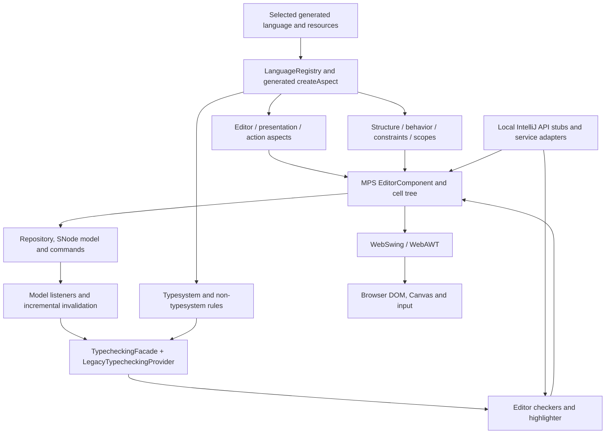

# MPS editor, typesystem and aspect runtime on J2CL

Status: browser editor milestone implemented and its nine-run live acceptance matrix passed, 9 September 2026. The user approved skipping desktop-heavy MPS dependencies or compiling only their specifically required classes. The pinned MPS checkout remains `d2589ed55bbc9445b660769fcc17da97e8e395a6`.

**Approved browser scope revision**

The full 62-project graph below is an upstream dependency census, not the browser build requirement. Skip Kotlin library import/compiler support, ASM bytecode tooling and Gson bug-reporting. Select only required Java companion classes from `mps-platform`, `mps-workbench`, `mps-ui` and other desktop-heavy projects. Keep project-sized public targets for retained projects, with explicit source lists and revised dependency edges recorded in `compatibility/browser-profile.json`. The generated `mps-browser-projects.bzl` and `compatibility/browser-projects.json` describe the actual build. Compile real editor/typesystem/aspect algorithms, and stub IntelliJ service boundaries. No empty target may imply a skipped feature was implemented.

The selected profile builds 36 projects and 2,052 Java sources, including four typesystem/editor checker classes and eight usage-search implementation classes. All 353 root Bazel targets compile. The live MPS editor passes Chromium, Firefox and WebKit in development, optimized and stripped-metadata builds: native mouse/keyboard edits, focused undo/redo shortcuts, real completion/intentions, automatic diagnostic painting/removal, structural/reference invalidation and repeated host disposal. Passive hints preserve focus and obsolete queued hints are cancelled. Chromium composition tests use its native browser input protocol; Firefox/WebKit cover the DOM composition contract. The [validation report](docs/validation.md) records the full source, JVM and browser checkpoint.

This completes the in-memory handwritten-language editor milestone. Production generated-language deployment, complete bundled language metadata, folding/contribution precedence, production reference-scope and child/root-constraint scenarios, persistence, dataflow, text generation and refactoring remain separate follow-on work. The implementation does not import the skipped desktop compiler or IDE startup graph.

**Intended result**

Run a real MPS projectional editor in the browser: generated language editors create cells; keyboard and mouse input change the MPS model; model events update the cells; commands support undo/redo; real typechecking, constraints and behavior produce live diagnostics and completion choices. Demonstrate a real intention/quick fix. Use the existing WebAWT and WebSwing implementations for graphics and UI.

The initial acceptance language is a small typed expression language with explicitly handwritten Java runtime descriptors. It exercises the same structure, editor, behavior, constraints, intentions and typesystem interfaces consumed by generated descriptors. This does not prove the MPS language generator or every bundled language has been ported. A selected production language brings its own generated code, extended languages, runtime solutions and assets; these dependencies must be inventoried separately.

`com.intellij.*` is supplied by local stubs, as requested. A stub for a service used during editing implements its narrow contract or delegates to the browser libraries. Font metrics use real measurements, and `invokeLater` executes its callback. Unsupported desktop IDE entrypoints fail explicitly. The actual MPS editor, inference, constraint, behavior and aspect algorithms remain real implementations.

**Verified dependency scope**

- Verified browser compilation: 36 selected projects including OpenAPI/Kernel, the live editor and type engine. All nine live-editor engine/build combinations pass; the earlier 26-project foundation remains a useful dependency checkpoint.
- Adding `editor-runtime` reaches **62 production projects: 42 additional projects**. This already includes `typesystemIntegration`, `project-check`, `mps-editor`, `mps-workbench`, `mps-platform`, persistence, generation and make-related code through transitive dependencies. Listing the checking modules as extra roots does not enlarge that closure.
- That closure contains **3,802 production Java files and 59 Kotlin files**, compared with 1,134 Java files in the existing build. The Kotlin files belong to `kotlin-stub` (38), `make-runtime` (11), `mps-platform` (2) and `mps-workbench` (8).
- The five immediate editor projects contain 645 production Java files: `editor-api` 116, `editorlang-runtime` 50, `editing-runtime` 1, `actions-runtime` 21 and `editor-runtime` 457.
- `editor-runtime` contains 235 distinct IntelliJ import statements and 115 AWT/Swing import statements. These are import counts, including nested types, not a final number of missing classes or methods.
- The closure includes Kotlin sources. The pinned J2CL `_kt_compile` implementation explicitly fails with `Kotlin frontend is disabled`; the current Java-only source inventory cannot be reused as proof that every production source was handled.
- The core `typechecking` and `typesystemEngine` Java sources have no direct `com.intellij` imports in this audit. The strongest IntelliJ coupling is in editor/workbench integration.

Retained projects have project-sized public Bazel targets. Desktop-heavy projects can expose only an explicitly recorded browser source subset; skipped projects are absent from the browser graph. The browser starts only services needed by selected editing features.

| Useful compilation checkpoint | Total projects | Java files | Kotlin files |
| --- | ---: | ---: | ---: |
| Current OpenAPI/Kernel | 20 | 1,134 | 0 |
| Editor API + editing + editor-language support | 23 | 1,301 | 0 |
| Typechecking + typesystem engine | 23 | 1,322 | 0 |
| Combined editor API and type-engine checkpoint | 26 | 1,489 | 0 |
| Selected browser editor profile | 36 | 2,052 | 0 |
| Typechecking/engine + project checking | 32 | 1,791 | 38 |
| Complete editor-runtime closure | 62 | 3,802 | 59 |

The two 23-project checkpoints are different sets of projects. Adding project checking already crosses the persistence/Kotlin boundary. Counts exclude test roots and honor descriptor exclusions. The [planning inventory](C:/Codex/mps-j2cl/compatibility/editor-plan-inventory.json) contains the full module lists, cycles, Kotlin paths and Java utility call sites; its call-site scan is lexical and can include imports/comments rather than executable calls.

| Area | Projects and purpose |
| --- | --- |
| Editor contracts and generated-code support | `editor-api`, `editorlang-runtime`, `editing-runtime` |
| Cell editor, commands and intentions | `editor-runtime`, `actions-runtime`, `intentions-runtime`, with required `mps-editor`/workbench classes |
| Type inference and sessions | `pattern-runtime`, `typechecking`, `typesystemEngine` |
| Diagnostic integration | `typesystemIntegration`, `project-check`, feedback/message projects |
| Existing language fundamentals | Structure/concept services in Kernel; `behavior-api`, `behavior-runtime`, `constraints-runtime`, scope resolution |
| Runtime host dependencies | `platform`, `mps-platform`, `mps-ui`, `mps-icons`, resources, persistence and other descriptor dependencies |
| Basic usage search | Real selected `findUsages-runtime` searches for node references, concept instances and model imports |
| Further features | Text generation, dataflow, refactoring and desktop finder/plugin integrations according to the selected language and milestone |

The upstream census has five cyclic groups. Recompute browser groups after source/dependency selection; do not carry the desktop cycles into the build automatically. Keep the existing public alias convention for cycles that remain.

| Private compilation group | Members |
| --- | --- |
| Existing Kernel group | `constraints-runtime`, `kernel`, `project` |
| Editor/workbench group | `actions-runtime`, `editor-runtime`, `intentions-runtime`, `mps-editor`, `mps-workbench`, `typesystemIntegration` |
| Make/resources group | `kernel-resources`, `make-runtime` |
| Persistence group | `kotlin-stub`, `persistence` |
| Platform tracking group | `mps-platform`, `vfs-tracking` |

The diagram below shows runtime responsibilities, rather than every descriptor dependency:



**Directory and build layout**

The implemented additions follow this layout; the upstream checkout and sibling libraries remain unchanged. Only directories containing files are created.

```text
mps-j2cl/
├── BUILD.bazel                         all project, stub, fixture and app targets
├── MODULE.bazel                        dependency versions and source providers
├── mps-projects.bzl                     complete generated upstream project catalog
├── mps-browser-projects.bzl             generated selected browser graph and groups
├── mps-rules.bzl                        project targets, cyclic groups, resources
├── mps-overrides.bzl                    exact exclusions and MPS replacements
├── intellij-stubs.bzl                   local IntelliJ library and contract targets
├── editor-*-tests.bzl                   editor utility/foundation/runtime/live targets
├── MPS-EDITOR-J2CL-PLAN.md               this plan
├── mps/                                clean pinned upstream checkout
├── mps-web/                            sparse replacements, matching MPS paths
│   ├── editor/editor-runtime/source/jetbrains/mps/nodeEditor/...
│   ├── core/typechecking/source/jetbrains/mps/typechecking/...
│   └── workbench/mps-platform/source/jetbrains/mps/...
├── third_party/
│   ├── intellij-stubs/src/com/intellij/...
│   ├── j2cl/                           coordinated runtime patches and MPS API additions
│   └── webawt/                         root-local shared Elemental2 patch
├── browser/
│   ├── src/                            platform, model access, host, factories, assets
│   └── editor-demo.html                runnable handwritten-language editor demo
├── compatibility/
│   ├── editor-plan-inventory.json       planning census of the 62-project closure
│   ├── browser-profile.json            reviewed source/dependency selection and reasons
│   ├── browser-projects.json           generated effective Java/resource graph
│   ├── intellij-api.json               provider and behavior inventory
│   ├── intellij-usage.json             lexical selected-source references and boundaries
│   └── editor-assets.json              actual MPS icon paths, dimensions and hashes
├── tests/editor_live/                  handwritten language, real editors/search/input
├── tests/editor_runtime/               keymaps and selection factory contracts
├── tests/editor_utilities/             shared tokenizer JVM/browser contracts
├── tests/typechecking/                 inference/invalidation/aspect fixtures
├── tests/intellij_stubs/                JVM and browser service-contract tests
├── .work/                              generator inputs and scratch
└── tools/                              inventory, registration/resource generation, validation
```

Shared Basic UI, native painting/input and popup contracts now live in
`../javax-swing-j2cl/src/test/runtime/`; MPS consumes their exported source labels.
AWT and Swing Java implementations come directly from the 0.2.0 sibling libraries.

No BUILD files go in `mps/`, `mps-web/` or individual Java packages. IntelliJ classes belong in `third_party/intellij-stubs`, because they are external API substitutes. New application classes belong in `browser/src`. Replacements for existing MPS classes belong at the corresponding `mps-web` path.

`compatibility/browser-profile.json` selects the required Java companions from desktop projects and overrides their dependency edges explicitly. `tools/inventory_browser.py` regenerates the source/resource graph and remaining cyclic groups; complete-project selection fails if unhandled Kotlin sources are present. The historical census retains the excluded Kotlin counts. A future required Kotlin declaration needs a reviewed Java/browser implementation or a supported toolchain before joining this profile.

`mps-rules.bzl` compiles explicit source lists, supports empty Java source lists, and exposes `<project>_sources` and `<project>_resources` filegroups. Declared resource roots and explicit extra resources are inventoried. `tools/prepare_editor_assets.py` generates the real MPS icon bundle and its provenance; `BrowserMpsAssets` registers and releases it. Registered classloader resource origins remain explicit under stripped metadata. Production generated-language resources still require their own deployment inventory.

**IntelliJ stub policy**

The root-owned `//:intellij_stubs` library contains authored compatibility sources and depends on JRE/WebAWT/WebSwing. It does not link IntelliJ implementation jars or depend on the MPS editor group. `BrowserEditorHost` injects the actual MPS services. JVM signature/oracle checks may consult installed APIs, but production browser targets use source implementations only.

| Kind of IntelliJ API | Implemented treatment | Validation contract |
| --- | --- | --- |
| Annotations and marker interfaces | Inert definitions with matching signatures | Compile source uses and prevent duplicate providers |
| `Key`, `DataKey`, ranges, user data, presentations | Small implementations preserving identity, equality and mutable state as applicable | Values round-trip through data/context lookups |
| Application/project services, message bus and disposal | Typed service registry, real publish/subscribe, deterministic child disposal | No missing required service; subscriptions disappear on disposal |
| Commands, undo, actions, data context and keymaps | Actual command/action callbacks, project model history and focused Ctrl/Meta undo/redo bindings | Model/cell state follows history; shortcuts stay scoped to editor focus |
| `Alarm`, update queues, progress and cancellation | Cooperative browser task scheduling with cancellation and stale-result suppression | Callback ordering, cancellation, editor close during a check |
| Colors, borders, `JBScrollPane`, lists, popup and font helpers | Delegate to Basic UI and real font measurements; passive hints separate focusability from automatic focus requests | Layout, pixels, popup selection, scrolling and passive-focus contracts |
| Persistent-state annotations/interfaces | Compatible declarations and explicitly owned in-memory settings | Defaults and state updates work; persistent storage remains a separate adapter |
| Native IDE shell, project wizards, JVM instrumentation and desktop tools | Explicit unavailable operations; corresponding UI entrypoints disabled | No unavailable operation reached by required editor scenarios |

`tools/inventory_intellij.py` inventories the exact retained sources after MPS overlays: imports, fully qualified references, imported-type qualifiers, simple subclass qualifiers and unsupported-operation sites. `--check` detects stale inventories. This is a lexical owning-type inventory, not exhaustive member/overload resolution; javac/J2CL and behavioral contracts check executable uses. `tools/run_intellij_contracts.py` runs JVM service contracts, and the `intellij_contracts` browser mode exercises actual browser implementations. Required provider ownership and unsupported host surfaces are recorded in [the compatibility boundary](docs/intellij-browser-boundary.md).

**Shared Java APIs before more MPS replacements**

| API area | Current implementation and remaining boundary |
| --- | --- |
| `String.format` / `String.formatted` | Already implemented centrally with a bounded, tested conversion profile. Inventory new format strings, retain original calls where supported, and extend the shared formatter only for missing required conversions. Do not return placeholder text. |
| `StringTokenizer` | Shared JRE implementation under `third_party/j2cl/api-support/jre/java/java/util`, used by unchanged `SelectionUtil`. All constructors, delimiter replacement/return, token counting, Enumeration and supplementary/surrogate delimiters are covered by the 520-row Java 21 oracle and browser fixture. The desktop `FilesEntry`/`MPSPackageItemProvider` callers are not selected. |
| `Formatter` | No general `java.util.Formatter` is supplied. `MessagesListCellRenderer` is outside the selected `mps-ui` subset. Current formatting calls use the central `MpsFormatter`/String profile; a future selected Appendable caller needs a real facade before inclusion. |
| `MessageFormat` / resource bundles | No general MessageFormat, choice-format or ResourceBundle implementation is claimed. Retained fixed-message callers have explicit same-path replacements preserving their pinned English diagnostics; desktop `EditorSettingsBundle`/`PropertiesBundle` callers are not selected. Broader localization remains future work. |
| `Instant` / checking timestamps | Shared Instant/Duration APIs retain public timestamp contracts, range/sentinel ordering, normalized seconds/nanos and arithmetic. `IncrementalTypecheckingComponent` conservatively reports equal timestamps; the real typechecking fixture freezes the clock to cover same-tick checks. `tools/run_foundation_time_oracle.py` checks the actual shared implementation. |
| Weak/soft/phantom references | Native weak liveness plus a real pollable ReferenceQueue; phantom references expose no referent. Soft caches retain values until explicit clear/enqueue or owner disposal, with no JVM memory-pressure claim. Blocking queue removal fails explicitly; editor/session disposal owns reliable cleanup. |
| Regex, lists and streams | Shared Pattern/Matcher now supports the documented subset, Java ASCII `CASE_INSENSITIVE` and word-boundary behavior used by `SearchConditions`. Unsupported constructs/flags fail explicitly; see `tests/regex/README.md`. `Pattern.split` remains absent and its `PropertyValueIndex` caller is excluded. The fixed `MacroHelper.MacroMatcher` overlay remains; desktop `BaseLibraryManager` is not selected. |
| Class metadata and factories | Existing `Class.isInstance`/`Class.isAssignableFrom` support, registered constructors and module resource origins remain. RuleSet keeps explicit language namespace ownership; `BrowserSelectionFactories` registers binary aliases for restoration under optimized/stripped metadata. |
| Reflection at editor boundaries | `AWTKeymapHandler` directly uses generated AWT key constants; selection/filter constructors use registered factories. MPS behavior-descriptor `SMethod` dispatch remains real MPS behavior, not substituted Java reflection. |
| Scheduling / thread-local contexts | BrowserModelAccess and scoped typechecking contexts run on one event thread. Highlighter tasks yield between editors, and intentions/hover use cancellable alarms. No model lock spans an asynchronous yield; required paths do not block on pending futures or thread sleeps. |

After each shared API addition, recheck existing replacements that only work around that API. Remove an override only after compiling the original class and passing the corresponding behavior tests. The earlier set of 55 overrides is not a target to preserve or expand unnecessarily.

**Other external dependencies**

The historical 62-project descriptor closure names 11 external libraries: `Annotations`, `gnu.trove`, `org.jdom`, `Idea-platform`, `com.intellij.openapi`, `KotlinCoreLibs`, `KotlinJavaRuntime`, `eclipse.ecj`, `google.gson`, `javac2` and `objectweb.asm`. The selected browser graph requires only four descriptor libraries. `mps-rules.bzl` maps `Annotations` to pinned source annotations, `gnu.trove` and `org.jdom` to sibling J2CL libraries, and `Idea-platform` to `//:intellij_stubs`; any unmapped retained library fails the rule.

`MODULE.bazel` uses sibling Trove/JDOM sources and root-generated WebAWT/WebSwing dependency views. The views apply root-owned UI additions without editing the siblings. `tools/compose_jre.py` composes the sibling IO/NIO/concurrency/network sources into one J2CL java.base provider; root API patches follow that composition. `dependency-views.json`, generated provenance and source-ownership checks keep duplicate providers out of the browser classpath.

Desktop bug reporting (`Reporter`/Gson), Java/Kotlin JAR-model import, ASM bytecode work, ECJ/Kotlin compilation and make/compiler startup remain outside the selected profile. There is no general `desktop-stubs` library claiming those features. Required editor, inference and usage-search algorithms execute real MPS code; unsupported filesystem/persistence operations fail explicitly rather than fabricate successful results. Production languages that require additional runtime libraries, JSON serialization or JAR import need a separate source/deployment inventory and working implementation.

**Generated language and aspect deployment**

The current `BrowserPlatform.registerLanguage(...)` deploys explicitly supplied compiled runtime descriptors and rule classes; the acceptance language is handwritten in `tests/editor_live/ExpressionLanguage.java`. The `.iml` closure does not select every generated class for a production language. That future deployment needs a manifest of its extended languages, runtime solutions, factory signatures, activators, aspect entrypoints and resources.

Register each generated `<language>.Language` constructor in the existing classloader registry. Generated `Language.createAspect(Class)` normally constructs its descriptors directly; preserve those calls and their real implementations. Register reflective extension/selection/query boundaries only where the source actually uses them. Keep all required entrypoints reachable under Closure optimization.

Aspect acceptance covers structure, inherited behavior, child/root constraints, reference scopes, editor contributions/hints, presentation, actions/intentions, inference and non-typesystem rules. Dataflow is needed when a selected language references it. Textgen can be enabled after the core editing milestone; model-to-model generation and Java compilation are separate features.

Dataflow's checked-in generated sources are owned by the aggregate `gensources` project, not an independent `.iml`. Do not invent a project-per-package target or silently pick a subset and label it the complete `gensources` project. The first fixture is an application/test language bundle. For production bundled languages, introduce an explicitly documented generated-language deployment profile with source ownership, or consume reproducible generated source artifacts from an external JVM MPS generation step. That source-selection exception must be visible in the plan/build metadata before adding those languages.

**Startup and lifecycle**


`BrowserPlatform` initializes MPSCore, MPSTypechecking and MPSTypesystem in dependency order. `BrowserEditorHost` installs the selected services directly, creates the real project repository, and adds `TypesEditorChecker` and `NonTypesystemEditorChecker` to its Highlighter. It does not bootstrap the complete desktop MPSValidationComponent/MPSEditorPlugin graph. Browser composition classes and explicit same-path adapters expose the required construction points without reflective startup. See [the implemented lifecycle, input and popup contracts](docs/editor-runtime-adaptations.md).

`HeadlessEditorComponent` installs `TypecheckingSession.NullHandle` and disables listeners. The live fixture instead uses NodeEditorComponent with model listeners and a real incremental session. Closing an editor cancels checks and hover/intention requests, detaches listeners, releases sessions and removes it from host tracking. Host disposal releases UI/project services before platform registries and restores owned global state.

Use in-memory fixture models first. Persistence/browser storage is a separate provider contract; synchronous host file APIs and the currently unsupported ZIP/JAR backend cannot be assumed to work. Preserve structured node clipboard semantics and add asynchronous system text clipboard access via the sibling browser API.

**Implementation sequence and completion gates**

| Stage | Work | Completion gate |
| --- | --- | --- |
| 1. Extend the inventory and build profiles | Keep the upstream census; define the selected browser project/source graph and recompute SCCs. Record omitted host projects, resources, generated inputs and libraries. | No unrecorded source selection, duplicate Java type or unresolved required dependency. Existing Kernel targets remain independently buildable. |
| 2. Shared APIs and the small foundations | Build the combined 26-project API/type-engine checkpoint. Implement tokenizer, time, weak/session and metadata gaps; introduce a small Java runtime typing fixture and bootstrap for inference. | Actual J2CL compilation/optimized linkage; JVM differential tests for utility contracts; known type inference and session disposal work. |
| 3. IntelliJ and host-library boundaries | Implement required stubs and browser service contracts. Skip Kotlin/compiler/JAR-import/bug-reporting projects and select needed desktop companion classes. Replace coupled MPS entrypoints where necessary. | The selected browser closure compiles through project targets; report exact selections/replacements and unavailable features. Required stub contracts tested. |
| 4. Language/aspect fixture and cell editor | Extend the handwritten runtime fixture with editor, behavior, constraints, scopes, intentions and assets through the real MPS aspect interfaces. Exercise editor selection, styles, cell construction and layout. | Runtime aspects execute; expected cells and diagnostics are produced. A generated production language, folding and contribution precedence need their own acceptance scenarios. |
| 5. Interactive editor | Mount live EditorComponent, listeners, fonts, focus/caret, mouse/keyboard/IME, scrolling, completion, commands and clipboard. Add registered selection factories. | Typing edits SNode properties; node insertion/deletion and external model changes update cells; undo/redo, selection restore, IME commit/cancel and clipboard work through real input. |
| 6. Live typesystem and semantic editor features | Install checkers/highlighter, schedule incremental checks, suppress stale results, expose constraint-filtered completion and one real intention/quick fix. | Known types/subtyping/non-typesystem errors; edits to properties/children/references invalidate results; fixing input removes errors; language inheritance/priority and quick-fix undo verified. |
| 7. Broaden and validate | Add selected-language dataflow/textgen/refactoring as needed; harden lifecycle and browser behavior. | Chromium, Firefox and WebKit in development and optimized builds; metadata-sensitive stripped tests; repeated open/edit/close releases listeners/timers; no required scenario reaches an unavailable stub. |

Use serial Bazel builds and the existing shared build lock. Adapt small upstream unit scenarios instead of importing the desktop testbench closure. Keep headless JVM/browser semantic comparisons separate from actual browser input/rendering tests. A successful compile, a screenshot or an error-free empty checker is not sufficient acceptance evidence.

The first visible deliverable is a browser page with a small typed expression model: select cells, edit a literal, introduce a type error, see the diagnostic, apply a fix and undo it. This exercises the requested editor and aspects together.

**Upstream census: all 42 additional projects**

These are the additional projects in the original desktop dependency closure. The browser profile retains only its documented 36-project selection; projects in this table are not implicitly included. Kotlin source dispositions and unsupported desktop operations remain explicit as described above.

| Project | Java | Kotlin | Directory relative to `mps/` |
| --- | ---: | ---: | --- |
| actions-runtime | 21 | 0 | editor/actions-runtime |
| ant-mps-common | 12 | 0 | core/tool/common |
| baseLanguage-search | 9 | 0 | languages/baseLanguage/baseLanguage.search |
| debuginfo-api | 10 | 0 | core/debuginfo/api |
| debuginfo-impl | 4 | 0 | core/debuginfo/impl |
| editing-runtime | 1 | 0 | editor/editing-runtime |
| editor-api | 116 | 0 | editor/editor-api |
| editor-runtime | 457 | 0 | editor/editor-runtime |
| editorlang-runtime | 50 | 0 | editor/editorlang-runtime |
| environment | 19 | 0 | core/tool/environment |
| feedback-api | 10 | 0 | core/aspects/feedback/feedback-api |
| findUsages-runtime | 50 | 0 | core/findUsages-runtime |
| generator-engine | 291 | 0 | core/generator |
| intentions-runtime | 20 | 0 | editor/intentions-runtime |
| java-stub | 50 | 0 | core/java-stub |
| kernel-resources | 12 | 0 | core/resources |
| kotlin-stub | 18 | 38 | core/kotlin-stub |
| make-runtime | 97 | 11 | core/make-runtime |
| messages-api | 3 | 0 | core/aspects/feedback/messages-api |
| messages-for-rules | 4 | 0 | core/aspects/feedback/messages-for-rules |
| messages-for-structure | 9 | 0 | core/aspects/feedback/messages-for-structure |
| model | 1 | 0 | core/model |
| module | 1 | 0 | core/module |
| mps-editor | 130 | 0 | workbench/mps-editor |
| mps-icons | 2 | 0 | workbench/mps-icons |
| mps-platform | 254 | 2 | workbench/mps-platform |
| mps-ui | 185 | 0 | workbench/mps-ui |
| mps-workbench | 478 | 8 | workbench/mps-workbench |
| pattern-runtime | 12 | 0 | core/patternRuntime |
| persistence | 61 | 0 | core/persistence |
| platform | 5 | 0 | core/platform |
| project-check | 23 | 0 | core/project-check |
| refactoring | 11 | 0 | workbench/mps-refactoring/j.m.refactoring |
| refactoring-runtime | 11 | 0 | workbench/mps-refactoring/j.m.refactoring.runtime |
| resources | 0 | 0 | workbench/resources |
| resources_en | 0 | 0 | core/resources_en |
| scripts-runtime | 6 | 0 | workbench/scripts-runtime |
| textgen | 37 | 0 | core/textgen |
| typechecking | 23 | 0 | core/typechecking |
| typesystemEngine | 153 | 0 | core/typesystemEngine |
| typesystemIntegration | 7 | 0 | editor/typesystemIntegration |
| vfs-tracking | 5 | 0 | platform/vfs-tracking |

**Source evidence**

- [Editor dependencies](C:/Codex/mps-j2cl/mps/editor/editor-runtime/editor-runtime.iml), [checking integration dependencies](C:/Codex/mps-j2cl/mps/editor/typesystemIntegration/typesystemIntegration.iml), and [complete catalog](C:/Codex/mps-j2cl/compatibility/mps-projects.json).
- [EditorComponent](C:/Codex/mps-j2cl/mps/editor/editor-runtime/source/jetbrains/mps/nodeEditor/EditorComponent.java): component construction, services and incremental session acquisition.
- [HeadlessEditorComponent](C:/Codex/mps-j2cl/mps/editor/editor-runtime/source_gen/jetbrains/mps/editor/runtime/HeadlessEditorComponent.java): null session and disabled listeners.
- [UpdaterImpl](C:/Codex/mps-j2cl/mps/editor/editor-runtime/source/jetbrains/mps/nodeEditor/updater/UpdaterImpl.java), [Highlighter](C:/Codex/mps-j2cl/mps/editor/editor-runtime/source/jetbrains/mps/nodeEditor/Highlighter.java): weak caches, scheduling and lifecycle.
- [MPSTypechecking](C:/Codex/mps-j2cl/mps/core/typechecking/source/jetbrains/mps/typechecking/internal/MPSTypechecking.java), [MPSTypesystem](C:/Codex/mps-j2cl/mps/core/typesystemEngine/source/jetbrains/mps/typesystem/MPSTypesystem.java), [CacheState](C:/Codex/mps-j2cl/mps/core/typechecking/source/jetbrains/mps/typechecking/CacheState.java).
- [EditorCheckerComponent](C:/Codex/mps-j2cl/mps/editor/typesystemIntegration/source/jetbrains/mps/typesystem/checking/EditorCheckerComponent.java), [MPSValidationComponent](C:/Codex/mps-j2cl/mps/workbench/mps-editor/source/jetbrains/mps/ide/editor/MPSValidationComponent.java), [MPSEditorPlugin](C:/Codex/mps-j2cl/mps/workbench/mps-editor/source/jetbrains/mps/ide/editor/MPSEditorPlugin.java).
- [Generated regexp language example](C:/Codex/mps-j2cl/mps/languages/util/regexp/source_gen/jetbrains/mps/baseLanguage/regexp/Language.java): direct construction of language aspect descriptors.
- [Current formatter contract](C:/Codex/mps-j2cl/docs/formatting.md), [UI integration](C:/Codex/mps-j2cl/docs/ui-dependencies.md), [registered runtime factories](C:/Codex/mps-j2cl/docs/runtime-factories.md).

The selected browser profile contains 36 projects, 2,052 Java sources and 99 sparse MPS replacements. Its source audit reports no duplicate types, orphan replacements or unresolved IntelliJ provider references. Final validation passed all 54 steps, 353 Bazel targets and 199 browser/build runs, with no skipped steps and matching final bundle hashes. The 62-project desktop census remains outside this browser build. See [validation results](docs/validation.md) and [editor adaptations](docs/editor-runtime-adaptations.md) for the implemented contracts and limits.
