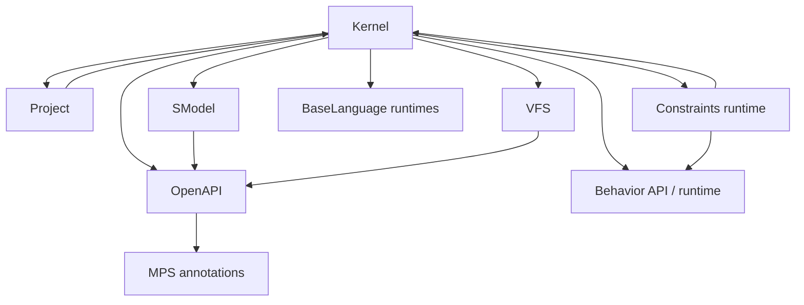
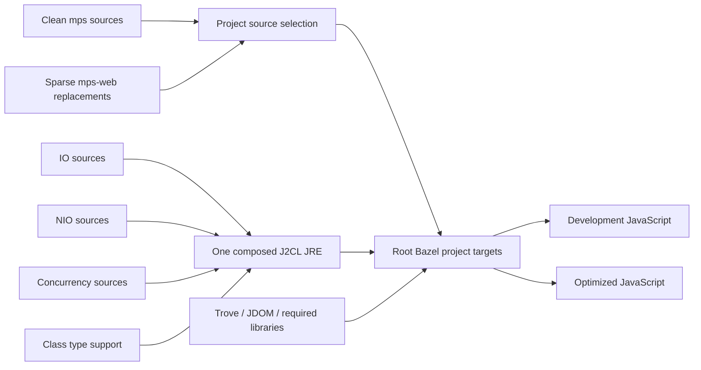
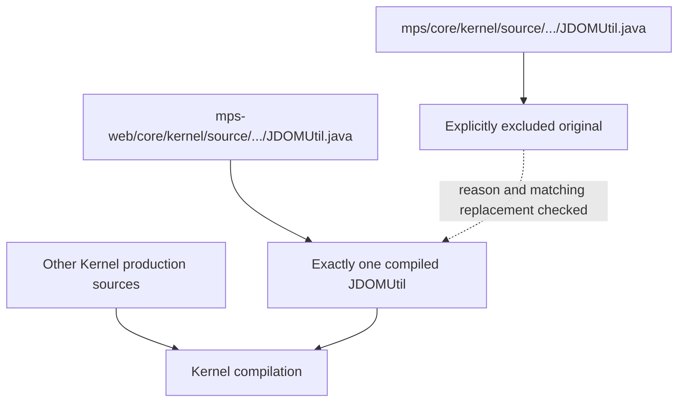
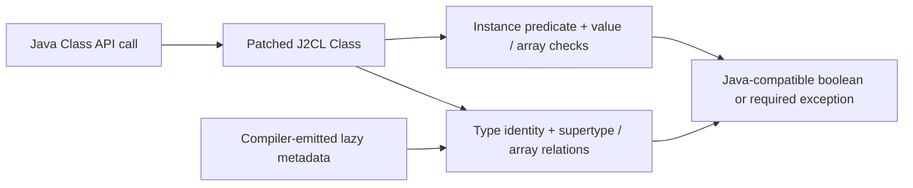

# MPS with J2CL and Bazel — approved design

Status: the initial implementation is complete and validated. OpenAPI, Kernel and their full 20-project production closure build successfully. All 172 root targets and 110 browser/build runs pass; generated metadata and source ownership checks pass. The pinned MPS checkout is clean. This document records the agreed architecture; see [validation results](docs/validation.md) and [build instructions](README.md) for the implemented browser profile.

## 1. Intended result

Build `core/openapi`, `core/kernel`, and their complete production dependency closure into JavaScript with Bazel and J2CL. Use the MPS Java project/module boundaries recorded in `.iml` files, including their declared handwritten and generated source roots. Do not divide targets by Java package.

Keep the upstream checkout in `mps/` clean. Put all MPS build declarations in this repository's root `BUILD.bazel` and root `.bzl` files. An MPS class that needs adaptation is excluded explicitly and replaced at the identical relative path under `mps-web/`. Preserve its package, class name, public contract, license, and provenance. Create replacement directories only when adding actual files.

The user confirmed the first scope: OpenAPI, Kernel, and all their dependencies. Inventory all MPS projects so subsequent work uses the same project-to-target convention. Building the editors, workbench, plugins, and every other MPS project is a later expansion.

## 2. Findings that affect the design

- Upstream inspected: JetBrains/MPS `master`, commit `d2589ed55bbc9445b660769fcc17da97e8e395a6`, dated 2026-09-08. Proposed checkout baseline: this exact commit, recorded in the source lock. Do not follow a moving branch during builds.
- The `.iml` production dependency closure contains **20 projects**. Three form a cycle confirmed in Java source: `kernel`, `project`, and `constraints-runtime`.
- The sibling libraries use Bazel `8.3.1`, J2CL `20260402`, and rules_closure `0.16.0`. Use these as the initial compatibility baseline, then validate the selected MPS source language level. Current MPS's full desktop build documents JDK 25; this does not establish that the selected source subset needs every JDK 25 feature or that J2CL supports it.
- IO, NIO, and concurrency contribute JRE overlays. Their independent patches cannot simply be stacked. NIO already includes IO and four WebAWT URI/URL classes, and includes placeholder Thread/ThreadFactory declarations that concurrency must replace.
- Current upstream J2CL `Class` lacks `isInstance`, `isAssignableFrom`, and `getInterfaces`. Verify the resolved `20260402` source independently before implementation. General reflection and dynamic class loading are separate from these two type-query methods.
- Several siblings were validated against older MPS revisions. Their passing fixtures are useful inputs, not proof that this new MPS dependency graph builds or runs.

Sources: [MPS repository](https://github.com/JetBrains/MPS), [OpenAPI descriptor](https://github.com/JetBrains/MPS/blob/d2589ed55bbc9445b660769fcc17da97e8e395a6/core/openapi/openapi.iml), [Kernel descriptor](https://github.com/JetBrains/MPS/blob/d2589ed55bbc9445b660769fcc17da97e8e395a6/core/kernel/kernel.iml), [J2CL Class](https://github.com/google/j2cl/blob/master/jre/java/java/lang/Class.java), [J2CL limitations](https://github.com/google/j2cl/blob/master/docs/limitations.md).

## 3. Proposed directory layout

```text
C:\Codex\
├── java-io-j2cl\                 existing dependency sources
├── java-nio-j2cl\
├── java-concurrent-j2cl\
├── gnu-trove-j2cl\
├── org-jdom-j2cl\
├── java-awt-j2cl\
├── javax-swing-j2cl\
└── mps-j2cl\
    ├── MPS-J2CL-PLAN.md          this proposal
    ├── BUILD.bazel              all MPS project targets, tests, bundle targets
    ├── MODULE.bazel             dependencies, root overrides, toolchain selection
    ├── MODULE.bazel.lock
    ├── .bazelversion
    ├── .bazelrc
    ├── mps-projects.bzl         project paths, source roots, project dependencies
    ├── mps-rules.bzl            shared project/overlay rule helpers
    ├── mps-overrides.bzl        explicit replacement and justified exclusion lists
    ├── source-lock.json         MPS SHA; sibling manifests and content hashes
    ├── mps\                    pinned, unmodified upstream Git checkout
    │   ├── core\
    │   │   ├── openapi\source\...
    │   │   ├── kernel\source\...
    │   │   ├── kernel\smodelRuntime\source_gen\...
    │   │   ├── kernel\kernelSolution\source_gen\...
    │   │   └── ...
    │   └── languages\baseLanguage\...\runtime\source_gen\...
    ├── mps-web\                sparse MPS replacements only
    │   └── core\kernel\source\jetbrains\mps\util\JDOMUtil.java
    ├── third_party\
    │   ├── j2cl\
    │   │   ├── overlay\...     maintained JRE/type-support changes
    │   │   ├── patches\...     composed JRE patch; compiler patch if required
    │   │   └── ownership.json  exactly one compiled provider per Java type
    │   └── annotations\...    only if a source dependency is missing locally
    ├── tools\
    │   ├── bootstrap.ps1
    │   ├── inventory_mps.py
    │   ├── compose_jre.py
    │   ├── check_sources.py
    │   └── validate.ps1
    └── tests\
        ├── class_support\...
        ├── core\...
        └── browser\...
```

This is a proposed layout, not a list of directories to precreate. `JDOMUtil.java` is an evidence-backed candidate from the existing JDOM integration guide, not a replacement already implemented or guaranteed sufficient. Other replacements will appear only after auditing failures against the chosen MPS revision. A generated MPS class retains its original `source_gen` path in `mps-web` if it needs replacement. Non-MPS JRE/toolchain changes belong under `third_party/j2cl`, outside the MPS-shaped overlay.

The nested Git checkout can be pinned with a bootstrap script and source lock; no Bazel files need to be installed in it. Generated outputs stay in Bazel's output tree. A future upstream BUILD/workspace boundary must be detected by the inventory; root globs must not silently lose files at package boundaries.

## 4. Project granularity and the dependency cycle

Create one named public target per `.iml` project, for example `//:mps_openapi`, `//:mps_kernel`, and `//:mps_collections_runtime`. Each source list includes every production root declared for that project, minus reviewed exclusions, plus its exact overlay replacements. Runtime resources and generated roots are included explicitly; broad folder globs must not silently include tests or excluded implementation directories.

Bazel's target graph must be acyclic. The upstream Java source confirms that these cyclic edges are needed. The proposed exception is one private `j2cl_library` compilation group for `{kernel, project, constraints-runtime}`, with a public alias for each project and a separate source inventory/filegroup for each. This preserves project-facing names but **does not provide independent compilation or isolated artifacts for those three projects**. Breaking the source cycles would require additional refactoring through replacements. This is the main architecture choice to review; it must not be silently treated as independent per-project compilation.

Evidence: Kernel's [AbstractModule](https://github.com/JetBrains/MPS/blob/d2589ed55bbc9445b660769fcc17da97e8e395a6/core/kernel/source/jetbrains/mps/project/AbstractModule.java#L607) constructs Project's VisibleDepsSearchScope, and Project's [ProjectBase](https://github.com/JetBrains/MPS/blob/d2589ed55bbc9445b660769fcc17da97e8e395a6/core/project/source/jetbrains/mps/project/ProjectBase.java#L143) uses AbstractModule. Kernel's [ConceptRegistry](https://github.com/JetBrains/MPS/blob/d2589ed55bbc9445b660769fcc17da97e8e395a6/core/kernel/source/jetbrains/mps/smodel/language/ConceptRegistry.java#L74) constructs ConstraintsRegistry, whose [constructor](https://github.com/JetBrains/MPS/blob/d2589ed55bbc9445b660769fcc17da97e8e395a6/core/aspects/constraints/constraints-runtime/source/jetbrains/mps/smodel/language/ConstraintsRegistry.java#L47) takes Kernel's LanguageRegistry.

The following diagram shows selected verified descriptor edges, with arrows pointing from a project to a dependency. It is intentionally not the complete 20-project graph.



Root build shape, illustrative rather than implemented Starlark:

```python
# One invocation per project; metadata comes from its .iml, not Java packages.
mps_project(
    name = "mps_openapi",
    project = "core/openapi",
    source_roots = ["source"],
    deps = [":mps_annotations"],
)

# The rule helper selects upstream source paths minus exact exclusions,
# then adds exact paths from mps-web. Cyclic projects use the documented group.
```

Bazel distinguishes packages (BUILD-file boundaries) from rule targets; one root package can contain multiple project-sized targets. See [Bazel packages and targets](https://bazel.build/concepts/build-ref).

## 5. Exact descriptor closure

All rows below are verified against the inspected upstream commit. Paths are relative to `mps/`. The dependency column lists production MPS project edges; external libraries follow in the next section. `.iml` edges may be broader than resolved Java source requirements, so compile-time verification still follows checkout.

| Project / public target suffix | Project directory | Production source roots | MPS dependencies |
| --- | --- | --- | --- |
| openapi | core/openapi | source | mps-annotations |
| kernel | core/kernel | source; smodelRuntime/source_gen; kernelSolution/source_gen | openapi, smodel, tuples-runtime, closures-runtime, collections-runtime, project, components, behavior-api, behavior-runtime, mps-messaging, baseLanguage-runtime, constraints-runtime, context, messages-for-legacy-constraints, vfs |
| mps-annotations | core/mps-annotations | source | — |
| smodel | core/smodel | source | openapi, logging, mps-annotations, util-core |
| tuples-runtime | languages/baseLanguage/tuples/runtime | source_gen | — |
| closures-runtime | languages/baseLanguage/closures/runtime | source_gen | — |
| collections-runtime | languages/baseLanguage/collections/runtime | source_gen | closures-runtime, baseLanguage-runtime |
| project | core/project | source; source_gen | kernel, closures-runtime, collections-runtime, components |
| components | core/components | source | mps-annotations |
| behavior-api | core/aspects/behavior/behavior-api | source | openapi, components, mps-annotations, smodel |
| behavior-runtime | core/aspects/behavior/behavior-runtime | source | behavior-api, components, smodel |
| mps-messaging | core/mps-messaging | source | logging, mps-annotations |
| baseLanguage-runtime | languages/baseLanguage/references/runtime | source | — |
| constraints-runtime | core/aspects/constraints/constraints-runtime | source | smodel, mps-annotations, context, behavior-api, behavior-runtime, messages-for-legacy-constraints, kernel |
| context | core/aspects/feedback/context | source | openapi |
| messages-for-legacy-constraints | core/aspects/feedback/messages-for-legacy-constraints | source | context, problem, openapi |
| vfs | core/vfs | source; deprecated | mps-annotations, openapi, logging, util-core, components |
| logging | core/logging | source | openapi, mps-annotations |
| util-core | core/util | source | mps-annotations, openapi |
| problem | core/aspects/feedback/problem | source | openapi, context |

VFS's descriptor excludes `source/jetbrains/mps/vfs/impl`; preserve that upstream exclusion. Production generated Java is checked in for the inspected Kernel and runtime roots. First use the committed generated output, recording its provenance. Any absent required generation becomes an explicit build step with outputs under Bazel, rather than generation into `mps/`.

Observed Kernel roots contain 395 + 14 + 68 Java files; OpenAPI contains 127. These counts describe inputs, not completed compilation. Kernel also contains PNG and trace metadata resources; audit access paths and bundle required resources rather than treating Java compilation as resource support.

## 6. Reuse the sibling libraries

Root `MODULE.bazel` owns the local path overrides, preferably relative paths such as `../org-jdom-j2cl`, and all dependency version decisions. Use only dependencies demanded by the selected source graph; retain mappings for the other sibling libraries for later projects.

| Existing directory | Bazel module / target | Integration |
| --- | --- | --- |
| gnu-trove-j2cl | gnu_trove_j2cl / @gnu_trove_j2cl//:trove-j2cl | Source library; verify MPS's required Trove variant |
| org-jdom-j2cl | org_jdom_j2cl / @org_jdom_j2cl//:jdom and :sax-api | Source libraries; use the existing in-memory XML/SAX implementation |
| java-io-j2cl | java_io_j2cl / @java_io_j2cl//:jre-overlay-sources | Source contribution to the single JRE |
| java-nio-j2cl | java_nio_j2cl / @java_nio_j2cl//:overlay-sources | Source contribution; :java-nio is an anchor, not the declarations themselves |
| java-concurrent-j2cl | java_concurrent_j2cl / @java_concurrent_j2cl//:overlay-sources | Source contribution to the single JRE |
| java-awt-j2cl | webawt / @webawt//:webawt | Add if needed; reconcile URI/URL ownership first |
| javax-swing-j2cl | javax-swing-j2cl / @javax-swing-j2cl//src/main:javax-swing-j2cl | Add if needed, with WebAWT and required Elemental2/JsInterop |

The MPS descriptors name external `Annotations`, `gnu.trove`, and `org.jdom`. They point to bundled JARs without declaring Maven versions. Compile MPS's own `mps-annotations` project and resolve JetBrains annotations to a compatible source/header provider; a JVM JAR cannot supply executable JavaScript. Ordinary dependencies need J2CL-compatible sources, except explicitly compile-only annotation processing/header inputs.

Compose the JRE from canonical sibling sources and a manifest of hashes/owners. Reconcile IO/NIO shared files, concurrency's Thread/ThreadFactory, `module-info.java`, and the four WebAWT URI/URL classes. Emit one reproducible root-owned patch with an explicit conflict decision for each differing file. If WebAWT is included, apply its existing URI integration adjustment in a root-controlled dependency view, preserving the canonical sibling checkout. Apply its required Elemental2 patch from the consuming root as well.



Existing runtime boundaries affect which MPS replacements will be needed: IO has working memory streams but not host files; NIO is largely signature compatibility with explicit unsupported operations; concurrency runs ordinary work inline on the browser main thread and uses timers for scheduled work; JDOM supports in-memory XML but not JAXP discovery or file/URL loading. These are known integration tasks, not newly discovered build failures. A source-level build may pass while one of these paths still cannot run.

Kernel's [ModuleClassLoader](https://github.com/JetBrains/MPS/blob/d2589ed55bbc9445b660769fcc17da97e8e395a6/core/kernel/source/jetbrains/mps/classloading/ModuleClassLoader.java#L206) calls Class.forName and defines classes from JVM bytecode. Audit and replace this boundary under the matching `mps-web/core/kernel/source/...` paths. Browser-resident classes must be linked ahead of time; use generated registries/factories for the required discovery paths and report unavailable dynamically loaded modules explicitly. A signature-only ClassLoader is not sufficient. VFS and resource access similarly need a defined browser data source for any exercised operation, and logging's java.util.logging usage needs an API audit.

Local evidence: [NIO composition](C:/Codex/java-nio-j2cl/README.md), [concurrency composition](C:/Codex/java-concurrent-j2cl/README.md), [WebAWT URI integration](C:/Codex/java-nio-j2cl/integrations/README.md), [JDOM MPS integration](C:/Codex/org-jdom-j2cl/integration/mps/README.md).

## 7. How replacements are selected

For each selected project:

1. Enumerate its production source roots and upstream descriptor exclusions.
2. Record every additional excluded upstream class explicitly in `mps-overrides.bzl`, with the original relative path and reason.
3. Require a same-path replacement under `mps-web/` for each adapted class. An intentional omitted feature needs its own explicit status and must not be counted as working compatibility.
4. Compile upstream sources minus those originals, plus the replacement sources.
5. Fail validation for stale exclusions, orphan replacements, two compiled providers of the same class, or missing required project sources.
6. Check `git -C mps status --porcelain` after build and tests. Build tools and generation must leave the checkout clean.



## 8. Class.isInstance and Class.isAssignableFrom

Interpret the requested `Class.instanceof` as `Class.isInstance(Object)`. Java's `value instanceof Type` operator is already distinct and supported by J2CL.

Preserve normal Java calls such as `type.isInstance(value)` and `expected.isAssignableFrom(actual)`. Add the APIs inside the composed J2CL JRE, not as a second `java.lang.Class` in an ordinary library and not by replacing many MPS callers.

### Implementation path

1. Inspect the pinned release's Class, Constructor, instance-check generation, array helpers, and selected Bazel transpiler tool.
2. Create a small compiler/runtime spike. J2CL already generates instance predicates; bridge those for `isInstance` with correct null, primitive, boxed/native representation, and array behavior.
3. For `isAssignableFrom`, use type identity and reliable superclass/interface relations. Prefer lazy compiler-emitted direct-supertype metadata or a generated relation predicate, so class queries do not construct objects or trigger user class initializers. Current `Class` metadata alone does not enumerate interfaces.
4. Implement Java reference-array covariance, primitive-array identity, multidimensional rules, and assignment to Object/Cloneable/Serializable explicitly. Primitive types, including void, only assign to the identical primitive type; do not introduce boxing or numeric widening.
5. Retain correctness metadata under optimization. Start with an explicitly supported metadata configuration, and either support stripped metadata or reject that build configuration clearly.
6. If changing the compiler, rebuild and select the actual host transpiler executable. Verify it through Bazel query/aquery and generated JavaScript, then rebuild JRE and all dependencies using the same toolchain. Editing a compiler Java file is insufficient if the release selects a prebuilt binary.

`target.$isInstance(source.prototype)` is not an adequate general implementation of assignability: arrays, unboxed JavaScript values, JsFunction/JsEnum, and native JsTypes can invalidate that shortcut. Java-managed types must pass the Java semantic tests. Document limits where native JsInterop erases distinct Java identities; do not silently return guessed answers. This work adds bounded type queries, not reflection, dynamic classloading, constructor lookup, or method invocation.



### First acceptance gate

Run the same cases on a stock JVM, J2CL development output, and Closure ADVANCED output:

- Identity; superclass/subclass in both directions; unrelated classes.
- Interface inheritance, inherited implementation, diamonds, unrelated interfaces, Object from an interface Class.
- Null object returns false; null argument to isAssignableFrom throws NullPointerException.
- All primitives, void, wrappers, and primitive/wrapper mismatches.
- Reference/primitive arrays and multiple dimensions, including Object/Cloneable/Serializable. For example Object[] accepts int[][], but not int[].
- String, Boolean, Double, ordinary enums, anonymous/local classes, and ordinary lambdas.
- No constructors or user class initializers execute just because of a type query.
- Separate compilation across MPS and sibling-library boundaries; metadata survives the selected optimizer settings.

Sources: [Java Class semantics](https://docs.oracle.com/en/java/javase/21/docs/api/java.base/java/lang/Class.html), [J2CL instance predicate generation](https://github.com/google/j2cl/blob/master/transpiler/java/com/google/j2cl/transpiler/passes/ImplementInstanceOfs.java), [J2CL arrays](https://github.com/google/j2cl/blob/master/jre/java/javaemul/internal/vmbootstrap/Arrays.impl.java.js), [J2CL transpiler tool selection](https://github.com/google/j2cl/blob/master/build_defs/internal_do_not_use/j2cl_common.bzl). These J2CL links were inspected on current upstream; implementation must resolve and record the pinned release equivalents.

## 9. Implementation sequence and completion evidence

| Phase | Work | Exit condition |
| --- | --- | --- |
| 1. Checkout and inventory | Clone official MPS into mps, checkout the recorded commit, read applicable instructions, enumerate all projects and the initial closure, source roots/resources/imports, test roots, source language level, and SCCs | Reproducible source lock, exact project inventory, dependency graph, source ownership baseline |
| 2. Root build and JRE | Add root Bazel configuration and project declarations; compose sibling JRE sources; resolve annotation/Trove/JDOM ownership; attempt OpenAPI compilation | Single JRE with no duplicate emitted classes; first concrete compiler diagnostics recorded |
| 3. Type support | Implement the Class spike and any necessary runtime/compiler changes | JVM/dev/optimized type-query agreement, including cross-library cases |
| 4. Build the closure | Build annotations and independent runtimes, OpenAPI/components, utility/logging/SModel, aspect runtimes/VFS, then Kernel and its cycle group | Every required production source compiled through the selected project targets; each additional exclusion accounted for |
| 5. MPS adaptations | Iteratively replace confirmed incompatible classes in sparse mps-web; use existing library implementations, including JDOM helpers; audit classloading, resources, model access, storage, and scheduling | Core smoke tests exercise real MPS paths; adaptation contracts and remaining unsupported operations documented |
| 6. Consumer and browser validation | Build real dev and optimized consumers; test model/node operations, runtime type dispatch, callbacks, and in-memory XML read/write as supported by the selected APIs | Passing browser tests, complete source accounting, reproducible patches/dependency hashes, clean upstream checkout |

Phases 4 and 5 are an iterative compile/adapt/test loop. Do not wait to discover all failures before building the first project. Do not declare success from Java header compilation, emitted JS, or the existence of class names alone.

Proposed final commands, after these targets exist (not executed during planning):

```powershell
wsl -d Ubuntu -- bash -lc 'cd /mnt/c/Codex/mps-j2cl && bazelisk build //:mps_openapi //:mps_kernel --jobs=1'
wsl -d Ubuntu -- bash -lc 'cd /mnt/c/Codex/mps-j2cl && bazelisk test //:class_support_tests //:core_tests --jobs=1 --local_test_jobs=1'
.\tools\validate.ps1
```

Use the shared sibling `/tmp/j2cl-build.lock` convention for the validation wrapper, with one compiler/test worker initially; avoid nesting that lock around a script that already owns it. Native Windows remains the checkout/editing environment; establish that WSL and the toolchain are available at implementation time. No build or environment readiness is claimed here.

## 10. Review decisions and limits

The proposal uses a pinned upstream master commit and starts with OpenAPI/Kernel plus their full closure. It places all MPS build instructions outside mps, preserves sparse same-path replacements, and adds the Class APIs in the J2CL layer.

The principal decision is the explicit internal compilation group for the confirmed Kernel/Project/Constraints cycle. If independently compiled artifacts for every project are mandatory, add a cycle-breaking refactoring milestone before promising that result.

Remaining uncertainty is technical work to resolve during implementation: the exact compiler extension needed for Class, the pinned J2CL release's host-tool build path, source-language compatibility, descriptor-versus-source dependency differences, missing external API subsets, and browser behavior of storage/classloading/concurrency-dependent MPS paths. A passing build will be reported separately from proven runtime behavior and outstanding capabilities.
