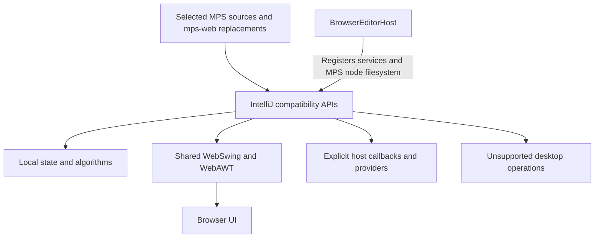

# IntelliJ compatibility overview

Inspected on 2 October 2026 in `C:/Codex/mps-j2cl`.

The `third_party/intellij-stubs` folder contains **276 Java source files** implementing the IntelliJ API subset used by the selected MPS browser profile. The name “stubs” understates the amount of working code: services, disposal, message delivery, undo, action contexts, clipboard history, scheduling, and several UI components have real behavior. Other APIs are declarations, simplified implementations, ignored options, or explicit failures.

This is a local compatibility implementation. It does not link IntelliJ implementation jars or provide a complete IntelliJ platform. [Build definition](C:/Codex/mps-j2cl/intellij-stubs.bzl:6).

## How the pieces fit



The compatibility layer supplies infrastructure consumed by the MPS editor. The projectional editor and MPS language/type-system behavior live elsewhere in the repository; these 276 files do not independently implement those systems.

“Implemented” below means that the inspected source performs the stated operation. It does not mean full IntelliJ API or behavioral parity. Many classes contain a mixture of implemented and simplified methods, so a percentage of “implemented files” would be misleading.

## Overview by subsystem

| Subsystem | Implemented behavior | Missing or restricted behavior |
| --- | --- | --- |
| Services and project identity | Explicit service registration and lookup, type checks, conflicting-registration rejection, project name/base path, disposal of registered services. | No automatic plugin discovery, dependency injection, project-file discovery, or settings persistence. Missing required services throw. |
| Object lifetime | Parent/child disposal tree, reparenting, cycle checks, reverse disposal order, repeated-disposal protection, continued cleanup after a child throws. | Designed for the browser's single event loop, not a complete concurrent desktop lifecycle system. |
| Message bus | Topic subscriptions, synchronous delivery, parent/child broadcast directions, disposable connections, cached typed publishers. | `syncPublisher` needs a registered factory; arbitrary Java proxy generation is absent. |
| Application access | Nested read/write context tracking, access assertions, write-action notifications, deferred Swing dispatch. | No JVM-style parallel execution or native modal queue. Read/write depths are context bookkeeping, not thread locks. |
| Commands and undo | Command lifecycle notifications, nested command grouping, per-project undo/redo action stacks, adjacent group merging, reverse undo, forward redo, history invalidation on playback failure. | Editor arguments do not partition history by document. Global-command marking does nothing. Undo confirmation policy does not produce a confirmation dialog. |
| Actions and data contexts | Registered actions, action presentations, update/perform callbacks, menus/toolbars, inherited data contexts, lazy cached values, explicit-null masking, dependency-cycle rejection. | No plugin action discovery. Toolbar layout policy and secondary-action presentation are only partially represented. Coordinate-based data-context lookup ignores coordinates. |
| Keyboard shortcuts | Mutable keymaps and single-keystroke Swing bindings. Default keymap supplies Escape, Up, Down, and Ctrl+Q. | Two-stroke action bindings and non-keyboard custom shortcuts throw. The default registry is not the full IDE keymap; the MPS host installs additional shortcuts separately. |
| Clipboard | Actual application clipboard integration, newest-first history, default limit 50, complete `Transferable` identity and custom node flavors preserved. | WebAWT's application clipboard does not itself provide OS/browser clipboard import/export. |
| Scheduling | Delayed and periodic callbacks, Swing event-thread dispatch, cancellation, exceptional completion, alarms, and merging update queues. | Cooperative browser execution rather than worker parallelism. Alarm modality is ignored. Blocking EDT termination is unavailable. |
| Progress and indexing state | Progress text/fraction, start/stop/cancel, state push/pop, noncancelable sections; `DumbService` queues callbacks until its state changes. | No indexing engine or progress presentation is created. Read-action/write-priority arbitration is not implemented; waiting synchronously for indexing throws while dumb. |
| Extensions and editor registration | In-memory extension lists scoped by name/area with disposable removal; registration and selection lists for file editors. | No plugin loading, extension scanning, editor factory, or tab/workspace manager. “Safe” extension iteration directly propagates callback failures. |
| Popup and tool-window UI | Lightweight Swing popups, focus handling, cancellation callbacks, disposal, list/submenu selection, documentation content panels, status text. | Native windows, docking, geometry persistence, modality, and many builder options are absent. List-popup speed-search/mnemonic/numbering aids are not implemented by the popup factory. |
| Text, icons, colors and matching | Measured/painted colored fragments, decorations, accessible text, layered icons, replaceable color scheme, host icon registry, case-sensitive/camel-boundary completion matching and match ranges. | Symbolic IntelliJ artwork defaults to placeholders. Fragment tags and `mainOnly` filtering are ignored. Completion ranking is a local algorithm, explicitly not IntelliJ score parity. Default font/colors use fixed values. |
| Virtual files | Protocol registration, URL routing, filename helpers, relative-path traversal over provider-supplied children. | Base content access and mutations need a backend. Base refresh is a no-op except for invoking the completion callback. No general local filesystem or persistent project storage is supplied. |
| Diagnostics and external links | Log/notification/console callbacks, notification expiration state, external-link callback. | Notification and console sinks default to `System.err`; external-link opening throws until configured. These APIs do not create a visible IDE console or notification center. |
| Utilities and declarations | Identity keys, user data, ranges, pairs, lists, text escaping, HTML construction, selected fonts/layout helpers, API interfaces and annotations. | Annotation presence does not activate persistence or IDE services. General reflective bean copying is explicitly unsupported. |

Representative implementations: [BrowserComponentManager](C:/Codex/mps-j2cl/third_party/intellij-stubs/src/com/intellij/compat/BrowserComponentManager.java), [Disposer](C:/Codex/mps-j2cl/third_party/intellij-stubs/src/com/intellij/openapi/util/Disposer.java), [DataManager](C:/Codex/mps-j2cl/third_party/intellij-stubs/src/com/intellij/ide/DataManager.java), [CopyPasteManagerEx](C:/Codex/mps-j2cl/third_party/intellij-stubs/src/com/intellij/ide/CopyPasteManagerEx.java), [BrowserEdtExecutor](C:/Codex/mps-j2cl/third_party/intellij-stubs/src/com/intellij/compat/BrowserEdtExecutor.java), [ToolWindowManager](C:/Codex/mps-j2cl/third_party/intellij-stubs/src/com/intellij/openapi/wm/ToolWindowManager.java), [NameUtil](C:/Codex/mps-j2cl/third_party/intellij-stubs/src/com/intellij/psi/codeStyle/NameUtil.java).

## Concrete examples of working implementations

### Undo executes recorded operations

The central playback logic in [UndoManager](C:/Codex/mps-j2cl/third_party/intellij-stubs/src/com/intellij/openapi/command/undo/UndoManager.java) is executable history management:

```java
if (forward) for (UndoableAction action : frame.actions) action.redo();
else for (int i = frame.actions.size() - 1; i >= 0; i--) frame.actions.get(i).undo();
if (historyVersion == version) { from.remove(from.size() - 1); to.add(frame); }
```

Undo reverses the action sequence; redo preserves it. The surrounding code suppresses recording during playback and clears history after playback failure. It stores model actions per project, not full IntelliJ document snapshots.

### Action data is computed and cached

[DataManager](C:/Codex/mps-j2cl/third_party/intellij-stubs/src/com/intellij/ide/DataManager.java:43) uses an actual lazy snapshot:

```java
public Object getData(String id) {
  if (cache.containsKey(id)) return cache.get(id);
  if (!values.containsKey(id)) return parent == null ? null : parent.getData(id);
  if (!evaluating.add(id)) throw new IllegalStateException("Cyclic lazy data dependency: " + id);
  try { Object result = values.get(id).get(); cache.put(id, result); return result; }
  finally { evaluating.remove(id); }
}
```

The separate `containsKey` checks matter: a locally supplied null masks a parent's value, and a null result is still cached.

### Indexing state is real, but no indexer is supplied

[DumbService](C:/Codex/mps-j2cl/third_party/intellij-stubs/src/com/intellij/openapi/project/DumbService.java:16):

```java
public void setBrowserDumb(boolean value) {
  dumb = value;
  if (!value) { List<Runnable> ready = new ArrayList<>(waiting); waiting.clear(); ready.forEach(Runnable::run); }
}
public void runWhenSmart(Runnable action) { if (dumb) waiting.add(action); else action.run(); }
```

This correctly retains and releases callbacks. A host must actually control that state and perform any indexing work.

## What is genuinely stubbed or silently simplified

### Popup flags often accept and ignore the requested behavior

[ComponentPopupBuilder](C:/Codex/mps-j2cl/third_party/intellij-stubs/src/com/intellij/openapi/ui/popup/ComponentPopupBuilder.java:16) contains:

```java
public ComponentPopupBuilder setResizable(boolean value) { return this; }
public ComponentPopupBuilder setMovable(boolean value) { return this; }
```

It also ignores project association, screen-bounds placement, modal context, outside-click/window-deactivation/other-window cancellation settings, cancel-key enablement, global-popup-stack membership, shadow, and dimension-service persistence. Its title setter only sets the content component's name. In contrast, focusability, initial focus request, minimum size, advertisement text, and cancel callback are used when building the popup.

[BalloonBuilder](C:/Codex/mps-j2cl/third_party/intellij-stubs/src/com/intellij/openapi/ui/popup/BalloonBuilder.java:17) ignores hide-on-action/frame-resize/key/link flags; other unsupported options throw. [HintHint](C:/Codex/mps-j2cl/third_party/intellij-stubs/src/com/intellij/ui/HintHint.java) also ignores several presentation/timing options.

### Some methods keep the signature without the named scheduling semantics

[ProgressManager](C:/Codex/mps-j2cl/third_party/intellij-stubs/src/com/intellij/openapi/progress/ProgressManager.java:34):

```java
public boolean runInReadActionWithWriteActionPriority(Runnable action, ProgressIndicator indicator) {
  runProcess(action, indicator); return true;
}
```

This installs the progress context and runs the action. It does not acquire an application read context, arbitrate pending writers, or return false because a writer takes priority.

Similarly, [ActionManager](C:/Codex/mps-j2cl/third_party/intellij-stubs/src/com/intellij/openapi/actionSystem/ActionManager.java:27) validates the three accepted toolbar layout constants but neither stores nor applies the selected policy. [ActionToolbar](C:/Codex/mps-j2cl/third_party/intellij-stubs/src/com/intellij/openapi/actionSystem/ActionToolbar.java:9) has empty secondary-icon/reserved-space setters.

### Placeholder types and fixed-profile values

| Source | What is actually present |
| --- | --- |
| [EditorImpl](C:/Codex/mps-j2cl/third_party/intellij-stubs/src/com/intellij/openapi/editor/impl/EditorImpl.java) | An empty final class with a private constructor; no IntelliJ text-editor engine. |
| [HintManagerImpl](C:/Codex/mps-j2cl/third_party/intellij-stubs/src/com/intellij/codeInsight/hint/HintManagerImpl.java) | Only the nested `ActionToIgnore` marker interface. |
| [Editor](C:/Codex/mps-j2cl/third_party/intellij-stubs/src/com/intellij/openapi/editor/Editor.java), [Document](C:/Codex/mps-j2cl/third_party/intellij-stubs/src/com/intellij/openapi/editor/Document.java), [ScrollingModel](C:/Codex/mps-j2cl/third_party/intellij-stubs/src/com/intellij/openapi/editor/ScrollingModel.java) | API contracts, with a few derived default methods; no concrete general-purpose IntelliJ editor/document supplied here. |
| [FeatureUsageTracker](C:/Codex/mps-j2cl/third_party/intellij-stubs/src/com/intellij/featureStatistics/FeatureUsageTracker.java:8) | `triggerFeatureUsed` does nothing; no telemetry collector. |
| [IdeBundle](C:/Codex/mps-j2cl/third_party/intellij-stubs/src/com/intellij/ide/IdeBundle.java:4) | Translates one key to “New Element”; otherwise returns the key and ignores formatting arguments. |
| [NewUI](C:/Codex/mps-j2cl/third_party/intellij-stubs/src/com/intellij/ui/NewUI.java) | `isEnabled()` always returns false. |
| [EditorCoreUtil](C:/Codex/mps-j2cl/third_party/intellij-stubs/src/com/intellij/openapi/editor/EditorCoreUtil.java) | Smooth-scrolling capability always returns false. |
| [ModalityState](C:/Codex/mps-j2cl/third_party/intellij-stubs/src/com/intellij/openapi/application/ModalityState.java) | Current/any/default/component modality all resolve to the same non-modal state. |
| [SystemInfo](C:/Codex/mps-j2cl/third_party/intellij-stubs/src/com/intellij/openapi/util/SystemInfo.java) | Browser identity and fixed OS flags, not detection of the user's operating system. |
| [RecentProjectsGroup](C:/Codex/mps-j2cl/third_party/intellij-stubs/src/com/intellij/ide/actions/RecentProjectsGroup.java) | Inherits a mutable action group; no automatic recent-project loading. |
| [State](C:/Codex/mps-j2cl/third_party/intellij-stubs/src/com/intellij/openapi/components/State.java), [Storage](C:/Codex/mps-j2cl/third_party/intellij-stubs/src/com/intellij/openapi/components/Storage.java), XML serialization annotations | Declaration metadata. No persistence/serialization engine is activated by using them. |

An empty body is not automatically a missing feature. Optional listener callbacks intentionally have empty defaults. `JBLayeredPane` and `IdeRootPane` inherit working Swing behavior. `EmptyCaret.paint` deliberately suppresses the insertion marker. `BrowserMessageBus.deliverImmediately` needs no work because delivery is already synchronous, and its `hasUndeliveredEvents` correctly returns false for that design.

## Operations that fail explicitly

| Operation | Current result |
| --- | --- |
| Application save/settings save, project save | Throws; host persistence is required. |
| Application exit/restart | Throws; host lifecycle is outside this implementation. |
| Synchronous yes/no confirmation | Throws; no user response is fabricated. Warning messages do go through notifications. |
| `XmlSerializerUtil.copyBean` | Throws; fields must be copied explicitly or a serializer supplied. |
| Unregistered message-bus publisher | Throws when `syncPublisher` cannot find a typed factory. |
| External link without installed opener | Throws. |
| Two-stroke or non-keyboard action binding | Throws. |
| Base virtual-file byte access, output, delete/rename/move/copy/create | Throws unless a provider overrides the operation. |
| Blocking `invokeAndWait` from outside the event thread; blocking EDT termination; waiting while dumb | Throws under those conditions. |
| Balloon click-blocking, persistent outside-click behavior, nonzero fadeout | The unsupported requested values throw. |

Sources: [Application](C:/Codex/mps-j2cl/third_party/intellij-stubs/src/com/intellij/openapi/application/Application.java:45), [Project](C:/Codex/mps-j2cl/third_party/intellij-stubs/src/com/intellij/openapi/project/Project.java:17), [Messages](C:/Codex/mps-j2cl/third_party/intellij-stubs/src/com/intellij/openapi/ui/Messages.java:15), [XmlSerializerUtil](C:/Codex/mps-j2cl/third_party/intellij-stubs/src/com/intellij/util/xmlb/XmlSerializerUtil.java:4), [AnAction](C:/Codex/mps-j2cl/third_party/intellij-stubs/src/com/intellij/openapi/actionSystem/AnAction.java:41), [VirtualFile](C:/Codex/mps-j2cl/third_party/intellij-stubs/src/com/intellij/openapi/vfs/VirtualFile.java:27).

The inventory reports 23 explicit unsupported-exception creation/throw sites. This is not a count of unsupported API methods or missing subsystems: multiple file operations share one exception factory, and invalid operations such as executing a separator also throw.

## What the current MPS host already supplies

[BrowserEditorHost](C:/Codex/mps-j2cl/browser/src/mpsj2cl/editor/BrowserEditorHost.java:73) creates a browser application and project and registers actual MPS platform, editor settings, intentions, documentation, highlighting, and search services. It creates real MPS `NodeEditorComponent` instances and installs editor shortcuts and project data providers.

It also registers `NodeVirtualFileSystem`. That is an MPS node-identity integration, not a disk-storage backend. [MPSNodeVirtualFile](C:/Codex/mps-j2cl/mps-web/workbench/mps-platform/source/jetbrains/mps/nodefs/MPSNodeVirtualFile.java) resolves nodes from the repository, exposes timestamps/validity, and deliberately returns empty byte content. Model data remains in the MPS repository.

[BrowserMpsAssets](C:/Codex/mps-j2cl/browser/src/mpsj2cl/editor/BrowserMpsAssets.java) registers MPS assets. That does not replace every symbolic IntelliJ icon: [BrowserIcons](C:/Codex/mps-j2cl/third_party/intellij-stubs/src/com/intellij/compat/BrowserIcons.java:24) paints a visible crossed-box placeholder when a named icon has no registered asset.

A source search in `browser`, `mps-web`, and `tests` found no production calls installing `BrowserUtil.setBrowserOpener`, `Notifications.Bus.setBrowserSink`, or `AnalyzeStacktraceUtil.setBrowserConsoleSink`. Within those inspected Java sources, their default throwing/stderr behavior therefore remains. This is a source-level wiring observation, not a browser interaction test.

Tool-window components and logical status components are available for a host to mount. Their existence does not itself supply a full IDE shell. General extension registration and message-bus publisher factories likewise require explicit wiring for the topics/extensions that callers need.

## What is needed to close the gaps

These are proposed additions, not changes made during this inspection.

1. **Make host integrations explicit.** Install external-link and visible notification/console callbacks; mount required tool/status panels and register each needed action, extension, publisher, and icon. Preserve the already working MPS service and node-filesystem registrations.
2. **Add persistence at the host boundary.** Define storage for project/model data and settings, restoration, and asynchronous save/error handling. An in-memory service plus `@State` is insufficient. Keep node identities distinct from serialized model bytes.
3. **Resolve behavior that is silently ignored.** For any popup, toolbar, progress-priority, or data-context option actually needed by MPS, implement its browser meaning or make the limitation explicit. Add targeted behavior checks for those options, rather than treating successful compilation as proof.
4. **Use asynchronous browser workflows for blocking desktop operations.** Confirmation dialogs, modal work, OS clipboard access, and backend file access need host workflows compatible with the browser event loop. Adding dummy return values would conceal the missing behavior.
5. **Choose the required editor/platform scope.** Full IntelliJ text editing, indexing, plugin discovery, docking, and settings management would require substantial additional systems. The projectional MPS editor can instead keep consuming the smaller, explicitly supported interface.

To reduce MPS source replacements, reusable IntelliJ API behavior belongs in this compatibility layer and reusable Swing/AWT behavior in the shared libraries. MPS-specific reflection, generated registration, model persistence, and service bootstrap adaptations still require MPS-side work. Filling in these 276 sources alone cannot eliminate all `mps-web` changes.

## Validation and evidence

Fresh checks performed during this inspection:

- `tools/inventory_intellij.py --check` passed: **2,052 selected MPS sources, 100 overlays, 276 compatibility providers, zero unresolved provider references**.
- `tools/run_intellij_contracts.py` passed: **147 synchronous assertions and the asynchronous scheduler contracts** on the JVM. Compilation emitted a deprecated-API note for `FontInfo`.
- Representative stateful implementations and the placeholder/unsupported paths above were inspected directly.

Provider resolution establishes that the referenced owner has a compatibility source; it does not prove every member, overload, or semantic contract. The JVM run compiles all compatibility sources, but neither tests every method nor proves browser rendering or scheduler parity.

[Existing browser results](C:/Codex/mps-j2cl/out/intellij_contracts-browser-results.json) record passing development/optimized runs across Chromium, Firefox, and WebKit, including popup-focus and scheduler checks. Those browser runs were **not rerun for this inspection**, and their recorded bundle hashes were not revalidated against a fresh build.

The older [boundary document](C:/Codex/mps-j2cl/docs/intellij-browser-boundary.md:15) still says 99 replacements and 275 compatibility files. The fresh counts above and [current inventory](C:/Codex/mps-j2cl/compatibility/intellij-api.json) supersede those two prose counts.

No runtime implementation files were changed for this overview.
