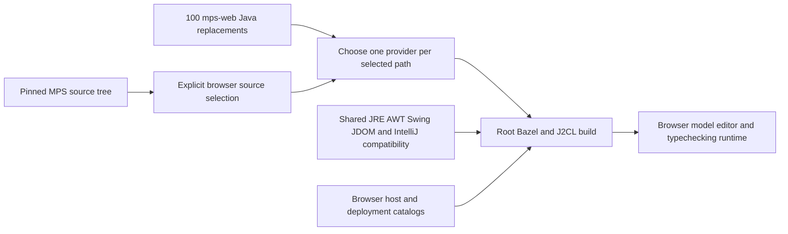
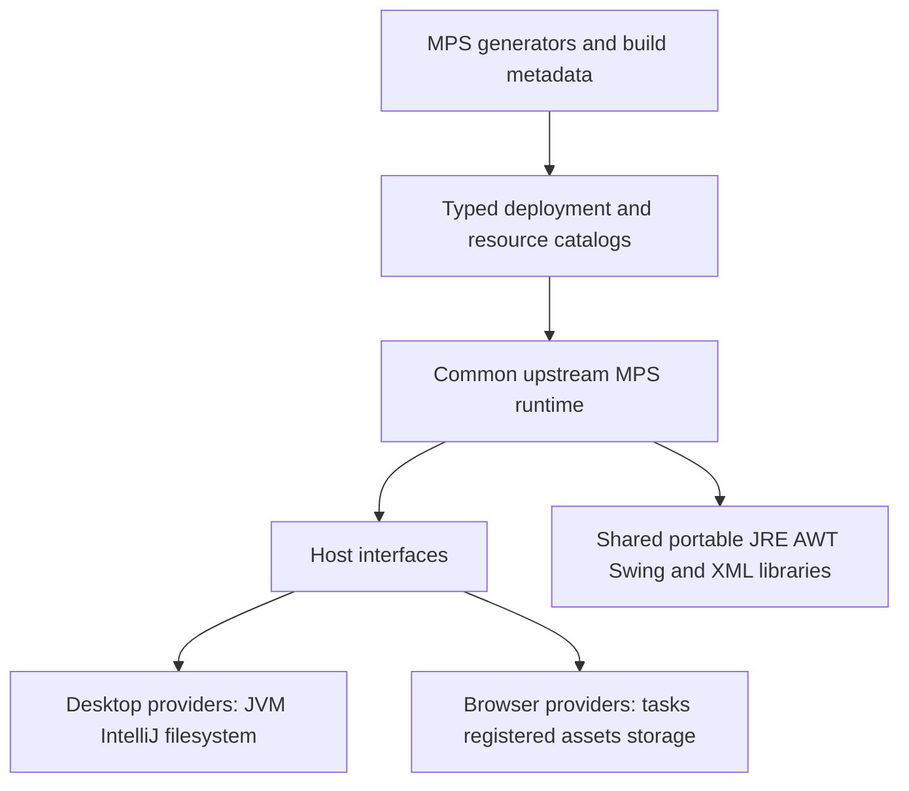

# mps-web overview and prevention plan

`mps-web` contains **100 replacements for existing MPS Java files**, plus **16 IntelliJ module descriptors**. The replacements bridge the selected MPS runtime to the current J2CL browser environment. They range from one-line API substitutions to new deployment, scheduling and project-service implementations. Removing the need for them requires several different actions: use shared APIs that already exist, fill remaining shared-library gaps, and give MPS explicit interfaces for browser-dependent services.

The practical first step is to test a small set of older API substitutions against the current shared runtime. The larger reduction comes from upstream MPS interfaces and generated deployment catalogs. Moving MPS classes into another local directory would reduce the folder's count while retaining the same maintenance burden.

This is a source-grounded analysis and proposed reduction plan, dated **2 October 2026**. No runtime replacement was removed or changed. The companion [per-file analysis](C:/Codex/mps-j2cl/docs/mps-web-file-analysis.md) covers all 116 files with code evidence, behavioral limits and a removal prerequisite for each.

## Scope and verified counts

| Item | Current result | Meaning |
| --- | ---: | --- |
| Files in mps-web | 116 | Every file appears in the companion document. |
| Java replacements | 100 | Each has an existing upstream Java counterpart and an explicit override entry. |
| Added Java files in this folder | 0 | Additional browser host/helper code lives elsewhere. |
| IntelliJ descriptors | 16 | Nine have no exact same-path upstream descriptor; seven customize an existing descriptor. |
| Selected browser projects | 36 | This is the selected profile, not the entire desktop IDE. |
| Selected MPS Java files | 2,052 | 100 replacements plus 1,952 direct upstream files. |
| Replaced share of selected files | 4.87% | A file-count ratio, not the fraction of behavior rewritten. |
| Source audit errors | 0 | Ownership, registration and duplicate-type checks pass. |

The baseline is MPS commit `d2589ed55bbc9445b660769fcc17da97e8e395a6`, with Bazel `8.3.1` and J2CL `20260402` recorded in [source-lock.json](C:/Codex/mps-j2cl/source-lock.json). Local MPS HEAD matches that commit, and the 100 compared original Java files match its content after line-ending normalization. The wider upstream working tree has existing IDE metadata changes; no clean-working-tree assumption was used.

The current [source audit](C:/Codex/mps-j2cl/out/mps-web-analysis-source-audit.json) was run for this analysis. The README's 99-replacement figure is stale. A source audit does not show that a proposed removal compiles or behaves correctly in the browser; no such removal experiment was performed here.

## How replacement works

The root [replacement manifest](C:/Codex/mps-j2cl/mps-overrides.bzl) maps each original path to the same relative path in `mps-web`. The [build rule](C:/Codex/mps-j2cl/mps-rules.bzl) selects one whole compilation unit:

```python
"mps-web/" + MPS_OVERRIDES[path] if path in MPS_OVERRIDES else "mps/" + path
```



This mechanism preserves the upstream Java source files. It also means a one-line change replaces an entire class file. Omitted desktop classes are controlled separately by [browser-profile.json](C:/Codex/mps-j2cl/compatibility/browser-profile.json); those exclusions are not part of the 100-file replacement count. [browser/src](C:/Codex/mps-j2cl/browser/src), [financial-web](C:/Codex/mps-j2cl/financial-web) and [third_party](C:/Codex/mps-j2cl/third_party) are adjacent adaptation layers outside this document's file inventory.

The `.iml` files serve IDE indexing. The root [.idea/modules.xml](C:/Codex/mps-j2cl/.idea/modules.xml) references all 16. [inventory_mps.py](C:/Codex/mps-j2cl/tools/inventory_mps.py) reads the pinned upstream descriptors for the Bazel catalog, and [check_sources.py](C:/Codex/mps-j2cl/tools/check_sources.py) explicitly excludes local `.iml` metadata from the replacement audit. Relocating IDE metadata is a separate maintenance task.

## Changes grouped by cause

Each Java file belongs to exactly one primary group in the following count. Some files address several causes; their complete per-file entries explain those overlaps. The final section lists every group member.

| Primary group | Java files | Main way to prevent local replacement |
| --- | ---: | --- |
| Java APIs and text processing | 27 | Use existing shared APIs first; fill remaining JRE/configuration gaps centrally. |
| Compiled deployment and reflection | 17 | Generate catalogs and expose upstream construction/resource/ownership services. |
| Files archives and XML | 14 | Separate lexical paths from actual storage and archive providers. |
| Weak references and lifecycle | 7 | Upstream deterministic cleanup; centralize compatible weak collections. |
| Icon resources and encoding | 5 | Generate resource metadata; move general encoding/loading into shared libraries. |
| Editor rendering input and dialogs | 11 | Move generic peer support into Swing/AWT and expose MPS host/view interfaces. |
| Scheduling model access and invalidation | 9 | Use asynchronous scheduling and explicit model/check lifetimes upstream. |
| Project services node handles and undo | 8 | Separate model/project operations from desktop IntelliJ integration. |
| JVM instrumentation | 1 | Make JVM instrumentation an optional desktop service. |
| Upstream diagnostic fix | 1 | Upstream the small diagnostic fix or update the pinned MPS version. |
| Total | 100 | Resolve all responsibilities in a file before retiring it. |

### Java APIs and text processing

The 27 files in this group adapt formatting, resources, Java-name validation, time values, array copies, newer collection APIs, properties, tokenizers, regexes and stack traces. The smallest substitutions have high potential for removal because the composed runtime has improved since they were introduced.

For example, `Message` changes only the representation of its creation time:

```java
// Pinned upstream
private final Instant myCreationTime = Instant.now();

// Current browser replacement
private final long myCreationTime = System.currentTimeMillis();
```

The shared [Instant implementation](C:/Codex/mps-j2cl/third_party/j2cl/api-support/jre/java/java/time/Instant.java) now contains `now()` and `toEpochMilli()`. That is concrete evidence for testing retirement of this overlay. It does not establish that the original has already been restored and tested.

Some entries still require more substantial shared support: `StringsIO` contains a UTF-8 line reader; `SModelName` embeds Unicode identifier tables and English messages; `MacroHelper` changes its public field and matcher types. The latter causes dependent substitutions in `PathSpec` and `ProjectModuleLoader`, illustrating how one missing shared abstraction can multiply local changes. See [F007 StringsIO.java](C:/Codex/mps-j2cl/docs/mps-web-file-analysis.md#f007-stringsiojava), [F019 Message.java](C:/Codex/mps-j2cl/docs/mps-web-file-analysis.md#f019-messagejava), [F031 SModelName.java](C:/Codex/mps-j2cl/docs/mps-web-file-analysis.md#f031-smodelnamejava), [F035 ProjectModuleLoader.java](C:/Codex/mps-j2cl/docs/mps-web-file-analysis.md#f035-projectmoduleloaderjava), [F065 MacroHelper.java](C:/Codex/mps-j2cl/docs/mps-web-file-analysis.md#f065-macrohelperjava), [F066 PathSpec.java](C:/Codex/mps-j2cl/docs/mps-web-file-analysis.md#f066-pathspecjava).

### Compiled deployment and reflection

The 17 files in this group replace constructor/method discovery, defining-loader inspection, package metadata and unstable class-name serialization with explicit registries. Language runtimes, generators, extension descriptors, activators, quick fixes, queries, scopes and selections must already be linked into the browser application.

`ModuleClassLoader` retains module/dependency/parent distinctions but cannot define JVM bytecode. Its factory registrations supply actual constructors and stable binary names. `LanguageRegistry` adds direct compiled-language deployment, activation, rollback and unload tracking. `QueryMethods` changes a public return type from `Method` to its own registered descriptor. These are architectural boundaries, not missing one-line library methods. See [F010 ModuleClassLoader.java](C:/Codex/mps-j2cl/docs/mps-web-file-analysis.md#f010-moduleclassloaderjava), [F022 LanguageRegistry.java](C:/Codex/mps-j2cl/docs/mps-web-file-analysis.md#f022-languageregistryjava), [F028 QueryMethods.java](C:/Codex/mps-j2cl/docs/mps-web-file-analysis.md#f028-querymethodsjava) and [runtime-factories.md](C:/Codex/mps-j2cl/docs/runtime-factories.md).

The proposed common solution is a generated deployment catalog plus upstream MPS services for construction, invocation, class ownership and resources. Catalog generation can remove handwritten registration maintenance. It removes the source overlays only when upstream callers can consume those services. Supporting reflection in J2CL instead would still require emitted metadata, invocation code and a policy for optimizer stripping; it would not supply runtime JVM bytecode execution.

### Files archives and XML

The 14 files in this group cover three distinct responsibilities: lexical paths/URLs, buffered XML/resources, and actual files/archives. Several URL substitutions could disappear through `File.toURI` and `URI.toURL` support in the shared libraries. XML parsing already delegates to the portable JDOM implementation, but its replacement parser type and file overloads differ from desktop JAXP/file behavior.

JAR content, ZIP output/extraction and host JDK discovery are explicitly unavailable at the inspected boundaries. A registered memory resource or lexical `file:` URL is not proof of storage access. `FileUtil` combines ZIP rejection, literal splitting and a new URI encoder; resolving only one of these cannot retire the whole class. See [F020 SDKDiscovery.java](C:/Codex/mps-j2cl/docs/mps-web-file-analysis.md#f020-sdkdiscoveryjava), [F025 JDOMUtil.java](C:/Codex/mps-j2cl/docs/mps-web-file-analysis.md#f025-jdomutiljava), [F029 UnzipUtil.java](C:/Codex/mps-j2cl/docs/mps-web-file-analysis.md#f029-unziputiljava), [F038 JarFileClassPathItem.java](C:/Codex/mps-j2cl/docs/mps-web-file-analysis.md#f038-jarfileclasspathitemjava), [F063 FileUtil.java](C:/Codex/mps-j2cl/docs/mps-web-file-analysis.md#f063-fileutiljava), [F068 JarEntryFile.java](C:/Codex/mps-j2cl/docs/mps-web-file-analysis.md#f068-jarentryfilejava), [F069 JarFileData.java](C:/Codex/mps-j2cl/docs/mps-web-file-analysis.md#f069-jarfiledatajava).

The proposed solution is to split storage/archive/SDK services from common MPS logic. Buffered browser data can be loaded asynchronously and then passed into synchronous parsing/model operations. A ZIP library alone would not provide filesystem permissions, file watchers, durable saving or execution of class files extracted from an archive.

### Weak references and lifecycle

Seven replacements address weak storage and explicit cleanup. `WeakSet` preserves Java equality with native weak references but strongly retains primitive-backed values and scans its entries. `DynamicComponentPlugin` needs WeakMap value semantics as well as WeakRef enumeration. Typechecking facades/controllers and the transfer manager need explicit ownership when a host shuts down and restarts on the same browser event thread. See [F014 DynamicComponentPlugin.java](C:/Codex/mps-j2cl/docs/mps-web-file-analysis.md#f014-dynamiccomponentpluginjava), [F046 DefaultTypecheckingController.java](C:/Codex/mps-j2cl/docs/mps-web-file-analysis.md#f046-defaulttypecheckingcontrollerjava), [F047 TypecheckingFacadeComponent.java](C:/Codex/mps-j2cl/docs/mps-web-file-analysis.md#f047-typecheckingfacadecomponentjava), [F048 WorkbenchTypecheckingController.java](C:/Codex/mps-j2cl/docs/mps-web-file-analysis.md#f048-workbenchtypecheckingcontrollerjava), [F049 TypecheckingFacade.java](C:/Codex/mps-j2cl/docs/mps-web-file-analysis.md#f049-typecheckingfacadejava), [F060 WeakSet.java](C:/Codex/mps-j2cl/docs/mps-web-file-analysis.md#f060-weaksetjava), [F077 DataTransferManager.java](C:/Codex/mps-j2cl/docs/mps-web-file-analysis.md#f077-datatransfermanagerjava).

Weak collections belong in the shared runtime. MPS session/listener/controller disposal belongs upstream in MPS. Adding weak-reference APIs cannot infer when a browser host ends, and garbage collection should not be the only way to detach listeners or invalidate disposed services.

### Icon resources and encoding

Five files keep the real MPS icon catalog and selection logic while replacing runtime classloader/package discovery with registered resource origins. `BaseIconManager` invalidates its cache using resource generations, and `IconCreationUtil` implements a real PNG encoder inside MPS. See [F024 IconCreationUtil.java](C:/Codex/mps-j2cl/docs/mps-web-file-analysis.md#f024-iconcreationutiljava), [F045 IconResource.java](C:/Codex/mps-j2cl/docs/mps-web-file-analysis.md#f045-iconresourcejava), [F101 MPSIcons.java](C:/Codex/mps-j2cl/docs/mps-web-file-analysis.md#f101-mpsiconsjava), [F104 BaseIconManager.java](C:/Codex/mps-j2cl/docs/mps-web-file-analysis.md#f104-baseiconmanagerjava), [F105 IconLoadingUtil.java](C:/Codex/mps-j2cl/docs/mps-web-file-analysis.md#f105-iconloadingutiljava).

The proposed ownership is: general image encoding in the image/AWT library, general icon loading/cache services in the shared UI layer, and MPS-specific icon choices in MPS. Build-generated asset/provider catalogs must install real bytes and unregister module metadata. Moving the PNG encoder is useful, but restoring `IconCreationUtil` unchanged also needs the original ImageIO API or an upstream encoder interface.

### Editor rendering input and dialogs

Eleven replacements cover canvas painting, native input/IME, shortcuts, documentation, paste import decisions and a reduced IntelliJ editor facade. `EditorComponent`, its gutter and completion panel retain their original painting algorithms while mounting browser paint surfaces. The shared Swing library already owns `BrowserPaintSurface` and input helpers, but MPS still contains the wiring. See [F080 NodeSubstitutePatternEditor.java](C:/Codex/mps-j2cl/docs/mps-web-file-analysis.md#f080-nodesubstitutepatterneditorjava), [F085 EditorComponent.java](C:/Codex/mps-j2cl/docs/mps-web-file-analysis.md#f085-editorcomponentjava), [F092 LeftEditorHighlighter.java](C:/Codex/mps-j2cl/docs/mps-web-file-analysis.md#f092-lefteditorhighlighterjava).

Generic custom-component painting and native-input translation can move further into Swing/AWT peers. MPS action policy, selection commands and host lifecycle need upstream hooks. `EditorComponent` also turns two Java assertions into unconditional guarded `AssertionError` throws, so removing its painting bridge alone is insufficient.

Documentation currently uses normalized plain text, and its CSS helper rejects unsupported use. Paste import selection is a synchronous host policy with a nonblocking requirement; it is not an asynchronous interactive dialog. `PlatformEditorEmulation` implements the selected smaller IntelliJ interface rather than all desktop text-editor APIs. Restoring these behaviors needs view/dialog interfaces or more complete shared UI implementations. See [F082 MPSDocumentationEditorPane.java](C:/Codex/mps-j2cl/docs/mps-web-file-analysis.md#f082-mpsdocumentationeditorpanejava), [F083 MPSDocumentationHtmlUtil.java](C:/Codex/mps-j2cl/docs/mps-web-file-analysis.md#f083-mpsdocumentationhtmlutiljava), [F095 PlatformEditorEmulation.java](C:/Codex/mps-j2cl/docs/mps-web-file-analysis.md#f095-platformeditoremulationjava), [F103 AddRequiredImportsDialog.java](C:/Codex/mps-j2cl/docs/mps-web-file-analysis.md#f103-addrequiredimportsdialogjava).

### Scheduling model access and invalidation

Nine replacements translate assumptions about threads, delays, cancellation and timestamps into browser task scheduling. Zero-delay `schedule` is used deliberately because the sibling executor's ordinary submission path can run inline. Highlighter continuations yield between editors after leaving read/typechecking scopes; an individual checker remains synchronous. Intention requests use a cancellable alarm instead of a sleeping thread. See [F044 DefaultModelAccess.java](C:/Codex/mps-j2cl/docs/mps-web-file-analysis.md#f044-defaultmodelaccessjava), [F087 HighlighterUpdateSession.java](C:/Codex/mps-j2cl/docs/mps-web-file-analysis.md#f087-highlighterupdatesessionjava), [F088 Highlighter.java](C:/Codex/mps-j2cl/docs/mps-web-file-analysis.md#f088-highlighterjava), [F090 IntentionsSupport.java](C:/Codex/mps-j2cl/docs/mps-web-file-analysis.md#f090-intentionssupportjava), [F108 ThreadUtils.java](C:/Codex/mps-j2cl/docs/mps-web-file-analysis.md#f108-threadutilsjava), [F115 ProjectModelAccess2.java](C:/Codex/mps-j2cl/docs/mps-web-file-analysis.md#f115-projectmodelaccess2java).

The required upstream interfaces are an asynchronous scheduler, cancellation/lifetime ownership, a host activity predicate and model-command access. Timer primitives in a library cannot automatically rewrite blocking control flow. `IncrementalTypecheckingComponent` also deals with equal timestamps; revision counters would express ordering more reliably. `ActionDispatcher` contains exception/cleanup fixes that should survive any compatibility reduction. See [F043 ActionDispatcher.java](C:/Codex/mps-j2cl/docs/mps-web-file-analysis.md#f043-actiondispatcherjava), [F053 IncrementalTypecheckingComponent.java](C:/Codex/mps-j2cl/docs/mps-web-file-analysis.md#f053-incrementaltypecheckingcomponentjava), [F089 HintPopupController.java](C:/Codex/mps-j2cl/docs/mps-web-file-analysis.md#f089-hintpopupcontrollerjava).

### Project services node handles and undo

Eight files replace desktop startup, project filesystem/VCS integration, node VirtualFiles and document-oriented undo bookkeeping. They retain real MPS repositories and UndoItems. The browser has one model history per project and clears that history conservatively when models are removed or replaced. Node files are identity handles with empty byte content and ephemeral paths. See [F107 MPSCoreComponents.java](C:/Codex/mps-j2cl/docs/mps-web-file-analysis.md#f107-mpscorecomponentsjava), [F109 OnReloadingUndoCleaner.java](C:/Codex/mps-j2cl/docs/mps-web-file-analysis.md#f109-onreloadingundocleanerjava), [F110 UndoActionsCollector.java](C:/Codex/mps-j2cl/docs/mps-web-file-analysis.md#f110-undoactionscollectorjava), [F111 WorkbenchUndoHandler.java](C:/Codex/mps-j2cl/docs/mps-web-file-analysis.md#f111-workbenchundohandlerjava), [F112 MPSNodeVirtualFile.java](C:/Codex/mps-j2cl/docs/mps-web-file-analysis.md#f112-mpsnodevirtualfilejava), [F113 NodeVirtualFileSystem.java](C:/Codex/mps-j2cl/docs/mps-web-file-analysis.md#f113-nodevirtualfilesystemjava), [F114 MPSProject.java](C:/Codex/mps-j2cl/docs/mps-web-file-analysis.md#f114-mpsprojectjava), [F116 BaseAction.java](C:/Codex/mps-j2cl/docs/mps-web-file-analysis.md#f116-baseactionjava).

The proposed upstream split is between common project/model operations and host services for history, storage, node identity and activity. `MPSProject.save()` delegates to the host; that delegation does not demonstrate persistence. `BaseAction` assumes no active make session. Those assumptions need explicit providers if browser deployment, saving or compilation expands.

### JVM instrumentation and the upstream diagnostic fix

`MemoryAnalyzer` reports instrumentation unavailable and throws from size operations. An optional instrumentation service would let the browser exclude this desktop implementation without presenting JavaScript heap measurements as JVM object sizes. Separately, `ClassLoaderManager` has a simple formatting-parenthesis bug fix that should go upstream or disappear after an upstream version update. See [F008 ClassLoaderManager.java](C:/Codex/mps-j2cl/docs/mps-web-file-analysis.md#f008-classloadermanagerjava), [F093 MemoryAnalyzer.java](C:/Codex/mps-j2cl/docs/mps-web-file-analysis.md#f093-memoryanalyzerjava).

## Shared support that already exists

Before adding another compatibility implementation, test the existing composed runtime. The following are concrete candidates, ordered to start with changes that are small and easy to review. These are proposals, not verified safe deletions.

| Candidate | Evidence already present | Remaining verification |
| --- | --- | --- |
| Five format-only replacements: DataSourceNotSupportedProblem, ModelFactory, PerformanceTracer, Files, PathFormatChecker | [MpsFormatter](C:/Codex/mps-j2cl/third_party/j2cl/api-support/jre/java/javaemul/internal/MpsFormatter.java) and [formatting contracts](C:/Codex/mps-j2cl/docs/formatting.md) support their simple `%s` calls. | Compile originals; compare null handling, exact diagnostics and browser execution. |
| Message | Shared Instant has now and toEpochMilli. | Creation-time behavior and relevant callers. |
| MPSClassLoadersRegistry | Shared Instant and [Duration](C:/Codex/mps-j2cl/third_party/j2cl/api-support/jre/java/java/time/Duration.java) include the required operations. | Timeout/null boundaries and clock changes. |
| StringUtil | Shared [List](C:/Codex/mps-j2cl/third_party/j2cl/api-support/jre/java/java/util/List.java) has getFirst; [prepare_api_basics.py](C:/Codex/mps-j2cl/tools/prepare_api_basics.py) emits Stream.toList. | Empty/space/capitalization cases and compilation of the complete original method. |
| PatternUtil, ModuleReference, NameUtil | The [regex subset](C:/Codex/mps-j2cl/tests/regex/README.md) covers many relevant constructs; StringTokenizer is present in shared API support. | Exact original expressions and tokenizer semantics in actual callers. |
| MacroHelper with PathSpec and ProjectModuleLoader | Shared Pattern/Matcher may cover the fixed macro grammar. | Restore all three public/caller types together; test greedy matching and malformed input. |
| QualifiedPath and PathFormats | Character int support and regex quoting exist. | Check the complete stream/String.split call chains and path/UTF-16 semantics. |

The first four rows comprise **eight files worth testing first**: [F032 DataSourceNotSupportedProblem.java](C:/Codex/mps-j2cl/docs/mps-web-file-analysis.md#f032-datasourcenotsupportedproblemjava), [F033 ModelFactory.java](C:/Codex/mps-j2cl/docs/mps-web-file-analysis.md#f033-modelfactoryjava), [F058 PerformanceTracer.java](C:/Codex/mps-j2cl/docs/mps-web-file-analysis.md#f058-performancetracerjava), [F062 Files.java](C:/Codex/mps-j2cl/docs/mps-web-file-analysis.md#f062-filesjava), [F074 PathFormatChecker.java](C:/Codex/mps-j2cl/docs/mps-web-file-analysis.md#f074-pathformatcheckerjava), [F019 Message.java](C:/Codex/mps-j2cl/docs/mps-web-file-analysis.md#f019-messagejava), [F011 MPSClassLoadersRegistry.java](C:/Codex/mps-j2cl/docs/mps-web-file-analysis.md#f011-mpsclassloadersregistryjava), [F059 StringUtil.java](C:/Codex/mps-j2cl/docs/mps-web-file-analysis.md#f059-stringutiljava). There is no supported claim yet that all eight can be deleted. `IFileUtil`, for example, is not on that shortlist because it also replaces date formatting. `State` only removes an annotation on a method that still rejects cloning; it should not be treated as a general state-copy rewrite.

Some manifest wording is broader than the current code. `ZipFileContainer` is an empty shell and does not itself throw; `WorkbenchTypecheckingController` adds disposed checks while cleanup is in its base controller; `JarEntryFile` also removes timestamp access. The companion analysis makes these distinctions explicitly.

## What is necessary to avoid future replacements

### Define common MPS service boundaries

The following diagram is a proposed destination, not the current implementation:



The central interfaces should cover construction/query invocation; resource origins and buffered streams; schedulers and activity; model/project/undo lifetime; views and user decisions; storage/archives; and optional SDK/profiling capabilities. MPS domain logic should stay in MPS. Browser-native behavior still has an implementation, but shared classes can call it through an intentional interface instead of requiring copied MPS classes.

If the requirement is to retain the exact current upstream MPS revision without changes, several substantial replacements remain necessary unless equivalent runtime/compiler capabilities are added below it. If upstream MPS can gain these interfaces, a much smaller local overlay becomes feasible. “Zero local replacements” is a plausible architectural direction, not a result established by this audit.

### Generate declarations that reflection currently discovers

A catalog should declare classes, exact constructor signatures, query callbacks, stable selection/filter IDs, rule language ownership, module/package resource origins and asset bytes. Its entries should call actual generated classes directly. Use literal persisted names instead of deriving keys from `Class.getName()` in stripped builds.

The catalog needs an explicit install/uninstall lifecycle: deploy dependencies first; register before MPS listeners construct runtimes; remove contributions and dispose sessions before releasing metadata. Current query registrations require separate close handles and are not automatically disposed by `ModuleClassLoader`. A generated catalog should own those handles as well. The existing financial demo/catalog is application-specific and does not establish automatic deployment for every MPS language.

For adaptations to MPS `source_gen` files, change the source model/generator or a supported generated companion contract. Reapplying textual substitutions after each generation leaves ongoing divergence even when the output is reproducible.

### Keep shared compatibility in its owning library

Portable Java API gaps belong in the shared JRE/compiler layer; IO/network conversions in IO/network support; PNG/ImageIO behavior in graphics/image support; generic painting/input and HTML behavior in UI libraries; and XML parser/provider compatibility in XML/JRE support. The workspace's [UI-library migration](C:/Codex/mps-j2cl/docs/ui-library-migration.md) documents an existing example of moving reusable AWT/Swing behavior to its library owners.

Ownership must remain singular for `java.*` types. The consuming root still composes patches and selects compatible versions; moving a helper must not create duplicate JRE classes. Several overlays combine shared compatibility with MPS-specific lifecycle changes, so split those responsibilities before judging a file ready for removal.

### Preserve deliberate fixes and define unsupported features

Upstream the diagnostic fix, deterministic disposal, exception cleanup, stale-popup cancellation and appropriate input/timestamp fixes. They should not vanish when an API becomes available. Changes to assertion behavior, weak-value retention, undo granularity and plain-text documentation must remain deliberate product/runtime decisions.

Archive access, durable model saving, full HTML rendering, interactive asynchronous import dialogs and JVM-style profiling are separate capabilities. Keep their providers optional and their unavailable behavior explicit. Removing an exception without supplying the capability is not successful replacement retirement.

## Proposed execution sequence

| Order | Concrete work | Exit condition |
| --- | --- | --- |
| 1 | In an isolated trial, restore the eight small candidates against the existing shared runtime. | Originals compile and relevant JVM/browser comparisons pass; only then remove their mappings and generator rewrites. |
| 2 | Trial the regex/tokenizer group, including the three-file macro chain. | Original public types are restored consistently and edge-case goldens match. |
| 3 | Fill remaining reusable API gaps: URI conversion, messages/line input, array overloads and optional image/XML adapters. | Shared implementations have their own contracts; MPS call sites can return to their intended APIs. |
| 4 | Add upstream compiled-deployment and generated catalog interfaces. | A concrete generated language deploys, unloads and redeploys with classes, queries, rules, selections and resources in stripped builds. |
| 5 | Introduce common scheduler/model/project/view services and upstream lifecycle fixes. | Live editing, highlighting, IME, selection, undo and repeated host shutdown retain their tested behavior. |
| 6 | Split optional desktop storage/SDK/profiling implementations from the browser source profile. | Excluded capabilities are explicit; enabled browser providers have real behavior and lifecycle. |
| 7 | Generate IDE metadata and refresh counts/documentation from the selected-source manifest. | IDE roots are valid and source-audit counts remain authoritative. |

These steps are dependency-ordered proposals, not a time estimate or a guaranteed reduction count. For example, restoring the original `MacroHelper` can remove two caller adaptations, while moving only the paint surface leaves other changes in `EditorComponent`.

## How to verify each removal

For an approved implementation, restore the exact pinned original through source selection, remove its override/reason, and adjust every generator that recreates it. Several overlays are generated by `prepare_*` or `make_*` scripts; [check_generated.py](C:/Codex/mps-j2cl/tools/check_generated.py) enumerates the checked generation steps. Hand-deleting generated output is temporary and will fail regeneration checks.

Run the source audit and relevant generator checks, then the build and behavior tests for the affected contract. The repository already has useful fixtures:

| Change area | Existing evidence to extend or rerun |
| --- | --- |
| Formatting, time, collections and Unicode | [formatting tests](C:/Codex/mps-j2cl/tests/formatting), [typechecking/JRE tests](C:/Codex/mps-j2cl/tests/typechecking), [runtime support](C:/Codex/mps-j2cl/tests/runtime_support) |
| Patterns, tokenization, paths and line input | [regex tests](C:/Codex/mps-j2cl/tests/regex), [editor utilities](C:/Codex/mps-j2cl/tests/editor_utilities), [VFS tests](C:/Codex/mps-j2cl/tests/vfs), [kernel utilities](C:/Codex/mps-j2cl/tests/kernel_utilities) |
| Class/resource/factory ownership and queries | [classloader tests](C:/Codex/mps-j2cl/tests/classloader), [runtime factories](C:/Codex/mps-j2cl/tests/runtime_factories), [kernel utilities](C:/Codex/mps-j2cl/tests/kernel_utilities) |
| Weak contributions, sessions and restart | [dynamic components](C:/Codex/mps-j2cl/tests/dynamic_components), [typechecking tests](C:/Codex/mps-j2cl/tests/typechecking), [live editor tests](C:/Codex/mps-j2cl/tests/editor_live) |
| XML, icon bytes and registered assets | [JDOM utility tests](C:/Codex/mps-j2cl/tests/jdom_util), [icon creation](C:/Codex/mps-j2cl/tests/icon_creation), [live editor resources](C:/Codex/mps-j2cl/tests/editor_live/EditorResourceContracts.java) |
| Input, rendering, highlighting, selections and undo | [editor runtime contracts](C:/Codex/mps-j2cl/tests/editor_runtime), [live browser runner](C:/Codex/mps-j2cl/tools/test_editor_live.mjs) and the owning sibling UI library suites |

Use development and optimized bundles, and stripped-metadata variants for registries/resources/selections. Real browser tests are needed for event-loop ordering, canvas/native input and disposal; JVM compilation or an oracle alone cannot establish those behaviors. Match served-bundle identity to the new build. For broader implementation validation, use [validate.py](C:/Codex/mps-j2cl/tools/validate.py) and the repository's [validation guidance](C:/Codex/mps-j2cl/docs/validation.md), including serialized shared WSL/Bazel work.

For this documentation task, verification was limited to the current source audit, complete file coverage, exact code excerpt extraction, count reconciliation and local-link checks. The snapshot's combined file-path/content digest is `d2f976721191af5981456782e0b7e7c0e3993575a6a2970e2875325dc8229e7e`. No build or browser result is claimed for the proposed removals. These are editable Markdown documents; their visual rendering and Mermaid diagrams were not independently inspected.

## Complete membership of the groups

Each link opens the corresponding file analysis. The groups below account for all 100 Java files exactly once; the additional 16 IDE descriptors are indexed and analyzed in the companion document.

### Java APIs and text processing

[F002 PredefinedRuleKinds.java](C:/Codex/mps-j2cl/docs/mps-web-file-analysis.md#f002-predefinedrulekindsjava), [F007 StringsIO.java](C:/Codex/mps-j2cl/docs/mps-web-file-analysis.md#f007-stringsiojava), [F011 MPSClassLoadersRegistry.java](C:/Codex/mps-j2cl/docs/mps-web-file-analysis.md#f011-mpsclassloadersregistryjava), [F016 FileKindIsNotAllowedException.java](C:/Codex/mps-j2cl/docs/mps-web-file-analysis.md#f016-filekindisnotallowedexceptionjava), [F017 SourcePaths.java](C:/Codex/mps-j2cl/docs/mps-web-file-analysis.md#f017-sourcepathsjava), [F019 Message.java](C:/Codex/mps-j2cl/docs/mps-web-file-analysis.md#f019-messagejava), [F027 PatternUtil.java](C:/Codex/mps-j2cl/docs/mps-web-file-analysis.md#f027-patternutiljava), [F031 SModelName.java](C:/Codex/mps-j2cl/docs/mps-web-file-analysis.md#f031-smodelnamejava), [F032 DataSourceNotSupportedProblem.java](C:/Codex/mps-j2cl/docs/mps-web-file-analysis.md#f032-datasourcenotsupportedproblemjava), [F033 ModelFactory.java](C:/Codex/mps-j2cl/docs/mps-web-file-analysis.md#f033-modelfactoryjava), [F036 ConceptMissingError.java](C:/Codex/mps-j2cl/docs/mps-web-file-analysis.md#f036-conceptmissingerrorjava), [F041 ModuleReference.java](C:/Codex/mps-j2cl/docs/mps-web-file-analysis.md#f041-modulereferencejava), [F042 RuntimeFlags.java](C:/Codex/mps-j2cl/docs/mps-web-file-analysis.md#f042-runtimeflagsjava), [F054 State.java](C:/Codex/mps-j2cl/docs/mps-web-file-analysis.md#f054-statejava), [F056 ArrayWrapper.java](C:/Codex/mps-j2cl/docs/mps-web-file-analysis.md#f056-arraywrapperjava), [F057 NameUtil.java](C:/Codex/mps-j2cl/docs/mps-web-file-analysis.md#f057-nameutiljava), [F058 PerformanceTracer.java](C:/Codex/mps-j2cl/docs/mps-web-file-analysis.md#f058-performancetracerjava), [F059 StringUtil.java](C:/Codex/mps-j2cl/docs/mps-web-file-analysis.md#f059-stringutiljava), [F062 Files.java](C:/Codex/mps-j2cl/docs/mps-web-file-analysis.md#f062-filesjava), [F064 IFileUtil.java](C:/Codex/mps-j2cl/docs/mps-web-file-analysis.md#f064-ifileutiljava), [F065 MacroHelper.java](C:/Codex/mps-j2cl/docs/mps-web-file-analysis.md#f065-macrohelperjava), [F066 PathSpec.java](C:/Codex/mps-j2cl/docs/mps-web-file-analysis.md#f066-pathspecjava), [F072 PathFormats.java](C:/Codex/mps-j2cl/docs/mps-web-file-analysis.md#f072-pathformatsjava), [F073 QualifiedPath.java](C:/Codex/mps-j2cl/docs/mps-web-file-analysis.md#f073-qualifiedpathjava), [F074 PathFormatChecker.java](C:/Codex/mps-j2cl/docs/mps-web-file-analysis.md#f074-pathformatcheckerjava), [F079 CompletionHelper.java](C:/Codex/mps-j2cl/docs/mps-web-file-analysis.md#f079-completionhelperjava), [F099 UpdaterRepositoryContentAdapter.java](C:/Codex/mps-j2cl/docs/mps-web-file-analysis.md#f099-updaterrepositorycontentadapterjava)

### Compiled deployment and reflection

[F004 FindUsagesScope.java](C:/Codex/mps-j2cl/docs/mps-web-file-analysis.md#f004-findusagesscopejava), [F009 IDEADelegatingModuleClassLoader.java](C:/Codex/mps-j2cl/docs/mps-web-file-analysis.md#f009-ideadelegatingmoduleclassloaderjava), [F010 ModuleClassLoader.java](C:/Codex/mps-j2cl/docs/mps-web-file-analysis.md#f010-moduleclassloaderjava), [F012 MPSModuleClassLoader.java](C:/Codex/mps-j2cl/docs/mps-web-file-analysis.md#f012-mpsmoduleclassloaderjava), [F013 RootClassloaderLookup.java](C:/Codex/mps-j2cl/docs/mps-web-file-analysis.md#f013-rootclassloaderlookupjava), [F015 BaseQuickFixProvider.java](C:/Codex/mps-j2cl/docs/mps-web-file-analysis.md#f015-basequickfixproviderjava), [F018 ParseFacility.java](C:/Codex/mps-j2cl/docs/mps-web-file-analysis.md#f018-parsefacilityjava), [F021 ExtensionRegistry.java](C:/Codex/mps-j2cl/docs/mps-web-file-analysis.md#f021-extensionregistryjava), [F022 LanguageRegistry.java](C:/Codex/mps-j2cl/docs/mps-web-file-analysis.md#f022-languageregistryjava), [F023 ModuleRuntime.java](C:/Codex/mps-j2cl/docs/mps-web-file-analysis.md#f023-moduleruntimejava), [F028 QueryMethods.java](C:/Codex/mps-j2cl/docs/mps-web-file-analysis.md#f028-querymethodsjava), [F051 DoubleRuleSet.java](C:/Codex/mps-j2cl/docs/mps-web-file-analysis.md#f051-doublerulesetjava), [F052 RuleSet.java](C:/Codex/mps-j2cl/docs/mps-web-file-analysis.md#f052-rulesetjava), [F081 ContextAssistantSettings.java](C:/Codex/mps-j2cl/docs/mps-web-file-analysis.md#f081-contextassistantsettingsjava), [F096 EditorCellSelection.java](C:/Codex/mps-j2cl/docs/mps-web-file-analysis.md#f096-editorcellselectionjava), [F097 NodeRangeSelection.java](C:/Codex/mps-j2cl/docs/mps-web-file-analysis.md#f097-noderangeselectionjava), [F098 SelectionInfoImpl.java](C:/Codex/mps-j2cl/docs/mps-web-file-analysis.md#f098-selectioninfoimpljava)

### Files archives and XML

[F020 SDKDiscovery.java](C:/Codex/mps-j2cl/docs/mps-web-file-analysis.md#f020-sdkdiscoveryjava), [F025 JDOMUtil.java](C:/Codex/mps-j2cl/docs/mps-web-file-analysis.md#f025-jdomutiljava), [F026 PathManager.java](C:/Codex/mps-j2cl/docs/mps-web-file-analysis.md#f026-pathmanagerjava), [F029 UnzipUtil.java](C:/Codex/mps-j2cl/docs/mps-web-file-analysis.md#f029-unziputiljava), [F035 ProjectModuleLoader.java](C:/Codex/mps-j2cl/docs/mps-web-file-analysis.md#f035-projectmoduleloaderjava), [F037 FileClassPathItem.java](C:/Codex/mps-j2cl/docs/mps-web-file-analysis.md#f037-fileclasspathitemjava), [F038 JarFileClassPathItem.java](C:/Codex/mps-j2cl/docs/mps-web-file-analysis.md#f038-jarfileclasspathitemjava), [F039 LocalResourceClassPathItem.java](C:/Codex/mps-j2cl/docs/mps-web-file-analysis.md#f039-localresourceclasspathitemjava), [F063 FileUtil.java](C:/Codex/mps-j2cl/docs/mps-web-file-analysis.md#f063-fileutiljava), [F067 LocalFile.java](C:/Codex/mps-j2cl/docs/mps-web-file-analysis.md#f067-localfilejava), [F068 JarEntryFile.java](C:/Codex/mps-j2cl/docs/mps-web-file-analysis.md#f068-jarentryfilejava), [F069 JarFileData.java](C:/Codex/mps-j2cl/docs/mps-web-file-analysis.md#f069-jarfiledatajava), [F070 JarFileDataCache.java](C:/Codex/mps-j2cl/docs/mps-web-file-analysis.md#f070-jarfiledatacachejava), [F071 ZipFileContainer.java](C:/Codex/mps-j2cl/docs/mps-web-file-analysis.md#f071-zipfilecontainerjava)

### Weak references and lifecycle

[F014 DynamicComponentPlugin.java](C:/Codex/mps-j2cl/docs/mps-web-file-analysis.md#f014-dynamiccomponentpluginjava), [F046 DefaultTypecheckingController.java](C:/Codex/mps-j2cl/docs/mps-web-file-analysis.md#f046-defaulttypecheckingcontrollerjava), [F047 TypecheckingFacadeComponent.java](C:/Codex/mps-j2cl/docs/mps-web-file-analysis.md#f047-typecheckingfacadecomponentjava), [F048 WorkbenchTypecheckingController.java](C:/Codex/mps-j2cl/docs/mps-web-file-analysis.md#f048-workbenchtypecheckingcontrollerjava), [F049 TypecheckingFacade.java](C:/Codex/mps-j2cl/docs/mps-web-file-analysis.md#f049-typecheckingfacadejava), [F060 WeakSet.java](C:/Codex/mps-j2cl/docs/mps-web-file-analysis.md#f060-weaksetjava), [F077 DataTransferManager.java](C:/Codex/mps-j2cl/docs/mps-web-file-analysis.md#f077-datatransfermanagerjava)

### Icon resources and encoding

[F024 IconCreationUtil.java](C:/Codex/mps-j2cl/docs/mps-web-file-analysis.md#f024-iconcreationutiljava), [F045 IconResource.java](C:/Codex/mps-j2cl/docs/mps-web-file-analysis.md#f045-iconresourcejava), [F101 MPSIcons.java](C:/Codex/mps-j2cl/docs/mps-web-file-analysis.md#f101-mpsiconsjava), [F104 BaseIconManager.java](C:/Codex/mps-j2cl/docs/mps-web-file-analysis.md#f104-baseiconmanagerjava), [F105 IconLoadingUtil.java](C:/Codex/mps-j2cl/docs/mps-web-file-analysis.md#f105-iconloadingutiljava)

### Editor rendering input and dialogs

[F080 NodeSubstitutePatternEditor.java](C:/Codex/mps-j2cl/docs/mps-web-file-analysis.md#f080-nodesubstitutepatterneditorjava), [F082 MPSDocumentationEditorPane.java](C:/Codex/mps-j2cl/docs/mps-web-file-analysis.md#f082-mpsdocumentationeditorpanejava), [F083 MPSDocumentationHtmlUtil.java](C:/Codex/mps-j2cl/docs/mps-web-file-analysis.md#f083-mpsdocumentationhtmlutiljava), [F084 MPSDocumentationToolWindowManager.java](C:/Codex/mps-j2cl/docs/mps-web-file-analysis.md#f084-mpsdocumentationtoolwindowmanagerjava), [F085 EditorComponent.java](C:/Codex/mps-j2cl/docs/mps-web-file-analysis.md#f085-editorcomponentjava), [F086 EditorComponentKeyboardHandler.java](C:/Codex/mps-j2cl/docs/mps-web-file-analysis.md#f086-editorcomponentkeyboardhandlerjava), [F091 AWTKeymapHandler.java](C:/Codex/mps-j2cl/docs/mps-web-file-analysis.md#f091-awtkeymaphandlerjava), [F092 LeftEditorHighlighter.java](C:/Codex/mps-j2cl/docs/mps-web-file-analysis.md#f092-lefteditorhighlighterjava), [F094 NodeInformationDialog.java](C:/Codex/mps-j2cl/docs/mps-web-file-analysis.md#f094-nodeinformationdialogjava), [F095 PlatformEditorEmulation.java](C:/Codex/mps-j2cl/docs/mps-web-file-analysis.md#f095-platformeditoremulationjava), [F103 AddRequiredImportsDialog.java](C:/Codex/mps-j2cl/docs/mps-web-file-analysis.md#f103-addrequiredimportsdialogjava)

### Scheduling model access and invalidation

[F043 ActionDispatcher.java](C:/Codex/mps-j2cl/docs/mps-web-file-analysis.md#f043-actiondispatcherjava), [F044 DefaultModelAccess.java](C:/Codex/mps-j2cl/docs/mps-web-file-analysis.md#f044-defaultmodelaccessjava), [F053 IncrementalTypecheckingComponent.java](C:/Codex/mps-j2cl/docs/mps-web-file-analysis.md#f053-incrementaltypecheckingcomponentjava), [F087 HighlighterUpdateSession.java](C:/Codex/mps-j2cl/docs/mps-web-file-analysis.md#f087-highlighterupdatesessionjava), [F088 Highlighter.java](C:/Codex/mps-j2cl/docs/mps-web-file-analysis.md#f088-highlighterjava), [F089 HintPopupController.java](C:/Codex/mps-j2cl/docs/mps-web-file-analysis.md#f089-hintpopupcontrollerjava), [F090 IntentionsSupport.java](C:/Codex/mps-j2cl/docs/mps-web-file-analysis.md#f090-intentionssupportjava), [F108 ThreadUtils.java](C:/Codex/mps-j2cl/docs/mps-web-file-analysis.md#f108-threadutilsjava), [F115 ProjectModelAccess2.java](C:/Codex/mps-j2cl/docs/mps-web-file-analysis.md#f115-projectmodelaccess2java)

### Project services node handles and undo

[F107 MPSCoreComponents.java](C:/Codex/mps-j2cl/docs/mps-web-file-analysis.md#f107-mpscorecomponentsjava), [F109 OnReloadingUndoCleaner.java](C:/Codex/mps-j2cl/docs/mps-web-file-analysis.md#f109-onreloadingundocleanerjava), [F110 UndoActionsCollector.java](C:/Codex/mps-j2cl/docs/mps-web-file-analysis.md#f110-undoactionscollectorjava), [F111 WorkbenchUndoHandler.java](C:/Codex/mps-j2cl/docs/mps-web-file-analysis.md#f111-workbenchundohandlerjava), [F112 MPSNodeVirtualFile.java](C:/Codex/mps-j2cl/docs/mps-web-file-analysis.md#f112-mpsnodevirtualfilejava), [F113 NodeVirtualFileSystem.java](C:/Codex/mps-j2cl/docs/mps-web-file-analysis.md#f113-nodevirtualfilesystemjava), [F114 MPSProject.java](C:/Codex/mps-j2cl/docs/mps-web-file-analysis.md#f114-mpsprojectjava), [F116 BaseAction.java](C:/Codex/mps-j2cl/docs/mps-web-file-analysis.md#f116-baseactionjava)

### JVM instrumentation

[F093 MemoryAnalyzer.java](C:/Codex/mps-j2cl/docs/mps-web-file-analysis.md#f093-memoryanalyzerjava)

### Upstream diagnostic fix

[F008 ClassLoaderManager.java](C:/Codex/mps-j2cl/docs/mps-web-file-analysis.md#f008-classloadermanagerjava)
