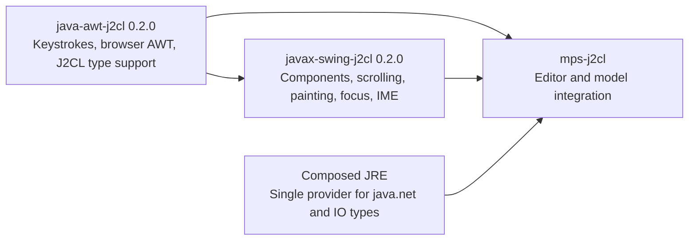

# AWT/Swing library migration

Completed locally on 2026-10-01. The one AWT and 44 Swing
Java implementations formerly supplied through MPS dependency views now belong
to `java-awt-j2cl` and `javax-swing-j2cl` version 0.2.0. MPS consumes these sibling
libraries directly. The obsolete implementations, duplicated shared fixtures,
network BUILD override and callback-exception source have been retired from MPS.

## Ownership and integration

- AWT owns `AWTKeyStroke`, the compiler/runtime Class support generator, reflective
  array support and the callback exception prerequisite. Its portable and browser
  tests also live in that library.
- Swing owns the component, viewport, scrollbar, menu, listener, renderer, border,
  root-pane, focus, painting and input-method additions. Shared JVM oracles and
  browser fixtures now live under `javax-swing-j2cl/src/test/runtime`; MPS refers
  to their exported source labels and retains its application integration tests.
- The IME DOM marker is `data-webswing-input-method`. Library code has no MPS
  imports. Browser tests select the Java scrollbar through its accessible role
  and value and select the intended painting canvas by its accessible name.
  Painted editor adapters register the composition-to-AWT-event callback;
  `BrowserInputMethodSupport` handles the DOM input target and forwarding. The
  standalone fixture exercises that connection, while MPS retains its editor
  selection/composition policy.
- MPS selects AWT's `external_jre=true` networking profile. Standalone AWT/Swing
  supply four `java.net` sources; the MPS profile supplies those four from the
  composed JRE and selects an empty AWT network target.
- Root-local Elemental2/J2CL patch files remain because Bazel root overrides must
  use root-owned labels. The Class and callback patches are checksummed copies
  of the library-owned patches. MPS omits the standalone reflection-base patch
  because its composed IO dependency already supplies that exception.
- `dependency-views.json` schema 2 records direct library/module identities and
  prerequisite patch copies. `prepare_dependency_views.py` retains its command
  name for bootstrap compatibility and no longer creates Java source views.

The Swing API review adds 22 accessible types without removing any existing types or
members. `invokeAndWait` now declares the standard checked exceptions; its
blocking behavior remains outside the browser profile. See the library's
`MIGRATION.md` and `COMPATIBILITY.md` for its supported scope.

## Verification

| Scope | Completed checks |
| --- | --- |
| AWT | 50 JVM/J2CL, 5 display and 6 browser test targets; complete 345-target build; 9 Class browser variants including optimized STRIPPED output; API, package ownership and both networking profiles |
| AWT size limits | Existing limits pass: Point 7,430 raw / 3,122 gzip bytes; showcase 187,431 / 61,067; dual showcase 369,838 / 124,290 |
| AWT archive | Independent archive-only consumer passed in Chromium, Firefox and WebKit, including the migrated runtime prerequisites |
| Swing | Tooling tests, all 15 existing JVM/J2CL/browser targets, API lock, optimized bundles and original size limits |
| Shared Swing contracts | JVM oracles plus 30 browser/build runs across five fixture families, three engines and development/optimized output; includes painting, native inputs, remount/disposal and IME composition |
| Swing archive | Separate stock-JVM and three-engine browser consumer passed using only packaged dependencies |
| MPS | All 54 validation steps passed with no skips, including fresh builds, generated/source checks, JVM oracles and served browser/editor suites |

The Class metadata migration initially retained unnecessary constructors in
optimized bundles. The library generator now assigns the supertype list in one
operation, allowing Closure to remove unused metadata. Runtime and STRIPPED
tests pass without raising size limits.

The fresh MPS build also exposed a missing direct `mps_typechecking` dependency
in `browser_editor_host`. Its generated surround-with action uses
`TypecheckingSession`, so the target now declares that dependency explicitly.
Two redundant-expression diagnostics (`MathRoundIntLong` and
`IdentityBinaryExpression`) in pinned generated financial-language sources remain
visible as warnings on that target; upstream Java sources and other checks remain
unchanged.

The source inventory now reads descriptors from the locked MPS Git revision,
preserving local IntelliJ customizations and reproducing the existing catalog
exactly. The source audit ignores IntelliJ `.iml` metadata while retaining its
strict checks on Java replacements and other unexpected files.
The installed oracle JDK is 21.0.12.1. Complete identifier and regex
Unicode exports were compared with the 21.0.12 snapshots and all behavioral
fields matched; only version metadata and its generated comment were refreshed.
All existing JVM expected-output files remain unchanged. The full validation
checks the upstream and overlay results against those same expected outputs.
Evidence is in `.work/ui-migration/jdk-baseline-comparison.json`; the initial
failed validation and logs remain in `mps-initial-validation/` there.

The final AWT candidate is `webawt-0.2.0-5108c8ba485f`,
SHA-256 `5108c8ba485fd8cd85c74a5811346d95cf548d48aa147f4df1cb7bdeef734d2b`. Swing pins that exact archive.
The Swing source candidate is in `../javax-swing-j2cl/out/release-ui-0.2.0/`,
SHA-256 `b75d247e9ea4b5e7a9cf0da546cb8bcb33e8672256b06ad22050439d0a76c243`.

Local evidence is preserved in `.work/ui-migration/awt-validation.json`,
`awt-final-profile.json`, `awt-final-candidate-diff.json`, `final-validation.log`,
`remaining-validation.log`, `consumer-and-mps-final.log`, `mps-validation-final.log`,
`swing-validation.json`, `migration-map.json`, and
`out/validation-summary.json`. Swing runtime validation was resumed after a
fixture-only correction; its report retains the earlier passed gates and failure.
The final AWT candidate differs from the preceding tested candidate only in its
release workflow; the final archive consumer was re-extracted and tested again.

## Preservation and delivery

Original edited/retired files are backed up under `.work/ui-migration/before/`.
The manifest in `.work/ui-migration/files.json` records original and applied
hashes and rejects concurrent edits before applying a batch. Prior generated
dependency/consumer directories and immutable source candidates were preserved.
These are local library and consumer changes; no public release or Git commit
was created.

## Migrated Java implementations

| Library | Canonical source |
| --- | --- |
| `awt` | `src/main/java/java/awt/AWTKeyStroke.java` |
| `swing` | `src/main/java/javax/swing/SwingUtilities.java` |
| `swing` | `src/main/java/javax/swing/JMenuItem.java` |
| `swing` | `src/main/java/javax/swing/JScrollBar.java` |
| `swing` | `src/main/java/javax/swing/JViewport.java` |
| `swing` | `src/main/java/javax/swing/JWindow.java` |
| `swing` | `src/main/java/javax/swing/LayoutFocusTraversalPolicy.java` |
| `swing` | `src/main/java/javax/swing/Scrollable.java` |
| `swing` | `src/main/java/javax/swing/event/CaretEvent.java` |
| `swing` | `src/main/java/javax/swing/event/CaretListener.java` |
| `swing` | `src/main/java/javax/swing/plaf/MenuItemUI.java` |
| `swing` | `src/main/java/javax/swing/plaf/ScrollBarUI.java` |
| `swing` | `src/main/java/javax/swing/text/JTextComponent.java` |
| `swing` | `src/main/java/javax/swing/plaf/basic/BasicMenuItemUI.java` |
| `swing` | `src/main/java/javax/swing/JComponent.java` |
| `swing` | `src/main/java/javax/swing/JEditorPane.java` |
| `swing` | `src/main/java/javax/swing/JMenu.java` |
| `swing` | `src/main/java/javax/swing/JPopupMenu.java` |
| `swing` | `src/main/java/javax/swing/JScrollPane.java` |
| `swing` | `src/main/java/javax/swing/event/HyperlinkEvent.java` |
| `swing` | `src/main/java/javax/swing/event/HyperlinkListener.java` |
| `swing` | `src/main/java/javax/swing/text/DefaultCaret.java` |
| `swing` | `src/main/java/javax/swing/plaf/basic/BasicScrollBarUI.java` |
| `swing` | `src/main/java/javax/swing/event/MenuEvent.java` |
| `swing` | `src/main/java/javax/swing/event/MenuListener.java` |
| `swing` | `src/main/java/javax/swing/BrowserPaintSurface.java` |
| `swing` | `src/main/java/javax/swing/event/EventListenerList.java` |
| `swing` | `src/main/java/javax/swing/BrowserRendererSnapshot.java` |
| `swing` | `src/main/java/javax/swing/JList.java` |
| `swing` | `src/main/java/javax/swing/event/PopupMenuEvent.java` |
| `swing` | `src/main/java/javax/swing/event/PopupMenuListener.java` |
| `swing` | `src/main/java/javax/swing/text/DefaultEditorKit.java` |
| `swing` | `src/main/java/javax/swing/AbstractButton.java` |
| `swing` | `src/main/java/javax/swing/BorderFactory.java` |
| `swing` | `src/main/java/javax/swing/DefaultListCellRenderer.java` |
| `swing` | `src/main/java/javax/swing/ImageIcon.java` |
| `swing` | `src/main/java/javax/swing/JLayeredPane.java` |
| `swing` | `src/main/java/javax/swing/JRootPane.java` |
| `swing` | `src/main/java/javax/swing/border/CompoundBorder.java` |
| `swing` | `src/main/java/javax/swing/border/MatteBorder.java` |
| `swing` | `src/main/java/javax/swing/plaf/basic/BasicButtonUI.java` |
| `swing` | `src/main/java/javax/swing/JDialog.java` |
| `swing` | `src/main/java/javax/swing/KeyStroke.java` |
| `swing` | `src/main/java/javax/swing/BrowserInputMethodSupport.java` |
| `swing` | `src/main/java/javax/swing/RepaintManager.java` |
