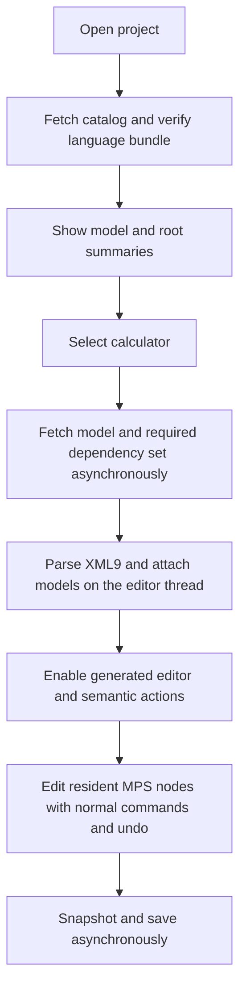

Web model loading proposal
==========================

Proposal only, based on the pinned MPS checkout and the current financialCalculations browser deployment. No runtime or storage changes are made by this document.

MPS discovers models more eagerly than it materializes their nodes. For this web port, start with a project catalog and asynchronous loading of complete models, while retaining synchronous MPS operations over an already prepared working set. Add finer loading only after measuring model sizes and semantic dependencies.

**What desktop MPS does**

The normal file-backed path has several distinct steps:

| Step | What becomes available | Source evidence in this checkout |
| --- | --- | --- |
| Module/model-root discovery | Which directories and model sources belong to the project and its loaded modules | `DefaultModelRoot.loadModels()` and `collectModels()` walk configured source roots. |
| Model descriptor creation | Identity, header and persistence source, without necessarily constructing the node graph | `DefaultModelPersistence.load()` reads the header and normally returns a lightweight `DefaultSModelDescriptor`; loading options can request more. |
| Interface loading | Roots and interface-relevant nodes, with some children omitted where persistence metadata permits | `LazyEditableSModelBase.getSModel()` requests `INTERFACE_LOADED`; the XML9 reader uses `InterfaceSNode` and marks skipped children. It can return a fully loaded model if nothing was omitted. |
| Full loading | The complete node graph of the model | `load()` requests `FULLY_LOADED`; accessing skipped children or an unresolved node ID can force that transition. `PartialModelDataSupport` updates the partial graph. |

The main transition is `NOT_LOADED -> INTERFACE_LOADED -> FULLY_LOADED`. The enum also contains `NO_IMPLEMENTATION`, a separate stripped-content state, which is not a mandatory step on that path. “Interface” here means the persistence-level model interface, not the visible editor or Java interface declarations alone.

Consequently, opening a project may discover many model files and read their headers without constructing every model's nodes. Opening editors, following references and running semantic services can load more. Project-wide operations may eventually require much or all of the project. Custom persistence factories and loading options can behave differently.

Distinguish bytes read from nodes constructed: the normal XML9 interface reader still parses the model stream. Partial materialization does not imply downloading a fraction of a file. Likewise, `FilePerRootFormatUtil.readModel()` iterates root streams; a file-per-root layout does not by itself provide independent root paging.

Relevant local sources: [DefaultModelRoot](C:/Codex/mps-j2cl/mps/core/kernel/source/jetbrains/mps/persistence/DefaultModelRoot.java:142), [DefaultModelPersistence](C:/Codex/mps-j2cl/mps/core/persistence/source/jetbrains/mps/persistence/DefaultModelPersistence.java:149), [LazyEditableSModelBase](C:/Codex/mps-j2cl/mps/core/persistence/source/jetbrains/mps/smodel/LazyEditableSModelBase.java:64), [InterfaceSNode](C:/Codex/mps-j2cl/mps/core/kernel/source/jetbrains/mps/smodel/InterfaceSNode.java:37), and [SModel](C:/Codex/mps-j2cl/mps/core/kernel/source/jetbrains/mps/smodel/SModel.java:238).

**Proposed browser architecture**

Keep three separate forms of data:

| Data | Delivery and lifetime |
| --- | --- |
| Executable language runtime | The existing compiled J2CL bundle: concepts, behaviors, constraints, typesystem, intentions and editors. Pin its version to the project catalog. Loading model XML cannot introduce an uncompiled language implementation. |
| Project catalog | Small metadata response listing module/model IDs, names, persistence versions, language versions, model dependencies, read-only status and content revisions. Add root summaries when useful for navigation. |
| Model content | XML9 bytes fetched for the selected working set, then parsed into real MPS nodes using the existing reader. Stable model/node IDs preserve references. |

The catalog is generated by a build/server utility using MPS persistence APIs; it is a derived index, not a second authoritative model representation. For a static demonstration it can be published alongside immutable model assets. A later server can provide the same contract over a filesystem, Git or another store. A running desktop MPS installation is not required in the browser.

Suggested new components, not existing APIs:

- `BrowserProjectCatalog`: validates project identity, revisions and required language runtimes; supplies the explorer without traversing model bodies.
- `BrowserModelStore`: asynchronous retrieval of versioned model bytes, request deduplication, cancellation and an optional local cache.
- `BrowserLoadCoordinator`: prepares all models needed for an operation before enabling that operation; handles loading, failures and stale requests.
- `BrowserModelDescriptor` / browser model root: integrate resident content with MPS model identity, repository lifecycle and persistence events. Their synchronous methods read resident bytes only.

**The synchronous/asynchronous boundary**

MPS node access, reference resolution and editor actions expect synchronous results. Fetch returns promises, and IndexedDB is asynchronous. Putting a network request inside `getNode()`, `getChildren()` or a model command cannot transparently preserve those contracts. [Fetch documentation](https://developer.mozilla.org/en-US/docs/Web/API/Fetch_API/Using_Fetch), [IndexedDB documentation](https://developer.mozilla.org/en-US/docs/Web/API/IndexedDB_API/Basic_Terminology).

The coordinator should therefore fetch first, then let MPS execute over resident data. Never hold a model read/write scope across an asynchronous wait. Attach completed loads through the browser editor's event-thread/model-access lifecycle, then refresh dependent scopes, diagnostics and editors. Ignore stale results if the project or selected revision changed while fetching.

For financialCalculations, begin conservatively: before enabling editing, fully load the selected solution's models, the models in its supported dependency scope and required language accessories. This may mean all data models of this small sample. Other project areas can remain catalog entries until opened. Do not claim a universally minimal dependency set: custom behaviors, constraints and scopes may inspect models beyond explicit imports.

An unavailable model must not appear to semantic code as an empty model or an ordinary missing reference. If an operation's complete model scope cannot yet be prepared, keep that operation unavailable and explain the loading requirement. Repository-wide queries need a complete scope or an explicit indexed implementation. Do not automatically replay a mutating action after a late dependency miss: it may already have made changes, and transparent rollback is not established here. Read-only operations can be rescheduled only after their side effects and cancellation behavior are understood.

A later worker may handle transport or indexing. Moving the live repository, typechecker and Swing-backed editor into separate workers is a distinct design change; it is not required for this first loading layer. Fetching asynchronously also does not eliminate parse time, so measure parse/layout pauses before attempting larger models.

**Caching and saving**

Initially retain the loaded working set for the browser session. When adding a memory budget, distinguish cached bytes from live model objects. Open editors, semantic dependencies, unsaved changes and undo history can all keep a model live; closing a tab alone does not prove it can be unloaded.

Use IndexedDB later for revision-keyed downloaded bytes and recoverable drafts. Keep the server authoritative for shared project content. Track local draft persistence separately from server acknowledgement.

Add saving as a separate milestone because the current demo's model descriptor does not implement it. Serialize a consistent, fully loaded model snapshot with an MPS-compatible writer, preserving node/model IDs, references, imports, language versions and relevant persistence metadata. Perform network I/O after the snapshot's model-access scope ends. Semantic round-trip fidelity is the acceptance criterion; byte-for-byte formatting identity is a separate requirement.

Use a revision precondition such as `If-Match` for saves so concurrent updates are rejected rather than silently overwritten. Track a local edit sequence as well: an acknowledgement for snapshot N must not mark later edits N+1 as saved. For commands changing several models, use an atomic project changeset endpoint before exposing those commands with durable saving. [HTTP If-Match](https://developer.mozilla.org/en-US/docs/Web/HTTP/Reference/Headers/If-Match).

**Incremental delivery**

| Milestone | Concrete result | Acceptance evidence |
| --- | --- | --- |
| 1. External model loading | Publish the sample data and primitive accessory as model assets; use a catalog and load coordinator instead of constructing the calculator and embedding accessory bytes. Keep current language compilation. | Open the fetched calculator in the generated editor; stable IDs, references and numeric type inference; typing/undo; delayed or failed downloads do not produce a partially enabled editor. |
| 2. Multiple model groups | Catalog-based explorer; complete model/dependency sets loaded on opening an area; unrelated areas stay unloaded. | A cross-model reference resolves correctly; requests show which model bodies were fetched; unavailable data is never reported as an empty scope. |
| 3. Durable editing | Compatible writer, reload and revision-checked save; optionally draft recovery. | Save/reopen preserves semantics and IDs; stale saves are rejected; edits made during a save remain dirty; multi-model changes are atomic where enabled. |
| 4. Measured scaling | Dependency prefetch tuning, safe eviction and indexes for broader queries; evaluate interface or root-level payloads if model sizes justify them. | Record bytes downloaded, materialized nodes, peak memory, parse time and first-edit latency. Verify loading does not change semantic results. |

The current demo already proves execution of the generated language and full XML9 reading for one embedded accessory. It does not yet provide a project catalog, HTTP model store, general file-backed descriptor, writer or save/reload workflow. Reuse that reader and runtime first. Root-by-root network loading requires additional persistence and runtime work and should follow measurements, rather than being assumed from desktop partial loading.

MPS explicitly supports alternative storage through custom model roots and factories, which makes that boundary a suitable integration point. [MPS persistence extension API](https://www.jetbrains.com/help/mps/open-api-accessing-models-from-code.html).
